> **DRAFT DOCUMENT — CONVERSION NOTE (not part of the original SRS)**
>
> This Markdown is a structural conversion of the uploaded *Report 3 – Software Requirement Specification*. The original SRS descriptions, permissions, use cases, and business rules have **not** been silently revised. Some complex source tables remain as HTML tables; diagrams and figures are linked in `assets/media/`.
>
> **Pending requirements (not approved yet):** A new **Reception** role will be split from **Operations Manager** to handle designated room lifecycle/status operations. **Department Head** means a manager of departments within one hotel branch/facility, **not** the head of a single department. The **Permission Matrix** must be reworked against the final Use Case list. Exact permissions and room status transitions have **not** been finalized.
>
> **Known source-versus-change conflicts to resolve:** The existing SRS refers to a Department Head associated with an individual department (for example, **GBR-041**) and says room operational status is system-calculated, not manually entered (**GBR-043/GBR-044**). These are **existing source statements, not approved interpretations** of the new Reception requirement. Preserve them as historical draft content; obtain a revised approved rule before implementing affected RBAC/status logic.
>
> **For Codex:** Read `SRS_CHANGE_NOTES.md` alongside this draft. Do not implement unresolved roles, permissions, scope rules, or state transitions by assumption. Treat an absent or unrevised Permission Matrix as pending approval.

---

**CAPSTONE PROJECT REPORT**

**Report 3 – Software Requirement Specification**

> – Hanoi, Aug 2026 –

**Table of Contents**

[Change Log 9](#change-log)

[Definition and Acronyms 10](#definition-and-acronyms)

[I. Overall Requirements 10](#i.-overall-requirements)

> [1. Context Diagram 10](#context-diagram)
>
> [2. Main Business Flow 11](#main-business-flow)
>
> [2.1 Room Cleaning, Inspection and Readiness (BF-01) 11](#room-cleaning-inspection-and-readiness-bf-01)
>
> [2.2 Incident, Maintenance and Asset Resolution (BF-02) 12](#incident-maintenance-and-asset-resolution-bf-02)
>
> [2.3 Material Request, Stock Issue and Return (BF-03) 13](#material-request-stock-issue-and-return-bf-03)
>
> [2.4 Replenishment and Supplier Delivery (BF-04) 13](#replenishment-and-supplier-delivery-bf-04)
>
> [2.5 Operational Task, Recurring Work and Work-Time (BF-05) 15](#operational-task-recurring-work-and-work-time-bf-05)
>
> [2.6 Cross-Department Internal Request (BF-06) 16](#cross-department-internal-request-bf-06)
>
> [3. Conceptual Data Model 17](#conceptual-data-model)
>
> [3.1 Entity Relationship Diagram 17](#entity-relationship-diagram)
>
> [3.2 Entity Descriptions 17](#entity-descriptions)
>
> [3.3 Data Business Rules 24](#data-business-rules)
>
> [4. User Requirements 25](#user-requirements)
>
> [4.1 Actors 25](#actors)
>
> [4.2 Use Cases (UC) 26](#use-cases-uc)
>
> [4.3 Use Case Diagrams 34](#use-case-diagrams)
>
> [4.4 Permission Matrix 45](#permission-matrix)
>
> [5. System Functionalities 48](#system-functionalities)
>
> [5.1 Screen Inventory 48](#screen-inventory)
>
> [5.2 External API Inventory 56](#external-api-inventory)
>
> [5.3 Background Job Inventory 56](#background-job-inventory)

[II. Use Case Specifications 56](#ii.-use-case-specifications)

> [1. Authentication & Role Management (FE-01) 56](#authentication-role-management-fe-01)
>
> [1.1 UC-001 Login 56](#uc-001-login)
>
> [1.2 UC-002 Logout 58](#uc-002-logout)
>
> [1.3 UC-003 Change Password 58](#uc-003-change-password)
>
> [1.4 UC-004 Create User Account 59](#uc-004-create-user-account)
>
> [1.5 UC-005 Update User Account 60](#uc-005-update-user-account)
>
> [1.6 UC-006 Activate/Deactivate User Account 61](#uc-006-activatedeactivate-user-account)
>
> [1.7 UC-007 Assign User to Branch/Department 62](#uc-007-assign-user-to-branchdepartment)
>
> [1.8 UC-008 Create/Update User Role 62](#uc-008-createupdate-user-role)
>
> [1.9 UC-009 Configure Role Permissions 63](#uc-009-configure-role-permissions)
>
> [1.10 UC-010 Assign/Revoke User Roles 64](#uc-010-assignrevoke-user-roles)
>
> [1.11 UC-011 Review User Access Permissions 64](#uc-011-review-user-access-permissions)
>
> [1.12 UC-141 View User List 65](#uc-141-view-user-list)
>
> [2. Hotel Structure Management (FE-02) 65](#hotel-structure-management-fe-02)
>
> [2.1 UC-012 Update Branch Information 65](#uc-012-update-branch-information)
>
> [2.2 UC-013 View Branch Structure 66](#uc-013-view-branch-structure)
>
> [2.3 UC-014 Create Floor/Area 67](#uc-014-create-floorarea)
>
> [2.4 UC-015 Update Floor/Area 67](#uc-015-update-floorarea)
>
> [2.5 UC-016 Deactivate Floor/Area 68](#uc-016-deactivate-floorarea)
>
> [2.6 UC-017 Create Room Type 68](#uc-017-create-room-type)
>
> [2.7 UC-018 Update Room Type 69](#uc-018-update-room-type)
>
> [2.8 UC-019 Deactivate Room Type 69](#uc-019-deactivate-room-type)
>
> [2.9 UC-020 Create Room 70](#uc-020-create-room)
>
> [2.10 UC-021 Update Room Information 71](#uc-021-update-room-information)
>
> [2.11 UC-022 Deactivate Room 71](#uc-022-deactivate-room)
>
> [2.12 UC-023 View Room Directory 72](#uc-023-view-room-directory)
>
> [2.13 UC-024 Create Department 73](#uc-024-create-department)
>
> [2.14 UC-025 Update Department 73](#uc-025-update-department)
>
> [2.15 UC-026 Deactivate Department 74](#uc-026-deactivate-department)
>
> [2.16 UC-142 View Room Types List 74](#uc-142-view-room-types-list)
>
> [3. Room Operations (FE-03) 75](#room-operations-fe-03)
>
> [3.1 UC-027 Manage Operational Room Status 75](#uc-027-manage-operational-room-status)
>
> [4. Housekeeping Management (FE-04) 76](#housekeeping-management-fe-04)
>
> [4.1 UC-028 Create Cleaning Task 76](#uc-028-create-cleaning-task)
>
> [4.2 UC-029 Assign Cleaning Task 77](#uc-029-assign-cleaning-task)
>
> [4.3 UC-030 Reassign Cleaning Task 77](#uc-030-reassign-cleaning-task)
>
> [4.4 UC-031 Start Cleaning Task 78](#uc-031-start-cleaning-task)
>
> [4.5 UC-032 Update Cleaning Progress 79](#uc-032-update-cleaning-progress)
>
> [4.6 UC-033 Report Cleaning Blocker 80](#uc-033-report-cleaning-blocker)
>
> [4.7 UC-034 Complete Cleaning Task 80](#uc-034-complete-cleaning-task)
>
> [4.8 UC-035 Receive Rework Task 81](#uc-035-receive-rework-task)
>
> [4.9 UC-036 Complete Cleaning Rework 82](#uc-036-complete-cleaning-rework)
>
> [4.10 UC-037 Monitor Cleaning Tasks 83](#uc-037-monitor-cleaning-tasks)
>
> [4.11 UC-038 View Room Turnover History 84](#uc-038-view-room-turnover-history)
>
> [5. Room Quality Inspection (FE-05) 84](#room-quality-inspection-fe-05)
>
> [5.1 UC-039 Create Room Inspection Checklist 84](#uc-039-create-room-inspection-checklist)
>
> [5.2 UC-040 Update Room Inspection Checklist 85](#uc-040-update-room-inspection-checklist)
>
> [5.3 UC-041 Assign Room Inspection 85](#uc-041-assign-room-inspection)
>
> [5.4 UC-042 Perform Room Inspection 86](#uc-042-perform-room-inspection)
>
> [5.5 UC-043 Record Inspection Defects 87](#uc-043-record-inspection-defects)
>
> [5.6 UC-044 Approve Room Inspection 88](#uc-044-approve-room-inspection)
>
> [5.7 UC-045 Reject Room Inspection 88](#uc-045-reject-room-inspection)
>
> [5.8 UC-046 Request Cleaning Rework 89](#uc-046-request-cleaning-rework)
>
> [5.9 UC-047 Reinspect Room 90](#uc-047-reinspect-room)
>
> [5.10 UC-048 View Room Inspection History 91](#uc-048-view-room-inspection-history)
>
> [6. Incident & Maintenance Management (FE-06) 91](#incident-maintenance-management-fe-06)
>
> [6.1 UC-049 Report Incident 91](#uc-049-report-incident)
>
> [6.2 UC-050 Classify Incident 92](#uc-050-classify-incident)
>
> [6.3 UC-051 Attach Incident Evidence 93](#uc-051-attach-incident-evidence)
>
> [6.4 UC-052 Triage Incident 94](#uc-052-triage-incident)
>
> [6.5 UC-053 Assign Maintenance Work 95](#uc-053-assign-maintenance-work)
>
> [6.6 UC-054 Accept and Start Maintenance 96](#uc-054-accept-and-start-maintenance)
>
> [6.7 UC-055 Update Maintenance Progress 96](#uc-055-update-maintenance-progress)
>
> [6.8 UC-056 Block Room Due to Incident 97](#uc-056-block-room-due-to-incident)
>
> [6.9 UC-057 Escalate Critical Incident 98](#uc-057-escalate-critical-incident)
>
> [6.10 UC-058 Resolve Maintenance Incident 99](#uc-058-resolve-maintenance-incident)
>
> [6.11 UC-059 Verify and Close Incident 99](#uc-059-verify-and-close-incident)
>
> [6.12 UC-060 Reopen Incident 100](#uc-060-reopen-incident)
>
> [6.13 UC-061 Create Preventive Maintenance Schedule 101](#uc-061-create-preventive-maintenance-schedule)
>
> [6.14 UC-062 Execute Scheduled Maintenance 102](#uc-062-execute-scheduled-maintenance)
>
> [6.15 UC-063 Manage Work Categories 103](#uc-063-manage-work-categories)
>
> [6.16 UC-064 Manage Operational Reference Data 103](#uc-064-manage-operational-reference-data)
>
> [6.17 UC-143 View Incidents List 104](#uc-143-view-incidents-list)
>
> [6.18 UC-144 View Maintenance List 105](#uc-144-view-maintenance-list)
>
> [7. Asset & Equipment Management (FE-07) 105](#asset-equipment-management-fe-07)
>
> [7.1 UC-065 Register Asset/Equipment 105](#uc-065-register-assetequipment)
>
> [7.2 UC-066 Update Asset Information 106](#uc-066-update-asset-information)
>
> [7.3 UC-067 Assign Asset to Location 106](#uc-067-assign-asset-to-location)
>
> [7.4 UC-068 Transfer Asset Location 107](#uc-068-transfer-asset-location)
>
> [7.5 UC-069 Record Asset Handover 108](#uc-069-record-asset-handover)
>
> [7.6 UC-070 Update Asset Condition 109](#uc-070-update-asset-condition)
>
> [7.7 UC-071 View Asset Profile 110](#uc-071-view-asset-profile)
>
> [7.8 UC-072 Review Asset Maintenance History 110](#uc-072-review-asset-maintenance-history)
>
> [7.9 UC-073 Review Assets by Location 111](#uc-073-review-assets-by-location)
>
> [7.10 UC-074 Retire/Deactivate Asset 111](#uc-074-retiredeactivate-asset)
>
> [8. Inventory Management (FE-08) 112](#inventory-management-fe-08)
>
> [8.1 UC-075 Manage Warehouses 112](#uc-075-manage-warehouses)
>
> [8.2 UC-076 Manage Inventory Items 112](#uc-076-manage-inventory-items)
>
> [8.3 UC-077 Manage Units of Measurement 113](#uc-077-manage-units-of-measurement)
>
> [8.4 UC-078 Configure Minimum Stock Levels 114](#uc-078-configure-minimum-stock-levels)
>
> [8.5 UC-079 Create Stock Receipt 114](#uc-079-create-stock-receipt)
>
> [8.6 UC-080 Verify and Post Stock Receipt 115](#uc-080-verify-and-post-stock-receipt)
>
> [8.7 UC-081 Issue Stock 116](#uc-081-issue-stock)
>
> [8.8 UC-082 Return Materials to Stock 117](#uc-082-return-materials-to-stock)
>
> [8.9 UC-083 Create Stock Transfer 117](#uc-083-create-stock-transfer)
>
> [8.10 UC-084 Confirm Stock Transfer Receipt 118](#uc-084-confirm-stock-transfer-receipt)
>
> [8.11 UC-085 Conduct Stocktake 119](#uc-085-conduct-stocktake)
>
> [8.12 UC-086 Reconcile Stocktake Discrepancies 120](#uc-086-reconcile-stocktake-discrepancies)
>
> [8.13 UC-087 Adjust Stock Balance 121](#uc-087-adjust-stock-balance)
>
> [8.14 UC-088 Reverse Stock Transaction 121](#uc-088-reverse-stock-transaction)
>
> [8.15 UC-089 View Stock Balance and Movement Ledger 122](#uc-089-view-stock-balance-and-movement-ledger)
>
> [8.16 UC-090 Return Unused Materials 123](#uc-090-return-unused-materials)
>
> [9. Material Request Management (FE-09) 123](#material-request-management-fe-09)
>
> [9.1 UC-091 Create Material Request 123](#uc-091-create-material-request)
>
> [9.2 UC-092 Link Material Request to Work 124](#uc-092-link-material-request-to-work)
>
> [9.3 UC-093 Update/Cancel Material Request 125](#uc-093-updatecancel-material-request)
>
> [9.4 UC-094 Review Material Request 126](#uc-094-review-material-request)
>
> [9.5 UC-095 Approve/Reject Material Request 127](#uc-095-approvereject-material-request)
>
> [9.6 UC-096 Check Material Availability 128](#uc-096-check-material-availability)
>
> [9.7 UC-097 Issue Approved Materials 128](#uc-097-issue-approved-materials)
>
> [9.8 UC-098 Manage Partial Material Fulfillment 129](#uc-098-manage-partial-material-fulfillment)
>
> [9.9 UC-099 Track Material Request History 129](#uc-099-track-material-request-history)
>
> [10. Material Replenishment Management (FE-10) 130](#material-replenishment-management-fe-10)
>
> [10.1 UC-100 Create Replenishment Request 130](#uc-100-create-replenishment-request)
>
> [10.2 UC-101 Track Material Replenishment 131](#uc-101-track-material-replenishment)
>
> [11. Task Assignment Management (FE-11) 132](#task-assignment-management-fe-11)
>
> [11.1 UC-102 Create Operational Task 132](#uc-102-create-operational-task)
>
> [11.2 UC-103 Set Task Priority and Deadline 132](#uc-103-set-task-priority-and-deadline)
>
> [11.3 UC-104 Assign/Reassign Task 133](#uc-104-assignreassign-task)
>
> [11.4 UC-105 Review and Verify Task Completion 134](#uc-105-review-and-verify-task-completion)
>
> [11.5 UC-106 Reopen Assigned Task 135](#uc-106-reopen-assigned-task)
>
> [11.6 UC-107 Accept Assigned Task 135](#uc-107-accept-assigned-task)
>
> [11.7 UC-108 Start Assigned Task 136](#uc-108-start-assigned-task)
>
> [11.8 UC-109 Update Task Progress 137](#uc-109-update-task-progress)
>
> [11.9 UC-110 Pause/Resume Task 137](#uc-110-pauseresume-task)
>
> [11.10 UC-112 Complete Assigned Task 138](#uc-112-complete-assigned-task)
>
> [11.11 UC-113 Review Task Workload and Time Logs 138](#uc-113-review-task-workload-and-time-logs)
>
> [12. Work-Time & Workday Tracking (FE-12) 139](#work-time-workday-tracking-fe-12)
>
> [12.1 UC-111 Record Actual Working Time 139](#uc-111-record-actual-working-time)
>
> [12.2 UC-138 Manage Operational Workday and Shift Records 140](#uc-138-manage-operational-workday-and-shift-records)
>
> [12.3 UC-139 Record Workday Start and End 141](#uc-139-record-workday-start-and-end)
>
> [12.4 UC-140 Manage Operational Shift Handover 142](#uc-140-manage-operational-shift-handover)
>
> [13. Internal Request Management (FE-13) 143](#internal-request-management-fe-13)
>
> [13.1 UC-114 Create Internal Request 143](#uc-114-create-internal-request)
>
> [13.2 UC-115 Route and Assign Internal Request 144](#uc-115-route-and-assign-internal-request)
>
> [13.3 UC-116 Accept/Reject Internal Request 145](#uc-116-acceptreject-internal-request)
>
> [13.4 UC-117 Update Internal Request Progress 145](#uc-117-update-internal-request-progress)
>
> [13.5 UC-118 Create Linked Operational Work 146](#uc-118-create-linked-operational-work)
>
> [13.6 UC-119 Record Request Handover 147](#uc-119-record-request-handover)
>
> [13.7 UC-120 Complete Internal Request 148](#uc-120-complete-internal-request)
>
> [13.8 UC-121 Reopen Internal Request 148](#uc-121-reopen-internal-request)
>
> [13.9 UC-122 Escalate Overdue Internal Request 149](#uc-122-escalate-overdue-internal-request)
>
> [13.10 UC-123 View Internal Request History 150](#uc-123-view-internal-request-history)
>
> [14. Notification & Operational Dashboard (FE-14) 151](#notification-operational-dashboard-fe-14)
>
> [14.1 UC-124 Receive Assignment Notifications 151](#uc-124-receive-assignment-notifications)
>
> [14.2 UC-125 Receive Approval Notifications 151](#uc-125-receive-approval-notifications)
>
> [14.3 UC-126 Receive Inspection and Incident Alerts 152](#uc-126-receive-inspection-and-incident-alerts)
>
> [14.4 UC-127 Receive Overdue Work Alerts 153](#uc-127-receive-overdue-work-alerts)
>
> [14.5 UC-128 Receive Low Stock Alerts 154](#uc-128-receive-low-stock-alerts)
>
> [14.6 UC-129 View Notification Center 154](#uc-129-view-notification-center)
>
> [14.7 UC-130 Acknowledge Notifications 155](#uc-130-acknowledge-notifications)
>
> [14.8 UC-131 View Room Readiness Dashboard 155](#uc-131-view-room-readiness-dashboard)
>
> [14.9 UC-132 View Task Workload Dashboard 156](#uc-132-view-task-workload-dashboard)
>
> [14.10 UC-133 View Incident and Maintenance Dashboard 157](#uc-133-view-incident-and-maintenance-dashboard)
>
> [14.11 UC-134 View Inventory and Material Dashboard 158](#uc-134-view-inventory-and-material-dashboard)
>
> [15. Operational Reports & Audit History (FE-15) 158](#operational-reports-audit-history-fe-15)
>
> [15.1 UC-135 Generate and Export Operational Reports 158](#uc-135-generate-and-export-operational-reports)
>
> [15.2 UC-136 View Audit Logs 159](#uc-136-view-audit-logs)
>
> [15.3 UC-137 Inspect Record Change History 160](#uc-137-inspect-record-change-history)

[III. Functional Requirements 160](#iii.-functional-requirements)

> [1. Authentication & Role Management (FE-01) 161](#authentication-role-management-fe-01-1)
>
> [1.1 Authentication 161](#authentication)
>
> [1.2 User Management 162](#user-management)
>
> [2. Hotel Structure (FE-02) 166](#hotel-structure-fe-02)
>
> [2.1 Room Management 166](#room-management)
>
> [2.2 Room Type Management 169](#room-type-management)
>
> [3. Room Operations (FE-03) 170](#room-operations-fe-03-1)
>
> [3.1 Room Readiness 170](#room-readiness)
>
> [4. Housekeeping Management (FE-04) 172](#housekeeping-management-fe-04-1)
>
> [4.1 Cleaning Task Management 172](#cleaning-task-management)
>
> [5. Room Inspection (FE-05) 176](#room-inspection-fe-05)
>
> [5.1 Inspection Management 176](#inspection-management)
>
> [6. Incident & Maintenance (FE-06) 179](#incident-maintenance-fe-06)
>
> [6.1 Incident Management 179](#incident-management)
>
> [6.2 Maintenance Execution 182](#maintenance-execution)
>
> [7. Asset & Equipment Management (FE-07) 186](#asset-equipment-management-fe-07-1)
>
> [7.1 Asset Management 186](#asset-management)
>
> [8. Inventory Management (FE-08) 190](#inventory-management-fe-08-1)
>
> [8.1 Inventory Monitoring 190](#inventory-monitoring)
>
> [8.2 Stock Transactions 191](#stock-transactions)
>
> [9. Material Request Management (FE-09) 195](#material-request-management-fe-09-1)
>
> [9.1 Material Requests 195](#material-requests)
>
> [10. Replenishment Management (FE-10) 199](#replenishment-management-fe-10)
>
> [10.1 Replenishment Tracking 199](#replenishment-tracking)
>
> [11. Task Assignment Management (FE-11) 201](#task-assignment-management-fe-11-1)
>
> [11.1 Operational Tasks 201](#operational-tasks)
>
> [12. Work-Time Management (FE-12) 205](#work-time-management-fe-12)
>
> [12.1 Shift Management 205](#shift-management)
>
> [12.2 Shift Handover 206](#shift-handover)
>
> [13. Internal Request Management (FE-13) 209](#internal-request-management-fe-13-1)
>
> [13.1 Internal Requests 209](#internal-requests)
>
> [14. Notification & Operational Dashboard (FE-14) 213](#notification-operational-dashboard-fe-14-1)
>
> [14.1 Operational Dashboard 213](#operational-dashboard)
>
> [15. Operational Reports & Audit History (FE-15) 216](#operational-reports-audit-history-fe-15-1)
>
> [15.1 Reporting 216](#reporting)
>
> [15.2 Audit History 217](#audit-history)
>
> [16. Background Job Inventory 219](#background-job-inventory-1)
>
> [16.1 Check Overdue and At-Risk Work (JOB-01) 219](#check-overdue-and-at-risk-work-job-01)
>
> [16.2 Check Low Stock (JOB-02) 219](#check-low-stock-job-02)
>
> [16.3 Retry Failed Notifications (JOB-03) 220](#retry-failed-notifications-job-03)
>
> [16.4 Generate Preventive Maintenance Occurrences (JOB-04) 220](#generate-preventive-maintenance-occurrences-job-04)
>
> [16.5 Generate Recurring Tasks (JOB-05) 221](#generate-recurring-tasks-job-05)
>
> [16.6 Clean Up Old Notifications and Audit Log Entries (JOB-06) 221](#clean-up-old-notifications-and-audit-log-entries-job-06)
>
> [17. External API Inventory 221](#external-api-inventory-1)
>
> [17.1 HTTP Method: URL pattern (API-ID) 221](#http-method-url-pattern-api-id)
>
> [17.2 VnPay Webhook (API-02) 222](#vnpay-webhook-api-02)
>
> [17.3 SePay Webhook (API-03) 222](#sepay-webhook-api-03)

[IV. Non-Functional Requirements 222](#iv.-non-functional-requirements)

> [4. Non-Functional Requirements 222](#non-functional-requirements)
>
> [4.1 Interfaces 222](#interfaces)
>
> [4.2 Quality Attributes 223](#quality-attributes)

[V. Requirement Appendix 228](#v.-requirement-appendix)

> [1. Business Rules 228](#business-rules)
>
> [2. System Messages 250](#_heading=)
>
> [3. Other Requirements 253](#_heading=)
>
> [3.1 Common Exception Flows 253](#_heading=)
>
> [3.2 System Parameters 253](#_heading=)
>
> [3.3 Status Catalog 254](#_heading=)
>
> [3.4 Status Transitions 256](#_heading=)
>
> [3.5 KPI and Report Catalog 261](#_heading=)
>
> [3.6 Scheduled Processing 262](#scheduled-processing)

# Change Log

<table>
<colgroup>
<col style="width: 14%" />
<col style="width: 7%" />
<col style="width: 13%" />
<col style="width: 64%" />
</colgroup>
<thead>
<tr class="header">
<th><strong>Date</strong></th>
<th><strong>A* 
M, D</strong></th>
<th><strong>In charge</strong></th>
<th><strong>Change Description</strong></th>
</tr>
<tr class="odd">
<th>30/09/2026</th>
<th>A</th>
<th>BaoDG</th>
<th>Add User Requirements</th>
</tr>
<tr class="header">
<th>01/10/2026</th>
<th>M</th>
<th>BaoDG</th>
<th>Update User Requirements</th>
</tr>
<tr class="odd">
<th>01/10/2026</th>
<th>A</th>
<th>KienTN</th>
<th>Add Screen Flow</th>
</tr>
<tr class="header">
<th>03/10/2026</th>
<th>M</th>
<th>KienTN</th>
<th>Update Screen Flow</th>
</tr>
<tr class="odd">
<th>04/10/2026</th>
<th>A</th>
<th>KienTN</th>
<th>Add Screen List</th>
</tr>
<tr class="header">
<th></th>
<th></th>
<th></th>
<th></th>
</tr>
<tr class="odd">
<th></th>
<th></th>
<th></th>
<th></th>
</tr>
<tr class="header">
<th></th>
<th></th>
<th></th>
<th></th>
</tr>
<tr class="odd">
<th></th>
<th></th>
<th></th>
<th></th>
</tr>
<tr class="header">
<th></th>
<th></th>
<th></th>
<th></th>
</tr>
<tr class="odd">
<th></th>
<th></th>
<th></th>
<th></th>
</tr>
<tr class="header">
<th></th>
<th></th>
<th></th>
<th></th>
</tr>
<tr class="odd">
<th></th>
<th></th>
<th></th>
<th></th>
</tr>
</thead>
<tbody>
</tbody>
</table>

\*A - Added M - Modified D - Deleted

# Definition and Acronyms 

| **Acronym** | **Definition**            |
|-------------|---------------------------|
| COS         | Cafeteria Ordering System |
| …           |                           |

# I. Overall Requirements

## 1. Context Diagram

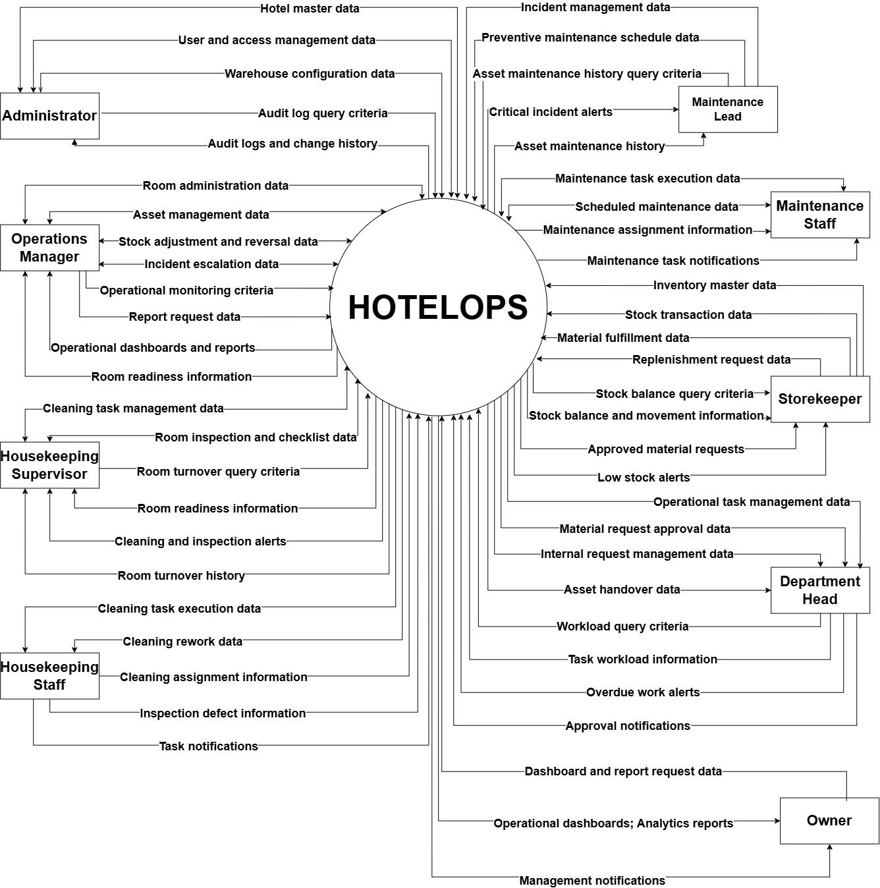

## 2. Main Business Flow

### 2.1 Room Cleaning, Inspection and Readiness (BF-01)

***Trigger:** A room requires cleaning or is identified as not ready for operation.*

***End condition:** The room has passed inspection, has no open blocking incident, and is confirmed as ready for operation.*

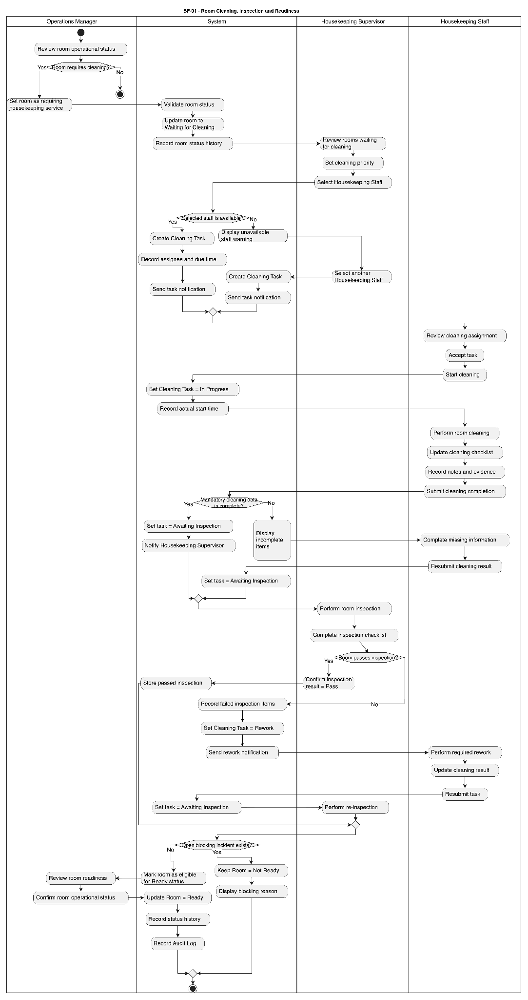

### 2.2 Incident, Maintenance and Asset Resolution (BF-02)

***Trigger:** An operational incident is reported for a room, area, or hotel asset.*

***End condition:** The incident has been resolved, the maintenance result has been verified, and the incident is closed with any affected room or asset status updated accordingly.*

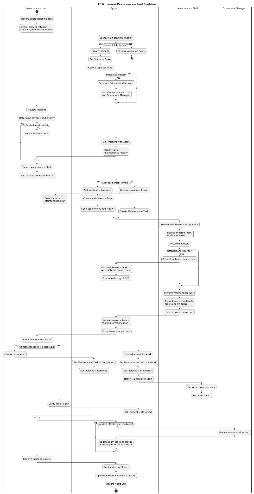

### 2.3 Material Request, Stock Issue and Return (BF-03)

***Trigger:*** A Department Head creates a request for materials required for operational work.

***End condition:*** The requested materials have been fully or partially issued, any remaining quantity is tracked for replenishment, and any unused materials have been returned when applicable

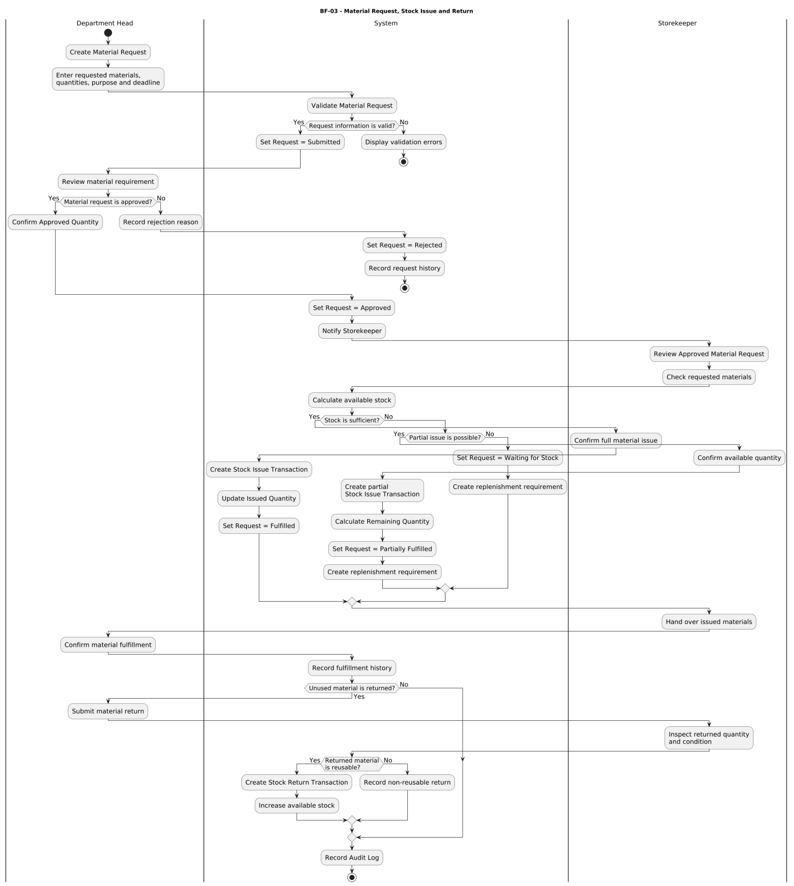

### 2.4 Replenishment and Supplier Delivery (BF-04)

***Trigger***: Available stock falls below the required level or is insufficient to fulfill approved material demand.

***End condition***: The received quantity has been recorded into inventory, the stock balance has been updated, and any remaining delivery quantity continues to be tracked until the replenishment request is completed.

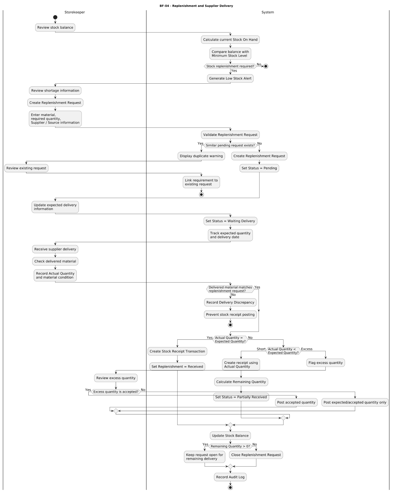

###  

### 2.5 Operational Task, Recurring Work and Work-Time (BF-05)

***Trigger***: A Department Head creates an ad-hoc operational task or a scheduled occurrence is generated from a recurring task rule.

***End condition***: The assigned work has been completed and verified, actual work-time has been recorded, and any required handover or rework has been completed.

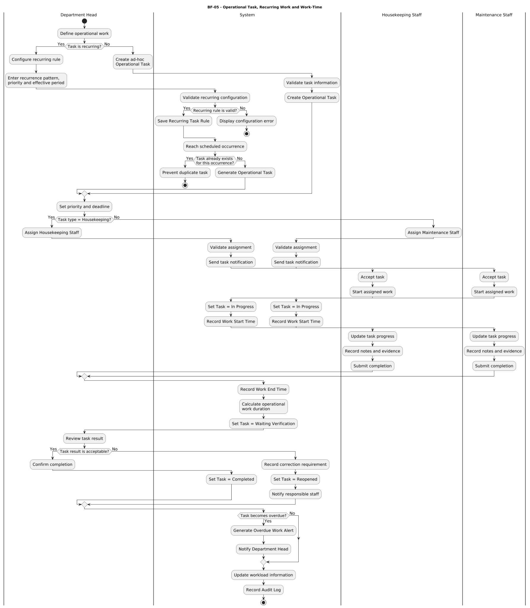

### 2.6 Cross-Department Internal Request (BF-06)

***Trigger***: A Department Head submits an internal request for operational support from another department.

***End condition***: The requested work has been processed and the result has either been confirmed by the requesting Department Head or the request has been reopened for further action.

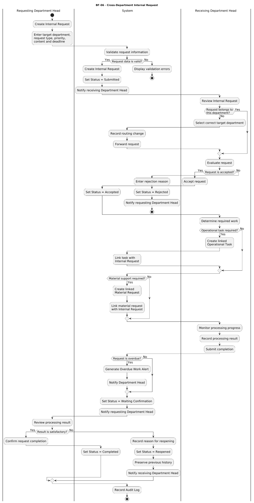

## 3. Conceptual Data Model

### 3.1 Entity Relationship Diagram

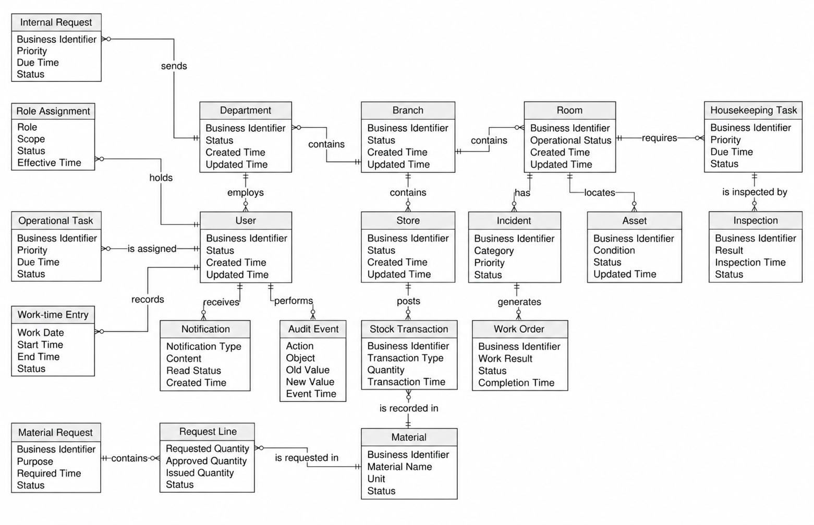

### 3.2 Entity Descriptions

#### Entity: Branch

| **Field**                   | **Value**                                                                                                      |
|-----------------------------|----------------------------------------------------------------------------------------------------------------|
| **Purpose**                 | Represents a hotel operating branch managed within HotelOps.                                                   |
| **Key business attributes** | Branch code, branch name, status                                                                               |
| **Business identity**       | Branch code must uniquely identify a hotel branch.                                                             |
| **Status / lifecycle**      | Active → Inactive. A branch should only be deactivated after relevant open operational work has been resolved. |

#### Entity: Department

| **Field**                   | **Value**                                                         |
|-----------------------------|-------------------------------------------------------------------|
| **Purpose**                 | Represents an operational department belonging to a hotel branch. |
| **Key business attributes** | Branch, department code, department name, status                  |
| **Business identity**       | Department code is unique within its Branch.                      |
| **Status / lifecycle**      | Active → Inactive                                                 |

#### Entity: User

| **Field**                   | **Value**                                                                       |
|-----------------------------|---------------------------------------------------------------------------------|
| **Purpose**                 | Represents an authenticated internal user who participates in hotel operations. |
| **Key business attributes** | Username, full name, department, account status                                 |
| **Business identity**       | Username must uniquely identify a User within the system.                       |
| **Status / lifecycle**      | Active ↔ Locked; Active → Inactive                                              |

#### Entity: Role Assignment

| **Field**                   | **Value**                                                         |
|-----------------------------|-------------------------------------------------------------------|
| **Purpose**                 | Defines the operational role and access scope assigned to a User. |
| **Key business attributes** | User, role, branch scope, department scope, effective status      |
| **Business identity**       | Defined by the combination of User, Role, and assigned scope.     |
| **Status / lifecycle**      | Active → Revoked                                                  |

#### Entity: Room

| **Field**                   | **Value**                                                                                     |
|-----------------------------|-----------------------------------------------------------------------------------------------|
| **Purpose**                 | Represents a physical hotel room and its current operational readiness.                       |
| **Key business attributes** | Branch, room number, operational status                                                       |
| **Business identity**       | Room number must be unique within a Branch.                                                   |
| **Status / lifecycle**      | Room status is updated through authorized operational actions and retains its status history. |

#### Entity: Housekeeping Task

| **Field**                   | **Value**                                                                             |
|-----------------------------|---------------------------------------------------------------------------------------|
| **Purpose**                 | Represents cleaning work created for a hotel Room and assigned to Housekeeping Staff. |
| **Key business attributes** | Room, assignee, priority, due time, cleaning checklist                                |
| **Business identity**       | Task number uniquely identifies a Housekeeping Task.                                  |
| **Status / lifecycle**      | Assigned → In Progress → Awaiting Inspection → Completed / Rework                     |

#### Entity: Inspection

| **Field**                   | **Value**                                                                          |
|-----------------------------|------------------------------------------------------------------------------------|
| **Purpose**                 | Represents the quality inspection performed after room-cleaning work is submitted. |
| **Key business attributes** | Housekeeping Task, inspector, checklist, result, failed items                      |
| **Business identity**       | Inspection number uniquely identifies an Inspection.                               |
| **Status / lifecycle**      | Submitted → Pass / Fail                                                            |

#### Entity: Incident

| **Field**                   | **Value**                                                                              |
|-----------------------------|----------------------------------------------------------------------------------------|
| **Purpose**                 | Represents a reported operational fault or issue affecting a room, location, or asset. |
| **Key business attributes** | Branch, room/location, asset, category, priority                                       |
| **Business identity**       | Incident number uniquely identifies an Incident.                                       |
| **Status / lifecycle**      | Open → Assigned → In Progress → Resolved → Closed / Reopened                           |

#### Entity: Work Order

| **Field**                   | **Value**                                                   |
|-----------------------------|-------------------------------------------------------------|
| **Purpose**                 | Represents maintenance work created to resolve an Incident. |
| **Key business attributes** | Incident, technician, diagnosis, work result, evidence      |
| **Business identity**       | Work order number uniquely identifies a Work Order.         |
| **Status / lifecycle**      | Assigned → In Progress → Verification → Closed / Rework     |

#### Entity: Asset

| **Field**                   | **Value**                                                                      |
|-----------------------------|--------------------------------------------------------------------------------|
| **Purpose**                 | Represents hotel equipment or another operational asset tracked by the system. |
| **Key business attributes** | Asset code, branch, room/location, condition                                   |
| **Business identity**       | Asset code is unique within its Branch.                                        |
| **Status / lifecycle**      | Active → Under Repair → Retired                                                |

#### Entity: Material

| **Field**                   | **Value**                                                        |
|-----------------------------|------------------------------------------------------------------|
| **Purpose**                 | Represents an operational supply item used by hotel departments. |
| **Key business attributes** | Material code, material name, unit, stock threshold              |
| **Business identity**       | Material code uniquely identifies a Material.                    |
| **Status / lifecycle**      | Active → Inactive                                                |

#### Entity: Store

| **Field**                   | **Value**                                                                     |
|-----------------------------|-------------------------------------------------------------------------------|
| **Purpose**                 | Represents an internal storage location used to manage operational materials. |
| **Key business attributes** | Branch, store code, status                                                    |
| **Business identity**       | Store code is unique within its Branch.                                       |
| **Status / lifecycle**      | Active → Inactive                                                             |

#### Entity: Stock Transaction

| **Field**                   | **Value**                                                                                                     |
|-----------------------------|---------------------------------------------------------------------------------------------------------------|
| **Purpose**                 | Represents a posted inventory quantity movement.                                                              |
| **Key business attributes** | Store, Material, signed quantity, transaction type, reference                                                 |
| **Business identity**       | Posting number or idempotency reference uniquely identifies the transaction event.                            |
| **Status / lifecycle**      | Draft → Posted. A posted transaction is corrected through an explicit reversal rather than being overwritten. |

#### Entity: Material Request

| **Field**                   | **Value**                                                                       |
|-----------------------------|---------------------------------------------------------------------------------|
| **Purpose**                 | Represents a department's request for operational materials.                    |
| **Key business attributes** | Requester, department, purpose, status                                          |
| **Business identity**       | Request number uniquely identifies a Material Request.                          |
| **Status / lifecycle**      | Draft → Submitted → Approved / Rejected → Partially Issued / Issued / Cancelled |

#### Entity: Request Line

| **Field**                   | **Value**                                                                                   |
|-----------------------------|---------------------------------------------------------------------------------------------|
| **Purpose**                 | Represents an individual Material and its quantities within a Material Request.             |
| **Key business attributes** | Material, requested quantity, approved quantity, issued quantity                            |
| **Business identity**       | Identified within a Material Request by its request and line number.                        |
| **Status / lifecycle**      | Quantities are accumulated and updated according to approval and material issue activities. |

#### Entity: Replenishment Request

| **Field**                   | **Value**                                                                                  |
|-----------------------------|--------------------------------------------------------------------------------------------|
| **Purpose**                 | Represents a lightweight internal requirement to replenish insufficient operational stock. |
| **Key business attributes** | Store, Material, replenishment need, source note, received quantity                        |
| **Business identity**       | Request number uniquely identifies a Replenishment Request.                                |
| **Status / lifecycle**      | Proposed → Approved → Partially Received → Received / Cancelled                            |

#### Entity: Operational Task

| **Field**                   | **Value**                                                 |
|-----------------------------|-----------------------------------------------------------|
| **Purpose**                 | Represents assigned ad-hoc or recurring operational work. |
| **Key business attributes** | Branch, owner/assignee, priority, due time, evidence      |
| **Business identity**       | Task number uniquely identifies an Operational Task.      |
| **Status / lifecycle**      | Open → In Progress → Verification → Closed / Reopened     |

#### Entity: Work-Time Entry

| **Field**                   | **Value**                                                          |
|-----------------------------|--------------------------------------------------------------------|
| **Purpose**                 | Represents an operational work interval recorded for a User.       |
| **Key business attributes** | User, work date, shift context, start time, end time, related task |
| **Business identity**       | Entry number uniquely identifies a Work-Time Entry.                |
| **Status / lifecycle**      | Open → Submitted → Reviewed / Returned                             |

#### Entity: Internal Request

| **Field**                   | **Value**                                                                     |
|-----------------------------|-------------------------------------------------------------------------------|
| **Purpose**                 | Represents a non-stock operational service request between hotel departments. |
| **Key business attributes** | Source department, destination department, responsible owner, due time        |
| **Business identity**       | Request number uniquely identifies an Internal Request.                       |
| **Status / lifecycle**      | Submitted → Accepted → In Progress → Confirmed / Returned                     |

#### Entity: Notification

| **Field**                   | **Value**                                                                 |
|-----------------------------|---------------------------------------------------------------------------|
| **Purpose**                 | Represents an in-system notification generated from an operational event. |
| **Key business attributes** | Recipient, linked record, notification type, read time                    |
| **Business identity**       | A system-generated notification reference identifies each Notification.   |
| **Status / lifecycle**      | Unread → Read                                                             |

#### Entity: Audit Event

| **Field**                   | **Value**                                                                               |
|-----------------------------|-----------------------------------------------------------------------------------------|
| **Purpose**                 | Represents the immutable history of significant actions and data changes in the system. |
| **Key business attributes** | Actor, event time, affected object, old value, new value, action                        |
| **Business identity**       | A system-generated event reference identifies each Audit Event.                         |
| **Status / lifecycle**      | Append-only; existing Audit Events are not overwritten.                                 |

### 3.3 Data Business Rules

> **REVIEW REQUIRED — annotation, not original SRS:** Some existing rules on Department Head scope and room status calculation may conflict with the pending role clarifications. Pay special attention to GBR-041 and GBR-043/GBR-044 in the later Business Rules appendix. Do not alter or implement those semantics without approval.

| **Rule**                                                    | **Description**                                                                                                                                                    | **Enforced On**                                     |
|-------------------------------------------------------------|--------------------------------------------------------------------------------------------------------------------------------------------------------------------|-----------------------------------------------------|
| Unique room number within branch                            | No two Rooms within the same Branch may have the same Room Number.                                                                                                 | Room creation and room information update           |
| Ready room requires valid inspection                        | A Room may be marked Ready only when it has a current passed Inspection and no open blocking Incident.                                                             | Room readiness update                               |
| Cleaning completion does not automatically make room Ready  | Completing a Housekeeping Task changes the task to Awaiting Inspection. The Room must not automatically become Ready.                                              | Cleaning completion submission                      |
| Failed inspection requires rework                           | A failed Inspection must record the failed checklist items and return the related Housekeeping Task for correction and re-inspection.                              | Inspection decision                                 |
| Stock issue cannot exceed available quantity                | Material issue quantity must not exceed the currently available stock. Stock balance and the corresponding ledger posting must be committed consistently.          | Stock issue posting                                 |
| Material request quantities remain separate                 | Requested Quantity, Approved Quantity, and Issued Quantity must be stored and tracked separately for each Request Line.                                            | Material request approval and issue                 |
| Posted stock transactions are not overwritten               | A posted Stock Transaction requiring correction must be handled through an explicit reversal or correction transaction rather than modifying the original posting. | Stock transaction correction                        |
| Access is restricted by role and operational scope          | A User may only access records permitted by their assigned Role, Branch, and Department scope.                                                                     | Every protected read and write operation            |
| Maintenance closure requires verification                   | A repair may only be completed and its Incident closed after the maintenance result has been documented and verified by the authorized reviewer.                   | Maintenance completion and incident closure         |
| Inactive records remain historically traceable              | Deactivated Users and inactive master records must remain available when referenced by historical operational records.                                             | User or master-data deactivation                    |
| Duplicate submission must not create duplicate transactions | Repeating the same transactional request must not create a second stock posting, approval event, or equivalent business transaction.                               | Transactional create, approval, and posting actions |
| Work-time is operational only                               | Work-Time Entry data is used for operational monitoring and workload visibility only. It must not calculate salary, leave, benefits, or biometric attendance.      | Work-time recording and reporting                   |

## 4. User Requirements

### 4.1 Actors

> **REVIEW REQUIRED — annotation, not original SRS:** The actor list below predates the newly proposed **Reception** role. The existing **Department Head** description may suggest a single-department manager; the clarified intended scope is to manage departments within one hotel branch/facility. Actor definitions need revision.

<table>
<colgroup>
<col style="width: 6%" />
<col style="width: 18%" />
<col style="width: 75%" />
</colgroup>
<thead>
<tr class="header">
<th><strong>#</strong></th>
<th><strong>Actor</strong></th>
<th><strong>Description</strong></th>
</tr>
<tr class="odd">
<th><blockquote>

1

</blockquote></th>
<th>Administrator</th>
<th>Quản trị viên hệ thống. Chịu trách nhiệm thiết lập dữ liệu gốc của khách sạn (hotel master data), quản lý tài khoản/quyền truy cập, và thiết lập cấu hình kho. Có quyền tra cứu và nhận các báo cáo nhật ký thay đổi của hệ thống (audit logs).</th>
</tr>
<tr class="header">
<th><blockquote>

2

</blockquote></th>
<th>Operations Manager</th>
<th>Quản lý vận hành. Xử lý các dữ liệu quản lý phòng, quản lý tài sản, điều chỉnh hoặc hủy giao dịch kho, và giải quyết các sự cố leo thang. Thiết lập các tiêu chí giám sát, yêu cầu báo cáo và tiếp nhận các dashboard/báo cáo về tình trạng sẵn sàng của toàn hệ thống.</th>
</tr>
<tr class="odd">
<th><blockquote>

3

</blockquote></th>
<th>Housekeeping Supervisor</th>
<th>Giám sát buồng phòng. Phụ trách quản lý, phân công công việc vệ sinh, và thiết lập dữ liệu/checklist kiểm tra phòng. Tra cứu lịch sử luân chuyển phòng, nhận các cảnh báo liên quan đến vệ sinh/kiểm tra và theo dõi tình trạng sẵn sàng của phòng.</th>
</tr>
<tr class="header">
<th><blockquote>

4

</blockquote></th>
<th>Housekeeping Staff</th>
<th>Nhân viên dọn phòng. Nhận các thông báo phân công công việc và thông tin lỗi sau khi giám sát kiểm tra. Gửi lại hệ thống dữ liệu thực hiện công việc vệ sinh và kết quả dọn lại (rework) nếu có.</th>
</tr>
<tr class="odd">
<th><blockquote>

5

</blockquote></th>
<th>Maintenance Lead</th>
<th>Trưởng nhóm kỹ thuật/bảo trì. Chịu trách nhiệm quản lý dữ liệu sự cố, thiết lập lịch bảo trì phòng ngừa định kỳ và tra cứu lịch sử bảo trì tài sản. Nhận các cảnh báo khi có sự cố nghiêm trọng (critical incident) xảy ra.</th>
</tr>
<tr class="header">
<th><blockquote>

6

</blockquote></th>
<th>Maintenance Staff</th>
<th>Nhân viên kỹ thuật/bảo trì. Nhận thông báo công việc, thông tin phân công sửa chữa và lịch bảo trì định kỳ từ hệ thống. Trực tiếp thực hiện và cập nhật dữ liệu tiến độ/kết quả sửa chữa.</th>
</tr>
<tr class="odd">
<th><blockquote>

7

</blockquote></th>
<th>Storekeeper</th>
<th>Thủ kho. Quản lý dữ liệu gốc vật tư, ghi nhận các giao dịch xuất/nhập/tồn kho, cấp phát vật tư thực tế và tạo yêu cầu bổ sung kho. Nhận các cảnh báo tồn kho thấp, danh sách yêu cầu vật tư đã được duyệt và thông tin biến động số dư kho.</th>
</tr>
<tr class="header">
<th><blockquote>

8

</blockquote></th>
<th>Department Head</th>
<th>Trưởng bộ phận. Quản lý các công việc vận hành, phê duyệt yêu cầu cấp phát vật tư, quản lý yêu cầu nội bộ, bàn giao tài sản và tra cứu khối lượng công việc của nhân sự. Nhận thông báo chờ phê duyệt, cảnh báo công việc quá hạn và thông tin chi tiết về khối lượng công việc.</th>
</tr>
<tr class="odd">
<th><blockquote>

9

</blockquote></th>
<th>Owner</th>
<th>Chủ sở hữu/Ban giám đốc. Yêu cầu hệ thống trích xuất các dashboard và báo cáo. Nhận và theo dõi các dashboard vận hành, báo cáo phân tích tổng hợp cùng các thông báo quản lý cấp cao.</th>
</tr>
</thead>
<tbody>
</tbody>
</table>

### 4.2 Use Cases (UC)

| **ID** | **UC Name**                                  | **Feature**   | **Description**                                                                                                                                             |
|--------|----------------------------------------------|---------------|-------------------------------------------------------------------------------------------------------------------------------------------------------------|
| UC-001 | Login                                        | FE-01         | Logs in using a provisioned account, verifies credentials, and checks account status.                                                                       |
| UC-002 | Logout                                       | FE-01         | Logs out and terminates the current session.                                                                                                                |
| UC-003 | Change Password                              | FE-01         | Changes personal password after verifying credentials according to security policies.                                                                       |
| UC-004 | Create User Account                          | FE-01         | Creates an internal staff account, declaring basic info and initial status.                                                                                 |
| UC-005 | Update User Account                          | FE-01         | Updates user account info and management attributes.                                                                                                        |
| UC-006 | Activate/Deactivate User Account             | FE-01         | Activates or deactivates an account; blocks access upon deactivation while preserving operation history.                                                    |
| UC-007 | Assign User to Branch/Department             | FE-01         | Assigns an account to a branch, department, and scope of responsibility, and adjusts it when staff are transferred.                                         |
| UC-008 | Create/Update User Role                      | FE-01         | Declares and updates system roles based on operational responsibilities.                                                                                    |
| UC-009 | Configure Role Permissions                   | FE-01         | Configures view, create, update, approve, and specific processing permissions by Feature or functional group.                                               |
| UC-010 | Assign/Revoke User Roles                     | FE-01         | Assigns or revokes user roles, verifying the scope of permissions after changes.                                                                            |
| UC-011 | Review User Access Permissions               | FE-01         | Looks up effective user permissions, including roles, branches, departments, and access limits.                                                             |
| UC-012 | Update Branch Information                    | FE-02         | Updates hotel branch information, including name, address, contact details, and operational status.                                                         |
| UC-013 | View Branch Structure                        | FE-02         | Views the organizational structure, including lists of floors, areas, rooms, and departments by branch.                                                     |
| UC-014 | Create Floor/Area                            | FE-02         | Creates a new floor or area within a branch, declaring its code, name, and location.                                                                        |
| UC-015 | Update Floor/Area                            | FE-02         | Edits floor, area information, and related descriptive details.                                                                                             |
| UC-016 | Deactivate Floor/Area                        | FE-02         | Deactivates a floor or area; checks for rooms and related tasks before deactivation.                                                                        |
| UC-017 | Create Room Type                             | FE-02         | Declares room types and classification attributes for operational management.                                                                               |
| UC-018 | Update Room Type                             | FE-02         | Updates the code, name, description, and management attributes of a room type.                                                                              |
| UC-019 | Deactivate Room Type                         | FE-02         | Deactivates a room type while retaining historical data.                                                                                                    |
| UC-020 | Create Room                                  | FE-02         | Creates a room profile, declaring room number, room type, floor, and managing branch.                                                                       |
| UC-021 | Update Room Information                      | FE-02         | Updates room type, area, and operational attributes of a room.                                                                                              |
| UC-022 | Deactivate Room                              | FE-02         | Deactivates room operational management after checking and resolving open tasks.                                                                            |
| UC-023 | View Room Directory                          | FE-02         | Searches, looks up, and filters rooms by branch, floor, room type, or status.                                                                               |
| UC-024 | Create Department                            | FE-02         | Declares internal operational departments, linking them to a branch and management scope.                                                                   |
| UC-025 | Update Department                            | FE-02         | Updates department information and its scope of responsibility.                                                                                             |
| UC-026 | Deactivate Department                        | FE-02         | Deactivates a department after verifying related accounts, tasks, and open requests.                                                                        |
| UC-027 | Manage Operational Room Status               | FE-03         | Monitors and processes room status based on cleaning progress, inspection results, and open incidents.                                                      |
| UC-028 | Create Cleaning Task                         | FE-04         | Creates a cleaning task for a room, specifying the cleaning type, priority level, requirements, and due date.                                               |
| UC-029 | Assign Cleaning Task                         | FE-04         | Assigns tasks based on branch, assigned area, and current workload.                                                                                         |
| UC-030 | Reassign Cleaning Task                       | FE-04         | Reassigns the task when the assigned staff cannot continue or requires reallocation.                                                                        |
| UC-031 | Start Cleaning Task                          | FE-04         | Receives, starts the cleaning task, and records the actual start time.                                                                                      |
| UC-032 | Update Cleaning Progress                     | FE-04         | Updates progress, notes, execution time, and arising issues.                                                                                                |
| UC-033 | Report Cleaning Blocker                      | FE-04         | Records inability to complete cleaning due to broken equipment, lack of supplies, or unsuitable room conditions.                                            |
| UC-034 | Complete Cleaning Task                       | FE-04         | Confirms cleaning completion, records end time, attaches evidence if any, and changes room status to pending inspection.                                    |
| UC-035 | Receive Rework Task                          | FE-04         | Receives substandard cleaning items returned from the quality inspection process.                                                                           |
| UC-036 | Complete Cleaning Rework                     | FE-04         | Completes items requiring rework and submits the room for reinspection.                                                                                     |
| UC-037 | Monitor Cleaning Tasks                       | FE-04         | Monitors unassigned, in-progress, overdue, pending inspection, or rework tasks.                                                                             |
| UC-038 | View Room Turnover History                   | FE-04         | Looks up cleaning history, assigned staff, time, inspection results, and rework count for each room.                                                        |
| UC-039 | Create Room Inspection Checklist             | FE-05         | Creates a room quality inspection checklist template, including criteria, items, and passing conditions.                                                    |
| UC-040 | Update Room Inspection Checklist             | FE-05         | Adjusts inspection criteria and manages checklist versions, preserving data of completed inspections.                                                       |
| UC-041 | Assign Room Inspection                       | FE-05         | Assigns an inspector for a room that has completed cleaning and is pending inspection.                                                                      |
| UC-042 | Perform Room Inspection                      | FE-05         | Inspects according to the applied checklist and records pass or fail results for each criterion.                                                            |
| UC-043 | Record Inspection Defects                    | FE-05         | Records failed items, describes defects, and attaches images and related evidence.                                                                          |
| UC-044 | Approve Room Inspection                      | FE-05         | Confirms the room meets requirements and checks blocking conditions before transitioning to Ready status.                                                   |
| UC-045 | Reject Room Inspection                       | FE-05         | Confirms the room fails inspection, records the reason, and lists items requiring rework.                                                                   |
| UC-046 | Request Cleaning Rework                      | FE-05         | Returns substandard work to cleaning staff or reassigns it, along with a list of defects to fix.                                                            |
| UC-047 | Reinspect Room                               | FE-05         | Reinspects reworked items and confirms mandatory conditions before final conclusion.                                                                        |
| UC-048 | View Room Inspection History                 | FE-05         | Looks up inspection history, results, failure count, associated staff, and evidence.                                                                        |
| UC-049 | Report Incident                              | FE-06         | Creates an incident report, specifying the branch, room/area, or related asset, describing the issue and discovery time.                                    |
| UC-050 | Classify Incident                            | FE-06         | Classifies incidents by technical group, severity, operational impact, and processing requirements.                                                         |
| UC-051 | Attach Incident Evidence                     | FE-06         | Attaches images, documents, or notes to clarify the incident status.                                                                                        |
| UC-052 | Triage Incident                              | FE-06         | Triages incidents, determines priority level, response/resolution deadlines, and initial action plan.                                                       |
| UC-053 | Assign Maintenance Work                      | FE-06         | Assigns a technician, specifies processing responsibilities, and sets the expected completion deadline.                                                     |
| UC-054 | Accept and Start Maintenance                 | FE-06         | Receives maintenance work and records the actual start time for processing.                                                                                 |
| UC-055 | Update Maintenance Progress                  | FE-06         | Updates progress, technical inspection results, repair actions, used materials, and arising issues.                                                         |
| UC-056 | Block Room Due to Incident                   | FE-06         | Flags incidents that affect room usability, preventing the room from transitioning to Ready until resolved.                                                 |
| UC-057 | Escalate Critical Incident                   | FE-06         | Escalates critical or potentially overdue incidents to management for resource reallocation.                                                                |
| UC-058 | Resolve Maintenance Incident                 | FE-06         | Records repair results, actual completion time, and evidence, then submits for verification.                                                                |
| UC-059 | Verify and Close Incident                    | FE-06         | Verifies repair results, confirms completion, closes the ticket, and updates room blocking conditions if applicable.                                        |
| UC-060 | Reopen Incident                              | FE-06         | Reopens an incident when repair results are unsatisfactory or the defect recurs, preserving previous handling history.                                      |
| UC-061 | Create Preventive Maintenance Schedule       | FE-06         | Creates a preventive or periodic maintenance schedule for equipment, assets, rooms, or areas.                                                               |
| UC-062 | Execute Scheduled Maintenance                | FE-06         | Executes tasks from the maintenance schedule, records results, and updates the next maintenance due date.                                                   |
| UC-063 | Manage Work Categories                       | FE-06 + FE-11 | Manages task category catalogs such as cleaning, room inspection, maintenance, and operational support.                                                     |
| UC-064 | Manage Operational Reference Data            | FE-06 + FE-11 | Manages shared reference data such as priority levels, status groups, and interruption reasons.                                                             |
| UC-065 | Register Asset/Equipment                     | FE-07         | Creates an asset profile, declaring code, name, type, identification details, and managing branch.                                                          |
| UC-066 | Update Asset Information                     | FE-07         | Edits identification information, description, and management details of an asset or equipment.                                                             |
| UC-067 | Assign Asset to Location                     | FE-07         | Assigns an asset to a branch, room, area, or department currently using it.                                                                                 |
| UC-068 | Transfer Asset Location                      | FE-07         | Records asset movement between rooms, areas, departments, or branches; logs previous and new locations.                                                     |
| UC-069 | Record Asset Handover                        | FE-07         | Confirms asset handover between individuals or departments, recording giver, receiver, time, and condition.                                                 |
| UC-070 | Update Asset Condition                       | FE-07         | Updates asset conditions such as active, damaged, under repair, or retired.                                                                                 |
| UC-071 | View Asset Profile                           | FE-07         | Looks up profile, current location, usage status, and responsible department of assets based on access rights.                                              |
| UC-072 | Review Asset Maintenance History             | FE-07         | Looks up incidents, repair count, results, and periodic maintenance history for each asset.                                                                 |
| UC-073 | Review Assets by Location                    | FE-07         | Generates asset statistics by branch, room, area, department, type, or usage status.                                                                        |
| UC-074 | Retire/Deactivate Asset                      | FE-07         | Retires asset operational management after verifying open tasks, handovers, and active profiles.                                                            |
| UC-075 | Manage Warehouses                            | FE-08         | Declares, updates, and deactivates warehouses; defines managing branch, responsible department, and operational status.                                     |
| UC-076 | Manage Inventory Items                       | FE-08         | Declares and updates material catalogs, material codes, types, descriptions, and inventory management info.                                                 |
| UC-077 | Manage Units of Measurement                  | FE-08         | Manages units of measurement and conversion rules when materials are managed in multiple units.                                                             |
| UC-078 | Configure Minimum Stock Levels               | FE-08         | Configures minimum stock thresholds by material and warehouse to trigger alerts and replenishment.                                                          |
| UC-079 | Create Stock Receipt                         | FE-08         | Creates a stock receipt, specifying receipt source, receiving warehouse, materials, quantities, and related documents.                                      |
| UC-080 | Verify and Post Stock Receipt                | FE-08         | Verifies actual received quantities, confirms the receipt, and updates to increase stock.                                                                   |
| UC-081 | Issue Stock                                  | FE-08         | Creates and confirms a stock issue note for valid requests, recording materials, quantities, departments, and related work.                                 |
| UC-082 | Return Materials to Stock                    | FE-08         | Receives excess or returned materials, verifies quantities, and records stock return.                                                                       |
| UC-083 | Create Stock Transfer                        | FE-08         | Creates a stock transfer note for materials between warehouses within the same branch or across branches.                                                   |
| UC-084 | Confirm Stock Transfer Receipt               | FE-08         | Verifies and confirms actual received quantities at the destination warehouse, completes the transfer, and logs discrepancies.                              |
| UC-085 | Conduct Stocktake                            | FE-08         | Initiates a stocktake and records the actual counted quantities of materials at the designated warehouse.                                                   |
| UC-086 | Reconcile Stocktake Discrepancies            | FE-08         | Reconciles system stock with actual counts, recording discrepancy levels and reasons.                                                                       |
| UC-087 | Adjust Stock Balance                         | FE-08         | Reviews and confirms stock adjustments based on stocktake results or valid adjustment transactions.                                                         |
| UC-088 | Reverse Stock Transaction                    | FE-08         | Executes a reverse transaction for a posted document that needs correction, keeping the original document and history intact.                               |
| UC-089 | View Stock Balance and Movement Ledger       | FE-08         | Looks up current stock, receipt/issue history, returns, transfers, and adjustments by warehouse, material, and time frame.                                  |
| UC-090 | Return Unused Materials                      | FE-08         | Requests the return of unused or excess materials, sending them to the warehouse for receipt confirmation.                                                  |
| UC-091 | Create Material Request                      | FE-09         | Creates a material request, declaring materials, quantities, purpose, department, and required time.                                                        |
| UC-092 | Link Material Request to Work                | FE-09         | Links material requests to corresponding cleaning, incident, maintenance, or operational tasks.                                                             |
| UC-093 | Update/Cancel Material Request               | FE-09         | Edits or cancels unprocessed requests, preserving history once the ticket enters the approval workflow.                                                     |
| UC-094 | Review Material Request                      | FE-09         | Reviews material needs, evaluates usage purpose, and verifies requested quantities.                                                                         |
| UC-095 | Approve/Reject Material Request              | FE-09         | Approves, adjusts approved quantities, or rejects the request with a stated reason.                                                                         |
| UC-096 | Check Material Availability                  | FE-09         | Checks available quantities of approved materials and determines fulfillment capacity.                                                                      |
| UC-097 | Issue Approved Materials                     | FE-09         | Issues materials based on approved quantities and availability, utilizing the FE-06 stock issue workflow.                                                   |
| UC-098 | Manage Partial Material Fulfillment          | FE-09         | Records partial fulfillment quantities, remaining shortages, and pending fulfillment status.                                                                |
| UC-099 | Track Material Request History               | FE-09         | Looks up the entire lifecycle of a material request from creation, approval, fulfillment, and return, to completion or cancellation.                        |
| UC-100 | Create Replenishment Request                 | FE-10         | Creates a replenishment request when materials are insufficient or stock falls below the minimum threshold.                                                 |
| UC-101 | Track Material Replenishment                 | FE-10         | Tracks replenishment needs, pending quantities, received quantities, and ability to fulfill remaining requests.                                             |
| UC-102 | Create Operational Task                      | FE-11         | Creates an independent operational task, declaring content, task category, location, and expected output.                                                   |
| UC-103 | Set Task Priority and Deadline               | FE-11         | Sets priority levels, planned start times, completion deadlines, and expected processing duration.                                                          |
| UC-104 | Assign/Reassign Task                         | FE-11         | Assigns or reassigns the responsible person based on branch, department, and workload.                                                                      |
| UC-105 | Review and Verify Task Completion            | FE-11         | Reviews results, confirms completion, or returns the task for further processing.                                                                           |
| UC-106 | Reopen Assigned Task                         | FE-11         | Reopens failed tasks, specifies items to fix, and designates the responsible person.                                                                        |
| UC-107 | Accept Assigned Task                         | FE-11 + FE-12 | Receives assigned tasks, reviews requirements, and confirms execution responsibility.                                                                       |
| UC-108 | Start Assigned Task                          | FE-11 + FE-12 | Starts the task and records the actual start time.                                                                                                          |
| UC-109 | Update Task Progress                         | FE-11 + FE-12 | Updates progress, stage results, notes, and task evidence.                                                                                                  |
| UC-110 | Pause/Resume Task                            | FE-11 + FE-12 | Pauses or resumes the task, recording interruption time and reasons.                                                                                        |
| UC-111 | Record Actual Working Time                   | FE-11 + FE-12 | Records actual working time, including start, end, and interruption periods.                                                                                |
| UC-112 | Complete Assigned Task                       | FE-11 + FE-12 | Confirms task completion, updates results, execution time, and mandatory handover info.                                                                     |
| UC-113 | Review Task Workload and Time Logs           | FE-11 + FE-12 | Looks up tasks by employee, department, status, priority, deadline, and execution time.                                                                     |
| UC-114 | Create Internal Request                      | FE-13         | Creates an internal support request, specifying the sending department, request type, content, branch, priority, and desired deadline.                      |
| UC-115 | Route and Assign Internal Request            | FE-13         | Receives requests, identifies processors, or routes them to the responsible department.                                                                     |
| UC-116 | Accept/Reject Internal Request               | FE-13         | Accepts or rejects the request, logging the reason and response time.                                                                                       |
| UC-117 | Update Internal Request Progress             | FE-13         | Updates progress, notes, processing results, and issues affecting deadlines.                                                                                |
| UC-118 | Create Linked Operational Work               | FE-13         | Creates or links corresponding cleaning, repair, material fulfillment, or operational tasks.                                                                |
| UC-119 | Record Request Handover                      | FE-13         | Records request handover between staff or departments, including giver, receiver, time, and content.                                                        |
| UC-120 | Complete Internal Request                    | FE-13         | Confirms completion of related tasks, records results, and closes the request.                                                                              |
| UC-121 | Reopen Internal Request                      | FE-13         | Reopens requests when results are unsatisfactory, preserving previous processing and handover history.                                                      |
| UC-122 | Escalate Overdue Internal Request            | FE-13         | Processes overdue or at-risk requests, reallocating resources or adjusting priority levels.                                                                 |
| UC-123 | View Internal Request History                | FE-13         | Looks up request status, assignees, deadlines, processing history, and results based on granted permissions.                                                |
| UC-124 | Receive Assignment Notifications             | FE-14         | Receives notifications regarding new tasks, reassigned tasks, or important task-related changes.                                                            |
| UC-125 | Receive Approval Notifications               | FE-14         | Receives notifications when material requests, internal requests, or pending tasks are approved, rejected, or returned.                                     |
| UC-126 | Receive Inspection and Incident Alerts       | FE-14         | Receives alerts for failed room inspections, critical incidents, or incidents affecting room operational readiness.                                         |
| UC-127 | Receive Overdue Work Alerts                  | FE-14         | Receives alerts for overdue tasks, incidents, or internal requests.                                                                                         |
| UC-128 | Receive Low Stock Alerts                     | FE-14         | Receives alerts when materials drop below the declared minimum stock threshold.                                                                             |
| UC-129 | View Notification Center                     | FE-14         | Views, searches, and filters notifications by type, time, priority, and read status.                                                                        |
| UC-130 | Acknowledge Notifications                    | FE-14         | Marks notifications as read or acknowledged, and accesses related operational records.                                                                      |
| UC-131 | View Room Readiness Dashboard                | FE-14         | Monitors the count and percentage of rooms that are Ready, pending cleaning, cleaning in progress, pending inspection, failed, or blocked.                  |
| UC-132 | View Task Workload Dashboard                 | FE-14         | Generates task statistics by status, department, employee, priority, time, and overdue status.                                                              |
| UC-133 | View Incident and Maintenance Dashboard      | FE-14         | Monitors open incidents, severity, response/completion times, recurring incidents, and periodic maintenance.                                                |
| UC-134 | View Inventory and Material Dashboard        | FE-14         | Monitors inventory levels, materials below threshold, receipts/issues, fulfillment requests, and unfulfilled replenishment needs.                           |
| UC-135 | Generate and Export Operational Reports      | FE-15         | Generates and exports operational reports by time, branch, or department for rooms, tasks, incidents, maintenance, assets, and inventory.                   |
| UC-136 | View Audit Logs                              | FE-15         | Looks up the history of creations, updates, approvals, rejections, completions, and critical actions by user, time, and entity.                             |
| UC-137 | Inspect Record Change History                | FE-15         | Views detailed changes, the actor, time, action, entity, and before/after data if available.                                                                |
| UC-138 | Manage Operational Workday and Shift Records | FE-12         | Manages workday info, shift definitions, and assignees by department/branch; data is strictly for operational coordination, not payroll.                    |
| UC-139 | Record Workday Start and End                 | FE-12         | Records the actual start and end time of a workday/shift; distinguishes total shift time from task time logged in UC-098.                                   |
| UC-140 | Manage Operational Shift Handover            | FE-12         | Records shift handover details, including incomplete tasks, unready rooms, open incidents, and pending internal requests; requires receiver acknowledgment. |
| UC-141 | View User List                               | FE-01         | Search, view, and filter the list of user accounts by status, department, or role.                                                                          |
| UC-142 | View Room Types List                         | FE-02         | Search, look up, and filter the list of room types by code, name, or status.                                                                                |
| UC-143 | View Incidents List                          | FE-06         | Search, look up, and filter incident reports by department, location, severity, status, or time period.                                                     |
| UC-144 | View Maintenance List                        | FE-06         | Search, look up, and filter maintenance tasks (arising from incidents or scheduled preventive maintenance) by assignee, status, due date, or time period.   |

### 4.3 Use Case Diagrams

*In this section, you need to provide the UC diagram(s) to show the actor-UCs and UC-UC relationships like the sample below. You can have multiple UC diagrams for the system, each diagram is for one human actor or one workflow\]*

#### 4.3.1 UCs for Administrator

#### 4.3.2 UCs for Operations Manager

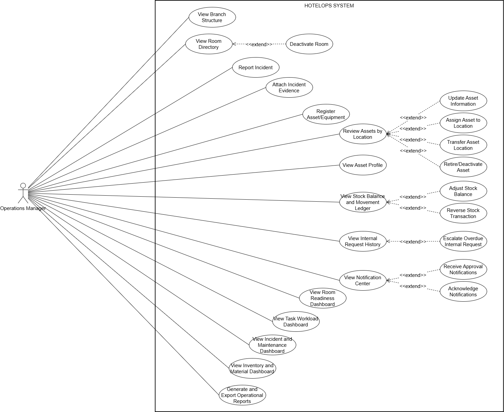

#### 4.3.3 UCs for Housekeeping Supervisor

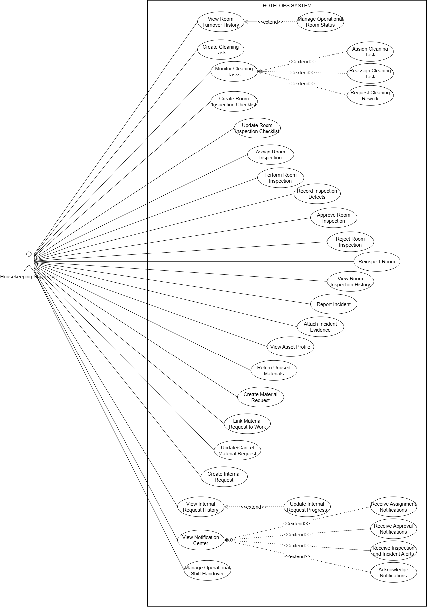

#### 4.3.4 UCs for Housekeeping Staff

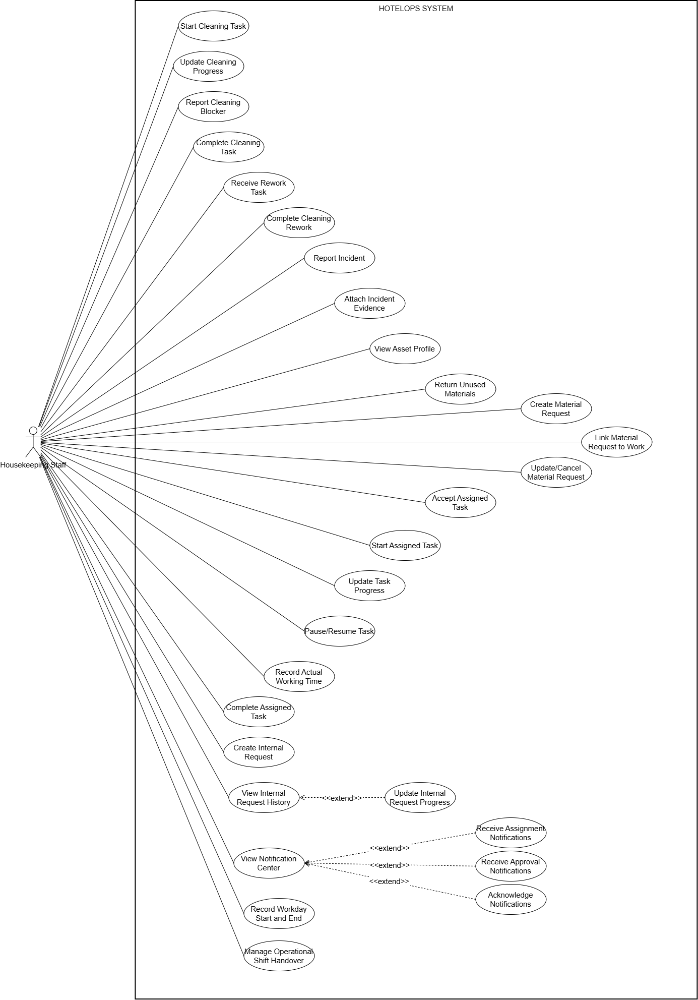

#### 4.3.5 UCs for Maintenance Lead

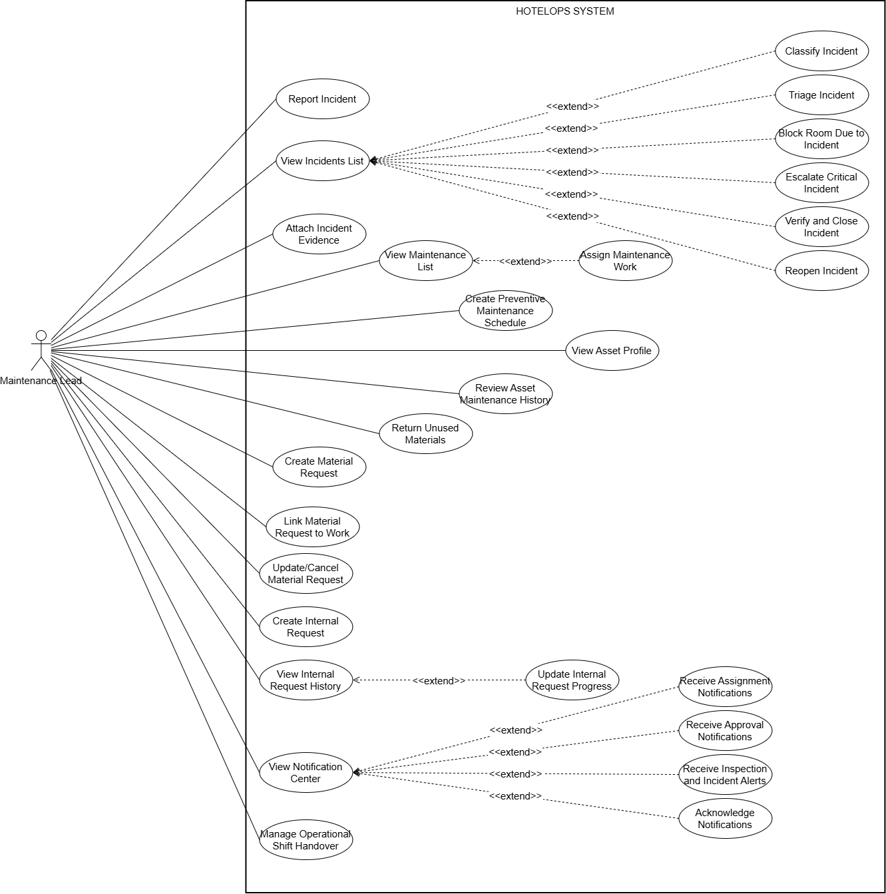

#### 4.3.6 UCs for Maintenance Staff

#### 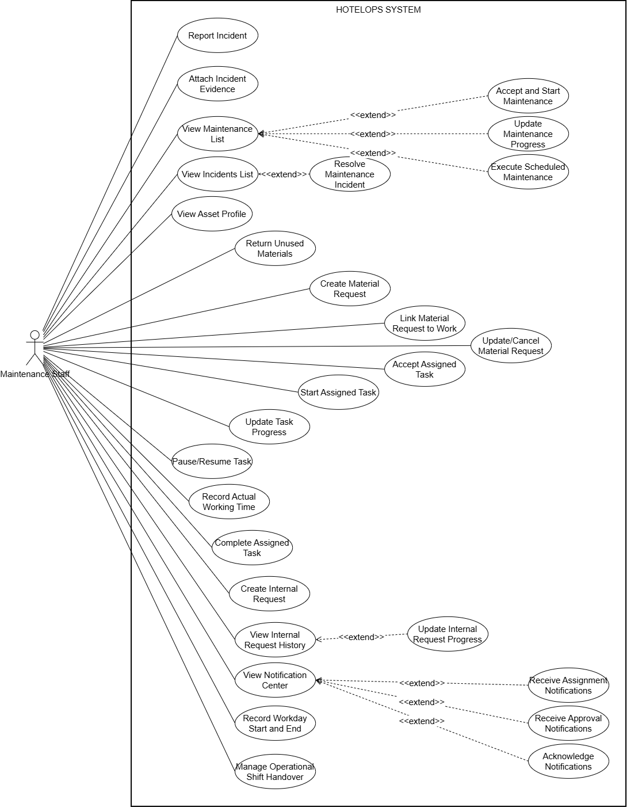 

#### 4.3.7 UCs for Storekeeper

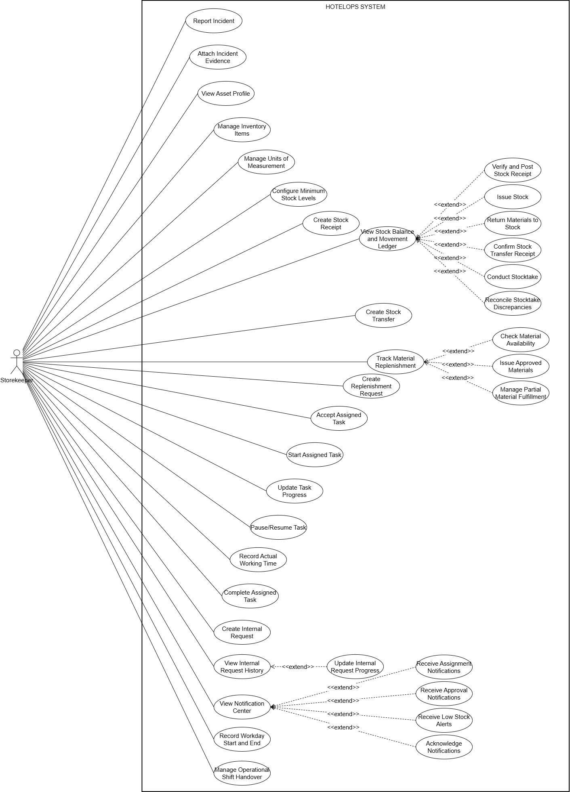

#### 4.3.8 UCs for Department Head

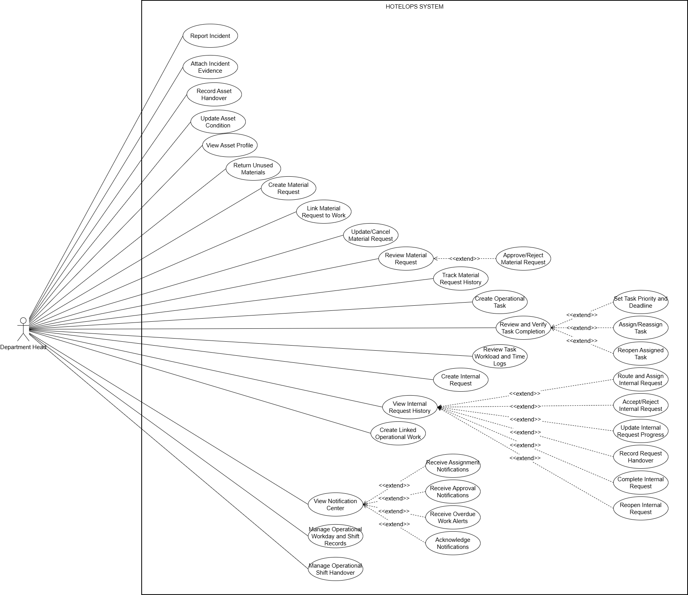

#### 4.3.9 UCs for Owner

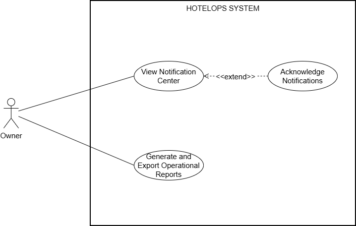

#### 4.3.10 UCs for User

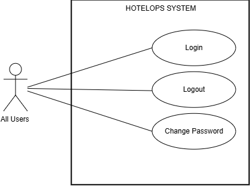

### 4.4 Permission Matrix

> **NOT APPROVED — annotation, not original SRS:** The entire permission matrix below is a **draft**, not a final implementation authority. Reception is missing; Operations Manager permissions need reassessment; Department Head scope requires clarification. Reconcile the matrix against the final Use Cases and obtain explicit approval before implementing RBAC.

Full = unrestricted · R=Restricted = conditions apply (see footnotes) · No = denied

<table style="width:100%;">
<colgroup>
<col style="width: 15%" />
<col style="width: 13%" />
<col style="width: 7%" />
<col style="width: 7%" />
<col style="width: 7%" />
<col style="width: 7%" />
<col style="width: 7%" />
<col style="width: 7%" />
<col style="width: 7%" />
<col style="width: 7%" />
<col style="width: 7%" />
</colgroup>
<thead>
<tr class="header">
<th><strong>Entity</strong></th>
<th><strong>Action</strong></th>
<th><strong>A</strong></th>
<th><strong>OM</strong></th>
<th><strong>O</strong></th>
<th><strong>HK Sup</strong></th>
<th>
<strong>HK</strong>

<strong>Staff</strong>
</th>
<th><strong>ML</strong></th>
<th><strong>MS</strong></th>
<th><strong>SK</strong></th>
<th><strong>DH</strong></th>
</tr>
<tr class="odd">
<th>User account</th>
<th>Create / Update / Deactivate</th>
<th>Full</th>
<th>No</th>
<th>No</th>
<th>No</th>
<th>No</th>
<th>No</th>
<th>No</th>
<th>No</th>
<th>No</th>
</tr>
<tr class="header">
<th>User account</th>
<th>Login / Logout / Change Password</th>
<th>Full</th>
<th>Full</th>
<th>Full</th>
<th>Full</th>
<th>Full</th>
<th>Full</th>
<th>Full</th>
<th>Full</th>
<th>Full</th>
</tr>
<tr class="odd">
<th>Role &amp; Permission</th>
<th>Configure / Assign</th>
<th>Full</th>
<th>No</th>
<th>No</th>
<th>No</th>
<th>No</th>
<th>No</th>
<th>No</th>
<th>No</th>
<th>No</th>
</tr>
<tr class="header">
<th>Hotel Master Data</th>
<th>Create / Edit / Deactivate</th>
<th>Full</th>
<th>No</th>
<th>No</th>
<th>No</th>
<th>No</th>
<th>No</th>
<th>No</th>
<th>No</th>
<th>No</th>
</tr>
<tr class="odd">
<th>Hotel Master Data</th>
<th>View Directory</th>
<th>Full</th>
<th>Full</th>
<th>Full</th>
<th>Full</th>
<th>R¹</th>
<th>Full</th>
<th>R¹</th>
<th>Full</th>
<th>Full</th>
</tr>
<tr class="header">
<th>Cleaning Task</th>
<th>Create / Assign</th>
<th>No</th>
<th>No</th>
<th>No</th>
<th>Full</th>
<th>No</th>
<th>No</th>
<th>No</th>
<th>No</th>
<th>No</th>
</tr>
<tr class="odd">
<th>Cleaning Task</th>
<th>Execute / Update Progress</th>
<th>No</th>
<th>No</th>
<th>No</th>
<th>No</th>
<th>Full</th>
<th>No</th>
<th>No</th>
<th>No</th>
<th>No</th>
</tr>
<tr class="header">
<th>Room Inspection</th>
<th>Perform / Approve / Reject</th>
<th>No</th>
<th>No</th>
<th>No</th>
<th>Full</th>
<th>No</th>
<th>No</th>
<th>No</th>
<th>No</th>
<th>No</th>
</tr>
<tr class="odd">
<th>Incident</th>
<th>Report / Attach Evidence</th>
<th>Full</th>
<th>Full</th>
<th>No</th>
<th>Full</th>
<th>Full</th>
<th>Full</th>
<th>Full</th>
<th>Full</th>
<th>Full</th>
</tr>
<tr class="header">
<th>Incident</th>
<th>Triage / Assign / Close</th>
<th>No</th>
<th>R²</th>
<th>No</th>
<th>No</th>
<th>No</th>
<th>Full</th>
<th>No</th>
<th>No</th>
<th>No</th>
</tr>
<tr class="odd">
<th>Maintenance Task</th>
<th>Execute / Update Progress</th>
<th>No</th>
<th>No</th>
<th>No</th>
<th>No</th>
<th>No</th>
<th>Full</th>
<th>Full</th>
<th>No</th>
<th>No</th>
</tr>
<tr class="header">
<th>Asset</th>
<th>Register / Retire</th>
<th>No</th>
<th>Full</th>
<th>No</th>
<th>No</th>
<th>No</th>
<th>No</th>
<th>No</th>
<th>No</th>
<th>No</th>
</tr>
<tr class="odd">
<th>Asset</th>
<th>Handover / Update Condition</th>
<th>No</th>
<th>Full</th>
<th>No</th>
<th>No</th>
<th>No</th>
<th>No</th>
<th>No</th>
<th>No</th>
<th>Full</th>
</tr>
<tr class="header">
<th>Inventory Catalog</th>
<th>Manage Items / Stock Levels</th>
<th>No</th>
<th>No</th>
<th>No</th>
<th>No</th>
<th>No</th>
<th>No</th>
<th>No</th>
<th>Full</th>
<th>No</th>
</tr>
<tr class="odd">
<th>Stock Transaction</th>
<th>Receipt / Issue / Transfer</th>
<th>No</th>
<th>No</th>
<th>No</th>
<th>No</th>
<th>No</th>
<th>No</th>
<th>No</th>
<th>Full</th>
<th>No</th>
</tr>
<tr class="header">
<th>Stock Transaction</th>
<th>Adjust / Reverse</th>
<th>No</th>
<th>Full</th>
<th>No</th>
<th>No</th>
<th>No</th>
<th>No</th>
<th>No</th>
<th>No</th>
<th>No</th>
</tr>
<tr class="odd">
<th>Material Request</th>
<th>Create / Submit</th>
<th>Full</th>
<th>Full</th>
<th>No</th>
<th>Full</th>
<th>Full</th>
<th>Full</th>
<th>Full</th>
<th>Full</th>
<th>Full</th>
</tr>
<tr class="header">
<th>Material Request</th>
<th>Approve / Reject</th>
<th>No</th>
<th>No</th>
<th>No</th>
<th>No</th>
<th>No</th>
<th>No</th>
<th>No</th>
<th>No</th>
<th>Full</th>
</tr>
<tr class="odd">
<th>Material Request</th>
<th>Issue Approved Materials</th>
<th>No</th>
<th>No</th>
<th>No</th>
<th>No</th>
<th>No</th>
<th>No</th>
<th>No</th>
<th>Full</th>
<th>No</th>
</tr>
<tr class="header">
<th>Operational Task</th>
<th>Create / Assign / Verify</th>
<th>No</th>
<th>No</th>
<th>No</th>
<th>No</th>
<th>No</th>
<th>No</th>
<th>No</th>
<th>No</th>
<th>Full</th>
</tr>
<tr class="odd">
<th>Operational Task</th>
<th>Execute / Update</th>
<th>No</th>
<th>No</th>
<th>No</th>
<th>No</th>
<th>No</th>
<th>No</th>
<th>No</th>
<th>No</th>
<th>No</th>
</tr>
<tr class="header">
<th>Internal Request</th>
<th>Create / Submit</th>
<th>Full</th>
<th>Full</th>
<th>No</th>
<th>Full</th>
<th>Full</th>
<th>Full</th>
<th>Full</th>
<th>Full</th>
<th>Full</th>
</tr>
<tr class="odd">
<th>Internal Request</th>
<th>Accept / Route / Close</th>
<th>No</th>
<th>No</th>
<th>No</th>
<th>No</th>
<th>No</th>
<th>No</th>
<th>No</th>
<th>No</th>
<th>Full</th>
</tr>
<tr class="header">
<th>Dashboard &amp; Report</th>
<th>View / Export</th>
<th>No</th>
<th>Full</th>
<th>Full</th>
<th>No</th>
<th>No</th>
<th>No</th>
<th>No</th>
<th>No</th>
<th>No</th>
</tr>
<tr class="odd">
<th>Audit Log</th>
<th>View / Inspect</th>
<th>Full</th>
<th>No</th>
<th>No</th>
<th>No</th>
<th>No</th>
<th>No</th>
<th>No</th>
<th>No</th>
<th>No</th>
</tr>
</thead>
<tbody>
</tbody>
</table>

¹ Restricted: Can only view data within their assigned branch or department.

² Restricted: Can escalate or view, but primary triage is done by Maintenance Lead.

A: Admin

OM: Operation Manager  
O: Owner  
HK Sup: Housekeeping Supervisor  
HK Staff: Housekeeping Staff  
ML: Maintenance Lead  
MS:Maintenance Staff  
SK: Storekeeper

DH: Department Head

## 5. System Functionalities

### 5.1 Screen Inventory

#### a. Screen Flow

##### a.1. Screen Flow Administrator

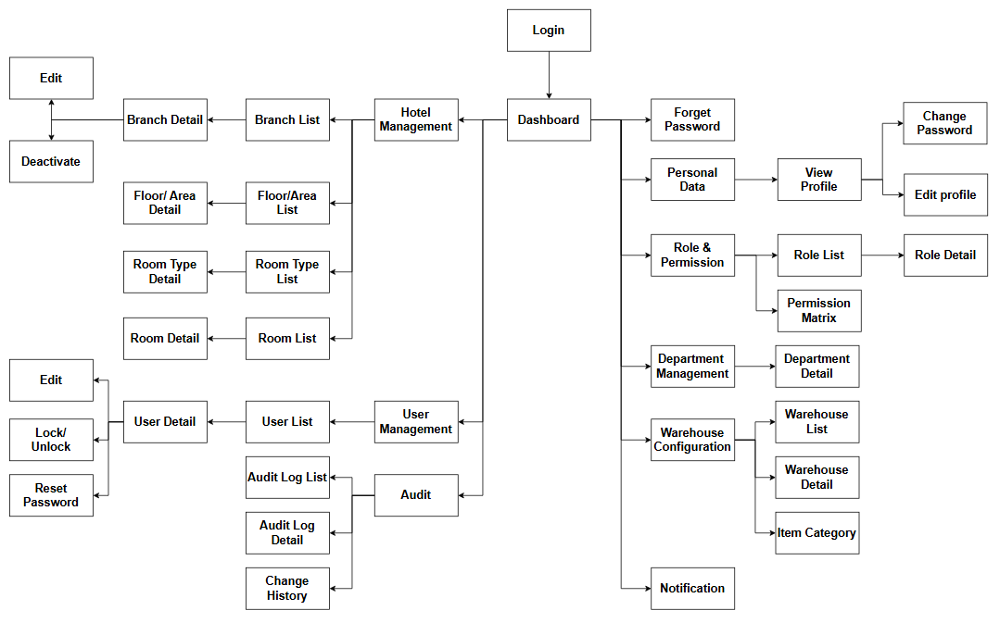

*Figure 5.1.1 Administrator Screen Flow Diagram*

##### a.2. Screen Flow Operations Manager 

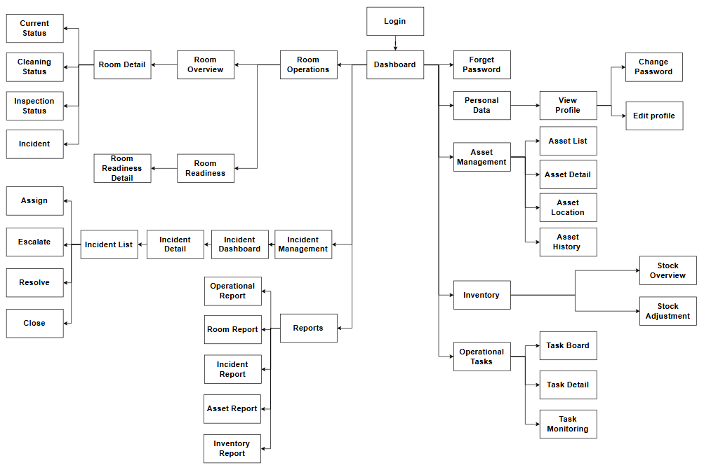

*Figure 5.1.2 Operations Manager Screen Flow Diagram*

##### a.3. Screen Flow Housekeeping Supervisor 

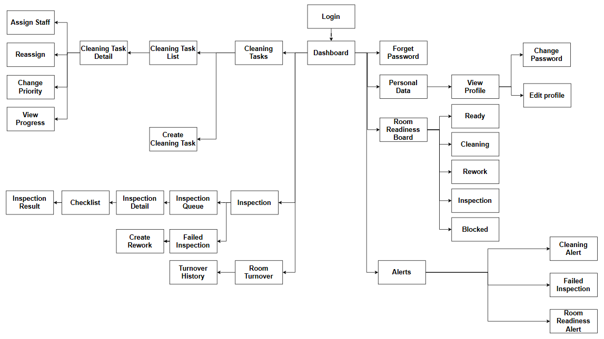

*Figure 5.1.3 Housekeeping Supervisor Screen Flow Diagram*

##### a.4. Screen Flow Housekeeping Staff

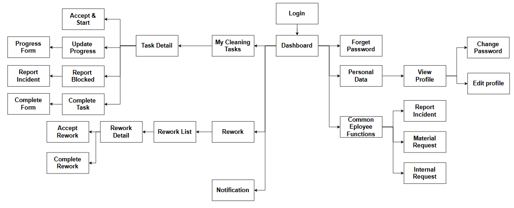

*Figure 5.1.4 Housekeeping Staff Screen Flow Diagram*

##### a.5. Screen Flow Maintenance Lead 

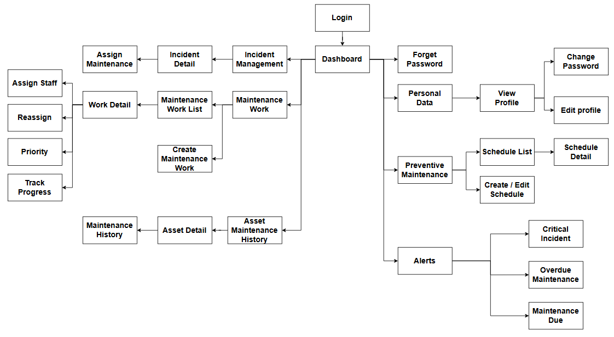

*Figure 5.1.5 Maintenance Lead Screen Flow Diagram*

##### a.6. Screen Flow Maintenance Staff 

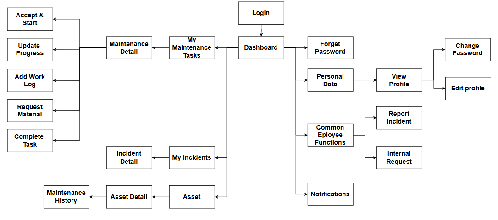

*Figure 5.1.6 Maintenance Staff Screen Flow Diagram*

##### a.7. Screen Flow Storekeeper 

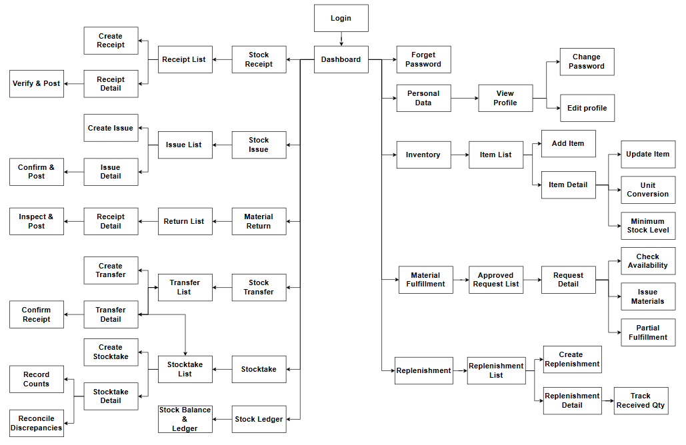

*Figure 5.1.7 Storekeeper Screen Flow Diagram*

##### a.8. Screen Flow Department Head

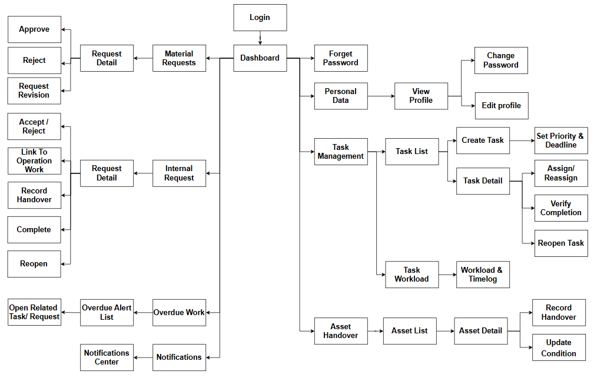

*Figure 5.1.8 Department Head Screen Flow Diagram*

##### a.9. Screen Flow Owner 

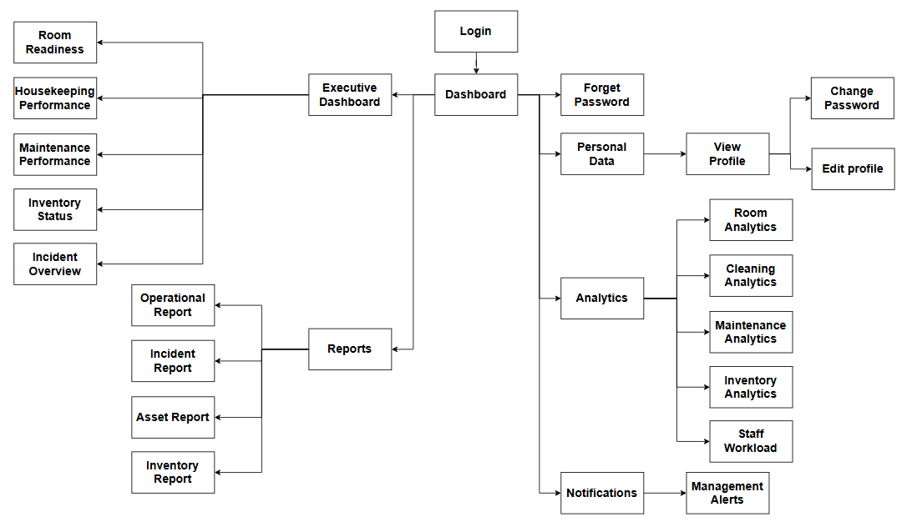

*Figure 5.1.9 Owner Screen Flow Diagram*

#### b. Screen List

| **\#** | **Screen Name**                        | **Feature**                                  | **Description**                                                                                                                                          |
|--------|----------------------------------------|----------------------------------------------|----------------------------------------------------------------------------------------------------------------------------------------------------------|
| 1      | Sign In                                | Authentication (FE-01)                       | Allows any user to log in with username/email and password and reach the role-specific dashboard.                                                        |
| 2      | Forgot Password                        | Authentication (FE-01)                       | Shows the instruction to contact the Administrator for a password reset (no self-service reset).                                                         |
| 3      | Change Password                        | Authentication (FE-01)                       | Allows users to change their own password, including the mandatory change after receiving a temporary password.                                          |
| 4      | Profile                                | Authentication (FE-01)                       | Displays the current user's account, roles and branch/department; provides Change Password and Logout.                                                   |
| 5      | Dashboard                              | Dashboard (FE-14)                            | Role-specific home page; for Operations Manager and Owner it shows room readiness, task workload, incident/maintenance and inventory indicators.         |
| 6      | Notification Center                    | Notification (FE-14)                         | Lists notifications and alerts; search and filter by type, time, priority and read status.                                                               |
| 7      | Notification Detail                    | Notification (FE-14)                         | Displays a notification, marks it as read/acknowledged and opens the related record.                                                                     |
| 8      | User List                              | User Management (FE-01)                      | Searches and filters user accounts; creates and activates/deactivates accounts.                                                                          |
| 9      | User Detail                            | User Management (FE-01)                      | Displays and updates an account, resets its password, assigns branch/department and roles, and shows effective permissions.                              |
| 10     | Role List                              | Access Control (FE-01)                       | Lists system roles and creates a new role.                                                                                                               |
| 11     | Role Detail                            | Access Control (FE-01)                       | Updates a role and configures its permissions by feature.                                                                                                |
| 12     | Permission Matrix                      | Access Control (FE-01)                       | Displays the permissions of all roles in one matrix (read-only overview).                                                                                |
| 13     | Branch List                            | Hotel Structure (FE-02)                      | Lists branches and creates a new branch.                                                                                                                 |
| 14     | Branch Detail                          | Hotel Structure (FE-02)                      | Displays, updates and deactivates a branch; shows its structure tree of floors, areas, rooms and departments.                                            |
| 15     | Floor/Area List                        | Hotel Structure (FE-02)                      | Lists floors and areas of a branch and creates a new floor/area.                                                                                         |
| 16     | Floor/Area Detail                      | Hotel Structure (FE-02)                      | Displays, updates and deactivates a floor/area.                                                                                                          |
| 17     | Room Type List                         | Hotel Structure (FE-02)                      | Lists room types of a branch and creates a new room type.                                                                                                |
| 18     | Room Type Detail                       | Hotel Structure (FE-02)                      | Displays, updates and deactivates a room type.                                                                                                           |
| 19     | Room List                              | Hotel Structure (FE-02)                      | Searches and filters rooms by branch, floor, area, room type and status; creates a new room.                                                             |
| 20     | Room Detail                            | Hotel Structure (FE-02)                      | Displays room information, current status reason and status history; updates, deactivates or reactivates the room.                                       |
| 21     | Department List                        | Hotel Structure (FE-02)                      | Lists departments of a branch and creates a new department.                                                                                              |
| 22     | Department Detail                      | Hotel Structure (FE-02)                      | Displays, updates and deactivates a department.                                                                                                          |
| 23     | Room Readiness Board                   | Room Operations (FE-03)                      | Displays rooms by floor with operational status (Ready, Pending Cleaning, Cleaning, Pending Inspection, Rework, Blocked) and counts; opens next actions. |
| 24     | Cleaning Task List                     | Housekeeping (FE-04)                         | Supervisor monitors tasks by status/overdue and cancels tasks; staff see their own cleaning tasks.                                                       |
| 25     | Create Cleaning Task                   | Housekeeping (FE-04)                         | Creates a cleaning task for a room with cleaning type, priority and due time.                                                                            |
| 26     | Cleaning Task Detail                   | Housekeeping (FE-04)                         | Displays a cleaning task; staff start it, update progress, report blockers and complete it.                                                              |
| 27     | Cleaning Assignment                    | Housekeeping (FE-04)                         | Assigns or reassigns a cleaning task based on area and current workload.                                                                                 |
| 28     | Rework Task List                       | Housekeeping (FE-04)                         | Lists rework tasks; staff see their own rework tasks.                                                                                                    |
| 29     | Rework Task Detail                     | Housekeeping (FE-04)                         | Displays defects to fix; staff accept, start and submit the rework with remediation notes.                                                               |
| 30     | Room Turnover History                  | Housekeeping (FE-04)                         | Displays cleaning cycles of a room with assignees, times, inspection results and rework count.                                                           |
| 31     | Inspection Checklist List              | Room Inspection (FE-05)                      | Lists inspection checklists and creates a new checklist.                                                                                                 |
| 32     | Inspection Checklist Detail            | Room Inspection (FE-05)                      | Edits criteria, manages versions, publishes or retires a checklist.                                                                                      |
| 33     | Inspection Queue                       | Room Inspection (FE-05)                      | Lists rooms pending inspection/reinspection and failed inspections without rework; assigns the inspector.                                                |
| 34     | Room Inspection                        | Room Inspection (FE-05)                      | Records Pass/Fail for each checklist criterion and defects with photos.                                                                                  |
| 35     | Inspection Result                      | Room Inspection (FE-05)                      | Displays the inspection summary and approves or rejects the room.                                                                                        |
| 36     | Request Rework                         | Room Inspection (FE-05)                      | Creates a rework task from a failed inspection with defects, assignee and due time.                                                                      |
| 37     | Reinspection                           | Room Inspection (FE-05)                      | Records Fixed/Not Fixed for each defect of a submitted rework and concludes.                                                                             |
| 38     | Inspection History                     | Room Inspection (FE-05)                      | Searches inspections with results, defects, inspectors, housekeepers and checklist version.                                                              |
| 39     | Incident List                          | Incident & Maintenance (FE-06)               | Lists incidents by status, severity, location and deadline.                                                                                              |
| 40     | Report Incident                        | Incident & Maintenance (FE-06)               | Creates an incident with location/asset, description and evidence; shows similar open incidents.                                                         |
| 41     | Incident Detail                        | Incident & Maintenance (FE-06)               | Classifies, triages, blocks room, escalates, verifies/closes or reopens an incident; adds evidence.                                                      |
| 42     | Maintenance Assignment                 | Incident & Maintenance (FE-06)               | Assigns a technician and deadline to an incident.                                                                                                        |
| 43     | Maintenance Task List                  | Incident & Maintenance (FE-06)               | Lists maintenance work from incidents and schedules; technicians see their own tasks.                                                                    |
| 44     | Maintenance Task Detail                | Incident & Maintenance (FE-06)               | Technician accepts, starts, updates progress and materials, and resolves the work.                                                                       |
| 45     | Preventive Maintenance Schedule List   | Incident & Maintenance (FE-06)               | Lists preventive maintenance schedules and creates a new schedule.                                                                                       |
| 46     | Preventive Maintenance Schedule Detail | Incident & Maintenance (FE-06)               | Updates a schedule and shows its executions and next due date.                                                                                           |
| 47     | Reference Data                         | Incident & Maintenance (FE-06), Task (FE-11) | Manages work categories, priority levels, status groups and interruption reasons.                                                                        |
| 48     | Asset List                             | Asset (FE-07)                                | Searches assets by branch, location, type and status; registers assets; shows statistics by location.                                                    |
| 49     | Asset Detail                           | Asset (FE-07)                                | Displays and updates an asset; assigns/transfers location, records handover, updates condition, retires it.                                              |
| 50     | Asset Maintenance History              | Asset (FE-07)                                | Displays incidents, repairs and preventive maintenance history of an asset.                                                                              |
| 51     | Warehouse List                         | Inventory (FE-08)                            | Lists warehouses and creates a new warehouse.                                                                                                            |
| 52     | Warehouse Detail                       | Inventory (FE-08)                            | Updates and deactivates a warehouse.                                                                                                                     |
| 53     | Inventory Dashboard                    | Inventory (FE-08)                            | Displays stock levels and items below minimum stock for the storekeeper.                                                                                 |
| 54     | Item List                              | Inventory (FE-08)                            | Lists inventory items and creates a new item.                                                                                                            |
| 55     | Item Detail                            | Inventory (FE-08)                            | Updates an item, its unit conversions and minimum stock levels per warehouse.                                                                            |
| 56     | Unit of Measurement                    | Inventory (FE-08)                            | Manages units of measurement.                                                                                                                            |
| 57     | Stock Transaction List                 | Inventory (FE-08)                            | Lists receipts, issues, returns and transfers by type; creates a new transaction.                                                                        |
| 58     | Stock Transaction Detail               | Inventory (FE-08)                            | Verifies and posts a transaction, confirms transfer receipt, or reverses a posted transaction.                                                           |
| 59     | Stocktake List                         | Inventory (FE-08)                            | Lists stocktakes and starts a new stocktake.                                                                                                             |
| 60     | Stocktake Detail                       | Inventory (FE-08)                            | Records counted quantities, reconciles discrepancies and confirms stock adjustment.                                                                      |
| 61     | Stock Balance & Ledger                 | Inventory (FE-08)                            | Displays current stock and movement history by warehouse, item and period.                                                                               |
| 62     | Material Request List                  | Material Request (FE-09)                     | Lists my requests, requests pending my approval and approved requests to issue; creates a request.                                                       |
| 63     | Material Request Detail                | Material Request (FE-09)                     | Updates/cancels, links to work, reviews, approves/rejects, checks availability, issues (full/partial) and returns unused materials.                      |
| 64     | Replenishment List                     | Replenishment (FE-10)                        | Lists replenishment requests and creates a new one.                                                                                                      |
| 65     | Replenishment Detail                   | Replenishment (FE-10)                        | Tracks requested, pending and received quantities of a replenishment request.                                                                            |
| 66     | Task List                              | Task Assignment (FE-11)                      | Lists operational tasks (department or my tasks); creates a new task.                                                                                    |
| 67     | Task Detail                            | Task Assignment (FE-11)                      | Sets priority/deadline, accepts, starts, pauses/resumes, updates, completes, verifies or reopens a task; logs working time.                              |
| 68     | Task Assignment                        | Task Assignment (FE-11)                      | Assigns or reassigns a task based on department and workload.                                                                                            |
| 69     | Workload & Time Logs                   | Task Assignment (FE-11), Work-Time (FE-12)   | Displays tasks and time logs by employee, department, status and deadline.                                                                               |
| 70     | Overdue Work                           | Task Assignment (FE-11)                      | Lists overdue tasks, incidents and internal requests and opens the related record.                                                                       |
| 71     | Shift Management                       | Work-Time (FE-12)                            | Displays the workday calendar; creates and updates shifts and their assignees.                                                                           |
| 72     | Shift Detail                           | Work-Time (FE-12)                            | Displays shift time, assigned employees and status.                                                                                                      |
| 73     | Workday Record                         | Work-Time (FE-12)                            | Staff start/end their workday; Department Head views actual start/end times.                                                                             |
| 74     | Shift Handover List                    | Work-Time (FE-12)                            | Lists shift handovers and their acknowledgement status.                                                                                                  |
| 75     | Shift Handover Detail                  | Work-Time (FE-12)                            | Records pending tasks, unready rooms, open incidents and requests; receiver acknowledges.                                                                |
| 76     | Internal Request List                  | Internal Request (FE-13)                     | Lists internal requests in scope; creates a new request.                                                                                                 |
| 77     | Internal Request Detail                | Internal Request (FE-13)                     | Routes, accepts/rejects, updates progress, links work, hands over, completes, reopens or escalates a request.                                            |
| 78     | Operational Reports                    | Reporting (FE-15)                            | Generates and exports reports by type (room, housekeeping/inspection, incident/maintenance, asset, inventory, task), period, branch and department.      |
| 79     | Audit Log                              | Audit (FE-15)                                | Searches audit entries by period, actor, entity and action.                                                                                              |
| 80     | Audit Log Detail                       | Audit (FE-15)                                | Displays the actor, time, action and before/after values of a change.                                                                                    |

### 5.2 External API Inventory

*\[Fill details of each external API into the table with the columns and sample data as below\]*

| **\#** | **API Name**      | **Calling Path**       | **Description**                                                                                                |
|--------|-------------------|------------------------|----------------------------------------------------------------------------------------------------------------|
| 1      | Employee sync API | HRM System → TalentHub | allows an external HR management system to push employee records and automatically create Interviewer accounts |

### 5.3 Background Job Inventory

*\[Fill details of each background job into the table with the columns and sample data as below\]*

| **\#** | **Job Name**                                     | **Group** | **Description**  |
|--------|--------------------------------------------------|-----------|------------------|
| 1      | Check overdue and at-risk work                   | Scheduled | Every 5 minutes  |
| 2      | Check low stock                                  | Scheduled | Every 5 minutes  |
| 3      | Retry failed notifications                       | Scheduled | Every 5 minutes  |
| 4      | Generate preventive maintenance occurrences      | Scheduled | Daily at 0:30 AM |
| 5      | Generate recurring tasks                         | Scheduled | Daily at 0:45 AM |
| 6      | Clean up old notifications and audit log entries | Scheduled | Daily at 2:00 AM |

# II. Use Case Specifications

*\[Provide specifications for the use cases (UCs) that are covered in the system. The UCs are grouped by the system features and even sub features. **You just need to provide UC specifications for UCs involved in the main workflows (business processes) or the complex ones**. Other UCs (i.e CRUD or data-viewing UCs) are simple, and you just need to refer the descriptions in the Functional Requirement (part III) below)\]*

## 1. Authentication & Role Management (FE-01)

### 1.1 UC-001 Login

<table>
<colgroup>
<col style="width: 19%" />
<col style="width: 28%" />
<col style="width: 20%" />
<col style="width: 31%" />
</colgroup>
<thead>
<tr class="header">
<th>UC ID and Name</th>
<th colspan="3">UC-001 Login</th>
</tr>
<tr class="odd">
<th>Primary Actors</th>
<th>Administrator, Operations Manager, Owner, Housekeeping Supervisor, Housekeeping Staff, Maintenance Lead, Maintenance Staff, Storekeeper, Department Head</th>
<th>Secondary Actors</th>
<th>N/A</th>
</tr>
<tr class="header">
<th>Trigger</th>
<th colspan="3">A user wants to access the functions of HotelOps.</th>
</tr>
<tr class="odd">
<th>Description</th>
<th colspan="3">Allows an internal user to sign in with a provisioned account so that the system can identify the user and apply the user's roles and scope.</th>
</tr>
<tr class="header">
<th>Preconditions</th>
<th colspan="3"><strong>PRE-01:</strong> The user has an internal account created by the Administrator (UC-004).</th>
</tr>
<tr class="odd">
<th>Postconditions</th>
<th colspan="3">
<strong>POST-01:</strong> Success: an active session exists and the user sees only functions granted by the user's roles and scope.

<strong>POST-02:</strong> Failure: no session is created; failed attempts and locks are recorded.
</th>
</tr>
<tr class="header">
<th>Normal Flow</th>
<th colspan="3">
<em><strong>Login</strong></em>

<blockquote>

1. User opens the Login page.

2. System displays the Login form (username or email, password) and the Forgot Password link.

3. User enters the username or email and the password and selects Login.

4. System checks that both fields are filled (GBR-003).

5. System finds the account and verifies the password (GBR-019).

6. System checks that the account is Active and not locked (GBR-020).

7. System resets the failed-attempt counter, creates a session and calculates the effective permissions from the user's roles and scope (GBR-021, GBR-002).

8. System records the login in the audit log (GBR-008).

9. System opens the user's home page (notifications and the functions allowed for the user's roles).

</blockquote></th>
</tr>
<tr class="odd">
<th>Alternative Flows</th>
<th colspan="3">
<em><strong>Step 2.1_Forgot Password</strong></em>

User selects Forgot Password and enters a username or email.

<ol type="1">
<li>
System displays the same instruction for every input, without revealing whether the account exists (MSG14, GBR-024).
</li>
<li>
The flow ends.
</li>
</ol>

<em><strong>Step 7.1_Temporary Password</strong></em>

The password used is a valid temporary password.

<ol type="1">
<li>
System creates a restricted session that only allows changing the password (GBR-023).
</li>
<li>
System opens the Change Password screen (UC-003); the flow ends.
</li>
</ol></th>
</tr>
<tr class="header">
<th>Exceptions</th>
<th colspan="3">
<em><strong>Step 4.1_Missing Information</strong></em>

Username/email or password is empty.

<ol type="1">
<li>
System shows which field is required (MSG03).
</li>
<li>
Return to step 3 of the normal flow.
</li>
</ol>

<em><strong>Step 5.1_Invalid Credentials</strong></em>

The account does not exist, the password is wrong, or the account is Inactive.

<ol type="1">
<li>
If the account exists, System increases its failed-attempt counter (GBR-020).
</li>
<li>
System displays the same generic message for all three cases (MSG11, GBR-019).
</li>
<li>
Return to step 3 of the normal flow.
</li>
</ol>

<em><strong>Step 5.2_Lock Threshold Reached</strong></em>

The failed attempt reaches SYS-PAR-01.

<ol type="1">
<li>
System sets locked_until = now + SYS-PAR-02 minutes (GBR-020).
</li>
<li>
System records the lock in the audit log (GBR-008).
</li>
<li>
System displays MSG11; the flow ends.
</li>
</ol>

<em><strong>Step 6.1_Account Temporarily Locked</strong></em>

The password is correct but locked_until is later than now.

<ol type="1">
<li>
System does not create a session and displays the unlock time (MSG12, GBR-020).
</li>
<li>
The flow ends.
</li>
</ol>

<em><strong>Step 7.2_Temporary Password Expired</strong></em>

The temporary password is older than SYS-PAR-05 hours.

<ol type="1">
<li>
System does not create a session (MSG13, GBR-023).
</li>
<li>
The flow ends.
</li>
</ol></th>
</tr>
<tr class="odd">
<th>Priority</th>
<th colspan="3">High</th>
</tr>
<tr class="header">
<th>Frequency of Use</th>
<th colspan="3">Once or twice per user per shift.</th>
</tr>
<tr class="odd">
<th>Business Rules</th>
<th colspan="3">GBR-002, GBR-003, GBR-008, GBR-019, GBR-020, GBR-021, GBR-023, GBR-024</th>
</tr>
</thead>
<tbody>
</tbody>
</table>

### 1.2 UC-002 Logout

<table>
<colgroup>
<col style="width: 19%" />
<col style="width: 28%" />
<col style="width: 20%" />
<col style="width: 31%" />
</colgroup>
<thead>
<tr class="header">
<th>UC ID and Name</th>
<th colspan="3">UC-002 Logout</th>
</tr>
<tr class="odd">
<th>Primary Actors</th>
<th>Administrator, Operations Manager, Owner, Housekeeping Supervisor, Housekeeping Staff, Maintenance Lead, Maintenance Staff, Storekeeper, Department Head</th>
<th>Secondary Actors</th>
<th>N/A</th>
</tr>
<tr class="header">
<th>Trigger</th>
<th colspan="3">A logged-in user wants to end the working session.</th>
</tr>
<tr class="odd">
<th>Description</th>
<th colspan="3">Allows a signed-in user to end the current session.</th>
</tr>
<tr class="header">
<th>Preconditions</th>
<th colspan="3"><strong>PRE-01:</strong> User has logged in and has permission for this function (GBR-001, GBR-002).</th>
</tr>
<tr class="odd">
<th>Postconditions</th>
<th colspan="3"><strong>POST-01:</strong> The session can no longer be used; any further request requires a new login.</th>
</tr>
<tr class="header">
<th>Normal Flow</th>
<th colspan="3">
<em><strong>Logout</strong></em>

<blockquote>

1. User selects Logout from the user menu.

2. System revokes the current session (GBR-021).

3. System records the logout in the audit log (GBR-008).

4. System clears the client session and opens the Login page.

</blockquote></th>
</tr>
<tr class="odd">
<th>Alternative Flows</th>
<th colspan="3">N/A</th>
</tr>
<tr class="header">
<th>Exceptions</th>
<th colspan="3">
<em><strong>Step 2.1_Session Already Expired</strong></em>

The session is already expired or revoked.

<ol type="1">
<li>
System treats the logout as successful and opens the Login page.
</li>
<li>
The flow ends.
</li>
</ol></th>
</tr>
<tr class="odd">
<th>Priority</th>
<th colspan="3">Medium</th>
</tr>
<tr class="header">
<th>Frequency of Use</th>
<th colspan="3">Once or twice per user per shift.</th>
</tr>
<tr class="odd">
<th>Business Rules</th>
<th colspan="3">GBR-001, GBR-002, GBR-008, GBR-021</th>
</tr>
</thead>
<tbody>
</tbody>
</table>

### 1.3 UC-003 Change Password

<table>
<colgroup>
<col style="width: 19%" />
<col style="width: 28%" />
<col style="width: 20%" />
<col style="width: 31%" />
</colgroup>
<thead>
<tr class="header">
<th>UC ID and Name</th>
<th colspan="3">UC-003 Change Password</th>
</tr>
<tr class="odd">
<th>Primary Actors</th>
<th>Administrator, Operations Manager, Owner, Housekeeping Supervisor, Housekeeping Staff, Maintenance Lead, Maintenance Staff, Storekeeper, Department Head</th>
<th>Secondary Actors</th>
<th>N/A</th>
</tr>
<tr class="header">
<th>Trigger</th>
<th colspan="3">A user wants to change the password, or must change a temporary password after the first login or a reset.</th>
</tr>
<tr class="odd">
<th>Description</th>
<th colspan="3">Allows a user to change their own password, including the mandatory change after receiving a temporary password.</th>
</tr>
<tr class="header">
<th>Preconditions</th>
<th colspan="3">
<strong>PRE-01:</strong> User has logged in and has permission for this function (GBR-001, GBR-002).

<strong>PRE-02:</strong> For a forced change, the user is in a restricted session created from a temporary password (UC-001, Step 7.1).
</th>
</tr>
<tr class="odd">
<th>Postconditions</th>
<th colspan="3"><strong>POST-01:</strong> The new password is effective; other sessions are revoked; the restricted session (if any) becomes a normal session.</th>
</tr>
<tr class="header">
<th>Normal Flow</th>
<th colspan="3">
<em><strong>Change Password</strong></em>

<blockquote>

1. User opens Change Password.

2. System displays fields: current password, new password, confirm new password.

3. User enters the three fields and selects Save.

4. System verifies the current password (GBR-019).

5. System checks that the new password matches the confirmation (GBR-022).

6. System stores the new password hash, clears the temporary-password flag and revokes all other sessions of the user (GBR-021, GBR-023).

7. System records the change in the audit log without the password values (GBR-008).

8. System displays a success message (MSG08).

</blockquote></th>
</tr>
<tr class="odd">
<th>Alternative Flows</th>
<th colspan="3">N/A</th>
</tr>
<tr class="header">
<th>Exceptions</th>
<th colspan="3">
<em><strong>Step 4.1_Wrong Current Password</strong></em>

The current password is incorrect.

<ol type="1">
<li>
System displays MSG03 for the current password field.
</li>
<li>
Return to step 3 of the normal flow.
</li>
</ol>

<em><strong>Step 5.1_Policy Not Met</strong></em>

The new password does not match the confirmation, violates the policy, or equals the current password.

<ol type="1">
<li>
System lists the unmet policy items (MSG03, GBR-022).
</li>
<li>
Return to step 3 of the normal flow.
</li>
</ol></th>
</tr>
<tr class="odd">
<th>Priority</th>
<th colspan="3">Medium</th>
</tr>
<tr class="header">
<th>Frequency of Use</th>
<th colspan="3">Rarely; at the first login and when a user changes the password.</th>
</tr>
<tr class="odd">
<th>Business Rules</th>
<th colspan="3">GBR-001, GBR-002, GBR-008, GBR-019, GBR-021, GBR-022, GBR-023</th>
</tr>
</thead>
<tbody>
</tbody>
</table>

### 1.4 UC-004 Create User Account

<table>
<colgroup>
<col style="width: 19%" />
<col style="width: 28%" />
<col style="width: 20%" />
<col style="width: 31%" />
</colgroup>
<thead>
<tr class="header">
<th>UC ID and Name</th>
<th colspan="3">UC-004 Create User Account</th>
</tr>
<tr class="odd">
<th>Primary Actors</th>
<th>Administrator</th>
<th>Secondary Actors</th>
<th>N/A</th>
</tr>
<tr class="header">
<th>Trigger</th>
<th colspan="3">A new employee needs an account to use HotelOps.</th>
</tr>
<tr class="odd">
<th>Description</th>
<th colspan="3">Allows the Administrator to create an internal account for a hotel employee and provision a temporary password.</th>
</tr>
<tr class="header">
<th>Preconditions</th>
<th colspan="3"><strong>PRE-01:</strong> User has logged in and has permission for this function (GBR-001, GBR-002).</th>
</tr>
<tr class="odd">
<th>Postconditions</th>
<th colspan="3"><strong>POST-01:</strong> The account exists; the employee must change the temporary password at first login (UC-001, UC-003).</th>
</tr>
<tr class="header">
<th>Normal Flow</th>
<th colspan="3">
<em><strong>Create User Account</strong></em>

<blockquote>

1. Administrator opens User Management and selects Create Account.

2. System displays the form: full name, username, email, phone, branch, department, role(s).

3. Administrator enters the information and selects Save.

4. System validates the input and business conditions (GBR-003, GBR-025, GBR-031, GBR-004).

5. System creates the account as Active with the selected roles and scope (GBR-031).

6. System generates a random temporary password valid for SYS-PAR-05 hours (GBR-023).

7. System saves the account, role assignments and scope (without the password value) and records the audit log in the same transaction (GBR-007, GBR-008).

8. System displays the temporary password once so the Administrator can hand it to the employee (MSG15).

</blockquote></th>
</tr>
<tr class="odd">
<th>Alternative Flows</th>
<th colspan="3">N/A</th>
</tr>
<tr class="header">
<th>Exceptions</th>
<th colspan="3">
<em><strong>Step 4.1_Duplicate Username or Email</strong></em>

The username or email already exists.

<ol type="1">
<li>
System shows the duplicated field (MSG35, GBR-025).
</li>
<li>
Return to step 3 of the normal flow.
</li>
</ol>

<em><strong>Step 4.1_Invalid Data</strong></em>

Another field is invalid (e.g. the department does not belong to the branch).

<ol type="1">
<li>
System highlights the invalid fields and shows the reason (MSG03).
</li>
<li>
Return to step 3 of the normal flow.
</li>
</ol></th>
</tr>
<tr class="odd">
<th>Priority</th>
<th colspan="3">Medium</th>
</tr>
<tr class="header">
<th>Frequency of Use</th>
<th colspan="3">Occasionally; when staff join, leave or change duties (a few times per month).</th>
</tr>
<tr class="odd">
<th>Business Rules</th>
<th colspan="3">GBR-001, GBR-002, GBR-003, GBR-004, GBR-007, GBR-008, GBR-023, GBR-025, GBR-031</th>
</tr>
</thead>
<tbody>
</tbody>
</table>

### 1.5 UC-005 Update User Account

<table>
<colgroup>
<col style="width: 19%" />
<col style="width: 28%" />
<col style="width: 20%" />
<col style="width: 31%" />
</colgroup>
<thead>
<tr class="header">
<th>UC ID and Name</th>
<th colspan="3">UC-005 Update User Account</th>
</tr>
<tr class="odd">
<th>Primary Actors</th>
<th>Administrator</th>
<th>Secondary Actors</th>
<th>N/A</th>
</tr>
<tr class="header">
<th>Trigger</th>
<th colspan="3">An employee's account information changes or the employee has forgotten the password.</th>
</tr>
<tr class="odd">
<th>Description</th>
<th colspan="3">Allows the Administrator to update an account's personal information and to reset a forgotten password.</th>
</tr>
<tr class="header">
<th>Preconditions</th>
<th colspan="3">
<strong>PRE-01:</strong> User has logged in and has permission for this function (GBR-001, GBR-002).

<strong>PRE-02:</strong> The account exists in the Administrator's scope.
</th>
</tr>
<tr class="odd">
<th>Postconditions</th>
<th colspan="3"><strong>POST-01:</strong> Account information is updated; after a reset the employee must log in with the temporary password and change it.</th>
</tr>
<tr class="header">
<th>Normal Flow</th>
<th colspan="3">
<em><strong>Update User Account</strong></em>

<blockquote>

1. Administrator searches for and opens the account.

2. System displays the account details with the current row version.

3. Administrator edits full name, email or phone and selects Save.

4. System validates the input and business conditions (GBR-003, GBR-025, GBR-005).

5. System saves the changes and records the audit log in the same transaction (GBR-007, GBR-008).

6. System displays a success message (MSG08).

</blockquote></th>
</tr>
<tr class="odd">
<th>Alternative Flows</th>
<th colspan="3">
<em><strong>Step 3.1_Reset Password</strong></em>

The employee has forgotten the password and Administrator selects Reset Password after verifying the person.

<ol type="1">
<li>
System asks User to confirm the password reset of the account (MSG33).
</li>
<li>
System generates a new temporary password, marks the account for a forced change and revokes all sessions of the account (GBR-023, GBR-024).
</li>
<li>
System saves the reset event (without the password value) and records the audit log in the same transaction (GBR-007, GBR-008).
</li>
<li>
System displays the temporary password once (MSG15).
</li>
<li>
The flow ends.
</li>
</ol></th>
</tr>
<tr class="header">
<th>Exceptions</th>
<th colspan="3">
<em><strong>Step 4.1_Duplicate Email</strong></em>

The new email is used by another account.

<ol type="1">
<li>
System displays MSG35.
</li>
<li>
Return to step 3 of the normal flow.
</li>
</ol>

<em><strong>Step 4.2_Role or Status Change Requested</strong></em>

Administrator tries to change roles or Active status here.

<ol type="1">
<li>
System informs that roles are changed in UC-010 and status in UC-006 (MSG03).
</li>
<li>
Return to step 3 of the normal flow.
</li>
</ol></th>
</tr>
<tr class="odd">
<th>Priority</th>
<th colspan="3">Medium</th>
</tr>
<tr class="header">
<th>Frequency of Use</th>
<th colspan="3">Occasionally; when staff join, leave or change duties (a few times per month).</th>
</tr>
<tr class="odd">
<th>Business Rules</th>
<th colspan="3">GBR-001, GBR-002, GBR-003, GBR-005, GBR-007, GBR-008, GBR-023, GBR-024, GBR-025</th>
</tr>
</thead>
<tbody>
</tbody>
</table>

### 1.6 UC-006 Activate/Deactivate User Account

<table>
<colgroup>
<col style="width: 19%" />
<col style="width: 28%" />
<col style="width: 20%" />
<col style="width: 31%" />
</colgroup>
<thead>
<tr class="header">
<th>UC ID and Name</th>
<th colspan="3">UC-006 Activate/Deactivate User Account</th>
</tr>
<tr class="odd">
<th>Primary Actors</th>
<th>Administrator</th>
<th>Secondary Actors</th>
<th>N/A</th>
</tr>
<tr class="header">
<th>Trigger</th>
<th colspan="3">An employee stops or resumes using HotelOps (e.g. leaves or returns to work).</th>
</tr>
<tr class="odd">
<th>Description</th>
<th colspan="3">Allows the Administrator to deactivate an account of an employee who leaves or must not use the system, or to reactivate it.</th>
</tr>
<tr class="header">
<th>Preconditions</th>
<th colspan="3">
<strong>PRE-01:</strong> User has logged in and has permission for this function (GBR-001, GBR-002).

<strong>PRE-02:</strong> The account exists in the Administrator's scope.
</th>
</tr>
<tr class="odd">
<th>Postconditions</th>
<th colspan="3"><strong>POST-01:</strong> Inactive accounts cannot log in; their history remains visible (GBR-009). Reactivated accounts can log in again.</th>
</tr>
<tr class="header">
<th>Normal Flow</th>
<th colspan="3">
<em><strong>Activate/Deactivate User Account</strong></em>

<blockquote>

1. Administrator opens the account and selects Deactivate (or Activate for an Inactive account).

2. System checks the dependencies: last Administrator, own account, open assigned work (GBR-026, GBR-027, GBR-028).

3. System asks User to confirm the status change of the account (MSG33).

4. Administrator enters the reason and confirms.

5. System validates the input and business conditions (GBR-012, GBR-005).

6. System changes the status from Active to Inactive and revokes all of the account's sessions (GBR-021).

7. System saves the status change and records the audit log in the same transaction (GBR-007, GBR-008).

8. System displays a success message (MSG08).

</blockquote></th>
</tr>
<tr class="odd">
<th>Alternative Flows</th>
<th colspan="3">
<em><strong>Step 6.1_Reactivate Account</strong></em>

The account is Inactive and Administrator selected Activate.

<ol type="1">
<li>
System changes the status from Inactive to Active; an existing lock (locked_until) is kept until it expires.
</li>
<li>
Return to step 7 of the normal flow.
</li>
</ol></th>
</tr>
<tr class="header">
<th>Exceptions</th>
<th colspan="3">
<em><strong>Step 2.1_Open Work Exists</strong></em>

The account still has open assigned work.

<ol type="1">
<li>
System lists the open work items (MSG34).
</li>
<li>
Administrator asks the responsible lead to reassign them; the flow ends.
</li>
</ol>

<em><strong>Step 2.2_Last Administrator or Own Account</strong></em>

The account is the last Administrator or the Administrator's own account.

<ul>
<li>
System rejects the action (MSG03, GBR-026, GBR-027).
</li>
<li>
The flow ends.
</li>
</ul></th>
</tr>
<tr class="odd">
<th>Priority</th>
<th colspan="3">Medium</th>
</tr>
<tr class="header">
<th>Frequency of Use</th>
<th colspan="3">Occasionally; when staff join, leave or change duties (a few times per month).</th>
</tr>
<tr class="odd">
<th>Business Rules</th>
<th colspan="3">GBR-001, GBR-002, GBR-005, GBR-007, GBR-008, GBR-009, GBR-012, GBR-021, GBR-026, GBR-027, GBR-028</th>
</tr>
</thead>
<tbody>
</tbody>
</table>

### 1.7 UC-007 Assign User to Branch/Department

<table>
<colgroup>
<col style="width: 19%" />
<col style="width: 28%" />
<col style="width: 20%" />
<col style="width: 31%" />
</colgroup>
<thead>
<tr class="header">
<th>UC ID and Name</th>
<th colspan="3">UC-007 Assign User to Branch/Department</th>
</tr>
<tr class="odd">
<th>Primary Actors</th>
<th>Administrator</th>
<th>Secondary Actors</th>
<th>N/A</th>
</tr>
<tr class="header">
<th>Trigger</th>
<th colspan="3">An employee's working branch or department changes.</th>
</tr>
<tr class="odd">
<th>Description</th>
<th colspan="3">Allows the Administrator to assign an account to branches and departments, and to change the assignment when the employee is transferred.</th>
</tr>
<tr class="header">
<th>Preconditions</th>
<th colspan="3">
<strong>PRE-01:</strong> User has logged in and has permission for this function (GBR-001, GBR-002).

<strong>PRE-02:</strong> The account is Active.
</th>
</tr>
<tr class="odd">
<th>Postconditions</th>
<th colspan="3"><strong>POST-01:</strong> The account can only see and act on data in its new scope.</th>
</tr>
<tr class="header">
<th>Normal Flow</th>
<th colspan="3">
<em><strong>Assign User to Branch/Department</strong></em>

<blockquote>

1. Administrator opens the account and selects Branch/Department Assignment.

2. System displays the current assignments and the active branches/departments.

3. Administrator adds or removes branch/department assignments and selects Save.

4. System validates the input and business conditions (GBR-031, GBR-004, GBR-028, GBR-005).

5. System saves the new scope and records the audit log in the same transaction (GBR-007, GBR-008).

6. System recalculates the account's effective permissions at its next request (GBR-002).

7. System displays a success message (MSG08).

</blockquote></th>
</tr>
<tr class="odd">
<th>Alternative Flows</th>
<th colspan="3">N/A</th>
</tr>
<tr class="header">
<th>Exceptions</th>
<th colspan="3">
<em><strong>Step 4.1_Open Work in Removed Scope</strong></em>

The account has open assigned work in a branch/department being removed.

<ol type="1">
<li>
System lists the work items (MSG34, GBR-028).
</li>
<li>
Return to step 3 of the normal flow.
</li>
</ol>

<em><strong>Step 4.1_Invalid Data</strong></em>

The department does not belong to the branch or is inactive.

<ol type="1">
<li>
System highlights the invalid fields and shows the reason (MSG03).
</li>
<li>
Return to step 3 of the normal flow.
</li>
</ol></th>
</tr>
<tr class="odd">
<th>Priority</th>
<th colspan="3">Medium</th>
</tr>
<tr class="header">
<th>Frequency of Use</th>
<th colspan="3">Occasionally; when staff join, leave or change duties (a few times per month).</th>
</tr>
<tr class="odd">
<th>Business Rules</th>
<th colspan="3">GBR-001, GBR-002, GBR-004, GBR-005, GBR-007, GBR-008, GBR-028, GBR-031</th>
</tr>
</thead>
<tbody>
</tbody>
</table>

### 1.8 UC-008 Create/Update User Role

<table>
<colgroup>
<col style="width: 19%" />
<col style="width: 28%" />
<col style="width: 20%" />
<col style="width: 31%" />
</colgroup>
<thead>
<tr class="header">
<th>UC ID and Name</th>
<th colspan="3">UC-008 Create/Update User Role</th>
</tr>
<tr class="odd">
<th>Primary Actors</th>
<th>Administrator</th>
<th>Secondary Actors</th>
<th>N/A</th>
</tr>
<tr class="header">
<th>Trigger</th>
<th colspan="3">A new role is needed or the information of an existing role changes.</th>
</tr>
<tr class="odd">
<th>Description</th>
<th colspan="3">Allows the Administrator to create, rename and deactivate roles that group permissions.</th>
</tr>
<tr class="header">
<th>Preconditions</th>
<th colspan="3"><strong>PRE-01:</strong> User has logged in and has permission for this function (GBR-001, GBR-002).</th>
</tr>
<tr class="odd">
<th>Postconditions</th>
<th colspan="3"><strong>POST-01:</strong> The role is available (or no longer available) for assignment in UC-010. Renaming a role does not change its permissions.</th>
</tr>
<tr class="header">
<th>Normal Flow</th>
<th colspan="3">
<em><strong>Create/Update User Role</strong></em>

<blockquote>

1. Administrator opens Role Management.

2. System displays the roles with status and number of users.

3. Administrator selects Create Role (or an existing role), enters code, name and description and selects Save.

4. System validates the input and business conditions (GBR-029, GBR-003, GBR-005).

5. System saves the role and records the audit log in the same transaction (GBR-007, GBR-008).

6. System displays a success message (MSG08).

</blockquote></th>
</tr>
<tr class="odd">
<th>Alternative Flows</th>
<th colspan="3">
<em><strong>Step 3.1_Deactivate Role</strong></em>

Administrator selects Deactivate on a custom role.

<ol type="1">
<li>
System asks User to confirm the deactivation of the role (MSG33).
</li>
<li>
System checks that deactivation does not remove the last Administrator permission set (GBR-026) and that the role is not a system role (GBR-029).
</li>
<li>
System changes the role from Active to Inactive; users keep their other roles (GBR-009).
</li>
<li>
Return to step 5 of the normal flow.
</li>
</ol></th>
</tr>
<tr class="header">
<th>Exceptions</th>
<th colspan="3">
<em><strong>Step 4.1_Duplicate Code</strong></em>

The role code already exists.

<ol type="1">
<li>
System displays MSG35.
</li>
<li>
Return to step 3 of the normal flow.
</li>
</ol></th>
</tr>
<tr class="odd">
<th>Priority</th>
<th colspan="3">Medium</th>
</tr>
<tr class="header">
<th>Frequency of Use</th>
<th colspan="3">Occasionally; when staff join, leave or change duties (a few times per month).</th>
</tr>
<tr class="odd">
<th>Business Rules</th>
<th colspan="3">GBR-001, GBR-002, GBR-003, GBR-005, GBR-007, GBR-008, GBR-009, GBR-026, GBR-029</th>
</tr>
</thead>
<tbody>
</tbody>
</table>

### 1.9 UC-009 Configure Role Permissions

<table>
<colgroup>
<col style="width: 19%" />
<col style="width: 28%" />
<col style="width: 20%" />
<col style="width: 31%" />
</colgroup>
<thead>
<tr class="header">
<th>UC ID and Name</th>
<th colspan="3">UC-009 Configure Role Permissions</th>
</tr>
<tr class="odd">
<th>Primary Actors</th>
<th>Administrator</th>
<th>Secondary Actors</th>
<th>N/A</th>
</tr>
<tr class="header">
<th>Trigger</th>
<th colspan="3">The functions a role may perform need to change.</th>
</tr>
<tr class="odd">
<th>Description</th>
<th colspan="3">Allows the Administrator to choose which catalog permissions a role grants.</th>
</tr>
<tr class="header">
<th>Preconditions</th>
<th colspan="3">
<strong>PRE-01:</strong> User has logged in and has permission for this function (GBR-001, GBR-002).

<strong>PRE-02:</strong> The role is Active.
</th>
</tr>
<tr class="odd">
<th>Postconditions</th>
<th colspan="3"><strong>POST-01:</strong> The role's permissions are updated; scope and segregation-of-duty rules still apply.</th>
</tr>
<tr class="header">
<th>Normal Flow</th>
<th colspan="3">
<em><strong>Configure Role Permissions</strong></em>

<blockquote>

1. Administrator opens a role and selects Permissions.

2. System displays the Permission Catalog grouped by feature, with the role's current grants (GBR-030).

3. Administrator selects or clears permissions and selects Save.

4. System validates the input and business conditions (GBR-030, GBR-026, GBR-005).

5. System saves the role permissions with before/after lists and records the audit log in the same transaction (GBR-007, GBR-008).

6. System applies the new permissions to all users of the role at their next request (GBR-002).

7. System displays a success message (MSG08).

</blockquote></th>
</tr>
<tr class="odd">
<th>Alternative Flows</th>
<th colspan="3">N/A</th>
</tr>
<tr class="header">
<th>Exceptions</th>
<th colspan="3">
<em><strong>Step 4.1_Last Administrator Permissions</strong></em>

The change would remove permission administration from the last Administrator.

<ol type="1">
<li>
System rejects the change (MSG03, GBR-026).
</li>
<li>
Return to step 3 of the normal flow.
</li>
</ol></th>
</tr>
<tr class="odd">
<th>Priority</th>
<th colspan="3">Medium</th>
</tr>
<tr class="header">
<th>Frequency of Use</th>
<th colspan="3">Occasionally; when staff join, leave or change duties (a few times per month).</th>
</tr>
<tr class="odd">
<th>Business Rules</th>
<th colspan="3">GBR-001, GBR-002, GBR-005, GBR-007, GBR-008, GBR-026, GBR-030</th>
</tr>
</thead>
<tbody>
</tbody>
</table>

### 1.10 UC-010 Assign/Revoke User Roles

<table>
<colgroup>
<col style="width: 19%" />
<col style="width: 28%" />
<col style="width: 20%" />
<col style="width: 31%" />
</colgroup>
<thead>
<tr class="header">
<th>UC ID and Name</th>
<th colspan="3">UC-010 Assign/Revoke User Roles</th>
</tr>
<tr class="odd">
<th>Primary Actors</th>
<th>Administrator</th>
<th>Secondary Actors</th>
<th>N/A</th>
</tr>
<tr class="header">
<th>Trigger</th>
<th colspan="3">An employee's responsibilities change and the account needs roles granted or revoked.</th>
</tr>
<tr class="odd">
<th>Description</th>
<th colspan="3">Allows the Administrator to grant or revoke roles of an account.</th>
</tr>
<tr class="header">
<th>Preconditions</th>
<th colspan="3">
<strong>PRE-01:</strong> User has logged in and has permission for this function (GBR-001, GBR-002).

<strong>PRE-02:</strong> The account is Active.
</th>
</tr>
<tr class="odd">
<th>Postconditions</th>
<th colspan="3"><strong>POST-01:</strong> The account's effective permissions reflect the new role set.</th>
</tr>
<tr class="header">
<th>Normal Flow</th>
<th colspan="3">
<em><strong>Assign/Revoke User Roles</strong></em>

<blockquote>

1. Administrator opens the account and selects Roles.

2. System displays the assigned roles and the active roles available.

3. Administrator adds or removes roles and selects Save.

4. System validates the input and business conditions (GBR-004, GBR-026, GBR-027, GBR-018, GBR-005).

5. System saves the role assignments and records the audit log in the same transaction (GBR-007, GBR-008).

6. System recalculates the account's effective permissions (GBR-002).

7. System displays a success message (MSG08).

</blockquote></th>
</tr>
<tr class="odd">
<th>Alternative Flows</th>
<th colspan="3">N/A</th>
</tr>
<tr class="header">
<th>Exceptions</th>
<th colspan="3">
<em><strong>Step 4.1_Revocation Not Allowed</strong></em>

The revocation removes the last Administrator or the Administrator's own Administrator role.

<ol type="1">
<li>
System rejects the change (MSG03).
</li>
<li>
Return to step 3 of the normal flow.
</li>
</ol>

<em><strong>Step 4.2_Executor Role Removed With Open Work</strong></em>

A removed role is needed for open work assigned to the account (e.g. Housekeeping Staff with open cleaning tasks).

<ul>
<li>
System lists the open work (MSG34, GBR-028).
</li>
<li>
Return to step 3 of the normal flow.
</li>
</ul></th>
</tr>
<tr class="odd">
<th>Priority</th>
<th colspan="3">Medium</th>
</tr>
<tr class="header">
<th>Frequency of Use</th>
<th colspan="3">Occasionally; when staff join, leave or change duties (a few times per month).</th>
</tr>
<tr class="odd">
<th>Business Rules</th>
<th colspan="3">GBR-001, GBR-002, GBR-004, GBR-005, GBR-007, GBR-008, GBR-018, GBR-026, GBR-027, GBR-028</th>
</tr>
</thead>
<tbody>
</tbody>
</table>

### 1.11 UC-011 Review User Access Permissions

<table>
<colgroup>
<col style="width: 19%" />
<col style="width: 28%" />
<col style="width: 20%" />
<col style="width: 31%" />
</colgroup>
<thead>
<tr class="header">
<th>UC ID and Name</th>
<th colspan="3">UC-011 Review User Access Permissions</th>
</tr>
<tr class="odd">
<th>Primary Actors</th>
<th>Administrator</th>
<th>Secondary Actors</th>
<th>N/A</th>
</tr>
<tr class="header">
<th>Trigger</th>
<th colspan="3">Administrator needs to check what a user can actually access.</th>
</tr>
<tr class="odd">
<th>Description</th>
<th colspan="3">Allows the Administrator to look up what a user can actually do: roles, scope and resulting permissions.</th>
</tr>
<tr class="header">
<th>Preconditions</th>
<th colspan="3"><strong>PRE-01:</strong> User has logged in and has permission for this function (GBR-001, GBR-002).</th>
</tr>
<tr class="odd">
<th>Postconditions</th>
<th colspan="3"><strong>POST-01:</strong> No data is changed.</th>
</tr>
<tr class="header">
<th>Normal Flow</th>
<th colspan="3">
<em><strong>Review User Access Permissions</strong></em>

<blockquote>

1. Administrator opens Access Review and selects an account.

2. System displays the account's roles, branches, departments and the effective permission list per feature (GBR-002).

3. Administrator optionally filters by feature or permission.

4. System shows, for each permission, which role grants it.

</blockquote></th>
</tr>
<tr class="odd">
<th>Alternative Flows</th>
<th colspan="3">N/A</th>
</tr>
<tr class="header">
<th>Exceptions</th>
<th colspan="3">
<em><strong>Step 4.1_No Matching Records</strong></em>

No record matches the filters.

<ol type="1">
<li>
System displays an empty list with the applied filters (MSG10).
</li>
<li>
User changes the filters or the flow ends.
</li>
</ol></th>
</tr>
<tr class="odd">
<th>Priority</th>
<th colspan="3">Low</th>
</tr>
<tr class="header">
<th>Frequency of Use</th>
<th colspan="3">A few times per week.</th>
</tr>
<tr class="odd">
<th>Business Rules</th>
<th colspan="3">GBR-001, GBR-002</th>
</tr>
</thead>
<tbody>
</tbody>
</table>

### 1.12 UC-141 View User List

<table>
<colgroup>
<col style="width: 19%" />
<col style="width: 28%" />
<col style="width: 20%" />
<col style="width: 31%" />
</colgroup>
<thead>
<tr class="header">
<th>UC ID and Name</th>
<th colspan="3">UC-141 View User List</th>
</tr>
<tr class="odd">
<th>Primary Actors</th>
<th>Administrator</th>
<th>Secondary Actors</th>
<th>N/A</th>
</tr>
<tr class="header">
<th>Trigger</th>
<th colspan="3">Administrator needs to find or review user accounts.</th>
</tr>
<tr class="odd">
<th>Description</th>
<th colspan="3">Allows the Administrator to search, view and filter the list of user accounts by status, department or role, and to open an account to review or update it.</th>
</tr>
<tr class="header">
<th>Preconditions</th>
<th colspan="3"><strong>PRE-01:</strong> User has logged in and has permission for this function (GBR-001, GBR-002).</th>
</tr>
<tr class="odd">
<th>Postconditions</th>
<th colspan="3"><strong>POST-01:</strong> No data is changed.</th>
</tr>
<tr class="header">
<th>Normal Flow</th>
<th colspan="3">
<em><strong>View User List</strong></em>

<blockquote>

1. Administrator opens the User List screen.

2. System displays the accounts in the Administrator's scope with full name, username, email, branch/department, roles and account status, sorted by full name (GBR-015).

3. Administrator filters by branch, department, role and account status or searches by full name, username or email.

4. System refreshes the list with matching records in the user's scope (GBR-015).

5. Administrator selects an account.

6. System displays the account details with its roles and effective permissions (UC-005, UC-011).

</blockquote></th>
</tr>
<tr class="odd">
<th>Alternative Flows</th>
<th colspan="3">N/A</th>
</tr>
<tr class="header">
<th>Exceptions</th>
<th colspan="3">
<em><strong>Step 4.1_No Matching Records</strong></em>

No record matches the filters.

<ol type="1">
<li>
System displays an empty list with the applied filters (MSG10).
</li>
<li>
User changes the filters or the flow ends.
</li>
</ol></th>
</tr>
<tr class="odd">
<th>Priority</th>
<th colspan="3">Low</th>
</tr>
<tr class="header">
<th>Frequency of Use</th>
<th colspan="3">A few times per week.</th>
</tr>
<tr class="odd">
<th>Business Rules</th>
<th colspan="3">GBR-001, GBR-002, GBR-015</th>
</tr>
</thead>
<tbody>
</tbody>
</table>

## 2. Hotel Structure Management (FE-02)

### 2.1 UC-012 Update Branch Information

<table>
<colgroup>
<col style="width: 19%" />
<col style="width: 28%" />
<col style="width: 20%" />
<col style="width: 31%" />
</colgroup>
<thead>
<tr class="header">
<th>UC ID and Name</th>
<th colspan="3">UC-012 Update Branch Information</th>
</tr>
<tr class="odd">
<th>Primary Actors</th>
<th>Administrator</th>
<th>Secondary Actors</th>
<th>N/A</th>
</tr>
<tr class="header">
<th>Trigger</th>
<th colspan="3">A branch's information changes, a new branch opens or a branch stops operating.</th>
</tr>
<tr class="odd">
<th>Description</th>
<th colspan="3">Allows the Administrator to maintain branch information (name, address, contact, status) and to add a new branch.</th>
</tr>
<tr class="header">
<th>Preconditions</th>
<th colspan="3"><strong>PRE-01:</strong> User has logged in and has permission for this function (GBR-001, GBR-002).</th>
</tr>
<tr class="odd">
<th>Postconditions</th>
<th colspan="3"><strong>POST-01:</strong> Branch data is up to date; inactive branches cannot be selected for new records.</th>
</tr>
<tr class="header">
<th>Normal Flow</th>
<th colspan="3">
<em><strong>Update Branch Information</strong></em>

<blockquote>

1. Administrator opens Branch Management and selects a branch.

2. System displays the branch details with the current row version.

3. Administrator edits name, address, contact phone or email and selects Save.

4. System validates the input and business conditions (GBR-032, GBR-003, GBR-005).

5. System saves the branch and records the audit log in the same transaction (GBR-007, GBR-008).

6. System displays a success message (MSG08).

</blockquote></th>
</tr>
<tr class="odd">
<th>Alternative Flows</th>
<th colspan="3">
<em><strong>Step 1.1_Create Branch</strong></em>

Administrator selects Create Branch.

<ol type="1">
<li>
System displays an empty branch form; the timezone is fixed to SYS-PAR-10 (GBR-032).
</li>
<li>
Administrator enters code, name, address and contact and selects Save.
</li>
<li>
System validates the input and business conditions (GBR-032, GBR-003).
</li>
<li>
System creates the branch as Active; return to Step 5.
</li>
</ol>

<em><strong>Step 3.1_Deactivate Branch</strong></em>

Administrator selects Deactivate.

<ol type="1">
<li>
System checks dependencies (GBR-033); if any exist it lists them (MSG34) and the flow ends.
</li>
<li>
System asks User to confirm the deactivation of the branch (MSG33).
</li>
<li>
System changes the branch from Active to Inactive; return to Step 5.
</li>
</ol></th>
</tr>
<tr class="header">
<th>Exceptions</th>
<th colspan="3">
<em><strong>Step 4.1_Duplicate Code</strong></em>

The branch code already exists.

<ol type="1">
<li>
System displays MSG35.
</li>
<li>
Return to step 3 of the normal flow.
</li>
</ol></th>
</tr>
<tr class="odd">
<th>Priority</th>
<th colspan="3">Medium</th>
</tr>
<tr class="header">
<th>Frequency of Use</th>
<th colspan="3">Rarely; mainly at initial setup and when the hotel structure changes.</th>
</tr>
<tr class="odd">
<th>Business Rules</th>
<th colspan="3">GBR-001, GBR-002, GBR-003, GBR-005, GBR-007, GBR-008, GBR-032, GBR-033</th>
</tr>
</thead>
<tbody>
</tbody>
</table>

### 2.2 UC-013 View Branch Structure

<table>
<colgroup>
<col style="width: 19%" />
<col style="width: 28%" />
<col style="width: 20%" />
<col style="width: 31%" />
</colgroup>
<thead>
<tr class="header">
<th>UC ID and Name</th>
<th colspan="3">UC-013 View Branch Structure</th>
</tr>
<tr class="odd">
<th>Primary Actors</th>
<th>Administrator, Operations Manager</th>
<th>Secondary Actors</th>
<th>N/A</th>
</tr>
<tr class="header">
<th>Trigger</th>
<th colspan="3">A user needs to look up the structure of a branch, or Administrator needs a starting point to update it.</th>
</tr>
<tr class="odd">
<th>Description</th>
<th colspan="3">Allows users to view the structure of a branch: floors, areas, rooms and departments. Administrator also uses it as the starting point to update the branch and its floors/areas (UC-012, UC-015, UC-016).</th>
</tr>
<tr class="header">
<th>Preconditions</th>
<th colspan="3"><strong>PRE-01:</strong> User has logged in and has permission for this function (GBR-001, GBR-002).</th>
</tr>
<tr class="odd">
<th>Postconditions</th>
<th colspan="3"><strong>POST-01:</strong> No data is changed.</th>
</tr>
<tr class="header">
<th>Normal Flow</th>
<th colspan="3">
<em><strong>View Branch Structure</strong></em>

<blockquote>

1. User opens Branch Structure and selects a branch in scope.

2. System displays the branch with its floors and areas as a tree (floor_area_id, floor_area_code, floor_area_name, parent_floor_id), the rooms of each floor, and the departments (GBR-015).

3. User expands a node or filters by active/inactive.

4. System displays the details of the selected node.

</blockquote></th>
</tr>
<tr class="odd">
<th>Alternative Flows</th>
<th colspan="3">N/A</th>
</tr>
<tr class="header">
<th>Exceptions</th>
<th colspan="3">
<em><strong>Step 2.1_No Matching Records</strong></em>

No record matches the filters.

<ol type="1">
<li>
System displays an empty list with the applied filters (MSG10).
</li>
<li>
User changes the filters or the flow ends.
</li>
</ol></th>
</tr>
<tr class="odd">
<th>Priority</th>
<th colspan="3">Low</th>
</tr>
<tr class="header">
<th>Frequency of Use</th>
<th colspan="3">A few times per week.</th>
</tr>
<tr class="odd">
<th>Business Rules</th>
<th colspan="3">GBR-001, GBR-002, GBR-015</th>
</tr>
</thead>
<tbody>
</tbody>
</table>

### 2.3 UC-014 Create Floor/Area

<table>
<colgroup>
<col style="width: 19%" />
<col style="width: 28%" />
<col style="width: 20%" />
<col style="width: 31%" />
</colgroup>
<thead>
<tr class="header">
<th>UC ID and Name</th>
<th colspan="3">UC-014 Create Floor/Area</th>
</tr>
<tr class="odd">
<th>Primary Actors</th>
<th>Administrator</th>
<th>Secondary Actors</th>
<th>N/A</th>
</tr>
<tr class="header">
<th>Trigger</th>
<th colspan="3">A new floor or area of a branch must be managed in HotelOps.</th>
</tr>
<tr class="odd">
<th>Description</th>
<th colspan="3">Allows the Administrator to create a floor or an area (e.g. lobby, laundry, kitchen) in a branch.</th>
</tr>
<tr class="header">
<th>Preconditions</th>
<th colspan="3"><strong>PRE-01:</strong> User has logged in and has permission for this function (GBR-001, GBR-002).</th>
</tr>
<tr class="odd">
<th>Postconditions</th>
<th colspan="3"><strong>POST-01:</strong> The floor/area can be used for rooms, assets and incidents.</th>
</tr>
<tr class="header">
<th>Normal Flow</th>
<th colspan="3">
<em><strong>Create Floor/Area</strong></em>

<blockquote>

1. Administrator opens Branch Structure and selects Add Floor/Area.

2. System displays the form: branch, type (Floor or Area), code, name, parent floor (for an area), description.

3. Administrator enters the information and selects Save.

4. System validates the input and business conditions (GBR-034, GBR-003, GBR-004).

5. System saves the floor/area as Active and records the audit log in the same transaction (GBR-007, GBR-008).

6. System displays a success message (MSG08).

</blockquote></th>
</tr>
<tr class="odd">
<th>Alternative Flows</th>
<th colspan="3">N/A</th>
</tr>
<tr class="header">
<th>Exceptions</th>
<th colspan="3">
<em><strong>Step 4.1_Duplicate Code</strong></em>

The code exists in the branch.

<ol type="1">
<li>
System displays MSG35.
</li>
<li>
Return to step 3 of the normal flow.
</li>
</ol>

<em><strong>Step 4.1_Invalid Data</strong></em>

The parent is inactive, belongs to another branch, or creates a cycle.

<ol type="1">
<li>
System highlights the invalid fields and shows the reason (MSG03).
</li>
<li>
Return to step 3 of the normal flow.
</li>
</ol></th>
</tr>
<tr class="odd">
<th>Priority</th>
<th colspan="3">Medium</th>
</tr>
<tr class="header">
<th>Frequency of Use</th>
<th colspan="3">Rarely; mainly at initial setup and when the hotel structure changes.</th>
</tr>
<tr class="odd">
<th>Business Rules</th>
<th colspan="3">GBR-001, GBR-002, GBR-003, GBR-004, GBR-007, GBR-008, GBR-034</th>
</tr>
</thead>
<tbody>
</tbody>
</table>

### 2.4 UC-015 Update Floor/Area

<table>
<colgroup>
<col style="width: 19%" />
<col style="width: 28%" />
<col style="width: 20%" />
<col style="width: 31%" />
</colgroup>
<thead>
<tr class="header">
<th>UC ID and Name</th>
<th colspan="3">UC-015 Update Floor/Area</th>
</tr>
<tr class="odd">
<th>Primary Actors</th>
<th>Administrator</th>
<th>Secondary Actors</th>
<th>N/A</th>
</tr>
<tr class="header">
<th>Trigger</th>
<th colspan="3">The information of a floor or area changes.</th>
</tr>
<tr class="odd">
<th>Description</th>
<th colspan="3">Allows the Administrator to edit a floor or area.</th>
</tr>
<tr class="header">
<th>Preconditions</th>
<th colspan="3">
<strong>PRE-01:</strong> User has logged in and has permission for this function (GBR-001, GBR-002).

<strong>PRE-02:</strong> The floor/area exists and is Active.
</th>
</tr>
<tr class="odd">
<th>Postconditions</th>
<th colspan="3"><strong>POST-01:</strong> Rooms, assets and history keep referring to the same floor/area.</th>
</tr>
<tr class="header">
<th>Normal Flow</th>
<th colspan="3">
<em><strong>Update Floor/Area</strong></em>

<blockquote>

1. Administrator opens the floor/area and selects Edit.

2. System displays its details with the current row version.

3. Administrator edits code, name, parent or description and enters a change reason, then selects Save.

4. System validates the input and business conditions (GBR-034, GBR-003, GBR-005).

5. System saves the floor/area and records the audit log in the same transaction (GBR-007, GBR-008).

6. System displays a success message (MSG08).

</blockquote></th>
</tr>
<tr class="odd">
<th>Alternative Flows</th>
<th colspan="3">N/A</th>
</tr>
<tr class="header">
<th>Exceptions</th>
<th colspan="3">
<em><strong>Step 4.1_Invalid Data</strong></em>

The code is duplicated or the new parent is in another branch or creates a cycle.

<ol type="1">
<li>
System highlights the invalid fields and shows the reason (MSG03).
</li>
<li>
Return to step 3 of the normal flow.
</li>
</ol></th>
</tr>
<tr class="odd">
<th>Priority</th>
<th colspan="3">Medium</th>
</tr>
<tr class="header">
<th>Frequency of Use</th>
<th colspan="3">Rarely; mainly at initial setup and when the hotel structure changes.</th>
</tr>
<tr class="odd">
<th>Business Rules</th>
<th colspan="3">GBR-001, GBR-002, GBR-003, GBR-005, GBR-007, GBR-008, GBR-034</th>
</tr>
</thead>
<tbody>
</tbody>
</table>

### 2.5 UC-016 Deactivate Floor/Area

<table>
<colgroup>
<col style="width: 19%" />
<col style="width: 28%" />
<col style="width: 20%" />
<col style="width: 31%" />
</colgroup>
<thead>
<tr class="header">
<th>UC ID and Name</th>
<th colspan="3">UC-016 Deactivate Floor/Area</th>
</tr>
<tr class="odd">
<th>Primary Actors</th>
<th>Administrator</th>
<th>Secondary Actors</th>
<th>N/A</th>
</tr>
<tr class="header">
<th>Trigger</th>
<th colspan="3">A floor or area is no longer used for operation.</th>
</tr>
<tr class="odd">
<th>Description</th>
<th colspan="3">Allows the Administrator to deactivate a floor or area that is no longer used.</th>
</tr>
<tr class="header">
<th>Preconditions</th>
<th colspan="3">
<strong>PRE-01:</strong> User has logged in and has permission for this function (GBR-001, GBR-002).

<strong>PRE-02:</strong> The floor/area is Active.
</th>
</tr>
<tr class="odd">
<th>Postconditions</th>
<th colspan="3"><strong>POST-01:</strong> The floor/area cannot be selected for new records; history is kept.</th>
</tr>
<tr class="header">
<th>Normal Flow</th>
<th colspan="3">
<em><strong>Deactivate Floor/Area</strong></em>

<blockquote>

1. Administrator opens the floor/area and selects Deactivate.

2. System checks for active rooms, child areas, assets and open incidents/tasks at the location (GBR-035).

3. System asks User to confirm the deactivation of the floor/area (MSG33).

4. Administrator enters the reason and confirms.

5. System validates the input and business conditions (GBR-012, GBR-005).

6. System changes the floor/area from Active to Inactive (GBR-009).

7. System saves the change and records the audit log in the same transaction (GBR-007, GBR-008).

8. System displays a success message (MSG08).

</blockquote></th>
</tr>
<tr class="odd">
<th>Alternative Flows</th>
<th colspan="3">N/A</th>
</tr>
<tr class="header">
<th>Exceptions</th>
<th colspan="3">
<em><strong>Step 2.1_Dependencies Exist</strong></em>

Active rooms, child areas, assets or open work exist.

<ol type="1">
<li>
System lists them (MSG34).
</li>
<li>
The flow ends; Administrator moves or deactivates them first.
</li>
</ol></th>
</tr>
<tr class="odd">
<th>Priority</th>
<th colspan="3">Medium</th>
</tr>
<tr class="header">
<th>Frequency of Use</th>
<th colspan="3">Rarely; mainly at initial setup and when the hotel structure changes.</th>
</tr>
<tr class="odd">
<th>Business Rules</th>
<th colspan="3">GBR-001, GBR-002, GBR-005, GBR-007, GBR-008, GBR-009, GBR-012, GBR-035</th>
</tr>
</thead>
<tbody>
</tbody>
</table>

### 2.6 UC-017 Create Room Type

<table>
<colgroup>
<col style="width: 19%" />
<col style="width: 28%" />
<col style="width: 20%" />
<col style="width: 31%" />
</colgroup>
<thead>
<tr class="header">
<th>UC ID and Name</th>
<th colspan="3">UC-017 Create Room Type</th>
</tr>
<tr class="odd">
<th>Primary Actors</th>
<th>Administrator</th>
<th>Secondary Actors</th>
<th>N/A</th>
</tr>
<tr class="header">
<th>Trigger</th>
<th colspan="3">A new room type with its own cleaning standard is introduced.</th>
</tr>
<tr class="odd">
<th>Description</th>
<th colspan="3">Allows the Administrator to define a room type used for operations (cleaning standard and default inspection checklist).</th>
</tr>
<tr class="header">
<th>Preconditions</th>
<th colspan="3"><strong>PRE-01:</strong> User has logged in and has permission for this function (GBR-001, GBR-002).</th>
</tr>
<tr class="odd">
<th>Postconditions</th>
<th colspan="3"><strong>POST-01:</strong> The room type can be assigned to rooms.</th>
</tr>
<tr class="header">
<th>Normal Flow</th>
<th colspan="3">
<em><strong>Create Room Type</strong></em>

<blockquote>

1. Administrator opens Room Types and selects Create.

2. System displays the form: branch, code, name, description, standard cleaning minutes, default checklist.

3. Administrator enters the information and selects Save.

4. System validates the input and business conditions (GBR-036, GBR-003, GBR-004).

5. System saves the room type as Active and records the audit log in the same transaction (GBR-007, GBR-008).

6. System displays a success message (MSG08).

</blockquote></th>
</tr>
<tr class="odd">
<th>Alternative Flows</th>
<th colspan="3">N/A</th>
</tr>
<tr class="header">
<th>Exceptions</th>
<th colspan="3">
<em><strong>Step 4.1_Duplicate Code</strong></em>

The code exists in the branch.

<ol type="1">
<li>
System displays MSG35.
</li>
<li>
Return to step 3 of the normal flow.
</li>
</ol></th>
</tr>
<tr class="odd">
<th>Priority</th>
<th colspan="3">Medium</th>
</tr>
<tr class="header">
<th>Frequency of Use</th>
<th colspan="3">Rarely; mainly at initial setup and when the hotel structure changes.</th>
</tr>
<tr class="odd">
<th>Business Rules</th>
<th colspan="3">GBR-001, GBR-002, GBR-003, GBR-004, GBR-007, GBR-008, GBR-036</th>
</tr>
</thead>
<tbody>
</tbody>
</table>

### 2.7 UC-018 Update Room Type

<table>
<colgroup>
<col style="width: 19%" />
<col style="width: 28%" />
<col style="width: 20%" />
<col style="width: 31%" />
</colgroup>
<thead>
<tr class="header">
<th>UC ID and Name</th>
<th colspan="3">UC-018 Update Room Type</th>
</tr>
<tr class="odd">
<th>Primary Actors</th>
<th>Administrator</th>
<th>Secondary Actors</th>
<th>N/A</th>
</tr>
<tr class="header">
<th>Trigger</th>
<th colspan="3">The information or operational defaults of a room type change.</th>
</tr>
<tr class="odd">
<th>Description</th>
<th colspan="3">Allows the Administrator to update a room type.</th>
</tr>
<tr class="header">
<th>Preconditions</th>
<th colspan="3">
<strong>PRE-01:</strong> User has logged in and has permission for this function (GBR-001, GBR-002).

<strong>PRE-02:</strong> The room type exists and is Active.
</th>
</tr>
<tr class="odd">
<th>Postconditions</th>
<th colspan="3"><strong>POST-01:</strong> New cleaning tasks and inspections use the updated defaults; past inspections keep the checklist version they used (GBR-057).</th>
</tr>
<tr class="header">
<th>Normal Flow</th>
<th colspan="3">
<em><strong>Update Room Type</strong></em>

<blockquote>

1. Administrator opens the room type and selects Edit.

2. System displays its details with the current row version.

3. Administrator edits name, description, standard cleaning minutes or default checklist and selects Save.

4. System validates the input and business conditions (GBR-036, GBR-003, GBR-005).

5. System saves the room type and records the audit log in the same transaction (GBR-007, GBR-008).

6. System displays a success message (MSG08).

</blockquote></th>
</tr>
<tr class="odd">
<th>Alternative Flows</th>
<th colspan="3">N/A</th>
</tr>
<tr class="header">
<th>Exceptions</th>
<th colspan="3">
<em><strong>Step 4.1_Invalid Data</strong></em>

<ol type="1">
<li>
System highlights the invalid fields and shows the reason (MSG03).
</li>
<li>
Return to step 3 of the normal flow.
</li>
</ol></th>
</tr>
<tr class="odd">
<th>Priority</th>
<th colspan="3">Medium</th>
</tr>
<tr class="header">
<th>Frequency of Use</th>
<th colspan="3">Rarely; mainly at initial setup and when the hotel structure changes.</th>
</tr>
<tr class="odd">
<th>Business Rules</th>
<th colspan="3">GBR-001, GBR-002, GBR-003, GBR-005, GBR-007, GBR-008, GBR-036, GBR-057</th>
</tr>
</thead>
<tbody>
</tbody>
</table>

### 2.8 UC-019 Deactivate Room Type

<table>
<colgroup>
<col style="width: 19%" />
<col style="width: 28%" />
<col style="width: 20%" />
<col style="width: 31%" />
</colgroup>
<thead>
<tr class="header">
<th>UC ID and Name</th>
<th colspan="3">UC-019 Deactivate Room Type</th>
</tr>
<tr class="odd">
<th>Primary Actors</th>
<th>Administrator</th>
<th>Secondary Actors</th>
<th>N/A</th>
</tr>
<tr class="header">
<th>Trigger</th>
<th colspan="3">A room type is no longer used.</th>
</tr>
<tr class="odd">
<th>Description</th>
<th colspan="3">Allows the Administrator to deactivate a room type that is no longer used.</th>
</tr>
<tr class="header">
<th>Preconditions</th>
<th colspan="3">
<strong>PRE-01:</strong> User has logged in and has permission for this function (GBR-001, GBR-002).

<strong>PRE-02:</strong> The room type is Active.
</th>
</tr>
<tr class="odd">
<th>Postconditions</th>
<th colspan="3"><strong>POST-01:</strong> The room type cannot be selected for rooms; history is kept.</th>
</tr>
<tr class="header">
<th>Normal Flow</th>
<th colspan="3">
<em><strong>Deactivate Room Type</strong></em>

<blockquote>

1. Administrator opens the room type and selects Deactivate.

2. System checks that no active room uses the room type (GBR-037).

3. System asks User to confirm the deactivation of the room type (MSG33).

4. Administrator enters the reason and confirms.

5. System validates the input and business conditions (GBR-012, GBR-005).

6. System changes the room type from Active to Inactive (GBR-009).

7. System saves the change and records the audit log in the same transaction (GBR-007, GBR-008).

8. System displays a success message (MSG08).

</blockquote></th>
</tr>
<tr class="odd">
<th>Alternative Flows</th>
<th colspan="3">N/A</th>
</tr>
<tr class="header">
<th>Exceptions</th>
<th colspan="3">
<em><strong>Step 2.1_Room Type In Use</strong></em>

Active rooms use the room type.

<ol type="1">
<li>
System lists the rooms (MSG34).
</li>
<li>
The flow ends; Administrator changes those rooms' type first (UC-021).
</li>
</ol></th>
</tr>
<tr class="odd">
<th>Priority</th>
<th colspan="3">Medium</th>
</tr>
<tr class="header">
<th>Frequency of Use</th>
<th colspan="3">Rarely; mainly at initial setup and when the hotel structure changes.</th>
</tr>
<tr class="odd">
<th>Business Rules</th>
<th colspan="3">GBR-001, GBR-002, GBR-005, GBR-007, GBR-008, GBR-009, GBR-012, GBR-037</th>
</tr>
</thead>
<tbody>
</tbody>
</table>

### 2.9 UC-020 Create Room

<table>
<colgroup>
<col style="width: 19%" />
<col style="width: 28%" />
<col style="width: 20%" />
<col style="width: 31%" />
</colgroup>
<thead>
<tr class="header">
<th>UC ID and Name</th>
<th colspan="3">UC-020 Create Room</th>
</tr>
<tr class="odd">
<th>Primary Actors</th>
<th>Administrator</th>
<th>Secondary Actors</th>
<th>N/A</th>
</tr>
<tr class="header">
<th>Trigger</th>
<th colspan="3">A new room must be managed in HotelOps.</th>
</tr>
<tr class="odd">
<th>Description</th>
<th colspan="3">Allows the Administrator to create a room so that it can be cleaned, inspected and tracked.</th>
</tr>
<tr class="header">
<th>Preconditions</th>
<th colspan="3"><strong>PRE-01:</strong> User has logged in and has permission for this function (GBR-001, GBR-002).</th>
</tr>
<tr class="odd">
<th>Postconditions</th>
<th colspan="3"><strong>POST-01:</strong> The room appears on the room status board as Pending Cleaning; it becomes Ready only after a passed inspection.</th>
</tr>
<tr class="header">
<th>Normal Flow</th>
<th colspan="3">
<em><strong>Create Room</strong></em>

<blockquote>

1. Administrator opens Rooms and selects Create Room.

2. System displays the form: branch, floor, area (optional), room number, room type, notes.

3. Administrator enters the information and selects Save.

4. System validates the input and business conditions (GBR-038, GBR-003, GBR-004).

5. System creates the room as active with operational status Pending Cleaning (GBR-039, GBR-043).

6. System saves the room and its first status history entry and records the audit log in the same transaction (GBR-007, GBR-008).

7. System displays a success message (MSG08).

</blockquote></th>
</tr>
<tr class="odd">
<th>Alternative Flows</th>
<th colspan="3">N/A</th>
</tr>
<tr class="header">
<th>Exceptions</th>
<th colspan="3">
<em><strong>Step 4.1_Duplicate Room Number</strong></em>

The room number exists in the branch.

<ol type="1">
<li>
System displays MSG35.
</li>
<li>
Return to step 3 of the normal flow.
</li>
</ol>

<em><strong>Step 4.1_Invalid Data</strong></em>

The floor or room type is inactive or belongs to another branch.

<ol type="1">
<li>
System highlights the invalid fields and shows the reason (MSG03).
</li>
<li>
Return to step 3 of the normal flow.
</li>
</ol></th>
</tr>
<tr class="odd">
<th>Priority</th>
<th colspan="3">Medium</th>
</tr>
<tr class="header">
<th>Frequency of Use</th>
<th colspan="3">Rarely; mainly at initial setup and when the hotel structure changes.</th>
</tr>
<tr class="odd">
<th>Business Rules</th>
<th colspan="3">GBR-001, GBR-002, GBR-003, GBR-004, GBR-007, GBR-008, GBR-038, GBR-039, GBR-043</th>
</tr>
</thead>
<tbody>
</tbody>
</table>

### 2.10 UC-021 Update Room Information

<table>
<colgroup>
<col style="width: 19%" />
<col style="width: 28%" />
<col style="width: 20%" />
<col style="width: 31%" />
</colgroup>
<thead>
<tr class="header">
<th>UC ID and Name</th>
<th colspan="3">UC-021 Update Room Information</th>
</tr>
<tr class="odd">
<th>Primary Actors</th>
<th>Administrator</th>
<th>Secondary Actors</th>
<th>N/A</th>
</tr>
<tr class="header">
<th>Trigger</th>
<th colspan="3">The information of a room changes.</th>
</tr>
<tr class="odd">
<th>Description</th>
<th colspan="3">Allows the Administrator to update a room's number, floor, area or room type.</th>
</tr>
<tr class="header">
<th>Preconditions</th>
<th colspan="3">
<strong>PRE-01:</strong> User has logged in and has permission for this function (GBR-001, GBR-002).

<strong>PRE-02:</strong> The room exists and is active.
</th>
</tr>
<tr class="odd">
<th>Postconditions</th>
<th colspan="3"><strong>POST-01:</strong> Room information is updated; open work keeps pointing to the same room.</th>
</tr>
<tr class="header">
<th>Normal Flow</th>
<th colspan="3">
<em><strong>Update Room Information</strong></em>

<blockquote>

1. Administrator opens the room and selects Edit.

2. System displays its details with the current row version.

3. Administrator edits the fields, enters a change reason and selects Save.

4. System validates the input and business conditions (GBR-038, GBR-003, GBR-004, GBR-005).

5. System saves the room (operational status, cleaning and inspection history are not changed) and records the audit log in the same transaction (GBR-007, GBR-008).

6. System displays a success message (MSG08).

</blockquote></th>
</tr>
<tr class="odd">
<th>Alternative Flows</th>
<th colspan="3">N/A</th>
</tr>
<tr class="header">
<th>Exceptions</th>
<th colspan="3">
<em><strong>Step 4.1_Invalid Data</strong></em>

The room number is duplicated or the floor/type is invalid.

<ol type="1">
<li>
System highlights the invalid fields and shows the reason (MSG03).
</li>
<li>
Return to step 3 of the normal flow.
</li>
</ol></th>
</tr>
<tr class="odd">
<th>Priority</th>
<th colspan="3">Medium</th>
</tr>
<tr class="header">
<th>Frequency of Use</th>
<th colspan="3">Rarely; mainly at initial setup and when the hotel structure changes.</th>
</tr>
<tr class="odd">
<th>Business Rules</th>
<th colspan="3">GBR-001, GBR-002, GBR-003, GBR-004, GBR-005, GBR-007, GBR-008, GBR-038</th>
</tr>
</thead>
<tbody>
</tbody>
</table>

### 2.11 UC-022 Deactivate Room

<table>
<colgroup>
<col style="width: 19%" />
<col style="width: 28%" />
<col style="width: 20%" />
<col style="width: 31%" />
</colgroup>
<thead>
<tr class="header">
<th>UC ID and Name</th>
<th colspan="3">UC-022 Deactivate Room</th>
</tr>
<tr class="odd">
<th>Primary Actors</th>
<th>Administrator</th>
<th>Secondary Actors</th>
<th>N/A</th>
</tr>
<tr class="header">
<th>Trigger</th>
<th colspan="3">A room is taken out of operation or returned to operation.</th>
</tr>
<tr class="odd">
<th>Description</th>
<th colspan="3">Allows the Administrator to deactivate a room that is taken out of operation permanently.</th>
</tr>
<tr class="header">
<th>Preconditions</th>
<th colspan="3">
<strong>PRE-01:</strong> User has logged in and has permission for this function (GBR-001, GBR-002).

<strong>PRE-02:</strong> The room is active.
</th>
</tr>
<tr class="odd">
<th>Postconditions</th>
<th colspan="3"><strong>POST-01:</strong> Inactive rooms are excluded from the readiness denominator and cannot receive new work.</th>
</tr>
<tr class="header">
<th>Normal Flow</th>
<th colspan="3">
<em><strong>Deactivate Room</strong></em>

<blockquote>

1. Administrator opens the room and selects Deactivate.

2. System checks for open cleaning, rework, inspection, incidents, effective blocks and assets in the room (GBR-040).

3. System asks User to confirm the deactivation of the room (MSG33).

4. Administrator enters the reason and confirms.

5. System validates the input and business conditions (GBR-012, GBR-005).

6. System marks the room inactive and recalculates its operational status to Inactive (GBR-043, GBR-044).

7. System saves the change and the status history entry and records the audit log in the same transaction (GBR-007, GBR-008).

8. System displays a success message (MSG08).

</blockquote></th>
</tr>
<tr class="odd">
<th>Alternative Flows</th>
<th colspan="3">
<em><strong>Step 1.1_Reactivate Room</strong></em>

The room is inactive and Administrator selects Activate.

<ol type="1">
<li>
System checks that its floor and room type are active (GBR-004).
</li>
<li>
System marks the room active and recalculates its status (Pending Cleaning until inspected) (GBR-039).
</li>
<li>
Return to step 7 of the normal flow.
</li>
</ol></th>
</tr>
<tr class="header">
<th>Exceptions</th>
<th colspan="3">
<em><strong>Step 2.1_Open Work or Assets Exist</strong></em>

Dependencies exist.

<ol type="1">
<li>
System lists them (MSG34).
</li>
<li>
The flow ends.
</li>
</ol></th>
</tr>
<tr class="odd">
<th>Priority</th>
<th colspan="3">Medium</th>
</tr>
<tr class="header">
<th>Frequency of Use</th>
<th colspan="3">Rarely; mainly at initial setup and when the hotel structure changes.</th>
</tr>
<tr class="odd">
<th>Business Rules</th>
<th colspan="3">GBR-001, GBR-002, GBR-004, GBR-005, GBR-007, GBR-008, GBR-012, GBR-039, GBR-040, GBR-043, GBR-044</th>
</tr>
</thead>
<tbody>
</tbody>
</table>

### 2.12 UC-023 View Room Directory

<table>
<colgroup>
<col style="width: 19%" />
<col style="width: 28%" />
<col style="width: 20%" />
<col style="width: 31%" />
</colgroup>
<thead>
<tr class="header">
<th>UC ID and Name</th>
<th colspan="3">UC-023 View Room Directory</th>
</tr>
<tr class="odd">
<th>Primary Actors</th>
<th>Operations Manager, Housekeeping Supervisor, Housekeeping Staff, Maintenance Lead, Maintenance Staff, Storekeeper, Department Head, Administrator, Owner</th>
<th>Secondary Actors</th>
<th>N/A</th>
</tr>
<tr class="header">
<th>Trigger</th>
<th colspan="3">A user needs to find rooms and their current operational status.</th>
</tr>
<tr class="odd">
<th>Description</th>
<th colspan="3">Allows users to search the room list by branch, floor, room type and operational status.</th>
</tr>
<tr class="header">
<th>Preconditions</th>
<th colspan="3"><strong>PRE-01:</strong> User has logged in and has permission for this function (GBR-001, GBR-002).</th>
</tr>
<tr class="odd">
<th>Postconditions</th>
<th colspan="3"><strong>POST-01:</strong> No data is changed.</th>
</tr>
<tr class="header">
<th>Normal Flow</th>
<th colspan="3">
<em><strong>View Room Directory</strong></em>

<blockquote>

1. User opens the Room Directory screen.

2. System displays rooms with number, floor, type and current operational status, sorted by floor then room number (GBR-015).

3. User filters by branch, floor, area, room type, operational status and active flag or searches by keyword.

4. System refreshes the list with matching records in the user's scope (GBR-015).

5. User selects a room.

6. System displays the room details, current status reason (source task/inspection/block) and links to its history.

</blockquote></th>
</tr>
<tr class="odd">
<th>Alternative Flows</th>
<th colspan="3">N/A</th>
</tr>
<tr class="header">
<th>Exceptions</th>
<th colspan="3">
<em><strong>Step 4.1_No Matching Records</strong></em>

No record matches the filters.

<ol start="3" type="1">
<li>
System displays an empty list with the applied filters (MSG10).
</li>
<li>
User changes the filters or the flow ends.
</li>
</ol></th>
</tr>
<tr class="odd">
<th>Priority</th>
<th colspan="3">Low</th>
</tr>
<tr class="header">
<th>Frequency of Use</th>
<th colspan="3">Several times per day.</th>
</tr>
<tr class="odd">
<th>Business Rules</th>
<th colspan="3">GBR-001, GBR-002, GBR-015</th>
</tr>
</thead>
<tbody>
</tbody>
</table>

### 2.13 UC-024 Create Department

<table>
<colgroup>
<col style="width: 19%" />
<col style="width: 28%" />
<col style="width: 20%" />
<col style="width: 31%" />
</colgroup>
<thead>
<tr class="header">
<th>UC ID and Name</th>
<th colspan="3">UC-024 Create Department</th>
</tr>
<tr class="odd">
<th>Primary Actors</th>
<th>Administrator</th>
<th>Secondary Actors</th>
<th>N/A</th>
</tr>
<tr class="header">
<th>Trigger</th>
<th colspan="3">A new department is set up in a branch.</th>
</tr>
<tr class="odd">
<th>Description</th>
<th colspan="3">Allows the Administrator to create a department and link it to a branch and a Department Head.</th>
</tr>
<tr class="header">
<th>Preconditions</th>
<th colspan="3"><strong>PRE-01:</strong> User has logged in and has permission for this function (GBR-001, GBR-002).</th>
</tr>
<tr class="odd">
<th>Postconditions</th>
<th colspan="3"><strong>POST-01:</strong> The department can receive users, warehouses, tasks and internal requests.</th>
</tr>
<tr class="header">
<th>Normal Flow</th>
<th colspan="3">
<em><strong>Create Department</strong></em>

<blockquote>

1. Administrator opens Departments and selects Create.

2. System displays the form: branch, code, name, description, Department Head (optional).

3. Administrator enters the information and selects Save.

4. System validates the input and business conditions (GBR-041, GBR-003, GBR-004).

5. System saves the department as Active and records the audit log in the same transaction (GBR-007, GBR-008).

6. System displays a success message (MSG08).

</blockquote></th>
</tr>
<tr class="odd">
<th>Alternative Flows</th>
<th colspan="3">N/A</th>
</tr>
<tr class="header">
<th>Exceptions</th>
<th colspan="3">
<em><strong>Step 4.1_Duplicate Code</strong></em>

The code exists in the branch.

<ol type="1">
<li>
System displays MSG35.
</li>
<li>
Return to step 3 of the normal flow.
</li>
</ol>

<em><strong>Step 4.1_Invalid Data</strong></em>

The selected Department Head is inactive or not assigned to the branch.

<ol type="1">
<li>
System highlights the invalid fields and shows the reason (MSG03).
</li>
<li>
Return to step 3 of the normal flow.
</li>
</ol></th>
</tr>
<tr class="odd">
<th>Priority</th>
<th colspan="3">Medium</th>
</tr>
<tr class="header">
<th>Frequency of Use</th>
<th colspan="3">Rarely; mainly at initial setup and when the hotel structure changes.</th>
</tr>
<tr class="odd">
<th>Business Rules</th>
<th colspan="3">GBR-001, GBR-002, GBR-003, GBR-004, GBR-007, GBR-008, GBR-041</th>
</tr>
</thead>
<tbody>
</tbody>
</table>

### 2.14 UC-025 Update Department

<table>
<colgroup>
<col style="width: 19%" />
<col style="width: 28%" />
<col style="width: 20%" />
<col style="width: 31%" />
</colgroup>
<thead>
<tr class="header">
<th>UC ID and Name</th>
<th colspan="3">UC-025 Update Department</th>
</tr>
<tr class="odd">
<th>Primary Actors</th>
<th>Administrator</th>
<th>Secondary Actors</th>
<th>N/A</th>
</tr>
<tr class="header">
<th>Trigger</th>
<th colspan="3">The information or the Department Head of a department changes.</th>
</tr>
<tr class="odd">
<th>Description</th>
<th colspan="3">Allows the Administrator to update a department's name, description and Department Head.</th>
</tr>
<tr class="header">
<th>Preconditions</th>
<th colspan="3">
<strong>PRE-01:</strong> User has logged in and has permission for this function (GBR-001, GBR-002).

<strong>PRE-02:</strong> The department is Active.
</th>
</tr>
<tr class="odd">
<th>Postconditions</th>
<th colspan="3"><strong>POST-01:</strong> New approvals and requests for the department are routed to the current Department Head (GBR-111).</th>
</tr>
<tr class="header">
<th>Normal Flow</th>
<th colspan="3">
<em><strong>Update Department</strong></em>

<blockquote>

1. Administrator opens the department and selects Edit.

2. System displays the details with the current row version.

3. Administrator edits the fields and selects Save.

4. System validates the input and business conditions (GBR-041, GBR-003, GBR-005).

5. System saves the department and records the audit log in the same transaction (GBR-007, GBR-008).

6. System displays a success message (MSG08).

</blockquote></th>
</tr>
<tr class="odd">
<th>Alternative Flows</th>
<th colspan="3">N/A</th>
</tr>
<tr class="header">
<th>Exceptions</th>
<th colspan="3">
<em><strong>Step 4.1_Invalid Data</strong></em>

<ol type="1">
<li>
System highlights the invalid fields and shows the reason (MSG03).
</li>
<li>
Return to step 3 of the normal flow.
</li>
</ol></th>
</tr>
<tr class="odd">
<th>Priority</th>
<th colspan="3">Medium</th>
</tr>
<tr class="header">
<th>Frequency of Use</th>
<th colspan="3">Rarely; mainly at initial setup and when the hotel structure changes.</th>
</tr>
<tr class="odd">
<th>Business Rules</th>
<th colspan="3">GBR-001, GBR-002, GBR-003, GBR-005, GBR-007, GBR-008, GBR-041, GBR-111</th>
</tr>
</thead>
<tbody>
</tbody>
</table>

### 2.15 UC-026 Deactivate Department

<table>
<colgroup>
<col style="width: 19%" />
<col style="width: 28%" />
<col style="width: 20%" />
<col style="width: 31%" />
</colgroup>
<thead>
<tr class="header">
<th>UC ID and Name</th>
<th colspan="3">UC-026 Deactivate Department</th>
</tr>
<tr class="odd">
<th>Primary Actors</th>
<th>Administrator</th>
<th>Secondary Actors</th>
<th>N/A</th>
</tr>
<tr class="header">
<th>Trigger</th>
<th colspan="3">A department stops operating.</th>
</tr>
<tr class="odd">
<th>Description</th>
<th colspan="3">Allows the Administrator to deactivate a department that no longer operates.</th>
</tr>
<tr class="header">
<th>Preconditions</th>
<th colspan="3">
<strong>PRE-01:</strong> User has logged in and has permission for this function (GBR-001, GBR-002).

<strong>PRE-02:</strong> The department is Active.
</th>
</tr>
<tr class="odd">
<th>Postconditions</th>
<th colspan="3"><strong>POST-01:</strong> The department cannot be selected for new records; history is kept.</th>
</tr>
<tr class="header">
<th>Normal Flow</th>
<th colspan="3">
<em><strong>Deactivate Department</strong></em>

<blockquote>

1. Administrator opens the department and selects Deactivate.

2. System checks for active users, warehouses, open tasks, open internal requests and assets in custody (GBR-042).

3. System asks User to confirm the deactivation of the department (MSG33).

4. Administrator enters the reason and confirms.

5. System validates the input and business conditions (GBR-012, GBR-005).

6. System changes the department from Active to Inactive (GBR-009).

7. System saves the change and records the audit log in the same transaction (GBR-007, GBR-008).

8. System displays a success message (MSG08).

</blockquote></th>
</tr>
<tr class="odd">
<th>Alternative Flows</th>
<th colspan="3">N/A</th>
</tr>
<tr class="header">
<th>Exceptions</th>
<th colspan="3">
<em><strong>Step 2.1_Dependencies Exist</strong></em>

Active users, warehouses, open work or assets exist.

<ol type="1">
<li>
System lists them (MSG34).
</li>
<li>
The flow ends.
</li>
</ol></th>
</tr>
<tr class="odd">
<th>Priority</th>
<th colspan="3">Medium</th>
</tr>
<tr class="header">
<th>Frequency of Use</th>
<th colspan="3">Rarely; mainly at initial setup and when the hotel structure changes.</th>
</tr>
<tr class="odd">
<th>Business Rules</th>
<th colspan="3">GBR-001, GBR-002, GBR-005, GBR-007, GBR-008, GBR-009, GBR-012, GBR-042</th>
</tr>
</thead>
<tbody>
</tbody>
</table>

### 2.16 UC-142 View Room Types List

<table>
<colgroup>
<col style="width: 19%" />
<col style="width: 28%" />
<col style="width: 20%" />
<col style="width: 31%" />
</colgroup>
<thead>
<tr class="header">
<th>UC ID and Name</th>
<th colspan="3">UC-142 View Room Types List</th>
</tr>
<tr class="odd">
<th>Primary Actors</th>
<th>Administrator</th>
<th>Secondary Actors</th>
<th>N/A</th>
</tr>
<tr class="header">
<th>Trigger</th>
<th colspan="3">Administrator needs to find or review the room types of a branch.</th>
</tr>
<tr class="odd">
<th>Description</th>
<th colspan="3">Allows the Administrator to search, look up and filter the list of room types by code, name or status, and to open a room type to update or deactivate it.</th>
</tr>
<tr class="header">
<th>Preconditions</th>
<th colspan="3"><strong>PRE-01:</strong> User has logged in and has permission for this function (GBR-001, GBR-002).</th>
</tr>
<tr class="odd">
<th>Postconditions</th>
<th colspan="3"><strong>POST-01:</strong> No data is changed.</th>
</tr>
<tr class="header">
<th>Normal Flow</th>
<th colspan="3">
<em><strong>View Room Types List</strong></em>

<blockquote>

1. Administrator opens the Room Type List screen.

2. System displays the room types of the branches in the Administrator's scope with code, name, branch, number of active rooms and status, sorted by code (GBR-015).

3. Administrator filters by branch and status or searches by code or name.

4. System refreshes the list with matching records in the user's scope (GBR-015).

5. Administrator selects a room type.

6. System displays the room type details and the actions allowed for it (UC-018, UC-019).

</blockquote></th>
</tr>
<tr class="odd">
<th>Alternative Flows</th>
<th colspan="3">N/A</th>
</tr>
<tr class="header">
<th>Exceptions</th>
<th colspan="3">
<em><strong>Step 4.1_No Matching Records</strong></em>

No record matches the filters.

<ol type="1">
<li>
System displays an empty list with the applied filters (MSG10).
</li>
<li>
User changes the filters or the flow ends.
</li>
</ol></th>
</tr>
<tr class="odd">
<th>Priority</th>
<th colspan="3">Low</th>
</tr>
<tr class="header">
<th>Frequency of Use</th>
<th colspan="3">Rarely; mainly at initial setup and when the hotel structure changes.</th>
</tr>
<tr class="odd">
<th>Business Rules</th>
<th colspan="3">GBR-001, GBR-002, GBR-015</th>
</tr>
</thead>
<tbody>
</tbody>
</table>

## 3. Room Operations (FE-03)

### 3.1 UC-027 Manage Operational Room Status

> **REVIEW REQUIRED — annotation, not original SRS:** UC-027 and its room-status workflow must be reconciled with the new Reception role. The current source describes system-derived room status; do not assume Reception can directly select/override all status values. Permissions and allowed transitions are pending.

<table>
<colgroup>
<col style="width: 19%" />
<col style="width: 28%" />
<col style="width: 20%" />
<col style="width: 31%" />
</colgroup>
<thead>
<tr class="header">
<th>UC ID and Name</th>
<th colspan="3">UC-027 Manage Operational Room Status</th>
</tr>
<tr class="odd">
<th>Primary Actors</th>
<th>Housekeeping Supervisor, Operations Manager</th>
<th>Secondary Actors</th>
<th>N/A</th>
</tr>
<tr class="header">
<th>Trigger</th>
<th colspan="3">A user needs to monitor room readiness or act on a room that is not ready.</th>
</tr>
<tr class="odd">
<th>Description</th>
<th colspan="3">Allows the Housekeeping Supervisor and Operations Manager to monitor the operational status of all rooms, understand why a room is not Ready and act on it. Room status itself is calculated by the system from cleaning, inspection and incident records.</th>
</tr>
<tr class="header">
<th>Preconditions</th>
<th colspan="3"><strong>PRE-01:</strong> User has logged in and has permission for this function (GBR-001, GBR-002).</th>
</tr>
<tr class="odd">
<th>Postconditions</th>
<th colspan="3"><strong>POST-01:</strong> No status is typed by the user; any action is completed in the selected use case and the board reflects it immediately.</th>
</tr>
<tr class="header">
<th>Normal Flow</th>
<th colspan="3">
<em><strong>Manage Operational Room Status</strong></em>

<blockquote>

1. User opens the Room Status Board.

2. System displays every room in scope grouped by floor, with its operational status (Ready, Pending Cleaning, Cleaning In Progress, Pending Inspection, Rework Required, Blocked, Inactive) calculated by the status priority (GBR-043, GBR-044).

3. User filters by floor, area, room type or status.

4. System refreshes the board and the count per status (GBR-015).

5. User selects a room.

6. System displays the status reason: the current cleaning task, inspection, rework task or effective blocks with their incidents, plus the room's status history.

7. User chooses the next action from the room panel: create a cleaning task (UC-028), assign an inspection (UC-041), report an incident (UC-049) or open the linked record.

8. System opens the selected function with the room preselected; the permission of that function is checked there (GBR-002).

</blockquote></th>
</tr>
<tr class="odd">
<th>Alternative Flows</th>
<th colspan="3">
<em><strong>Step 6.1_View Status History</strong></em>

User selects Status History.

<ol type="1">
<li>
System lists the room's status changes with old/new status, source event, actor and time (GBR-043).
</li>
<li>
Return to step 7 of the normal flow.
</li>
</ol></th>
</tr>
<tr class="header">
<th>Exceptions</th>
<th colspan="3">
<em><strong>Step 4.1_No Matching Records</strong></em>

No record matches the filters.

<ol type="1">
<li>
System displays an empty list with the applied filters (MSG10).
</li>
<li>
User changes the filters or the flow ends.
</li>
</ol></th>
</tr>
<tr class="odd">
<th>Priority</th>
<th colspan="3">High</th>
</tr>
<tr class="header">
<th>Frequency of Use</th>
<th colspan="3">Continuously during each shift (many times per day).</th>
</tr>
<tr class="odd">
<th>Business Rules</th>
<th colspan="3">GBR-001, GBR-002, GBR-015, GBR-043, GBR-044</th>
</tr>
</thead>
<tbody>
</tbody>
</table>

## 4. Housekeeping Management (FE-04)

### 4.1 UC-028 Create Cleaning Task

<table>
<colgroup>
<col style="width: 19%" />
<col style="width: 28%" />
<col style="width: 20%" />
<col style="width: 31%" />
</colgroup>
<thead>
<tr class="header">
<th>UC ID and Name</th>
<th colspan="3">UC-028 Create Cleaning Task</th>
</tr>
<tr class="odd">
<th>Primary Actors</th>
<th>Housekeeping Supervisor</th>
<th>Secondary Actors</th>
<th>N/A</th>
</tr>
<tr class="header">
<th>Trigger</th>
<th colspan="3">A room requires cleaning.</th>
</tr>
<tr class="odd">
<th>Description</th>
<th colspan="3">Allows the Housekeeping Supervisor to create a cleaning task for a room, with cleaning type, priority, instructions and due time.</th>
</tr>
<tr class="header">
<th>Preconditions</th>
<th colspan="3"><strong>PRE-01:</strong> User has logged in and has permission for this function (GBR-001, GBR-002).</th>
</tr>
<tr class="odd">
<th>Postconditions</th>
<th colspan="3"><strong>POST-01:</strong> The room has one open cleaning task waiting for assignment.</th>
</tr>
<tr class="header">
<th>Normal Flow</th>
<th colspan="3">
<em><strong>Create Cleaning Task</strong></em>

<blockquote>

1. Housekeeping Supervisor opens Cleaning Tasks and selects Create (or selects a room on the Room Status Board).

2. System displays the form: room, cleaning type (checkout, stay-over, deep cleaning), priority, due time, instructions and the room type's cleaning items.

3. Housekeeping Supervisor enters the information and selects Save.

4. System validates the input and business conditions (GBR-003, GBR-004, GBR-045, GBR-014).

5. System creates the cleaning task with status Pending Assignment (GBR-045).

6. System recalculates the room status (Pending Cleaning unless Blocked) and stores the status history (GBR-043, GBR-044).

7. System saves the cleaning task and room status and records the audit log in the same transaction (GBR-007, GBR-008).

8. System displays a success message (MSG08).

</blockquote></th>
</tr>
<tr class="odd">
<th>Alternative Flows</th>
<th colspan="3">
<em><strong>Step 8.1_Assign Immediately</strong></em>

Housekeeping Supervisor selects Save and Assign.

<ol type="1">
<li>
System continues with UC-029 for the new task.
</li>
</ol></th>
</tr>
<tr class="header">
<th>Exceptions</th>
<th colspan="3">
<em><strong>Step 4.1_Room Already Has an Open Cleaning Task</strong></em>

The room has a cleaning task that is not Completed or Cancelled.

<ol type="1">
<li>
System shows the existing task (MSG03, GBR-045).
</li>
<li>
Housekeeping Supervisor opens the existing task; the flow ends.
</li>
</ol>

<em><strong>Step 4.2_Room Inactive</strong></em>

The room is inactive.

<ol type="1">
<li>
System rejects the creation (MSG24).
</li>
<li>
The flow ends.
</li>
</ol></th>
</tr>
<tr class="odd">
<th>Priority</th>
<th colspan="3">High</th>
</tr>
<tr class="header">
<th>Frequency of Use</th>
<th colspan="3">Many times per day (about once per room that needs cleaning or inspection).</th>
</tr>
<tr class="odd">
<th>Business Rules</th>
<th colspan="3">GBR-001, GBR-002, GBR-003, GBR-004, GBR-007, GBR-008, GBR-014, GBR-043, GBR-044, GBR-045</th>
</tr>
</thead>
<tbody>
</tbody>
</table>

### 4.2 UC-029 Assign Cleaning Task

<table>
<colgroup>
<col style="width: 19%" />
<col style="width: 28%" />
<col style="width: 20%" />
<col style="width: 31%" />
</colgroup>
<thead>
<tr class="header">
<th>UC ID and Name</th>
<th colspan="3">UC-029 Assign Cleaning Task</th>
</tr>
<tr class="odd">
<th>Primary Actors</th>
<th>Housekeeping Supervisor</th>
<th>Secondary Actors</th>
<th>N/A</th>
</tr>
<tr class="header">
<th>Trigger</th>
<th colspan="3">A cleaning task is waiting for assignment.</th>
</tr>
<tr class="odd">
<th>Description</th>
<th colspan="3">Allows the Housekeeping Supervisor to assign a cleaning task to a housekeeper, taking the current workload into account.</th>
</tr>
<tr class="header">
<th>Preconditions</th>
<th colspan="3">
<strong>PRE-01:</strong> User has logged in and has permission for this function (GBR-001, GBR-002).

<strong>PRE-02:</strong> The cleaning task is Pending Assignment.
</th>
</tr>
<tr class="odd">
<th>Postconditions</th>
<th colspan="3"><strong>POST-01:</strong> The task is Assigned and visible in the housekeeper's work list.</th>
</tr>
<tr class="header">
<th>Normal Flow</th>
<th colspan="3">
<em><strong>Assign Cleaning Task</strong></em>

<blockquote>

1. Housekeeping Supervisor opens the cleaning task and selects Assign.

2. System lists eligible housekeepers on shift in the branch with their number of open cleaning tasks today (GBR-046).

3. Housekeeping Supervisor selects a housekeeper (and may adjust the due time) and selects Assign.

4. System validates the input and business conditions (GBR-046, GBR-014, GBR-005).

5. System sets the assignee and changes the task from Pending Assignment to Assigned.

6. System saves the assignment and records the audit log in the same transaction (GBR-007, GBR-008).

7. System sends an in-app notification to the assigned housekeeper (UC-124) (GBR-010).

8. System displays a success message (MSG08).

</blockquote></th>
</tr>
<tr class="odd">
<th>Alternative Flows</th>
<th colspan="3">N/A</th>
</tr>
<tr class="header">
<th>Exceptions</th>
<th colspan="3">
<em><strong>Step 4.1_Invalid Data</strong></em>

The selected user is inactive, lacks the Housekeeping Staff role or is outside the branch/department.

<ol type="1">
<li>
System highlights the invalid fields and shows the reason (MSG03).
</li>
<li>
Return to step 3 of the normal flow.
</li>
</ol>

<em><strong>Step 7.1_Notification Not Sent</strong></em>

The notification cannot be created.

<ol type="1">
<li>
System keeps the assignment, queues the notification for retry and displays MSG21 (GBR-010).
</li>
<li>
The flow ends.
</li>
</ol></th>
</tr>
<tr class="odd">
<th>Priority</th>
<th colspan="3">High</th>
</tr>
<tr class="header">
<th>Frequency of Use</th>
<th colspan="3">Many times per day (about once per room that needs cleaning or inspection).</th>
</tr>
<tr class="odd">
<th>Business Rules</th>
<th colspan="3">GBR-001, GBR-002, GBR-005, GBR-007, GBR-008, GBR-010, GBR-014, GBR-046</th>
</tr>
</thead>
<tbody>
</tbody>
</table>

### 4.3 UC-030 Reassign Cleaning Task

<table>
<colgroup>
<col style="width: 19%" />
<col style="width: 28%" />
<col style="width: 20%" />
<col style="width: 31%" />
</colgroup>
<thead>
<tr class="header">
<th>UC ID and Name</th>
<th colspan="3">UC-030 Reassign Cleaning Task</th>
</tr>
<tr class="odd">
<th>Primary Actors</th>
<th>Housekeeping Supervisor</th>
<th>Secondary Actors</th>
<th>N/A</th>
</tr>
<tr class="header">
<th>Trigger</th>
<th colspan="3">The current housekeeper cannot continue the cleaning task or the workload must be rebalanced.</th>
</tr>
<tr class="odd">
<th>Description</th>
<th colspan="3">Allows the Housekeeping Supervisor to move a cleaning task to another housekeeper when the current one cannot continue.</th>
</tr>
<tr class="header">
<th>Preconditions</th>
<th colspan="3">
<strong>PRE-01:</strong> User has logged in and has permission for this function (GBR-001, GBR-002).

<strong>PRE-02:</strong> The cleaning task is Assigned, In Progress or On Hold.
</th>
</tr>
<tr class="odd">
<th>Postconditions</th>
<th colspan="3"><strong>POST-01:</strong> Only the new assignee can work on the task; time already worked stays with the previous assignee.</th>
</tr>
<tr class="header">
<th>Normal Flow</th>
<th colspan="3">
<em><strong>Reassign Cleaning Task</strong></em>

<blockquote>

1. Housekeeping Supervisor opens the cleaning task and selects Reassign.

2. System displays the current assignee and eligible housekeepers with workload (GBR-046).

3. Housekeeping Supervisor selects the new housekeeper, enters the reason and selects Save.

4. System validates the input and business conditions (GBR-047, GBR-046, GBR-012, GBR-005).

5. System closes the previous assignee's open work interval at the current time, if any (GBR-138).

6. System sets the new assignee and changes the task to Assigned (GBR-047).

7. System recalculates the room status (GBR-043).

8. System saves the reassignment with previous and new assignee and records the audit log in the same transaction (GBR-007, GBR-008).

9. System sends an in-app notification to the previous and the new assignee (UC-124) (GBR-010).

10. System displays a success message (MSG08).

</blockquote></th>
</tr>
<tr class="odd">
<th>Alternative Flows</th>
<th colspan="3">N/A</th>
</tr>
<tr class="header">
<th>Exceptions</th>
<th colspan="3">
<em><strong>Step 4.1_Invalid Data</strong></em>

The new assignee is the same person, ineligible, or the task is already Pending Inspection.

<ol type="1">
<li>
System highlights the invalid fields and shows the reason (MSG03).
</li>
<li>
Return to step 3 of the normal flow.
</li>
</ol></th>
</tr>
<tr class="odd">
<th>Priority</th>
<th colspan="3">High</th>
</tr>
<tr class="header">
<th>Frequency of Use</th>
<th colspan="3">A few times per day.</th>
</tr>
<tr class="odd">
<th>Business Rules</th>
<th colspan="3">GBR-001, GBR-002, GBR-005, GBR-007, GBR-008, GBR-010, GBR-012, GBR-043, GBR-046, GBR-047, GBR-138</th>
</tr>
</thead>
<tbody>
</tbody>
</table>

### 4.4 UC-031 Start Cleaning Task

<table>
<colgroup>
<col style="width: 19%" />
<col style="width: 28%" />
<col style="width: 20%" />
<col style="width: 31%" />
</colgroup>
<thead>
<tr class="header">
<th>UC ID and Name</th>
<th colspan="3">UC-031 Start Cleaning Task</th>
</tr>
<tr class="odd">
<th>Primary Actors</th>
<th>Housekeeping Staff</th>
<th>Secondary Actors</th>
<th>N/A</th>
</tr>
<tr class="header">
<th>Trigger</th>
<th colspan="3">Housekeeping Staff is ready to work on an assigned cleaning task.</th>
</tr>
<tr class="odd">
<th>Description</th>
<th colspan="3">Allows the assigned housekeeper to start (or resume) cleaning a room; the system starts recording working time.</th>
</tr>
<tr class="header">
<th>Preconditions</th>
<th colspan="3">
<strong>PRE-01:</strong> User has logged in and has permission for this function (GBR-001, GBR-002).

<strong>PRE-02:</strong> The cleaning task is Assigned or On Hold and assigned to User.
</th>
</tr>
<tr class="odd">
<th>Postconditions</th>
<th colspan="3"><strong>POST-01:</strong> The task is In Progress and the housekeeper's work time is being recorded.</th>
</tr>
<tr class="header">
<th>Normal Flow</th>
<th colspan="3">
<em><strong>Start Cleaning Task</strong></em>

<blockquote>

1. Housekeeping Staff opens My Work and selects the cleaning task.

2. System displays the room, cleaning type, instructions, cleaning items and due time.

3. Housekeeping Staff selects Start.

4. System validates the input and business conditions (GBR-049, GBR-136, GBR-137, GBR-005).

5. System changes the task to In Progress, sets the actual start time (first start only) and opens a work interval (GBR-138).

6. System recalculates the room status to Cleaning In Progress unless Blocked (GBR-043, GBR-044).

7. System saves the task, work interval and room status and records the audit log in the same transaction (GBR-007, GBR-008).

8. System displays a success message (MSG08).

</blockquote></th>
</tr>
<tr class="odd">
<th>Alternative Flows</th>
<th colspan="3">
<em><strong>Step 4.3_Resume After Blocker</strong></em>

The task is On Hold.

<ol type="1">
<li>
Housekeeping Staff confirms that the blocker is resolved and enters a note.
</li>
<li>
System closes the blocker and continues at Step 5.
</li>
</ol></th>
</tr>
<tr class="header">
<th>Exceptions</th>
<th colspan="3">
<em><strong>Step 4.1_Workday Not Started</strong></em>

User has no Working workday.

<ol type="1">
<li>
System displays MSG30 and offers to start the workday (UC-139).
</li>
<li>
Return to step 3 of the normal flow after the workday is started.
</li>
</ol>

<em><strong>Step 4.2_Another Item In Progress</strong></em>

User has another open work interval.

<ol type="1">
<li>
System displays MSG31 with the open item (GBR-137).
</li>
<li>
The flow ends.
</li>
</ol></th>
</tr>
<tr class="odd">
<th>Priority</th>
<th colspan="3">High</th>
</tr>
<tr class="header">
<th>Frequency of Use</th>
<th colspan="3">Many times per day (about once per room that needs cleaning or inspection).</th>
</tr>
<tr class="odd">
<th>Business Rules</th>
<th colspan="3">GBR-001, GBR-002, GBR-005, GBR-007, GBR-008, GBR-043, GBR-044, GBR-049, GBR-136, GBR-137, GBR-138</th>
</tr>
</thead>
<tbody>
</tbody>
</table>

### 4.5 UC-032 Update Cleaning Progress

<table>
<colgroup>
<col style="width: 19%" />
<col style="width: 28%" />
<col style="width: 20%" />
<col style="width: 31%" />
</colgroup>
<thead>
<tr class="header">
<th>UC ID and Name</th>
<th colspan="3">UC-032 Update Cleaning Progress</th>
</tr>
<tr class="odd">
<th>Primary Actors</th>
<th>Housekeeping Staff</th>
<th>Secondary Actors</th>
<th>N/A</th>
</tr>
<tr class="header">
<th>Trigger</th>
<th colspan="3">Housekeeping Staff has made progress on a cleaning task in progress.</th>
</tr>
<tr class="odd">
<th>Description</th>
<th colspan="3">Allows the housekeeper to tick cleaning items, add notes and photos, and update progress while cleaning.</th>
</tr>
<tr class="header">
<th>Preconditions</th>
<th colspan="3">
<strong>PRE-01:</strong> User has logged in and has permission for this function (GBR-001, GBR-002).

<strong>PRE-02:</strong> The cleaning task is In Progress and assigned to User.
</th>
</tr>
<tr class="odd">
<th>Postconditions</th>
<th colspan="3"><strong>POST-01:</strong> Progress is updated; the task is still In Progress (100% does not complete it).</th>
</tr>
<tr class="header">
<th>Normal Flow</th>
<th colspan="3">
<em><strong>Update Cleaning Progress</strong></em>

<blockquote>

1. Housekeeping Staff opens the cleaning task in progress.

2. System displays the cleaning items with their state, progress and notes.

3. Housekeeping Staff ticks completed items, updates progress, adds notes or photos and selects Save.

4. System validates the input and business conditions (GBR-050, GBR-016, GBR-005).

5. System saves the progress and records the audit log in the same transaction (GBR-007, GBR-008).

6. System displays a success message (MSG08).

</blockquote></th>
</tr>
<tr class="odd">
<th>Alternative Flows</th>
<th colspan="3">N/A</th>
</tr>
<tr class="header">
<th>Exceptions</th>
<th colspan="3">
<em><strong>Step 4.1_Invalid Attachment</strong></em>

A file violates the attachment policy.

<ol type="1">
<li>
System rejects the file (MSG23, GBR-016).
</li>
<li>
Return to step 3 of the normal flow.
</li>
</ol>

<em><strong>Step 4.1_Invalid Data</strong></em>

Progress is outside 0–100.

<ol type="1">
<li>
System highlights the invalid fields and shows the reason (MSG03).
</li>
<li>
Return to step 3 of the normal flow.
</li>
</ol></th>
</tr>
<tr class="odd">
<th>Priority</th>
<th colspan="3">High</th>
</tr>
<tr class="header">
<th>Frequency of Use</th>
<th colspan="3">Many times per day (about once per room that needs cleaning or inspection).</th>
</tr>
<tr class="odd">
<th>Business Rules</th>
<th colspan="3">GBR-001, GBR-002, GBR-005, GBR-007, GBR-008, GBR-016, GBR-050</th>
</tr>
</thead>
<tbody>
</tbody>
</table>

### 4.6 UC-033 Report Cleaning Blocker

<table>
<colgroup>
<col style="width: 19%" />
<col style="width: 28%" />
<col style="width: 20%" />
<col style="width: 31%" />
</colgroup>
<thead>
<tr class="header">
<th>UC ID and Name</th>
<th colspan="3">UC-033 Report Cleaning Blocker</th>
</tr>
<tr class="odd">
<th>Primary Actors</th>
<th>Housekeeping Staff</th>
<th>Secondary Actors</th>
<th>N/A</th>
</tr>
<tr class="header">
<th>Trigger</th>
<th colspan="3">Housekeeping Staff meets a problem that prevents the cleaning from continuing.</th>
</tr>
<tr class="odd">
<th>Description</th>
<th colspan="3">Allows the housekeeper to report that cleaning cannot continue (guest still in room, broken equipment, missing supplies, unsafe condition).</th>
</tr>
<tr class="header">
<th>Preconditions</th>
<th colspan="3">
<strong>PRE-01:</strong> User has logged in and has permission for this function (GBR-001, GBR-002).

<strong>PRE-02:</strong> The cleaning task is In Progress and assigned to User.
</th>
</tr>
<tr class="odd">
<th>Postconditions</th>
<th colspan="3"><strong>POST-01:</strong> The task is On Hold with an open blocker; the housekeeper can start another room; the supervisor is informed.</th>
</tr>
<tr class="header">
<th>Normal Flow</th>
<th colspan="3">
<em><strong>Report Cleaning Blocker</strong></em>

<blockquote>

1. Housekeeping Staff opens the cleaning task and selects Report Blocker.

2. System displays the blocker reasons (reference data) and fields for note and photo.

3. Housekeeping Staff selects the reason, enters a note, optionally attaches photos and selects Submit.

4. System validates the input and business conditions (GBR-051, GBR-003, GBR-016).

5. System records the blocker, changes the task from In Progress to On Hold and closes the open work interval (GBR-051, GBR-138).

6. System recalculates the room status (Pending Cleaning unless Blocked) (GBR-043).

7. System saves the blocker, task and room status and records the audit log in the same transaction (GBR-007, GBR-008).

8. System sends an in-app notification to the Housekeeping Supervisor (UC-126) (GBR-010).

9. System displays a success message (MSG09).

</blockquote></th>
</tr>
<tr class="odd">
<th>Alternative Flows</th>
<th colspan="3">
<em><strong>Step 3.1_Equipment or Room Defect</strong></em>

The blocker is a broken fixture or equipment.

<ul>
<li>
System offers to report an incident for the room (UC-049) with the blocker note prefilled.
</li>
<li>
After the incident is saved, System links it to the blocker; return to Step 4.
</li>
</ul>

<em><strong>Step 3.2_Missing Supplies</strong></em>

The blocker is a lack of cleaning supplies or amenities.

<ol type="1">
<li>
System offers to create a material request (UC-091) linked to the cleaning task (UC-092).
</li>
<li>
Return to step 4 of the normal flow.
</li>
</ol></th>
</tr>
<tr class="header">
<th>Exceptions</th>
<th colspan="3">
<em><strong>Step 4.1_Same Blocker Already Open</strong></em>

An open blocker with the same reason exists.

<ol type="1">
<li>
System displays MSG03 (GBR-051).
</li>
<li>
The flow ends.
</li>
</ol></th>
</tr>
<tr class="odd">
<th>Priority</th>
<th colspan="3">High</th>
</tr>
<tr class="header">
<th>Frequency of Use</th>
<th colspan="3">A few times per day.</th>
</tr>
<tr class="odd">
<th>Business Rules</th>
<th colspan="3">GBR-001, GBR-002, GBR-003, GBR-007, GBR-008, GBR-010, GBR-016, GBR-043, GBR-051, GBR-138</th>
</tr>
</thead>
<tbody>
</tbody>
</table>

### 4.7 UC-034 Complete Cleaning Task

<table>
<colgroup>
<col style="width: 19%" />
<col style="width: 28%" />
<col style="width: 20%" />
<col style="width: 31%" />
</colgroup>
<thead>
<tr class="header">
<th>UC ID and Name</th>
<th colspan="3">UC-034 Complete Cleaning Task</th>
</tr>
<tr class="odd">
<th>Primary Actors</th>
<th>Housekeeping Staff</th>
<th>Secondary Actors</th>
<th>N/A</th>
</tr>
<tr class="header">
<th>Trigger</th>
<th colspan="3">Housekeeping Staff has finished cleaning the room.</th>
</tr>
<tr class="odd">
<th>Description</th>
<th colspan="3">Allows the housekeeper to confirm that cleaning is finished so the room goes to inspection.</th>
</tr>
<tr class="header">
<th>Preconditions</th>
<th colspan="3">
<strong>PRE-01:</strong> User has logged in and has permission for this function (GBR-001, GBR-002).

<strong>PRE-02:</strong> The cleaning task is In Progress and assigned to User.
</th>
</tr>
<tr class="odd">
<th>Postconditions</th>
<th colspan="3"><strong>POST-01:</strong> The room waits for inspection; the housekeeper's time on the task is closed.</th>
</tr>
<tr class="header">
<th>Normal Flow</th>
<th colspan="3">
<em><strong>Complete Cleaning Task</strong></em>

<blockquote>

1. Housekeeping Staff opens the cleaning task and selects Complete.

2. System displays the cleaning items, completion note and optional evidence photos.

3. Housekeeping Staff confirms all mandatory items, enters a note, optionally attaches photos and selects Complete.

4. System validates the input and business conditions (GBR-052, GBR-016, GBR-005).

5. System changes the task from In Progress to Pending Inspection, sets the actual end time and closes the work interval (GBR-052, GBR-138).

6. System recalculates the room status to Pending Inspection unless Blocked (GBR-043, GBR-044).

7. System saves the task, interval and room status and records the audit log in the same transaction (GBR-007, GBR-008).

8. System sends an in-app notification to the Housekeeping Supervisor so an inspection can be assigned (UC-041) (GBR-010).

9. System displays a success message (MSG09).

</blockquote></th>
</tr>
<tr class="odd">
<th>Alternative Flows</th>
<th colspan="3">N/A</th>
</tr>
<tr class="header">
<th>Exceptions</th>
<th colspan="3">
<em><strong>Step 4.1_Mandatory Items Not Done</strong></em>

A mandatory item is not ticked or a blocker is open.

<ol type="1">
<li>
System lists the missing items (MSG03, GBR-052).
</li>
<li>
Return to step 3 of the normal flow.
</li>
</ol>

<em><strong>Step 4.2_Invalid Attachment</strong></em>

A file violates the attachment policy.

<ol type="1">
<li>
System displays MSG23.
</li>
<li>
Return to step 3 of the normal flow.
</li>
</ol></th>
</tr>
<tr class="odd">
<th>Priority</th>
<th colspan="3">High</th>
</tr>
<tr class="header">
<th>Frequency of Use</th>
<th colspan="3">Many times per day (about once per room that needs cleaning or inspection).</th>
</tr>
<tr class="odd">
<th>Business Rules</th>
<th colspan="3">GBR-001, GBR-002, GBR-005, GBR-007, GBR-008, GBR-010, GBR-016, GBR-043, GBR-044, GBR-052, GBR-138</th>
</tr>
</thead>
<tbody>
</tbody>
</table>

### 4.8 UC-035 Receive Rework Task

<table>
<colgroup>
<col style="width: 19%" />
<col style="width: 28%" />
<col style="width: 20%" />
<col style="width: 31%" />
</colgroup>
<thead>
<tr class="header">
<th>UC ID and Name</th>
<th colspan="3">UC-035 Receive Rework Task</th>
</tr>
<tr class="odd">
<th>Primary Actors</th>
<th>Housekeeping Staff</th>
<th>Secondary Actors</th>
<th>N/A</th>
</tr>
<tr class="header">
<th>Trigger</th>
<th colspan="3">Housekeeping Staff receives a rework task after a failed inspection.</th>
</tr>
<tr class="odd">
<th>Description</th>
<th colspan="3">Allows the housekeeper to receive a rework task created after a failed inspection, see the defects to fix, accept it and start working.</th>
</tr>
<tr class="header">
<th>Preconditions</th>
<th colspan="3">
<strong>PRE-01:</strong> User has logged in and has permission for this function (GBR-001, GBR-002).

<strong>PRE-02:</strong> A rework task assigned to User exists in Pending Acceptance or Accepted.
</th>
</tr>
<tr class="odd">
<th>Postconditions</th>
<th colspan="3"><strong>POST-01:</strong> The rework is In Progress; the room stays Rework Required until the rework is submitted.</th>
</tr>
<tr class="header">
<th>Normal Flow</th>
<th colspan="3">
<em><strong>Receive Rework Task</strong></em>

<blockquote>

1. Housekeeping Staff opens the rework task from My Work or the notification.

2. System displays the room, the failed inspection, the list of defects with photos and the due time.

3. Housekeeping Staff selects Accept.

4. System validates the input and business conditions (GBR-053, GBR-005).

5. System changes the rework task from Pending Acceptance to Accepted.

6. Housekeeping Staff selects Start when going to the room.

7. System validates the input and business conditions (GBR-053, GBR-136, GBR-137).

8. System changes the rework task to In Progress and opens a work interval (GBR-138).

9. System saves the rework task and interval and records the audit log in the same transaction (GBR-007, GBR-008).

10. System displays a success message (MSG08).

</blockquote></th>
</tr>
<tr class="odd">
<th>Alternative Flows</th>
<th colspan="3">N/A</th>
</tr>
<tr class="header">
<th>Exceptions</th>
<th colspan="3">
<em><strong>Step 7.1_Workday Not Started or Busy</strong></em>

User has no Working workday or another open work interval.

<ol type="1">
<li>
System displays MSG30 or MSG31.
</li>
<li>
Return to step 6 of the normal flow after resolving it.
</li>
</ol></th>
</tr>
<tr class="odd">
<th>Priority</th>
<th colspan="3">High</th>
</tr>
<tr class="header">
<th>Frequency of Use</th>
<th colspan="3">A few times per day.</th>
</tr>
<tr class="odd">
<th>Business Rules</th>
<th colspan="3">GBR-001, GBR-002, GBR-005, GBR-007, GBR-008, GBR-053, GBR-136, GBR-137, GBR-138</th>
</tr>
</thead>
<tbody>
</tbody>
</table>

### 4.9 UC-036 Complete Cleaning Rework

<table>
<colgroup>
<col style="width: 19%" />
<col style="width: 28%" />
<col style="width: 20%" />
<col style="width: 31%" />
</colgroup>
<thead>
<tr class="header">
<th>UC ID and Name</th>
<th colspan="3">UC-036 Complete Cleaning Rework</th>
</tr>
<tr class="odd">
<th>Primary Actors</th>
<th>Housekeeping Staff</th>
<th>Secondary Actors</th>
<th>N/A</th>
</tr>
<tr class="header">
<th>Trigger</th>
<th colspan="3">Housekeeping Staff has fixed all defects of a rework task.</th>
</tr>
<tr class="odd">
<th>Description</th>
<th colspan="3">Allows the housekeeper to submit the fixed defects so the room can be reinspected.</th>
</tr>
<tr class="header">
<th>Preconditions</th>
<th colspan="3">
<strong>PRE-01:</strong> User has logged in and has permission for this function (GBR-001, GBR-002).

<strong>PRE-02:</strong> The rework task is In Progress and assigned to User.
</th>
</tr>
<tr class="odd">
<th>Postconditions</th>
<th colspan="3"><strong>POST-01:</strong> The room waits for reinspection.</th>
</tr>
<tr class="header">
<th>Normal Flow</th>
<th colspan="3">
<em><strong>Complete Cleaning Rework</strong></em>

<blockquote>

1. Housekeeping Staff opens the rework task and selects Complete Rework.

2. System displays each defect with a remediation note field and optional photo.

3. Housekeeping Staff enters the remediation for each defect, optionally attaches photos and selects Submit.

4. System validates the input and business conditions (GBR-054, GBR-016, GBR-005).

5. System changes the rework task from In Progress to Pending Reinspection and closes the work interval (GBR-138).

6. System recalculates the room status to Pending Inspection unless Blocked (GBR-044).

7. System saves the rework results and room status and records the audit log in the same transaction (GBR-007, GBR-008).

8. System sends an in-app notification to the Housekeeping Supervisor for reinspection (UC-047) (GBR-010).

9. System displays a success message (MSG09).

</blockquote></th>
</tr>
<tr class="odd">
<th>Alternative Flows</th>
<th colspan="3">N/A</th>
</tr>
<tr class="header">
<th>Exceptions</th>
<th colspan="3">
<em><strong>Step 4.1_Defect Without Remediation</strong></em>

A defect has no remediation note.

<ol type="1">
<li>
System highlights the defect (MSG03, GBR-054).
</li>
<li>
Return to step 3 of the normal flow.
</li>
</ol></th>
</tr>
<tr class="odd">
<th>Priority</th>
<th colspan="3">High</th>
</tr>
<tr class="header">
<th>Frequency of Use</th>
<th colspan="3">A few times per day.</th>
</tr>
<tr class="odd">
<th>Business Rules</th>
<th colspan="3">GBR-001, GBR-002, GBR-005, GBR-007, GBR-008, GBR-010, GBR-016, GBR-044, GBR-054, GBR-138</th>
</tr>
</thead>
<tbody>
</tbody>
</table>

### 4.10 UC-037 Monitor Cleaning Tasks

<table>
<colgroup>
<col style="width: 19%" />
<col style="width: 28%" />
<col style="width: 20%" />
<col style="width: 31%" />
</colgroup>
<thead>
<tr class="header">
<th>UC ID and Name</th>
<th colspan="3">UC-037 Monitor Cleaning Tasks</th>
</tr>
<tr class="odd">
<th>Primary Actors</th>
<th>Housekeeping Supervisor</th>
<th>Secondary Actors</th>
<th>N/A</th>
</tr>
<tr class="header">
<th>Trigger</th>
<th colspan="3">Housekeeping Supervisor needs to follow the progress of cleaning work.</th>
</tr>
<tr class="odd">
<th>Description</th>
<th colspan="3">Allows the Housekeeping Supervisor to monitor cleaning and rework tasks (unassigned, in progress, on hold, waiting inspection, rework, overdue) and cancel tasks that are no longer needed.</th>
</tr>
<tr class="header">
<th>Preconditions</th>
<th colspan="3"><strong>PRE-01:</strong> User has logged in and has permission for this function (GBR-001, GBR-002).</th>
</tr>
<tr class="odd">
<th>Postconditions</th>
<th colspan="3"><strong>POST-01:</strong> The supervisor sees the current workload; cancelled tasks remain in history.</th>
</tr>
<tr class="header">
<th>Normal Flow</th>
<th colspan="3">
<em><strong>Monitor Cleaning Tasks</strong></em>

<blockquote>

1. User opens the Cleaning Monitor screen.

2. System displays today's cleaning and rework tasks with room, status, assignee, due time and overdue flag (GBR-055), sorted by due time (GBR-015).

3. User filters by date, floor, status, assignee, priority and overdue flag or searches by keyword.

4. System refreshes the list with matching records in the user's scope (GBR-015).

5. User selects a task to view its details, blocker, timeline and links to assign (UC-029) or reassign (UC-030).

</blockquote></th>
</tr>
<tr class="odd">
<th>Alternative Flows</th>
<th colspan="3">
<em><strong>Step 5.1_Cancel Cleaning Task</strong></em>

The task is no longer needed (e.g. the room is not checked out) and Housekeeping Supervisor selects Cancel.

<ol type="1">
<li>
System checks that the task is Pending Assignment or Assigned (GBR-048).
</li>
<li>
System asks User to confirm the cancellation of the cleaning task (MSG33).
</li>
<li>
Housekeeping Supervisor enters the reason and confirms (GBR-012).
</li>
<li>
System changes the task to Cancelled and recalculates the room status from the latest non-cancelled cycle (GBR-044).
</li>
<li>
System saves the cancellation and records the audit log in the same transaction (GBR-007, GBR-008).
</li>
<li>
System sends an in-app notification to the assignee, if any (GBR-010).
</li>
<li>
System displays a success message (MSG08).
</li>
</ol></th>
</tr>
<tr class="header">
<th>Exceptions</th>
<th colspan="3">
<em><strong>Step 4.1_No Matching Records</strong></em>

No record matches the filters.

<ol type="1">
<li>
System displays an empty list with the applied filters (MSG10).
</li>
<li>
User changes the filters or the flow ends.
</li>
</ol>

<em><strong>Step 5.2_Cancellation Not Allowed</strong></em>

The task has already started.

<ol type="1">
<li>
System displays MSG24; Housekeeping Supervisor may reassign it instead (UC-030).
</li>
<li>
The flow ends.
</li>
</ol></th>
</tr>
<tr class="odd">
<th>Priority</th>
<th colspan="3">Medium</th>
</tr>
<tr class="header">
<th>Frequency of Use</th>
<th colspan="3">Continuously during each shift (many times per day).</th>
</tr>
<tr class="odd">
<th>Business Rules</th>
<th colspan="3">GBR-001, GBR-002, GBR-007, GBR-008, GBR-010, GBR-012, GBR-015, GBR-044, GBR-048, GBR-055</th>
</tr>
</thead>
<tbody>
</tbody>
</table>

### 4.11 UC-038 View Room Turnover History

<table>
<colgroup>
<col style="width: 19%" />
<col style="width: 28%" />
<col style="width: 20%" />
<col style="width: 31%" />
</colgroup>
<thead>
<tr class="header">
<th>UC ID and Name</th>
<th colspan="3">UC-038 View Room Turnover History</th>
</tr>
<tr class="odd">
<th>Primary Actors</th>
<th>Housekeeping Supervisor, Operations Manager</th>
<th>Secondary Actors</th>
<th>N/A</th>
</tr>
<tr class="header">
<th>Trigger</th>
<th colspan="3">A user needs to review the cleaning and inspection cycles of a room.</th>
</tr>
<tr class="odd">
<th>Description</th>
<th colspan="3">Allows the Housekeeping Supervisor to view the turnover history of a room: each cleaning cycle with housekeeper, times, inspection results and rework count.</th>
</tr>
<tr class="header">
<th>Preconditions</th>
<th colspan="3"><strong>PRE-01:</strong> User has logged in and has permission for this function (GBR-001, GBR-002).</th>
</tr>
<tr class="odd">
<th>Postconditions</th>
<th colspan="3"><strong>POST-01:</strong> No data is changed.</th>
</tr>
<tr class="header">
<th>Normal Flow</th>
<th colspan="3">
<em><strong>View Room Turnover History</strong></em>

<blockquote>

1. User opens a room and selects Turnover History (or opens Turnover History and selects a room).

2. System lists the room's cleaning cycles, newest first: cleaning type, assignee(s), start/end times, inspection result, number of rework rounds, cancellation reason if any (GBR-015).

3. User filters by date range or result.

4. User selects a cycle.

5. System displays the cycle timeline: cleaning task, blockers, inspections with checklist version and defects, rework tasks and attachments (GBR-016).

</blockquote></th>
</tr>
<tr class="odd">
<th>Alternative Flows</th>
<th colspan="3">N/A</th>
</tr>
<tr class="header">
<th>Exceptions</th>
<th colspan="3">
<em><strong>Step 3.1_No Matching Records</strong></em>

No record matches the filters.

<ol type="1">
<li>
System displays an empty list with the applied filters (MSG10).
</li>
<li>
User changes the filters or the flow ends.
</li>
</ol></th>
</tr>
<tr class="odd">
<th>Priority</th>
<th colspan="3">Low</th>
</tr>
<tr class="header">
<th>Frequency of Use</th>
<th colspan="3">A few times per week.</th>
</tr>
<tr class="odd">
<th>Business Rules</th>
<th colspan="3">GBR-001, GBR-002, GBR-015, GBR-016</th>
</tr>
</thead>
<tbody>
</tbody>
</table>

## 5. Room Quality Inspection (FE-05)

### 5.1 UC-039 Create Room Inspection Checklist

<table>
<colgroup>
<col style="width: 19%" />
<col style="width: 28%" />
<col style="width: 20%" />
<col style="width: 31%" />
</colgroup>
<thead>
<tr class="header">
<th>UC ID and Name</th>
<th colspan="3">UC-039 Create Room Inspection Checklist</th>
</tr>
<tr class="odd">
<th>Primary Actors</th>
<th>Housekeeping Supervisor</th>
<th>Secondary Actors</th>
<th>N/A</th>
</tr>
<tr class="header">
<th>Trigger</th>
<th colspan="3">A room type needs an inspection standard.</th>
</tr>
<tr class="odd">
<th>Description</th>
<th colspan="3">Allows the Housekeeping Supervisor to create an inspection checklist (criteria, mandatory flags, pass conditions) and publish it for a room type.</th>
</tr>
<tr class="header">
<th>Preconditions</th>
<th colspan="3"><strong>PRE-01:</strong> User has logged in and has permission for this function (GBR-001, GBR-002).</th>
</tr>
<tr class="odd">
<th>Postconditions</th>
<th colspan="3"><strong>POST-01:</strong> The published checklist can be used for inspections of the selected room types.</th>
</tr>
<tr class="header">
<th>Normal Flow</th>
<th colspan="3">
<em><strong>Create Room Inspection Checklist</strong></em>

<blockquote>

1. Housekeeping Supervisor opens Inspection Checklists and selects Create.

2. System displays the form: name, applicable room types, and a criteria list (text, group, mandatory flag).

3. Housekeeping Supervisor enters the criteria and selects Save as Draft.

4. System validates the input and business conditions (GBR-056, GBR-003).

5. System saves the checklist as version 1 in Draft and records the audit log in the same transaction (GBR-007, GBR-008).

6. Housekeeping Supervisor reviews it and selects Publish.

7. System changes the version from Draft to Published (GBR-056).

8. System displays a success message (MSG08).

</blockquote></th>
</tr>
<tr class="odd">
<th>Alternative Flows</th>
<th colspan="3">N/A</th>
</tr>
<tr class="header">
<th>Exceptions</th>
<th colspan="3">
<em><strong>Step 4.1_Invalid Data</strong></em>

The checklist has no criterion or a criterion has no text.

<ol type="1">
<li>
System highlights the invalid fields and shows the reason (MSG03).
</li>
<li>
Return to step 3 of the normal flow.
</li>
</ol></th>
</tr>
<tr class="odd">
<th>Priority</th>
<th colspan="3">Medium</th>
</tr>
<tr class="header">
<th>Frequency of Use</th>
<th colspan="3">Rarely; when inspection standards change.</th>
</tr>
<tr class="odd">
<th>Business Rules</th>
<th colspan="3">GBR-001, GBR-002, GBR-003, GBR-007, GBR-008, GBR-056</th>
</tr>
</thead>
<tbody>
</tbody>
</table>

### 5.2 UC-040 Update Room Inspection Checklist

<table>
<colgroup>
<col style="width: 19%" />
<col style="width: 28%" />
<col style="width: 20%" />
<col style="width: 31%" />
</colgroup>
<thead>
<tr class="header">
<th>UC ID and Name</th>
<th colspan="3">UC-040 Update Room Inspection Checklist</th>
</tr>
<tr class="odd">
<th>Primary Actors</th>
<th>Housekeeping Supervisor</th>
<th>Secondary Actors</th>
<th>N/A</th>
</tr>
<tr class="header">
<th>Trigger</th>
<th colspan="3">The inspection standard of a room type changes or is no longer used.</th>
</tr>
<tr class="odd">
<th>Description</th>
<th colspan="3">Allows the Housekeeping Supervisor to change checklist criteria while keeping completed inspections unchanged.</th>
</tr>
<tr class="header">
<th>Preconditions</th>
<th colspan="3">
<strong>PRE-01:</strong> User has logged in and has permission for this function (GBR-001, GBR-002).

<strong>PRE-02:</strong> The checklist exists.
</th>
</tr>
<tr class="odd">
<th>Postconditions</th>
<th colspan="3"><strong>POST-01:</strong> New inspections use the latest published version; history shows the version actually used.</th>
</tr>
<tr class="header">
<th>Normal Flow</th>
<th colspan="3">
<em><strong>Update Room Inspection Checklist</strong></em>

<blockquote>

1. Housekeeping Supervisor opens the checklist and selects Edit.

2. System displays the current version and whether it has been used by an inspection (GBR-057).

3. Housekeeping Supervisor changes criteria and selects Save.

4. System validates the input and business conditions (GBR-056, GBR-057, GBR-005).

5. System saves the changes into the Draft version, or creates a new Draft version if the current version is Published (GBR-057).

6. Housekeeping Supervisor selects Publish.

7. System publishes the new version and retires the previous one; inspections already assigned keep their version.

8. System saves the checklist versions and records the audit log in the same transaction (GBR-007, GBR-008).

9. System displays a success message (MSG08).

</blockquote></th>
</tr>
<tr class="odd">
<th>Alternative Flows</th>
<th colspan="3">
<em><strong>Step 3.1_Retire Checklist</strong></em>

Housekeeping Supervisor selects Retire.

<ol type="1">
<li>
System asks User to confirm the retirement of the checklist (MSG33).
</li>
<li>
System changes the published version to Retired; it can no longer be used for new inspections.
</li>
<li>
Return to step 8 of the normal flow.
</li>
</ol></th>
</tr>
<tr class="header">
<th>Exceptions</th>
<th colspan="3">N/A</th>
</tr>
<tr class="odd">
<th>Priority</th>
<th colspan="3">Medium</th>
</tr>
<tr class="header">
<th>Frequency of Use</th>
<th colspan="3">Rarely; when inspection standards change.</th>
</tr>
<tr class="odd">
<th>Business Rules</th>
<th colspan="3">GBR-001, GBR-002, GBR-005, GBR-007, GBR-008, GBR-056, GBR-057</th>
</tr>
</thead>
<tbody>
</tbody>
</table>

### 5.3 UC-041 Assign Room Inspection

<table>
<colgroup>
<col style="width: 19%" />
<col style="width: 28%" />
<col style="width: 20%" />
<col style="width: 31%" />
</colgroup>
<thead>
<tr class="header">
<th>UC ID and Name</th>
<th colspan="3">UC-041 Assign Room Inspection</th>
</tr>
<tr class="odd">
<th>Primary Actors</th>
<th>Housekeeping Supervisor</th>
<th>Secondary Actors</th>
<th>N/A</th>
</tr>
<tr class="header">
<th>Trigger</th>
<th colspan="3">A cleaned room or a submitted rework is waiting for inspection.</th>
</tr>
<tr class="odd">
<th>Description</th>
<th colspan="3">Allows the Housekeeping Supervisor to assign an inspector to a room whose cleaning or rework has been submitted.</th>
</tr>
<tr class="header">
<th>Preconditions</th>
<th colspan="3">
<strong>PRE-01:</strong> User has logged in and has permission for this function (GBR-001, GBR-002).

<strong>PRE-02:</strong> The room's cleaning task is Pending Inspection (or its rework task is Pending Reinspection for UC-047).
</th>
</tr>
<tr class="odd">
<th>Postconditions</th>
<th colspan="3"><strong>POST-01:</strong> One inspection is assigned for the cleaning cycle.</th>
</tr>
<tr class="header">
<th>Normal Flow</th>
<th colspan="3">
<em><strong>Assign Room Inspection</strong></em>

<blockquote>

1. Housekeeping Supervisor opens Pending Inspections (or selects the room on the board) and selects Assign Inspection.

2. System displays the room, the cleaning cycle, the published checklist of the room type and eligible inspectors (GBR-058).

3. Housekeeping Supervisor selects the inspector (can be themself) and the due time, and selects Assign.

4. System validates the input and business conditions (GBR-058, GBR-059, GBR-056, GBR-014).

5. System creates the inspection with status Assigned, linked to the cleaning cycle and the checklist version.

6. System saves the inspection and records the audit log in the same transaction (GBR-007, GBR-008).

7. System sends an in-app notification to the inspector (UC-124) (GBR-010).

8. System displays a success message (MSG08).

</blockquote></th>
</tr>
<tr class="odd">
<th>Alternative Flows</th>
<th colspan="3">N/A</th>
</tr>
<tr class="header">
<th>Exceptions</th>
<th colspan="3">
<em><strong>Step 4.1_Inspector Performed the Cleaning</strong></em>

The selected inspector cleaned the room in this cycle.

<ol type="1">
<li>
System rejects the selection (MSG22, GBR-059).
</li>
<li>
Return to step 3 of the normal flow.
</li>
</ol>

<em><strong>Step 4.2_Open Inspection Exists</strong></em>

The cycle already has an open inspection.

<ol type="1">
<li>
System shows it (MSG03); Housekeeping Supervisor may change its inspector instead.
</li>
<li>
The flow ends.
</li>
</ol>

<em><strong>Step 4.3_No Published Checklist</strong></em>

The room type has no published checklist.

<ol type="1">
<li>
System displays MSG03 and asks to publish a checklist (UC-039).
</li>
<li>
The flow ends.
</li>
</ol></th>
</tr>
<tr class="odd">
<th>Priority</th>
<th colspan="3">High</th>
</tr>
<tr class="header">
<th>Frequency of Use</th>
<th colspan="3">Many times per day (about once per room that needs cleaning or inspection).</th>
</tr>
<tr class="odd">
<th>Business Rules</th>
<th colspan="3">GBR-001, GBR-002, GBR-007, GBR-008, GBR-010, GBR-014, GBR-056, GBR-058, GBR-059</th>
</tr>
</thead>
<tbody>
</tbody>
</table>

### 5.4 UC-042 Perform Room Inspection

<table>
<colgroup>
<col style="width: 19%" />
<col style="width: 28%" />
<col style="width: 20%" />
<col style="width: 31%" />
</colgroup>
<thead>
<tr class="header">
<th>UC ID and Name</th>
<th colspan="3">UC-042 Perform Room Inspection</th>
</tr>
<tr class="odd">
<th>Primary Actors</th>
<th>Housekeeping Supervisor</th>
<th>Secondary Actors</th>
<th>N/A</th>
</tr>
<tr class="header">
<th>Trigger</th>
<th colspan="3">The assigned inspector is ready to inspect the room.</th>
</tr>
<tr class="odd">
<th>Description</th>
<th colspan="3">Allows the assigned inspector to inspect the room against the checklist and record Pass/Fail for each criterion.</th>
</tr>
<tr class="header">
<th>Preconditions</th>
<th colspan="3">
<strong>PRE-01:</strong> User has logged in and has permission for this function (GBR-001, GBR-002).

<strong>PRE-02:</strong> The inspection is Assigned or Inspecting and assigned to User.
</th>
</tr>
<tr class="odd">
<th>Postconditions</th>
<th colspan="3"><strong>POST-01:</strong> The inspection is Pending Conclusion with complete results.</th>
</tr>
<tr class="header">
<th>Normal Flow</th>
<th colspan="3">
<em><strong>Perform Room Inspection</strong></em>

<blockquote>

1. Inspector opens the inspection and selects Start.

2. System changes the inspection from Assigned to Inspecting and displays the checklist criteria.

3. Inspector records Pass or Fail for each criterion, with notes and photos as needed.

4. For each failed criterion, Inspector records the defects (UC-043).

5. Inspector selects Finish Inspection.

6. System validates the input and business conditions (GBR-060, GBR-016, GBR-005).

7. System changes the inspection from Inspecting to Pending Conclusion and shows the summary (passed/failed criteria, defects).

8. System saves the results and records the audit log in the same transaction (GBR-007, GBR-008).

9. Inspector concludes with Approve (UC-044) or Reject (UC-045).

</blockquote></th>
</tr>
<tr class="odd">
<th>Alternative Flows</th>
<th colspan="3">
<em><strong>Step 3.1_Save and Continue Later</strong></em>

Inspector selects Save Draft.

<ol type="1">
<li>
System saves the results entered so far; the inspection stays Inspecting.
</li>
<li>
The flow ends.
</li>
</ol></th>
</tr>
<tr class="header">
<th>Exceptions</th>
<th colspan="3">
<em><strong>Step 6.1_Results Incomplete</strong></em>

A mandatory criterion has no result or a failed criterion has no defect.

<ul>
<li>
System lists the missing items (MSG03, GBR-060).
</li>
<li>
Return to step 3 of the normal flow.
</li>
</ul></th>
</tr>
<tr class="odd">
<th>Priority</th>
<th colspan="3">High</th>
</tr>
<tr class="header">
<th>Frequency of Use</th>
<th colspan="3">Many times per day (about once per room that needs cleaning or inspection).</th>
</tr>
<tr class="odd">
<th>Business Rules</th>
<th colspan="3">GBR-001, GBR-002, GBR-005, GBR-007, GBR-008, GBR-016, GBR-060</th>
</tr>
</thead>
<tbody>
</tbody>
</table>

### 5.5 UC-043 Record Inspection Defects

<table>
<colgroup>
<col style="width: 19%" />
<col style="width: 28%" />
<col style="width: 20%" />
<col style="width: 31%" />
</colgroup>
<thead>
<tr class="header">
<th>UC ID and Name</th>
<th colspan="3">UC-043 Record Inspection Defects</th>
</tr>
<tr class="odd">
<th>Primary Actors</th>
<th>Housekeeping Supervisor</th>
<th>Secondary Actors</th>
<th>N/A</th>
</tr>
<tr class="header">
<th>Trigger</th>
<th colspan="3">The inspector finds a defect during an inspection.</th>
</tr>
<tr class="odd">
<th>Description</th>
<th colspan="3">Allows the inspector to record defects found during inspection with description, severity and photos.</th>
</tr>
<tr class="header">
<th>Preconditions</th>
<th colspan="3">
<strong>PRE-01:</strong> User has logged in and has permission for this function (GBR-001, GBR-002).

<strong>PRE-02:</strong> The inspection is Inspecting or Pending Conclusion and assigned to User.
</th>
</tr>
<tr class="odd">
<th>Postconditions</th>
<th colspan="3"><strong>POST-01:</strong> Defects are attached to the inspection and will be used for the rework task.</th>
</tr>
<tr class="header">
<th>Normal Flow</th>
<th colspan="3">
<em><strong>Record Inspection Defects</strong></em>

<blockquote>

1. Inspector selects a failed criterion and selects Add Defect.

2. System displays the defect form: description, severity (minor/major), location in room, photos.

3. Inspector enters the defect and selects Save.

4. System validates the input and business conditions (GBR-061, GBR-003, GBR-016).

5. System saves the defect linked to the criterion and inspection and records the audit log in the same transaction (GBR-007, GBR-008).

6. System displays a success message (MSG08).

</blockquote></th>
</tr>
<tr class="odd">
<th>Alternative Flows</th>
<th colspan="3">N/A</th>
</tr>
<tr class="header">
<th>Exceptions</th>
<th colspan="3">
<em><strong>Step 4.1_Inspection Already Concluded</strong></em>

The inspection is Passed or Failed.

<ol type="1">
<li>
System displays MSG24 (GBR-061).
</li>
<li>
The flow ends.
</li>
</ol>

<em><strong>Step 4.2_Invalid Attachment</strong></em>

A photo violates the attachment policy.

<ol type="1">
<li>
System displays MSG23.
</li>
<li>
Return to step 3 of the normal flow.
</li>
</ol></th>
</tr>
<tr class="odd">
<th>Priority</th>
<th colspan="3">High</th>
</tr>
<tr class="header">
<th>Frequency of Use</th>
<th colspan="3">Many times per day (about once per room that needs cleaning or inspection).</th>
</tr>
<tr class="odd">
<th>Business Rules</th>
<th colspan="3">GBR-001, GBR-002, GBR-003, GBR-007, GBR-008, GBR-016, GBR-061</th>
</tr>
</thead>
<tbody>
</tbody>
</table>

### 5.6 UC-044 Approve Room Inspection

<table>
<colgroup>
<col style="width: 19%" />
<col style="width: 28%" />
<col style="width: 20%" />
<col style="width: 31%" />
</colgroup>
<thead>
<tr class="header">
<th>UC ID and Name</th>
<th colspan="3">UC-044 Approve Room Inspection</th>
</tr>
<tr class="odd">
<th>Primary Actors</th>
<th>Housekeeping Supervisor</th>
<th>Secondary Actors</th>
<th>N/A</th>
</tr>
<tr class="header">
<th>Trigger</th>
<th colspan="3">All mandatory criteria of an inspection are Pass.</th>
</tr>
<tr class="odd">
<th>Description</th>
<th colspan="3">Allows the inspector to approve a room that meets all mandatory criteria, completing the cleaning cycle and making the room Ready if it is not blocked.</th>
</tr>
<tr class="header">
<th>Preconditions</th>
<th colspan="3">
<strong>PRE-01:</strong> User has logged in and has permission for this function (GBR-001, GBR-002).

<strong>PRE-02:</strong> The inspection is Pending Conclusion and assigned to User.
</th>
</tr>
<tr class="odd">
<th>Postconditions</th>
<th colspan="3"><strong>POST-01:</strong> The cleaning cycle is Completed; the room is Ready unless blocked.</th>
</tr>
<tr class="header">
<th>Normal Flow</th>
<th colspan="3">
<em><strong>Approve Room Inspection</strong></em>

<blockquote>

1. Inspector reviews the summary and selects Approve.

2. System validates the input and business conditions (GBR-062, GBR-059, GBR-005).

3. System changes the inspection from Pending Conclusion to Passed.

4. System changes the cleaning task from Pending Inspection to Completed (GBR-062).

5. System recalculates the room status: Ready if no effective block exists (GBR-043, GBR-044).

6. System saves the inspection, cleaning task and room status and records the audit log in the same transaction (GBR-007, GBR-008).

7. System sends an in-app notification to the housekeeper who cleaned the room (GBR-010).

8. System displays a success message (MSG08).

</blockquote></th>
</tr>
<tr class="odd">
<th>Alternative Flows</th>
<th colspan="3">
<em><strong>Step 5.1_Room Still Blocked</strong></em>

The room has an effective block.

<ol type="1">
<li>
System keeps the room Blocked and displays MSG17.
</li>
<li>
Return to step 6 of the normal flow.
</li>
</ol></th>
</tr>
<tr class="header">
<th>Exceptions</th>
<th colspan="3">
<em><strong>Step 2.1_Mandatory Criterion Failed</strong></em>

At least one mandatory criterion is Fail.

<ol type="1">
<li>
System rejects approval (MSG03, GBR-062) and offers Reject (UC-045).
</li>
<li>
The flow ends.
</li>
</ol></th>
</tr>
<tr class="odd">
<th>Priority</th>
<th colspan="3">High</th>
</tr>
<tr class="header">
<th>Frequency of Use</th>
<th colspan="3">Many times per day (about once per room that needs cleaning or inspection).</th>
</tr>
<tr class="odd">
<th>Business Rules</th>
<th colspan="3">GBR-001, GBR-002, GBR-005, GBR-007, GBR-008, GBR-010, GBR-043, GBR-044, GBR-059, GBR-062</th>
</tr>
</thead>
<tbody>
</tbody>
</table>

### 5.7 UC-045 Reject Room Inspection

<table>
<colgroup>
<col style="width: 19%" />
<col style="width: 28%" />
<col style="width: 20%" />
<col style="width: 31%" />
</colgroup>
<thead>
<tr class="header">
<th>UC ID and Name</th>
<th colspan="3">UC-045 Reject Room Inspection</th>
</tr>
<tr class="odd">
<th>Primary Actors</th>
<th>Housekeeping Supervisor</th>
<th>Secondary Actors</th>
<th>N/A</th>
</tr>
<tr class="header">
<th>Trigger</th>
<th colspan="3">An inspection has at least one failed criterion.</th>
</tr>
<tr class="odd">
<th>Description</th>
<th colspan="3">Allows the inspector to reject a room that does not meet the checklist, so rework is required.</th>
</tr>
<tr class="header">
<th>Preconditions</th>
<th colspan="3">
<strong>PRE-01:</strong> User has logged in and has permission for this function (GBR-001, GBR-002).

<strong>PRE-02:</strong> The inspection is Pending Conclusion and assigned to User.
</th>
</tr>
<tr class="odd">
<th>Postconditions</th>
<th colspan="3"><strong>POST-01:</strong> The room is Rework Required; a rework task must be created.</th>
</tr>
<tr class="header">
<th>Normal Flow</th>
<th colspan="3">
<em><strong>Reject Room Inspection</strong></em>

<blockquote>

1. Inspector reviews the summary and selects Reject.

2. System displays the failed criteria and defects and a field for the overall reason.

3. Inspector enters the reason and confirms.

4. System validates the input and business conditions (GBR-063, GBR-060, GBR-012, GBR-005).

5. System changes the inspection from Pending Conclusion to Failed.

6. System changes the cleaning task from Pending Inspection to Rework Required (GBR-063).

7. System recalculates the room status to Rework Required unless Blocked (GBR-044).

8. System saves the inspection, cleaning task and room status and records the audit log in the same transaction (GBR-007, GBR-008).

9. System sends an in-app notification to the Housekeeping Supervisor and the housekeeper who cleaned the room (UC-126) (GBR-010).

10. System opens Request Cleaning Rework (UC-046) with the defects preselected.

</blockquote></th>
</tr>
<tr class="odd">
<th>Alternative Flows</th>
<th colspan="3">N/A</th>
</tr>
<tr class="header">
<th>Exceptions</th>
<th colspan="3">
<em><strong>Step 4.1_No Defect Recorded</strong></em>

The failed inspection has no defect.

<ol type="1">
<li>
System displays MSG03 (GBR-060).
</li>
<li>
Return to step 2 of the normal flow.
</li>
</ol></th>
</tr>
<tr class="odd">
<th>Priority</th>
<th colspan="3">High</th>
</tr>
<tr class="header">
<th>Frequency of Use</th>
<th colspan="3">Many times per day (about once per room that needs cleaning or inspection).</th>
</tr>
<tr class="odd">
<th>Business Rules</th>
<th colspan="3">GBR-001, GBR-002, GBR-005, GBR-007, GBR-008, GBR-010, GBR-012, GBR-044, GBR-060, GBR-063</th>
</tr>
</thead>
<tbody>
</tbody>
</table>

### 5.8 UC-046 Request Cleaning Rework

<table>
<colgroup>
<col style="width: 19%" />
<col style="width: 28%" />
<col style="width: 20%" />
<col style="width: 31%" />
</colgroup>
<thead>
<tr class="header">
<th>UC ID and Name</th>
<th colspan="3">UC-046 Request Cleaning Rework</th>
</tr>
<tr class="odd">
<th>Primary Actors</th>
<th>Housekeeping Supervisor</th>
<th>Secondary Actors</th>
<th>N/A</th>
</tr>
<tr class="header">
<th>Trigger</th>
<th colspan="3">An inspection has been concluded as Failed.</th>
</tr>
<tr class="odd">
<th>Description</th>
<th colspan="3">Allows the Housekeeping Supervisor to send the defects of a failed inspection back as a rework task to a housekeeper.</th>
</tr>
<tr class="header">
<th>Preconditions</th>
<th colspan="3">
<strong>PRE-01:</strong> User has logged in and has permission for this function (GBR-001, GBR-002).

<strong>PRE-02:</strong> The inspection is Failed and has no open rework task.
</th>
</tr>
<tr class="odd">
<th>Postconditions</th>
<th colspan="3"><strong>POST-01:</strong> The rework task waits for the housekeeper's acceptance (UC-035).</th>
</tr>
<tr class="header">
<th>Normal Flow</th>
<th colspan="3">
<em><strong>Request Cleaning Rework</strong></em>

<blockquote>

1. Housekeeping Supervisor opens the failed inspection and selects Request Rework.

2. System displays the defects (all preselected), eligible housekeepers (the original cleaner first) and a due time field.

3. Housekeeping Supervisor selects the defects, assignee and due time and selects Save.

4. System validates the input and business conditions (GBR-064, GBR-046, GBR-014).

5. System creates the rework task with status Pending Acceptance, linked to the inspection and the selected defects.

6. System saves the rework task and records the audit log in the same transaction (GBR-007, GBR-008).

7. System sends an in-app notification to the assignee (UC-124) (GBR-010).

8. System displays a success message (MSG09).

</blockquote></th>
</tr>
<tr class="odd">
<th>Alternative Flows</th>
<th colspan="3">N/A</th>
</tr>
<tr class="header">
<th>Exceptions</th>
<th colspan="3">
<em><strong>Step 4.1_Open Rework Exists</strong></em>

The inspection already has an open rework task.

<ol type="1">
<li>
System shows it (MSG03, GBR-064).
</li>
<li>
The flow ends.
</li>
</ol></th>
</tr>
<tr class="odd">
<th>Priority</th>
<th colspan="3">High</th>
</tr>
<tr class="header">
<th>Frequency of Use</th>
<th colspan="3">A few times per day.</th>
</tr>
<tr class="odd">
<th>Business Rules</th>
<th colspan="3">GBR-001, GBR-002, GBR-007, GBR-008, GBR-010, GBR-014, GBR-046, GBR-064</th>
</tr>
</thead>
<tbody>
</tbody>
</table>

### 5.9 UC-047 Reinspect Room

<table>
<colgroup>
<col style="width: 19%" />
<col style="width: 28%" />
<col style="width: 20%" />
<col style="width: 31%" />
</colgroup>
<thead>
<tr class="header">
<th>UC ID and Name</th>
<th colspan="3">UC-047 Reinspect Room</th>
</tr>
<tr class="odd">
<th>Primary Actors</th>
<th>Housekeeping Supervisor</th>
<th>Secondary Actors</th>
<th>N/A</th>
</tr>
<tr class="header">
<th>Trigger</th>
<th colspan="3">Housekeeping Staff has submitted a rework task.</th>
</tr>
<tr class="odd">
<th>Description</th>
<th colspan="3">Allows the Housekeeping Supervisor to reinspect the defects of a submitted rework task and conclude the cleaning cycle.</th>
</tr>
<tr class="header">
<th>Preconditions</th>
<th colspan="3">
<strong>PRE-01:</strong> User has logged in and has permission for this function (GBR-001, GBR-002).

<strong>PRE-02:</strong> The rework task is Pending Reinspection; the reinspection is assigned to User (UC-041).
</th>
</tr>
<tr class="odd">
<th>Postconditions</th>
<th colspan="3"><strong>POST-01:</strong> The cycle is Completed, or a new rework round is started.</th>
</tr>
<tr class="header">
<th>Normal Flow</th>
<th colspan="3">
<em><strong>Reinspect Room</strong></em>

<blockquote>

1. Inspector opens the reinspection.

2. System displays each defect of the rework task with the remediation note and photos, and the link to the original inspection (GBR-065).

3. Inspector records Fixed or Not Fixed for every defect, with notes and photos, and selects Conclude.

4. System validates the input and business conditions (GBR-065, GBR-059, GBR-016, GBR-005).

5. All defects are Fixed: System sets the reinspection Passed, the rework task Completed and the cleaning task Completed (GBR-065).

6. System recalculates the room status (Ready unless Blocked) (GBR-044).

7. System saves the reinspection, rework task, cleaning task and room status and records the audit log in the same transaction (GBR-007, GBR-008).

8. System sends an in-app notification to the housekeeper (GBR-010).

9. System displays a success message (MSG08).

</blockquote></th>
</tr>
<tr class="odd">
<th>Alternative Flows</th>
<th colspan="3">
<em><strong>Step 5.1_Defects Not Fixed</strong></em>

At least one defect is Not Fixed.

<ol type="1">
<li>
System sets the reinspection Failed and the rework task Failed; the cleaning task stays Rework Required (GBR-065).
</li>
<li>
System records new defects for the items not fixed.
</li>
<li>
System saves the results and records the audit log in the same transaction (GBR-007, GBR-008).
</li>
<li>
System opens Request Cleaning Rework (UC-046) for the remaining defects; the flow ends.
</li>
</ol>

<em><strong>Step 6.1_Room Still Blocked</strong></em>

The room has an effective block.

<ol type="1">
<li>
System keeps the room Blocked and displays MSG17.
</li>
<li>
Return to step 7 of the normal flow.
</li>
</ol></th>
</tr>
<tr class="header">
<th>Exceptions</th>
<th colspan="3">
<em><strong>Step 4.1_Not All Defects Checked</strong></em>

A defect has no result.

<ol type="1">
<li>
System displays MSG03.
</li>
<li>
Return to step 3 of the normal flow.
</li>
</ol></th>
</tr>
<tr class="odd">
<th>Priority</th>
<th colspan="3">High</th>
</tr>
<tr class="header">
<th>Frequency of Use</th>
<th colspan="3">A few times per day.</th>
</tr>
<tr class="odd">
<th>Business Rules</th>
<th colspan="3">GBR-001, GBR-002, GBR-005, GBR-007, GBR-008, GBR-010, GBR-016, GBR-044, GBR-059, GBR-065</th>
</tr>
</thead>
<tbody>
</tbody>
</table>

### 5.10 UC-048 View Room Inspection History

<table>
<colgroup>
<col style="width: 19%" />
<col style="width: 28%" />
<col style="width: 20%" />
<col style="width: 31%" />
</colgroup>
<thead>
<tr class="header">
<th>UC ID and Name</th>
<th colspan="3">UC-048 View Room Inspection History</th>
</tr>
<tr class="odd">
<th>Primary Actors</th>
<th>Housekeeping Supervisor, Operations Manager</th>
<th>Secondary Actors</th>
<th>N/A</th>
</tr>
<tr class="header">
<th>Trigger</th>
<th colspan="3">A user needs to review past inspections and their results.</th>
</tr>
<tr class="odd">
<th>Description</th>
<th colspan="3">Allows users to look up inspection history: results, failed criteria, defects, inspectors, housekeepers and evidence.</th>
</tr>
<tr class="header">
<th>Preconditions</th>
<th colspan="3"><strong>PRE-01:</strong> User has logged in and has permission for this function (GBR-001, GBR-002).</th>
</tr>
<tr class="odd">
<th>Postconditions</th>
<th colspan="3"><strong>POST-01:</strong> No data is changed.</th>
</tr>
<tr class="header">
<th>Normal Flow</th>
<th colspan="3">
<em><strong>View Room Inspection History</strong></em>

<blockquote>

1. User opens the Inspection History screen.

2. System displays inspections with room, date, inspector, checklist version, result and rework rounds, sorted by inspection date (newest first) (GBR-015).

3. User filters by branch, room, date range, result, inspector and housekeeper or searches by keyword.

4. System refreshes the list with matching records in the user's scope (GBR-015).

5. User selects an inspection.

6. System displays all criteria results, defects with photos, rework tasks and reinspections, and the checklist version used (GBR-057, GBR-016).

</blockquote></th>
</tr>
<tr class="odd">
<th>Alternative Flows</th>
<th colspan="3">N/A</th>
</tr>
<tr class="header">
<th>Exceptions</th>
<th colspan="3">
<em><strong>Step 4.1_No Matching Records</strong></em>

No record matches the filters.

<ol type="1">
<li>
System displays an empty list with the applied filters (MSG10).
</li>
<li>
User changes the filters or the flow ends.
</li>
</ol></th>
</tr>
<tr class="odd">
<th>Priority</th>
<th colspan="3">Low</th>
</tr>
<tr class="header">
<th>Frequency of Use</th>
<th colspan="3">A few times per week.</th>
</tr>
<tr class="odd">
<th>Business Rules</th>
<th colspan="3">GBR-001, GBR-002, GBR-015, GBR-016, GBR-057</th>
</tr>
</thead>
<tbody>
</tbody>
</table>

## 6. Incident & Maintenance Management (FE-06)

### 6.1 UC-049 Report Incident

<table>
<colgroup>
<col style="width: 19%" />
<col style="width: 28%" />
<col style="width: 20%" />
<col style="width: 31%" />
</colgroup>
<thead>
<tr class="header">
<th>UC ID and Name</th>
<th colspan="3">UC-049 Report Incident</th>
</tr>
<tr class="odd">
<th>Primary Actors</th>
<th>Administrator, Operations Manager, Housekeeping Supervisor, Housekeeping Staff, Maintenance Lead, Maintenance Staff, Storekeeper, Department Head</th>
<th>Secondary Actors</th>
<th>N/A</th>
</tr>
<tr class="header">
<th>Trigger</th>
<th colspan="3">A user detects a damage, malfunction or other operational problem in a room, area or asset.</th>
</tr>
<tr class="odd">
<th>Description</th>
<th colspan="3">Allows any operational user to report a fault or service incident with its location, description, discovery time and evidence.</th>
</tr>
<tr class="header">
<th>Preconditions</th>
<th colspan="3"><strong>PRE-01:</strong> User has logged in and has permission for this function (GBR-001, GBR-002).</th>
</tr>
<tr class="odd">
<th>Postconditions</th>
<th colspan="3"><strong>POST-01:</strong> The incident waits for classification and triage by the Maintenance Lead.</th>
</tr>
<tr class="header">
<th>Normal Flow</th>
<th colspan="3">
<em><strong>Report Incident</strong></em>

<blockquote>

1. User opens Report Incident (or selects Report Incident from a room, asset or cleaning blocker).

2. System displays the form: branch, room/area, asset (optional), title, description, detected time, photos.

3. User enters the information and selects Next.

4. System validates the input and business conditions (GBR-066, GBR-003, GBR-016, GBR-014).

5. System searches open incidents at the same room/area/asset and shows them if any (GBR-067).

6. User confirms creating a new incident.

7. System creates the incident with status Pending Triage and stores the attachments.

8. System saves the incident and records the audit log in the same transaction (GBR-007, GBR-008).

9. System sends an in-app notification to the Maintenance Lead of the branch (UC-126) (GBR-010).

10. System displays a success message (MSG09).

</blockquote></th>
</tr>
<tr class="odd">
<th>Alternative Flows</th>
<th colspan="3">
<em><strong>Step 5.1_Add to Existing Incident</strong></em>

A similar open incident exists and User selects it.

<ol type="1">
<li>
System displays MSG32 and continues with UC-051 for the selected incident.
</li>
<li>
The flow ends without creating a new incident.
</li>
</ol></th>
</tr>
<tr class="header">
<th>Exceptions</th>
<th colspan="3">
<em><strong>Step 4.1_Invalid Attachment</strong></em>

A file violates the attachment policy.

<ol type="1">
<li>
System displays MSG23.
</li>
<li>
Return to step 3 of the normal flow.
</li>
</ol>

<em><strong>Step 4.1_Invalid Data</strong></em>

No room, area or asset is selected, or the asset is in another branch.

<ol type="1">
<li>
System highlights the invalid fields and shows the reason (MSG03).
</li>
<li>
Return to step 3 of the normal flow.
</li>
</ol></th>
</tr>
<tr class="odd">
<th>Priority</th>
<th colspan="3">High</th>
</tr>
<tr class="header">
<th>Frequency of Use</th>
<th colspan="3">Several times per day.</th>
</tr>
<tr class="odd">
<th>Business Rules</th>
<th colspan="3">GBR-001, GBR-002, GBR-003, GBR-007, GBR-008, GBR-010, GBR-014, GBR-016, GBR-066, GBR-067</th>
</tr>
</thead>
<tbody>
</tbody>
</table>

### 6.2 UC-050 Classify Incident

<table>
<colgroup>
<col style="width: 19%" />
<col style="width: 28%" />
<col style="width: 20%" />
<col style="width: 31%" />
</colgroup>
<thead>
<tr class="header">
<th>UC ID and Name</th>
<th colspan="3">UC-050 Classify Incident</th>
</tr>
<tr class="odd">
<th>Primary Actors</th>
<th>Maintenance Lead</th>
<th>Secondary Actors</th>
<th>N/A</th>
</tr>
<tr class="header">
<th>Trigger</th>
<th colspan="3">A new incident is waiting for classification.</th>
</tr>
<tr class="odd">
<th>Description</th>
<th colspan="3">Allows the Maintenance Lead to classify an incident by technical category, severity and impact on room readiness.</th>
</tr>
<tr class="header">
<th>Preconditions</th>
<th colspan="3">
<strong>PRE-01:</strong> User has logged in and has permission for this function (GBR-001, GBR-002).

<strong>PRE-02:</strong> The incident is not Closed or Cancelled.
</th>
</tr>
<tr class="odd">
<th>Postconditions</th>
<th colspan="3"><strong>POST-01:</strong> The incident is classified and ready for triage.</th>
</tr>
<tr class="header">
<th>Normal Flow</th>
<th colspan="3">
<em><strong>Classify Incident</strong></em>

<blockquote>

1. Maintenance Lead opens the incident and selects Classify.

2. System displays category (reference data), severity (Low, Normal, High, Critical) and the 'affects room readiness' flag.

3. Maintenance Lead selects the values and selects Save.

4. System validates the input and business conditions (GBR-068, GBR-004, GBR-005).

5. System saves the classification and records the audit log in the same transaction (GBR-007, GBR-008).

6. System displays a success message (MSG08).

</blockquote></th>
</tr>
<tr class="odd">
<th>Alternative Flows</th>
<th colspan="3">
<em><strong>Step 5.1_Critical Severity</strong></em>

Severity is Critical.

<ol type="1">
<li>
System creates Critical incident alerts for the Maintenance Lead and Operations Manager that require acknowledgment (UC-126, GBR-068, GBR-159).
</li>
<li>
Return to step 6 of the normal flow.
</li>
</ol>

<em><strong>Step 5.2_Affects Room Readiness</strong></em>

The flag is set and the incident has a room.

<ol type="1">
<li>
System suggests blocking the room (UC-056).
</li>
<li>
Return to step 6 of the normal flow.
</li>
</ol></th>
</tr>
<tr class="header">
<th>Exceptions</th>
<th colspan="3">N/A</th>
</tr>
<tr class="odd">
<th>Priority</th>
<th colspan="3">High</th>
</tr>
<tr class="header">
<th>Frequency of Use</th>
<th colspan="3">Several times per day.</th>
</tr>
<tr class="odd">
<th>Business Rules</th>
<th colspan="3">GBR-001, GBR-002, GBR-004, GBR-005, GBR-007, GBR-008, GBR-068, GBR-159</th>
</tr>
</thead>
<tbody>
</tbody>
</table>

### 6.3 UC-051 Attach Incident Evidence

<table>
<colgroup>
<col style="width: 19%" />
<col style="width: 28%" />
<col style="width: 20%" />
<col style="width: 31%" />
</colgroup>
<thead>
<tr class="header">
<th>UC ID and Name</th>
<th colspan="3">UC-051 Attach Incident Evidence</th>
</tr>
<tr class="odd">
<th>Primary Actors</th>
<th>Administrator, Operations Manager, Housekeeping Supervisor, Housekeeping Staff, Maintenance Lead, Maintenance Staff, Storekeeper, Department Head</th>
<th>Secondary Actors</th>
<th>N/A</th>
</tr>
<tr class="header">
<th>Trigger</th>
<th colspan="3">A user has additional evidence (photos or documents) about an incident.</th>
</tr>
<tr class="odd">
<th>Description</th>
<th colspan="3">Allows users involved in an incident to add photos, documents or notes that clarify it.</th>
</tr>
<tr class="header">
<th>Preconditions</th>
<th colspan="3">
<strong>PRE-01:</strong> User has logged in and has permission for this function (GBR-001, GBR-002).

<strong>PRE-02:</strong> The incident is not Closed or Cancelled.

<strong>PRE-03:</strong> User is the reporter, the assignee, a Maintenance Lead or an Operations Manager in scope.
</th>
</tr>
<tr class="odd">
<th>Postconditions</th>
<th colspan="3"><strong>POST-01:</strong> The evidence is visible to everyone who can view the incident.</th>
</tr>
<tr class="header">
<th>Normal Flow</th>
<th colspan="3">
<em><strong>Attach Incident Evidence</strong></em>

<blockquote>

1. User opens the incident and selects Add Evidence.

2. System displays fields for a note and files.

3. User enters a note and/or selects files and selects Save.

4. System validates the input and business conditions (GBR-016, GBR-003).

5. System saves the evidence linked to the incident with author and time and records the audit log in the same transaction (GBR-007, GBR-008).

6. System displays a success message (MSG08).

</blockquote></th>
</tr>
<tr class="odd">
<th>Alternative Flows</th>
<th colspan="3">N/A</th>
</tr>
<tr class="header">
<th>Exceptions</th>
<th colspan="3">
<em><strong>Step 4.1_Incident Closed</strong></em>

The incident is Closed or Cancelled.

<ol type="1">
<li>
System displays MSG24; evidence can only be viewed.
</li>
<li>
The flow ends.
</li>
</ol>

<em><strong>Step 4.2_Invalid File</strong></em>

A file violates the attachment policy.

<ol type="1">
<li>
System displays MSG23.
</li>
<li>
Return to step 3 of the normal flow.
</li>
</ol></th>
</tr>
<tr class="odd">
<th>Priority</th>
<th colspan="3">Medium</th>
</tr>
<tr class="header">
<th>Frequency of Use</th>
<th colspan="3">Several times per day.</th>
</tr>
<tr class="odd">
<th>Business Rules</th>
<th colspan="3">GBR-001, GBR-002, GBR-003, GBR-007, GBR-008, GBR-016</th>
</tr>
</thead>
<tbody>
</tbody>
</table>

### 6.4 UC-052 Triage Incident

<table>
<colgroup>
<col style="width: 19%" />
<col style="width: 28%" />
<col style="width: 20%" />
<col style="width: 31%" />
</colgroup>
<thead>
<tr class="header">
<th>UC ID and Name</th>
<th colspan="3">UC-052 Triage Incident</th>
</tr>
<tr class="odd">
<th>Primary Actors</th>
<th>Maintenance Lead</th>
<th>Secondary Actors</th>
<th>N/A</th>
</tr>
<tr class="header">
<th>Trigger</th>
<th colspan="3">A classified incident is waiting for triage.</th>
</tr>
<tr class="odd">
<th>Description</th>
<th colspan="3">Allows the Maintenance Lead to triage a new incident: set priority, response and resolution deadlines and the initial action plan, or cancel it as duplicate/invalid.</th>
</tr>
<tr class="header">
<th>Preconditions</th>
<th colspan="3">
<strong>PRE-01:</strong> User has logged in and has permission for this function (GBR-001, GBR-002).

<strong>PRE-02:</strong> The incident is Pending Triage and has category and severity (UC-050).
</th>
</tr>
<tr class="odd">
<th>Postconditions</th>
<th colspan="3"><strong>POST-01:</strong> The incident has a priority and SLA deadlines and waits for assignment.</th>
</tr>
<tr class="header">
<th>Normal Flow</th>
<th colspan="3">
<em><strong>Triage Incident</strong></em>

<blockquote>

1. Maintenance Lead opens the incident and selects Triage.

2. System displays priority options and calculates default response and resolution deadlines from the detected time and the SLA targets of each priority (GBR-069).

3. Maintenance Lead selects the priority, reviews the deadlines and enters the initial action plan, then selects Save.

4. System validates the input and business conditions (GBR-069, GBR-014, GBR-005).

5. System changes the incident from Pending Triage to Pending Assignment.

6. System saves the triage and records the audit log in the same transaction (GBR-007, GBR-008).

7. System opens Assign Maintenance Work (UC-053).

</blockquote></th>
</tr>
<tr class="odd">
<th>Alternative Flows</th>
<th colspan="3">
<em><strong>Step 3.1_Deadline Changed</strong></em>

Maintenance Lead changes a default deadline.

<ol type="1">
<li>
System requires a reason and stores the default and chosen deadline (GBR-069, GBR-012).
</li>
<li>
Return to step 4 of the normal flow.
</li>
</ol>

<em><strong>Step 3.2_Duplicate or Invalid Incident</strong></em>

Maintenance Lead selects Cancel as Duplicate/Invalid.

<ol type="1">
<li>
System requires the original incident (for Duplicate) and a reason (GBR-070).
</li>
<li>
System asks User to confirm the cancellation of the incident (MSG33).
</li>
<li>
System changes the incident to Cancelled and removes its effective blocks, recalculating room status (GBR-075, GBR-043).
</li>
<li>
System saves the cancellation and records the audit log in the same transaction (GBR-007, GBR-008).
</li>
<li>
System sends an in-app notification to the reporter (GBR-010).
</li>
<li>
The flow ends.
</li>
</ol></th>
</tr>
<tr class="header">
<th>Exceptions</th>
<th colspan="3">
<em><strong>Step 4.1_Not Classified</strong></em>

Category or severity is missing.

<ol type="1">
<li>
System displays MSG03 and opens UC-050.
</li>
<li>
The flow ends.
</li>
</ol></th>
</tr>
<tr class="odd">
<th>Priority</th>
<th colspan="3">High</th>
</tr>
<tr class="header">
<th>Frequency of Use</th>
<th colspan="3">Several times per day.</th>
</tr>
<tr class="odd">
<th>Business Rules</th>
<th colspan="3">GBR-001, GBR-002, GBR-005, GBR-007, GBR-008, GBR-010, GBR-012, GBR-014, GBR-043, GBR-069, GBR-070, GBR-075</th>
</tr>
</thead>
<tbody>
</tbody>
</table>

### 6.5 UC-053 Assign Maintenance Work

<table>
<colgroup>
<col style="width: 19%" />
<col style="width: 28%" />
<col style="width: 20%" />
<col style="width: 31%" />
</colgroup>
<thead>
<tr class="header">
<th>UC ID and Name</th>
<th colspan="3">UC-053 Assign Maintenance Work</th>
</tr>
<tr class="odd">
<th>Primary Actors</th>
<th>Maintenance Lead</th>
<th>Secondary Actors</th>
<th>N/A</th>
</tr>
<tr class="header">
<th>Trigger</th>
<th colspan="3">A triaged incident needs a technician.</th>
</tr>
<tr class="odd">
<th>Description</th>
<th colspan="3">Allows the Maintenance Lead to assign (or reassign) a technician and the expected completion time.</th>
</tr>
<tr class="header">
<th>Preconditions</th>
<th colspan="3">
<strong>PRE-01:</strong> User has logged in and has permission for this function (GBR-001, GBR-002).

<strong>PRE-02:</strong> The incident is Pending Assignment or Assigned.
</th>
</tr>
<tr class="odd">
<th>Postconditions</th>
<th colspan="3"><strong>POST-01:</strong> The incident is Assigned and appears in the technician's work list.</th>
</tr>
<tr class="header">
<th>Normal Flow</th>
<th colspan="3">
<em><strong>Assign Maintenance Work</strong></em>

<blockquote>

1. Maintenance Lead opens the incident and selects Assign.

2. System lists eligible technicians in the branch with their open incidents and occurrences (GBR-071).

3. Maintenance Lead selects the technician (themself only if another active Maintenance Lead of the branch can verify), instructions and planned end time, then selects Assign.

4. System validates the input and business conditions (GBR-071, GBR-014, GBR-005).

5. System sets the assignee and changes the incident to Assigned.

6. System saves the assignment with previous and new assignee and records the audit log in the same transaction (GBR-007, GBR-008).

7. System sends an in-app notification to the technician (and the previous assignee when reassigning) (UC-124) (GBR-010).

8. System displays a success message (MSG08).

</blockquote></th>
</tr>
<tr class="odd">
<th>Alternative Flows</th>
<th colspan="3">N/A</th>
</tr>
<tr class="header">
<th>Exceptions</th>
<th colspan="3">
<em><strong>Step 4.1_Invalid Data</strong></em>

The selected user is inactive or not Maintenance Staff/Maintenance Lead of the branch.

<ol type="1">
<li>
System highlights the invalid fields and shows the reason (MSG03).
</li>
<li>
Return to step 3 of the normal flow.
</li>
</ol></th>
</tr>
<tr class="odd">
<th>Priority</th>
<th colspan="3">High</th>
</tr>
<tr class="header">
<th>Frequency of Use</th>
<th colspan="3">Several times per day.</th>
</tr>
<tr class="odd">
<th>Business Rules</th>
<th colspan="3">GBR-001, GBR-002, GBR-005, GBR-007, GBR-008, GBR-010, GBR-014, GBR-071</th>
</tr>
</thead>
<tbody>
</tbody>
</table>

### 6.6 UC-054 Accept and Start Maintenance

<table>
<colgroup>
<col style="width: 19%" />
<col style="width: 28%" />
<col style="width: 20%" />
<col style="width: 31%" />
</colgroup>
<thead>
<tr class="header">
<th>UC ID and Name</th>
<th colspan="3">UC-054 Accept and Start Maintenance</th>
</tr>
<tr class="odd">
<th>Primary Actors</th>
<th>Maintenance Staff, Maintenance Lead</th>
<th>Secondary Actors</th>
<th>N/A</th>
</tr>
<tr class="header">
<th>Trigger</th>
<th colspan="3">A technician has been assigned maintenance work.</th>
</tr>
<tr class="odd">
<th>Description</th>
<th colspan="3">Allows the assigned technician to accept the maintenance work and start it; the acceptance time is the response time.</th>
</tr>
<tr class="header">
<th>Preconditions</th>
<th colspan="3">
<strong>PRE-01:</strong> User has logged in and has permission for this function (GBR-001, GBR-002).

<strong>PRE-02:</strong> The incident is Assigned to User.
</th>
</tr>
<tr class="odd">
<th>Postconditions</th>
<th colspan="3"><strong>POST-01:</strong> The incident is In Progress; the response time is fixed.</th>
</tr>
<tr class="header">
<th>Normal Flow</th>
<th colspan="3">
<em><strong>Accept and Start Maintenance</strong></em>

<blockquote>

1. Technician opens the incident from My Work or the notification.

2. System displays the incident, location, evidence, priority and deadlines.

3. Technician selects Accept and Start.

4. System validates the input and business conditions (GBR-072, GBR-136, GBR-137, GBR-005).

5. System records the acceptance time, changes the incident from Assigned to In Progress and opens a work interval (GBR-138).

6. System saves the incident and interval and records the audit log in the same transaction (GBR-007, GBR-008).

7. System displays a success message (MSG08).

</blockquote></th>
</tr>
<tr class="odd">
<th>Alternative Flows</th>
<th colspan="3">
<em><strong>Step 3.1_Cannot Take the Work</strong></em>

Technician selects Decline with a reason.

<ol type="1">
<li>
System returns the incident to Pending Assignment and notifies the Maintenance Lead (GBR-012).
</li>
<li>
The flow ends.
</li>
</ol></th>
</tr>
<tr class="header">
<th>Exceptions</th>
<th colspan="3">
<em><strong>Step 4.1_Workday Not Started or Busy</strong></em>

User has no Working workday or another open work interval.

<ol type="1">
<li>
System displays MSG30 or MSG31.
</li>
<li>
Return to step 3 of the normal flow after resolving it.
</li>
</ol></th>
</tr>
<tr class="odd">
<th>Priority</th>
<th colspan="3">High</th>
</tr>
<tr class="header">
<th>Frequency of Use</th>
<th colspan="3">Several times per day.</th>
</tr>
<tr class="odd">
<th>Business Rules</th>
<th colspan="3">GBR-001, GBR-002, GBR-005, GBR-007, GBR-008, GBR-012, GBR-072, GBR-136, GBR-137, GBR-138</th>
</tr>
</thead>
<tbody>
</tbody>
</table>

### 6.7 UC-055 Update Maintenance Progress

<table>
<colgroup>
<col style="width: 19%" />
<col style="width: 28%" />
<col style="width: 20%" />
<col style="width: 31%" />
</colgroup>
<thead>
<tr class="header">
<th>UC ID and Name</th>
<th colspan="3">UC-055 Update Maintenance Progress</th>
</tr>
<tr class="odd">
<th>Primary Actors</th>
<th>Maintenance Staff, Maintenance Lead</th>
<th>Secondary Actors</th>
<th>N/A</th>
</tr>
<tr class="header">
<th>Trigger</th>
<th colspan="3">The technician makes progress, uses materials or must stop the maintenance work.</th>
</tr>
<tr class="odd">
<th>Description</th>
<th colspan="3">Allows the technician to record diagnosis, actions, progress and materials used, and to put the work on hold or resume it.</th>
</tr>
<tr class="header">
<th>Preconditions</th>
<th colspan="3">
<strong>PRE-01:</strong> User has logged in and has permission for this function (GBR-001, GBR-002).

<strong>PRE-02:</strong> The incident is In Progress or On Hold and assigned to User.
</th>
</tr>
<tr class="odd">
<th>Postconditions</th>
<th colspan="3"><strong>POST-01:</strong> Progress and material usage are recorded; SLA time continues during On Hold.</th>
</tr>
<tr class="header">
<th>Normal Flow</th>
<th colspan="3">
<em><strong>Update Maintenance Progress</strong></em>

<blockquote>

1. Technician opens the incident and selects Update Progress.

2. System displays progress, diagnosis, actions taken, materials issued for this incident and attachments.

3. Technician enters progress, notes and materials used and selects Save.

4. System validates the input and business conditions (GBR-050, GBR-074, GBR-016, GBR-005).

5. System saves the progress update and records the audit log in the same transaction (GBR-007, GBR-008).

6. System displays a success message (MSG08).

</blockquote></th>
</tr>
<tr class="odd">
<th>Alternative Flows</th>
<th colspan="3">
<em><strong>Step 3.1_Put On Hold</strong></em>

Work must stop (waiting for materials, vendor or guest).

<ol type="1">
<li>
Technician selects Hold, the hold reason and a note.
</li>
<li>
System changes the incident from In Progress to On Hold and closes the work interval (GBR-073, GBR-138).
</li>
<li>
Return to step 5 of the normal flow.
</li>
</ol>

<em><strong>Step 3.2_Resume Work</strong></em>

The incident is On Hold and Technician selects Resume.

<ol type="1">
<li>
System checks the workday and open intervals (GBR-136, GBR-137).
</li>
<li>
System changes the incident to In Progress and opens a work interval.
</li>
<li>
Return to step 5 of the normal flow.
</li>
</ol>

<em><strong>Step 3.3_Materials Needed</strong></em>

Technician needs materials.

<ol type="1">
<li>
System opens Create Material Request (UC-091) linked to the incident (UC-092).
</li>
<li>
Return to step 3 of the normal flow.
</li>
</ol></th>
</tr>
<tr class="header">
<th>Exceptions</th>
<th colspan="3">
<em><strong>Step 4.1_Materials Exceed Issued Quantity</strong></em>

Used quantity is higher than the issued, not returned quantity.

<ol type="1">
<li>
System displays MSG03 (GBR-074).
</li>
<li>
Return to step 3 of the normal flow.
</li>
</ol></th>
</tr>
<tr class="odd">
<th>Priority</th>
<th colspan="3">High</th>
</tr>
<tr class="header">
<th>Frequency of Use</th>
<th colspan="3">Several times per day.</th>
</tr>
<tr class="odd">
<th>Business Rules</th>
<th colspan="3">GBR-001, GBR-002, GBR-005, GBR-007, GBR-008, GBR-016, GBR-050, GBR-073, GBR-074, GBR-136, GBR-137, GBR-138</th>
</tr>
</thead>
<tbody>
</tbody>
</table>

### 6.8 UC-056 Block Room Due to Incident

<table>
<colgroup>
<col style="width: 19%" />
<col style="width: 28%" />
<col style="width: 20%" />
<col style="width: 31%" />
</colgroup>
<thead>
<tr class="header">
<th>UC ID and Name</th>
<th colspan="3">UC-056 Block Room Due to Incident</th>
</tr>
<tr class="odd">
<th>Primary Actors</th>
<th>Maintenance Lead</th>
<th>Secondary Actors</th>
<th>N/A</th>
</tr>
<tr class="header">
<th>Trigger</th>
<th colspan="3">An incident makes a room unusable, or the room can be used again before the incident is closed.</th>
</tr>
<tr class="odd">
<th>Description</th>
<th colspan="3">Allows the Maintenance Lead to block a room affected by an incident so that it cannot become Ready, and to remove the block early when the room is usable.</th>
</tr>
<tr class="header">
<th>Preconditions</th>
<th colspan="3">
<strong>PRE-01:</strong> User has logged in and has permission for this function (GBR-001, GBR-002).

<strong>PRE-02:</strong> The incident is not Closed or Cancelled and has a room in its affected scope.
</th>
</tr>
<tr class="odd">
<th>Postconditions</th>
<th colspan="3"><strong>POST-01:</strong> The room is Blocked until all its effective blocks are removed.</th>
</tr>
<tr class="header">
<th>Normal Flow</th>
<th colspan="3">
<em><strong>Block Room Due to Incident</strong></em>

<blockquote>

1. Maintenance Lead opens the incident and selects Block Room.

2. System displays the rooms in the incident's scope and their current status.

3. Maintenance Lead selects the room(s), enters the reason and selects Block.

4. System validates the input and business conditions (GBR-075, GBR-012, GBR-004).

5. System creates an effective block per incident–room pair and recalculates each room's status to Blocked (GBR-075, GBR-044).

6. System saves the blocks and room status history and records the audit log in the same transaction (GBR-007, GBR-008).

7. System sends an in-app notification to the Housekeeping Supervisor of the branch (UC-126) (GBR-010).

8. System displays a success message (MSG08).

</blockquote></th>
</tr>
<tr class="odd">
<th>Alternative Flows</th>
<th colspan="3">
<em><strong>Step 1.1_Remove Block Early</strong></em>

The room can be used before the incident is closed; Maintenance Lead selects Remove Block.

<ol type="1">
<li>
System asks User to confirm the removal of the block (MSG33).
</li>
<li>
Maintenance Lead enters the reason (GBR-012).
</li>
<li>
System changes the block from Effective to Removed and recalculates the room status (GBR-075).
</li>
<li>
Return to step 6 of the normal flow.
</li>
</ol></th>
</tr>
<tr class="header">
<th>Exceptions</th>
<th colspan="3">
<em><strong>Step 4.1_Block Already Exists</strong></em>

The incident already blocks the room.

<ol type="1">
<li>
System displays MSG03.
</li>
<li>
Return to step 3 of the normal flow.
</li>
</ol></th>
</tr>
<tr class="odd">
<th>Priority</th>
<th colspan="3">High</th>
</tr>
<tr class="header">
<th>Frequency of Use</th>
<th colspan="3">Occasionally; a few times per week.</th>
</tr>
<tr class="odd">
<th>Business Rules</th>
<th colspan="3">GBR-001, GBR-002, GBR-004, GBR-007, GBR-008, GBR-010, GBR-012, GBR-044, GBR-075</th>
</tr>
</thead>
<tbody>
</tbody>
</table>

### 6.9 UC-057 Escalate Critical Incident

<table>
<colgroup>
<col style="width: 19%" />
<col style="width: 28%" />
<col style="width: 20%" />
<col style="width: 31%" />
</colgroup>
<thead>
<tr class="header">
<th>UC ID and Name</th>
<th colspan="3">UC-057 Escalate Critical Incident</th>
</tr>
<tr class="odd">
<th>Primary Actors</th>
<th>Maintenance Lead</th>
<th>Secondary Actors</th>
<th>N/A</th>
</tr>
<tr class="header">
<th>Trigger</th>
<th colspan="3">An incident is critical, at risk of missing its deadline or overdue.</th>
</tr>
<tr class="odd">
<th>Description</th>
<th colspan="3">Allows the Maintenance Lead to escalate a critical, at-risk or overdue incident to the Operations Manager for extra resources or decisions.</th>
</tr>
<tr class="header">
<th>Preconditions</th>
<th colspan="3">
<strong>PRE-01:</strong> User has logged in and has permission for this function (GBR-001, GBR-002).

<strong>PRE-02:</strong> The incident is not Closed or Cancelled.
</th>
</tr>
<tr class="odd">
<th>Postconditions</th>
<th colspan="3"><strong>POST-01:</strong> The Operations Manager is informed; the escalation closes automatically when the incident is closed or cancelled.</th>
</tr>
<tr class="header">
<th>Normal Flow</th>
<th colspan="3">
<em><strong>Escalate Critical Incident</strong></em>

<blockquote>

1. Maintenance Lead opens the incident and selects Escalate.

2. System shows the severity, deadlines and time used against the at-risk threshold (GBR-076).

3. Maintenance Lead enters the escalation reason and requested support and selects Escalate.

4. System validates the input and business conditions (GBR-076, GBR-012).

5. System creates an Open escalation linked to the incident.

6. System saves the escalation and records the audit log in the same transaction (GBR-007, GBR-008).

7. System sends an in-app notification to the Operations Manager; the alert requires acknowledgment (UC-126, UC-130) (GBR-010).

8. System displays a success message (MSG09).

</blockquote></th>
</tr>
<tr class="odd">
<th>Alternative Flows</th>
<th colspan="3">N/A</th>
</tr>
<tr class="header">
<th>Exceptions</th>
<th colspan="3">
<em><strong>Step 4.1_Not Eligible or Already Escalated</strong></em>

The incident is not critical/at-risk/overdue, or an Open escalation exists.

<ul>
<li>
System displays MSG03 (GBR-076).
</li>
<li>
The flow ends.
</li>
</ul></th>
</tr>
<tr class="odd">
<th>Priority</th>
<th colspan="3">Medium</th>
</tr>
<tr class="header">
<th>Frequency of Use</th>
<th colspan="3">Occasionally; a few times per week.</th>
</tr>
<tr class="odd">
<th>Business Rules</th>
<th colspan="3">GBR-001, GBR-002, GBR-007, GBR-008, GBR-010, GBR-012, GBR-076</th>
</tr>
</thead>
<tbody>
</tbody>
</table>

### 6.10 UC-058 Resolve Maintenance Incident

<table>
<colgroup>
<col style="width: 19%" />
<col style="width: 28%" />
<col style="width: 20%" />
<col style="width: 31%" />
</colgroup>
<thead>
<tr class="header">
<th>UC ID and Name</th>
<th colspan="3">UC-058 Resolve Maintenance Incident</th>
</tr>
<tr class="odd">
<th>Primary Actors</th>
<th>Maintenance Staff, Maintenance Lead</th>
<th>Secondary Actors</th>
<th>N/A</th>
</tr>
<tr class="header">
<th>Trigger</th>
<th colspan="3">The technician has finished the repair.</th>
</tr>
<tr class="odd">
<th>Description</th>
<th colspan="3">Allows the assigned technician to submit the repair result for verification.</th>
</tr>
<tr class="header">
<th>Preconditions</th>
<th colspan="3">
<strong>PRE-01:</strong> User has logged in and has permission for this function (GBR-001, GBR-002).

<strong>PRE-02:</strong> The incident is In Progress and assigned to User.
</th>
</tr>
<tr class="odd">
<th>Postconditions</th>
<th colspan="3"><strong>POST-01:</strong> The incident waits for verification; the resolution time is recorded.</th>
</tr>
<tr class="header">
<th>Normal Flow</th>
<th colspan="3">
<em><strong>Resolve Maintenance Incident</strong></em>

<blockquote>

1. Technician opens the incident and selects Submit Result.

2. System displays fields: diagnosis/root cause, action taken, materials used, actual end time (server time), result photos.

3. Technician enters the result and selects Submit.

4. System validates the input and business conditions (GBR-077, GBR-074, GBR-016, GBR-005).

5. System changes the incident from In Progress to Pending Verification and closes the work interval (GBR-138).

6. System saves the result and records the audit log in the same transaction (GBR-007, GBR-008).

7. System sends an in-app notification to the Maintenance Lead of the branch who did not perform the work (verifier) (GBR-010).

8. System displays a success message (MSG09).

</blockquote></th>
</tr>
<tr class="odd">
<th>Alternative Flows</th>
<th colspan="3">N/A</th>
</tr>
<tr class="header">
<th>Exceptions</th>
<th colspan="3">
<em><strong>Step 4.1_Invalid Data</strong></em>

A mandatory result field is missing or materials exceed the issued quantity.

<ol type="1">
<li>
System highlights the invalid fields and shows the reason (MSG03).
</li>
<li>
Return to step 3 of the normal flow.
</li>
</ol></th>
</tr>
<tr class="odd">
<th>Priority</th>
<th colspan="3">High</th>
</tr>
<tr class="header">
<th>Frequency of Use</th>
<th colspan="3">Several times per day.</th>
</tr>
<tr class="odd">
<th>Business Rules</th>
<th colspan="3">GBR-001, GBR-002, GBR-005, GBR-007, GBR-008, GBR-010, GBR-016, GBR-074, GBR-077, GBR-138</th>
</tr>
</thead>
<tbody>
</tbody>
</table>

### 6.11 UC-059 Verify and Close Incident

<table>
<colgroup>
<col style="width: 19%" />
<col style="width: 28%" />
<col style="width: 20%" />
<col style="width: 31%" />
</colgroup>
<thead>
<tr class="header">
<th>UC ID and Name</th>
<th colspan="3">UC-059 Verify and Close Incident</th>
</tr>
<tr class="odd">
<th>Primary Actors</th>
<th>Maintenance Lead</th>
<th>Secondary Actors</th>
<th>N/A</th>
</tr>
<tr class="header">
<th>Trigger</th>
<th colspan="3">A repair result is waiting for verification.</th>
</tr>
<tr class="odd">
<th>Description</th>
<th colspan="3">Allows the Maintenance Lead to check the repair result and close the incident, removing its room blocks, or return it for more work.</th>
</tr>
<tr class="header">
<th>Preconditions</th>
<th colspan="3">
<strong>PRE-01:</strong> User has logged in and has permission for this function (GBR-001, GBR-002).

<strong>PRE-02:</strong> The incident is Pending Verification.
</th>
</tr>
<tr class="odd">
<th>Postconditions</th>
<th colspan="3"><strong>POST-01:</strong> The incident is Closed and rooms without other blocks can become Ready, or it is back In Progress.</th>
</tr>
<tr class="header">
<th>Normal Flow</th>
<th colspan="3">
<em><strong>Verify and Close Incident</strong></em>

<blockquote>

1. Verifier opens the incident and selects Verify.

2. System displays the submitted result, evidence, materials and deadlines.

3. Verifier selects Accept and Close and enters a verification note.

4. System validates the input and business conditions (GBR-078, GBR-013, GBR-005).

5. System changes the incident from Pending Verification to Closed and closes its Open escalation.

6. System removes all effective blocks of the incident and recalculates the status of each affected room (GBR-075, GBR-044).

7. System saves the closure, blocks and room status and records the audit log in the same transaction (GBR-007, GBR-008).

8. System sends an in-app notification to the reporter, the technician and the Housekeeping Supervisor if a room was unblocked (GBR-010).

9. System displays a success message (MSG08).

</blockquote></th>
</tr>
<tr class="odd">
<th>Alternative Flows</th>
<th colspan="3">
<em><strong>Step 3.1_Return for More Work</strong></em>

The result is not acceptable.

<ol type="1">
<li>
Verifier selects Return and enters the reason (GBR-012).
</li>
<li>
System changes the incident from Pending Verification to In Progress; blocks stay effective (GBR-078).
</li>
<li>
System saves the return and records the audit log in the same transaction (GBR-007, GBR-008).
</li>
<li>
System sends an in-app notification to the technician (GBR-010).
</li>
<li>
System displays MSG20; the flow ends.
</li>
</ol>

<em><strong>Step 8.1_Linked Asset</strong></em>

The incident is linked to an asset in Damaged or Under Repair condition.

<ol type="1">
<li>
System notifies the Operations Manager to update the asset condition (UC-070).
</li>
<li>
Return to step 9 of the normal flow.
</li>
</ol></th>
</tr>
<tr class="header">
<th>Exceptions</th>
<th colspan="3">
<em><strong>Step 4.1_Verifier Did the Work</strong></em>

The verifier submitted or performed the result.

<ol type="1">
<li>
System displays MSG22 (GBR-013, GBR-078).
</li>
<li>
The flow ends.
</li>
</ol></th>
</tr>
<tr class="odd">
<th>Priority</th>
<th colspan="3">High</th>
</tr>
<tr class="header">
<th>Frequency of Use</th>
<th colspan="3">Several times per day.</th>
</tr>
<tr class="odd">
<th>Business Rules</th>
<th colspan="3">GBR-001, GBR-002, GBR-005, GBR-007, GBR-008, GBR-010, GBR-012, GBR-013, GBR-044, GBR-075, GBR-078</th>
</tr>
</thead>
<tbody>
</tbody>
</table>

### 6.12 UC-060 Reopen Incident

<table>
<colgroup>
<col style="width: 19%" />
<col style="width: 28%" />
<col style="width: 20%" />
<col style="width: 31%" />
</colgroup>
<thead>
<tr class="header">
<th>UC ID and Name</th>
<th colspan="3">UC-060 Reopen Incident</th>
</tr>
<tr class="odd">
<th>Primary Actors</th>
<th>Maintenance Lead</th>
<th>Secondary Actors</th>
<th>N/A</th>
</tr>
<tr class="header">
<th>Trigger</th>
<th colspan="3">The problem of a closed incident occurs again.</th>
</tr>
<tr class="odd">
<th>Description</th>
<th colspan="3">Allows the Maintenance Lead to reopen a closed incident when the problem returns, keeping the previous handling history.</th>
</tr>
<tr class="header">
<th>Preconditions</th>
<th colspan="3">
<strong>PRE-01:</strong> User has logged in and has permission for this function (GBR-001, GBR-002).

<strong>PRE-02:</strong> The incident is Closed.
</th>
</tr>
<tr class="odd">
<th>Postconditions</th>
<th colspan="3"><strong>POST-01:</strong> The incident goes through triage, assignment and verification again.</th>
</tr>
<tr class="header">
<th>Normal Flow</th>
<th colspan="3">
<em><strong>Reopen Incident</strong></em>

<blockquote>

1. Maintenance Lead opens the incident and selects Reopen.

2. System displays the closure details and reopen window (GBR-079).

3. Maintenance Lead enters the reason and evidence of recurrence and selects Reopen.

4. System validates the input and business conditions (GBR-079, GBR-012, GBR-016).

5. System starts a new processing cycle: the incident changes from Closed to Pending Triage; previous cycle data is kept.

6. System saves the reopening and records the audit log in the same transaction (GBR-007, GBR-008).

7. System sends an in-app notification to the previous technician (GBR-010).

8. System displays a success message (MSG08).

</blockquote></th>
</tr>
<tr class="odd">
<th>Alternative Flows</th>
<th colspan="3">N/A</th>
</tr>
<tr class="header">
<th>Exceptions</th>
<th colspan="3">
<em><strong>Step 4.1_Reopen Window Expired</strong></em>

The incident was closed more than SYS-PAR-19 days ago.

<ol type="1">
<li>
System displays MSG03 and suggests reporting a new incident (UC-049).
</li>
<li>
The flow ends.
</li>
</ol></th>
</tr>
<tr class="odd">
<th>Priority</th>
<th colspan="3">Medium</th>
</tr>
<tr class="header">
<th>Frequency of Use</th>
<th colspan="3">Rarely; only when a closed problem occurs again.</th>
</tr>
<tr class="odd">
<th>Business Rules</th>
<th colspan="3">GBR-001, GBR-002, GBR-007, GBR-008, GBR-010, GBR-012, GBR-016, GBR-079</th>
</tr>
</thead>
<tbody>
</tbody>
</table>

### 6.13 UC-061 Create Preventive Maintenance Schedule

<table>
<colgroup>
<col style="width: 19%" />
<col style="width: 28%" />
<col style="width: 20%" />
<col style="width: 31%" />
</colgroup>
<thead>
<tr class="header">
<th>UC ID and Name</th>
<th colspan="3">UC-061 Create Preventive Maintenance Schedule</th>
</tr>
<tr class="odd">
<th>Primary Actors</th>
<th>Maintenance Lead</th>
<th>Secondary Actors</th>
<th>N/A</th>
</tr>
<tr class="header">
<th>Trigger</th>
<th colspan="3">An asset, room or area needs periodic maintenance, or its maintenance plan changes.</th>
</tr>
<tr class="odd">
<th>Description</th>
<th colspan="3">Allows the Maintenance Lead to create a preventive maintenance schedule for an asset, room or area, and to edit or deactivate it later.</th>
</tr>
<tr class="header">
<th>Preconditions</th>
<th colspan="3"><strong>PRE-01:</strong> User has logged in and has permission for this function (GBR-001, GBR-002).</th>
</tr>
<tr class="odd">
<th>Postconditions</th>
<th colspan="3"><strong>POST-01:</strong> The system generates occurrences automatically before each due date (GBR-083).</th>
</tr>
<tr class="header">
<th>Normal Flow</th>
<th colspan="3">
<em><strong>Create Preventive Maintenance Schedule</strong></em>

<blockquote>

1. Maintenance Lead opens Preventive Maintenance and selects Create Schedule.

2. System displays the form: target (asset/room/area), title, work description and check items, interval (number + days/weeks/months), first due date, default assignee.

3. Maintenance Lead enters the information and selects Save.

4. System validates the input and business conditions (GBR-081, GBR-003, GBR-004, GBR-014).

5. System saves the schedule as Active with next due date = first due date and records the audit log in the same transaction (GBR-007, GBR-008).

6. System displays a success message (MSG08).

</blockquote></th>
</tr>
<tr class="odd">
<th>Alternative Flows</th>
<th colspan="3">
<em><strong>Step 1.1_Edit Schedule</strong></em>

Maintenance Lead opens an Active schedule and selects Edit.

<ol type="1">
<li>
System displays the schedule with the current row version.
</li>
<li>
Maintenance Lead changes description, check items, interval or default assignee and selects Save.
</li>
<li>
System validates the input and business conditions (GBR-081, GBR-082, GBR-005).
</li>
<li>
System applies the change to future occurrences only; return to Step 5.
</li>
</ol>

<em><strong>Step 1.2_Deactivate Schedule</strong></em>

Maintenance Lead selects Deactivate.

<ol type="1">
<li>
System asks User to confirm the deactivation of the schedule (MSG33).
</li>
<li>
Maintenance Lead enters the reason (GBR-012).
</li>
<li>
System changes the schedule to Inactive; occurrences already generated remain (GBR-082).
</li>
<li>
Return to step 5 of the normal flow.
</li>
</ol></th>
</tr>
<tr class="header">
<th>Exceptions</th>
<th colspan="3">
<em><strong>Step 4.1_Duplicate Schedule</strong></em>

The target already has an Active schedule with the same title.

<ol type="1">
<li>
System displays MSG35.
</li>
<li>
Return to step 3 of the normal flow.
</li>
</ol></th>
</tr>
<tr class="odd">
<th>Priority</th>
<th colspan="3">Medium</th>
</tr>
<tr class="header">
<th>Frequency of Use</th>
<th colspan="3">Occasionally; when maintenance plans change (a few times per month).</th>
</tr>
<tr class="odd">
<th>Business Rules</th>
<th colspan="3">GBR-001, GBR-002, GBR-003, GBR-004, GBR-005, GBR-007, GBR-008, GBR-012, GBR-014, GBR-081, GBR-082, GBR-083</th>
</tr>
</thead>
<tbody>
</tbody>
</table>

### 6.14 UC-062 Execute Scheduled Maintenance

<table>
<colgroup>
<col style="width: 19%" />
<col style="width: 28%" />
<col style="width: 20%" />
<col style="width: 31%" />
</colgroup>
<thead>
<tr class="header">
<th>UC ID and Name</th>
<th colspan="3">UC-062 Execute Scheduled Maintenance</th>
</tr>
<tr class="odd">
<th>Primary Actors</th>
<th>Maintenance Staff, Maintenance Lead</th>
<th>Secondary Actors</th>
<th>N/A</th>
</tr>
<tr class="header">
<th>Trigger</th>
<th colspan="3">A preventive maintenance occurrence is due or assigned.</th>
</tr>
<tr class="odd">
<th>Description</th>
<th colspan="3">Allows the technician to carry out a generated preventive maintenance occurrence, record the check results and complete it.</th>
</tr>
<tr class="header">
<th>Preconditions</th>
<th colspan="3">
<strong>PRE-01:</strong> User has logged in and has permission for this function (GBR-001, GBR-002).

<strong>PRE-02:</strong> A maintenance occurrence is Assigned to User (generated by the system, GBR-083).
</th>
</tr>
<tr class="odd">
<th>Postconditions</th>
<th colspan="3"><strong>POST-01:</strong> The occurrence is Completed and the next one is planned.</th>
</tr>
<tr class="header">
<th>Normal Flow</th>
<th colspan="3">
<em><strong>Execute Scheduled Maintenance</strong></em>

<blockquote>

1. Technician opens the occurrence from My Work.

2. System displays the target, check items, due date and history of the previous occurrence.

3. Technician selects Start.

4. System validates the input and business conditions (GBR-084, GBR-136, GBR-137).

5. System changes the occurrence from Assigned to In Progress and opens a work interval (GBR-138).

6. Technician records a result for every check item, notes and photos, and selects Complete.

7. System validates the input and business conditions (GBR-084, GBR-016, GBR-005).

8. System changes the occurrence to Completed, closes the work interval and sets the schedule's next due date from the scheduled due date (GBR-083).

9. System saves the occurrence, interval and schedule and records the audit log in the same transaction (GBR-007, GBR-008).

10. System displays a success message (MSG08).

</blockquote></th>
</tr>
<tr class="odd">
<th>Alternative Flows</th>
<th colspan="3">
<em><strong>Step 1.1_Assign or Cancel Occurrence</strong></em>

Maintenance Lead opens a Pending Assignment or Assigned occurrence.

<ol type="1">
<li>
Maintenance Lead selects a technician, or selects Cancel with a reason (GBR-012).
</li>
<li>
System sets it Assigned (notifying the technician) or Cancelled.
</li>
<li>
The flow ends.
</li>
</ol>

<em><strong>Step 6.1_Problem Found</strong></em>

A check item fails.

<ol type="1">
<li>
Technician selects Report Incident; System opens UC-049 prefilled with the target and links the incident to the occurrence (GBR-084).
</li>
<li>
Return to step 6 of the normal flow.
</li>
</ol></th>
</tr>
<tr class="header">
<th>Exceptions</th>
<th colspan="3">
<em><strong>Step 4.1_Workday Not Started or Busy</strong></em>

User has no Working workday or another open interval.

<ol type="1">
<li>
System displays MSG30 or MSG31.
</li>
<li>
Return to step 3 of the normal flow.
</li>
</ol></th>
</tr>
<tr class="odd">
<th>Priority</th>
<th colspan="3">Medium</th>
</tr>
<tr class="header">
<th>Frequency of Use</th>
<th colspan="3">Several times per week, as preventive maintenance occurrences fall due.</th>
</tr>
<tr class="odd">
<th>Business Rules</th>
<th colspan="3">GBR-001, GBR-002, GBR-005, GBR-007, GBR-008, GBR-012, GBR-016, GBR-083, GBR-084, GBR-136, GBR-137, GBR-138</th>
</tr>
</thead>
<tbody>
</tbody>
</table>

### 6.15 UC-063 Manage Work Categories

<table>
<colgroup>
<col style="width: 19%" />
<col style="width: 28%" />
<col style="width: 20%" />
<col style="width: 31%" />
</colgroup>
<thead>
<tr class="header">
<th>UC ID and Name</th>
<th colspan="3">UC-063 Manage Work Categories</th>
</tr>
<tr class="odd">
<th>Primary Actors</th>
<th>Administrator</th>
<th>Secondary Actors</th>
<th>N/A</th>
</tr>
<tr class="header">
<th>Trigger</th>
<th colspan="3">The categories used to classify work need to be added or changed.</th>
</tr>
<tr class="odd">
<th>Description</th>
<th colspan="3">Allows the Administrator to manage task categories used by operational tasks and work statistics (e.g. cleaning support, maintenance, inventory, front-office support).</th>
</tr>
<tr class="header">
<th>Preconditions</th>
<th colspan="3"><strong>PRE-01:</strong> User has logged in and has permission for this function (GBR-001, GBR-002).</th>
</tr>
<tr class="odd">
<th>Postconditions</th>
<th colspan="3"><strong>POST-01:</strong> Active categories can be selected for new tasks.</th>
</tr>
<tr class="header">
<th>Normal Flow</th>
<th colspan="3">
<em><strong>Manage Work Categories</strong></em>

<blockquote>

1. Administrator opens Work Categories.

2. System lists categories with code, name, status and usage count.

3. Administrator creates or edits a category (code, name, description) and selects Save.

4. System validates the input and business conditions (GBR-085, GBR-003, GBR-005).

5. System saves the category and records the audit log in the same transaction (GBR-007, GBR-008).

6. System displays a success message (MSG08).

</blockquote></th>
</tr>
<tr class="odd">
<th>Alternative Flows</th>
<th colspan="3">
<em><strong>Step 3.1_Deactivate Category</strong></em>

Administrator selects Deactivate.

<ol type="1">
<li>
System asks User to confirm the deactivation of the category (MSG33).
</li>
<li>
System sets the category Inactive; existing tasks keep it (GBR-085, GBR-009).
</li>
<li>
Return to step 5 of the normal flow.
</li>
</ol></th>
</tr>
<tr class="header">
<th>Exceptions</th>
<th colspan="3">
<em><strong>Step 4.1_Duplicate Code</strong></em>

The code exists.

<ol type="1">
<li>
System displays MSG35.
</li>
<li>
Return to step 3 of the normal flow.
</li>
</ol></th>
</tr>
<tr class="odd">
<th>Priority</th>
<th colspan="3">Medium</th>
</tr>
<tr class="header">
<th>Frequency of Use</th>
<th colspan="3">Rarely; mainly at initial setup and when the hotel structure changes.</th>
</tr>
<tr class="odd">
<th>Business Rules</th>
<th colspan="3">GBR-001, GBR-002, GBR-003, GBR-005, GBR-007, GBR-008, GBR-009, GBR-085</th>
</tr>
</thead>
<tbody>
</tbody>
</table>

### 6.16 UC-064 Manage Operational Reference Data

<table>
<colgroup>
<col style="width: 19%" />
<col style="width: 28%" />
<col style="width: 20%" />
<col style="width: 31%" />
</colgroup>
<thead>
<tr class="header">
<th>UC ID and Name</th>
<th colspan="3">UC-064 Manage Operational Reference Data</th>
</tr>
<tr class="odd">
<th>Primary Actors</th>
<th>Administrator</th>
<th>Secondary Actors</th>
<th>N/A</th>
</tr>
<tr class="header">
<th>Trigger</th>
<th colspan="3">Operational reference values (reasons, priorities, SLA targets) need to be added or changed.</th>
</tr>
<tr class="odd">
<th>Description</th>
<th colspan="3">Allows the Administrator to manage shared reference data: incident categories, blocker and pause reasons, cleaning types, internal request types, priority labels and the SLA targets of each priority.</th>
</tr>
<tr class="header">
<th>Preconditions</th>
<th colspan="3"><strong>PRE-01:</strong> User has logged in and has permission for this function (GBR-001, GBR-002).</th>
</tr>
<tr class="odd">
<th>Postconditions</th>
<th colspan="3"><strong>POST-01:</strong> New SLA targets apply to incidents triaged afterwards; existing deadlines are unchanged.</th>
</tr>
<tr class="header">
<th>Normal Flow</th>
<th colspan="3">
<em><strong>Manage Operational Reference Data</strong></em>

<blockquote>

1. Administrator opens Reference Data and selects a group.

2. System lists the values of the group with code, label, order and status (for priorities: response and resolution targets in minutes).

3. Administrator creates or edits a value and selects Save.

4. System validates the input and business conditions (GBR-085, GBR-003, GBR-005).

5. System saves the value and records the audit log in the same transaction (GBR-007, GBR-008).

6. System displays a success message (MSG08).

</blockquote></th>
</tr>
<tr class="odd">
<th>Alternative Flows</th>
<th colspan="3">
<em><strong>Step 3.1_Deactivate Value</strong></em>

Administrator selects Deactivate.

<ol type="1">
<li>
System asks User to confirm the deactivation of the value (MSG33).
</li>
<li>
System sets it Inactive; history keeps its meaning (GBR-085).
</li>
<li>
Return to step 5 of the normal flow.
</li>
</ol></th>
</tr>
<tr class="header">
<th>Exceptions</th>
<th colspan="3">
<em><strong>Step 4.1_Fixed Priority Code</strong></em>

Administrator tries to add, rename the code of, or deactivate a priority.

<ol type="1">
<li>
System displays MSG03; only labels and SLA targets of LOW, NORMAL, HIGH, CRITICAL can change (GBR-085).
</li>
<li>
Return to step 3 of the normal flow.
</li>
</ol></th>
</tr>
<tr class="odd">
<th>Priority</th>
<th colspan="3">Medium</th>
</tr>
<tr class="header">
<th>Frequency of Use</th>
<th colspan="3">Rarely; mainly at initial setup and when the hotel structure changes.</th>
</tr>
<tr class="odd">
<th>Business Rules</th>
<th colspan="3">GBR-001, GBR-002, GBR-003, GBR-005, GBR-007, GBR-008, GBR-085</th>
</tr>
</thead>
<tbody>
</tbody>
</table>

### 6.17 UC-143 View Incidents List

<table>
<colgroup>
<col style="width: 19%" />
<col style="width: 28%" />
<col style="width: 20%" />
<col style="width: 31%" />
</colgroup>
<thead>
<tr class="header">
<th>UC ID and Name</th>
<th colspan="3">UC-143 View Incidents List</th>
</tr>
<tr class="odd">
<th>Primary Actors</th>
<th>Maintenance Lead, Maintenance Staff</th>
<th>Secondary Actors</th>
<th>N/A</th>
</tr>
<tr class="header">
<th>Trigger</th>
<th colspan="3">A user needs to find incidents to follow up or act on.</th>
</tr>
<tr class="odd">
<th>Description</th>
<th colspan="3">Allows users to search, look up and filter incident reports by department, location, severity, status or time period.</th>
</tr>
<tr class="header">
<th>Preconditions</th>
<th colspan="3"><strong>PRE-01:</strong> User has logged in and has permission for this function (GBR-001, GBR-002).</th>
</tr>
<tr class="odd">
<th>Postconditions</th>
<th colspan="3"><strong>POST-01:</strong> No data is changed.</th>
</tr>
<tr class="header">
<th>Normal Flow</th>
<th colspan="3">
<em><strong>View Incidents List</strong></em>

<blockquote>

1. User opens the Incident List screen.

2. System displays the incidents visible to the user (GBR-165) with incident number, location/asset, category, severity, priority, status, assignee, deadlines and overdue flag (GBR-080), sorted by resolution deadline (GBR-015).

3. User filters by department, location (room/area/asset), category, severity, status, assignee, overdue flag and detected period or searches by keyword.

4. System refreshes the list with matching records in the user's scope (GBR-015).

5. User selects an incident.

6. System displays the incident details with evidence, progress and processing history.

</blockquote></th>
</tr>
<tr class="odd">
<th>Alternative Flows</th>
<th colspan="3">N/A</th>
</tr>
<tr class="header">
<th>Exceptions</th>
<th colspan="3">
<em><strong>Step 4.1_No Matching Records</strong></em>

No record matches the filters.

<ol type="1">
<li>
System displays an empty list with the applied filters (MSG10).
</li>
<li>
User changes the filters or the flow ends.
</li>
</ol></th>
</tr>
<tr class="odd">
<th>Priority</th>
<th colspan="3">Low</th>
</tr>
<tr class="header">
<th>Frequency of Use</th>
<th colspan="3">Continuously during each shift (many times per day).</th>
</tr>
<tr class="odd">
<th>Business Rules</th>
<th colspan="3">GBR-001, GBR-002, GBR-015, GBR-080, GBR-165</th>
</tr>
</thead>
<tbody>
</tbody>
</table>

### 6.18 UC-144 View Maintenance List

<table>
<colgroup>
<col style="width: 19%" />
<col style="width: 28%" />
<col style="width: 20%" />
<col style="width: 31%" />
</colgroup>
<thead>
<tr class="header">
<th>UC ID and Name</th>
<th colspan="3">UC-144 View Maintenance List</th>
</tr>
<tr class="odd">
<th>Primary Actors</th>
<th>Maintenance Lead, Maintenance Staff</th>
<th>Secondary Actors</th>
<th>N/A</th>
</tr>
<tr class="header">
<th>Trigger</th>
<th colspan="3">A user needs to find maintenance work to follow up or act on.</th>
</tr>
<tr class="odd">
<th>Description</th>
<th colspan="3">Allows users to search, look up and filter maintenance work arising from incidents or preventive maintenance schedules by assignee, status, due date or time period.</th>
</tr>
<tr class="header">
<th>Preconditions</th>
<th colspan="3"><strong>PRE-01:</strong> User has logged in and has permission for this function (GBR-001, GBR-002).</th>
</tr>
<tr class="odd">
<th>Postconditions</th>
<th colspan="3"><strong>POST-01:</strong> No data is changed.</th>
</tr>
<tr class="header">
<th>Normal Flow</th>
<th colspan="3">
<em><strong>View Maintenance List</strong></em>

<blockquote>

1. User opens the Maintenance Task List screen.

2. System displays the maintenance work visible to the user (GBR-165) with work reference, source (incident or preventive maintenance), location/asset, priority, assignee, status, due date and overdue flag, sorted by due date (GBR-015).

3. User filters by source, assignee, status, due date range and overdue flag or searches by keyword.

4. System refreshes the list with matching records in the user's scope (GBR-015).

5. User selects a work item.

6. System displays the work details and the actions allowed for the user (UC-054, UC-055, UC-058, UC-062).

</blockquote></th>
</tr>
<tr class="odd">
<th>Alternative Flows</th>
<th colspan="3">N/A</th>
</tr>
<tr class="header">
<th>Exceptions</th>
<th colspan="3">
<em><strong>Step 4.1_No Matching Records</strong></em>

No record matches the filters.

<ol type="1">
<li>
System displays an empty list with the applied filters (MSG10).
</li>
<li>
User changes the filters or the flow ends.
</li>
</ol></th>
</tr>
<tr class="odd">
<th>Priority</th>
<th colspan="3">Low</th>
</tr>
<tr class="header">
<th>Frequency of Use</th>
<th colspan="3">Continuously during each shift (many times per day).</th>
</tr>
<tr class="odd">
<th>Business Rules</th>
<th colspan="3">GBR-001, GBR-002, GBR-015, GBR-165</th>
</tr>
</thead>
<tbody>
</tbody>
</table>

## 7. Asset & Equipment Management (FE-07)

### 7.1 UC-065 Register Asset/Equipment

<table>
<colgroup>
<col style="width: 19%" />
<col style="width: 28%" />
<col style="width: 20%" />
<col style="width: 31%" />
</colgroup>
<thead>
<tr class="header">
<th>UC ID and Name</th>
<th colspan="3">UC-065 Register Asset/Equipment</th>
</tr>
<tr class="odd">
<th>Primary Actors</th>
<th>Operations Manager</th>
<th>Secondary Actors</th>
<th>N/A</th>
</tr>
<tr class="header">
<th>Trigger</th>
<th colspan="3">A new asset or piece of equipment is put into use.</th>
</tr>
<tr class="odd">
<th>Description</th>
<th colspan="3">Allows the Operations Manager to register an asset or equipment item with its identification and managing branch.</th>
</tr>
<tr class="header">
<th>Preconditions</th>
<th colspan="3"><strong>PRE-01:</strong> User has logged in and has permission for this function (GBR-001, GBR-002).</th>
</tr>
<tr class="odd">
<th>Postconditions</th>
<th colspan="3"><strong>POST-01:</strong> The asset is registered; it is counted at a location after UC-067.</th>
</tr>
<tr class="header">
<th>Normal Flow</th>
<th colspan="3">
<em><strong>Register Asset/Equipment</strong></em>

<blockquote>

1. Operations Manager opens Assets and selects Register.

2. System displays the form: branch, asset code, name, category, brand/model, serial number, purchase date, warranty end, custodian department, notes, photos.

3. Operations Manager enters the information and selects Save.

4. System validates the input and business conditions (GBR-086, GBR-003, GBR-004, GBR-016).

5. System saves the asset as Active, condition In Use, without location and records the audit log in the same transaction (GBR-007, GBR-008).

6. System opens Assign Asset to Location (UC-067).

</blockquote></th>
</tr>
<tr class="odd">
<th>Alternative Flows</th>
<th colspan="3">N/A</th>
</tr>
<tr class="header">
<th>Exceptions</th>
<th colspan="3">
<em><strong>Step 4.1_Duplicate Code</strong></em>

The asset code exists.

<ol type="1">
<li>
System displays MSG35.
</li>
<li>
Return to step 3 of the normal flow.
</li>
</ol></th>
</tr>
<tr class="odd">
<th>Priority</th>
<th colspan="3">Medium</th>
</tr>
<tr class="header">
<th>Frequency of Use</th>
<th colspan="3">Occasionally (a few times per month).</th>
</tr>
<tr class="odd">
<th>Business Rules</th>
<th colspan="3">GBR-001, GBR-002, GBR-003, GBR-004, GBR-007, GBR-008, GBR-016, GBR-086</th>
</tr>
</thead>
<tbody>
</tbody>
</table>

### 7.2 UC-066 Update Asset Information

<table>
<colgroup>
<col style="width: 19%" />
<col style="width: 28%" />
<col style="width: 20%" />
<col style="width: 31%" />
</colgroup>
<thead>
<tr class="header">
<th>UC ID and Name</th>
<th colspan="3">UC-066 Update Asset Information</th>
</tr>
<tr class="odd">
<th>Primary Actors</th>
<th>Operations Manager</th>
<th>Secondary Actors</th>
<th>N/A</th>
</tr>
<tr class="header">
<th>Trigger</th>
<th colspan="3">The information of an asset changes.</th>
</tr>
<tr class="odd">
<th>Description</th>
<th colspan="3">Allows the Operations Manager to edit an asset's identification and description.</th>
</tr>
<tr class="header">
<th>Preconditions</th>
<th colspan="3">
<strong>PRE-01:</strong> User has logged in and has permission for this function (GBR-001, GBR-002).

<strong>PRE-02:</strong> The asset is Active.
</th>
</tr>
<tr class="odd">
<th>Postconditions</th>
<th colspan="3"><strong>POST-01:</strong> Asset information is updated; location changes use UC-068 and custody changes use UC-069.</th>
</tr>
<tr class="header">
<th>Normal Flow</th>
<th colspan="3">
<em><strong>Update Asset Information</strong></em>

<blockquote>

1. Operations Manager opens the asset and selects Edit.

2. System displays its details with the current row version; location, custodian and condition are read-only (GBR-087).

3. Operations Manager edits the fields and selects Save.

4. System validates the input and business conditions (GBR-086, GBR-003, GBR-005).

5. System saves the asset and records the audit log in the same transaction (GBR-007, GBR-008).

6. System displays a success message (MSG08).

</blockquote></th>
</tr>
<tr class="odd">
<th>Alternative Flows</th>
<th colspan="3">N/A</th>
</tr>
<tr class="header">
<th>Exceptions</th>
<th colspan="3">
<em><strong>Step 4.1_Invalid Data</strong></em>

<ol type="1">
<li>
System highlights the invalid fields and shows the reason (MSG03).
</li>
<li>
Return to step 3 of the normal flow.
</li>
</ol></th>
</tr>
<tr class="odd">
<th>Priority</th>
<th colspan="3">Medium</th>
</tr>
<tr class="header">
<th>Frequency of Use</th>
<th colspan="3">Occasionally (a few times per month).</th>
</tr>
<tr class="odd">
<th>Business Rules</th>
<th colspan="3">GBR-001, GBR-002, GBR-003, GBR-005, GBR-007, GBR-008, GBR-086, GBR-087</th>
</tr>
</thead>
<tbody>
</tbody>
</table>

### 7.3 UC-067 Assign Asset to Location

<table>
<colgroup>
<col style="width: 19%" />
<col style="width: 28%" />
<col style="width: 20%" />
<col style="width: 31%" />
</colgroup>
<thead>
<tr class="header">
<th>UC ID and Name</th>
<th colspan="3">UC-067 Assign Asset to Location</th>
</tr>
<tr class="odd">
<th>Primary Actors</th>
<th>Operations Manager</th>
<th>Secondary Actors</th>
<th>N/A</th>
</tr>
<tr class="header">
<th>Trigger</th>
<th colspan="3">A registered asset is placed at a location.</th>
</tr>
<tr class="odd">
<th>Description</th>
<th colspan="3">Allows the Operations Manager to place a newly registered asset at its first location.</th>
</tr>
<tr class="header">
<th>Preconditions</th>
<th colspan="3">
<strong>PRE-01:</strong> User has logged in and has permission for this function (GBR-001, GBR-002).

<strong>PRE-02:</strong> The asset is Active and has no current location.
</th>
</tr>
<tr class="odd">
<th>Postconditions</th>
<th colspan="3"><strong>POST-01:</strong> The asset is counted at its location.</th>
</tr>
<tr class="header">
<th>Normal Flow</th>
<th colspan="3">
<em><strong>Assign Asset to Location</strong></em>

<blockquote>

1. Operations Manager opens the asset and selects Assign Location.

2. System displays rooms and areas of the asset's branch.

3. Operations Manager selects the room or area and the effective date and selects Save.

4. System validates the input and business conditions (GBR-086, GBR-004, GBR-005).

5. System sets the current location and creates the first movement record (GBR-087).

6. System saves the location and records the audit log in the same transaction (GBR-007, GBR-008).

7. System displays a success message (MSG08).

</blockquote></th>
</tr>
<tr class="odd">
<th>Alternative Flows</th>
<th colspan="3">N/A</th>
</tr>
<tr class="header">
<th>Exceptions</th>
<th colspan="3">
<em><strong>Step 4.1_Invalid Data</strong></em>

The location is inactive or in another branch.

<ul>
<li>
System highlights the invalid fields and shows the reason (MSG03).
</li>
<li>
Return to step 3 of the normal flow.
</li>
</ul></th>
</tr>
<tr class="odd">
<th>Priority</th>
<th colspan="3">Medium</th>
</tr>
<tr class="header">
<th>Frequency of Use</th>
<th colspan="3">Occasionally (a few times per month).</th>
</tr>
<tr class="odd">
<th>Business Rules</th>
<th colspan="3">GBR-001, GBR-002, GBR-004, GBR-005, GBR-007, GBR-008, GBR-086, GBR-087</th>
</tr>
</thead>
<tbody>
</tbody>
</table>

### 7.4 UC-068 Transfer Asset Location

<table>
<colgroup>
<col style="width: 19%" />
<col style="width: 28%" />
<col style="width: 20%" />
<col style="width: 31%" />
</colgroup>
<thead>
<tr class="header">
<th>UC ID and Name</th>
<th colspan="3">UC-068 Transfer Asset Location</th>
</tr>
<tr class="odd">
<th>Primary Actors</th>
<th>Operations Manager</th>
<th>Secondary Actors</th>
<th>N/A</th>
</tr>
<tr class="header">
<th>Trigger</th>
<th colspan="3">An asset is moved to another location.</th>
</tr>
<tr class="odd">
<th>Description</th>
<th colspan="3">Allows the Operations Manager to move an asset between rooms, areas or branches with a movement record.</th>
</tr>
<tr class="header">
<th>Preconditions</th>
<th colspan="3">
<strong>PRE-01:</strong> User has logged in and has permission for this function (GBR-001, GBR-002).

<strong>PRE-02:</strong> The asset is Active and has a current location.
</th>
</tr>
<tr class="odd">
<th>Postconditions</th>
<th colspan="3"><strong>POST-01:</strong> The asset appears at its new location; movements are listed in its profile.</th>
</tr>
<tr class="header">
<th>Normal Flow</th>
<th colspan="3">
<em><strong>Transfer Asset Location</strong></em>

<blockquote>

1. Operations Manager opens the asset and selects Transfer Location.

2. System displays the current location and the target options (rooms/areas in branches within the manager's scope).

3. Operations Manager selects the new location, enters the reason and selects Save.

4. System validates the input and business conditions (GBR-087, GBR-004, GBR-012, GBR-005).

5. System updates the current location and creates a movement record with old and new location (GBR-087).

6. System saves the movement and records the audit log in the same transaction (GBR-007, GBR-008).

7. System displays a success message (MSG08).

</blockquote></th>
</tr>
<tr class="odd">
<th>Alternative Flows</th>
<th colspan="3">
<em><strong>Step 4.2_Open Incident or Occurrence</strong></em>

The asset has an open incident or maintenance occurrence.

<ol type="1">
<li>
System warns and requires a confirmation note (GBR-087).
</li>
<li>
Return to step 5 of the normal flow.
</li>
</ol></th>
</tr>
<tr class="header">
<th>Exceptions</th>
<th colspan="3">
<em><strong>Step 4.1_Same Location</strong></em>

The target equals the current location.

<ol type="1">
<li>
System displays MSG03.
</li>
<li>
Return to step 3 of the normal flow.
</li>
</ol></th>
</tr>
<tr class="odd">
<th>Priority</th>
<th colspan="3">Medium</th>
</tr>
<tr class="header">
<th>Frequency of Use</th>
<th colspan="3">Occasionally (a few times per month).</th>
</tr>
<tr class="odd">
<th>Business Rules</th>
<th colspan="3">GBR-001, GBR-002, GBR-004, GBR-005, GBR-007, GBR-008, GBR-012, GBR-087</th>
</tr>
</thead>
<tbody>
</tbody>
</table>

### 7.5 UC-069 Record Asset Handover

<table>
<colgroup>
<col style="width: 19%" />
<col style="width: 28%" />
<col style="width: 20%" />
<col style="width: 31%" />
</colgroup>
<thead>
<tr class="header">
<th>UC ID and Name</th>
<th colspan="3">UC-069 Record Asset Handover</th>
</tr>
<tr class="odd">
<th>Primary Actors</th>
<th>Operations Manager, Department Head</th>
<th>Secondary Actors</th>
<th>Department Head of the receiving department</th>
</tr>
<tr class="header">
<th>Trigger</th>
<th colspan="3">Custody of an asset passes to another department.</th>
</tr>
<tr class="odd">
<th>Description</th>
<th colspan="3">Allows the custodian department to hand over custody of an asset to another department; the receiving Department Head acknowledges or rejects it.</th>
</tr>
<tr class="header">
<th>Preconditions</th>
<th colspan="3">
<strong>PRE-01:</strong> User has logged in and has permission for this function (GBR-001, GBR-002).

<strong>PRE-02:</strong> The asset is Active and in the sender's custody (sender's department, or any department for the Operations Manager).

<strong>PRE-03:</strong> No pending handover exists for the asset.
</th>
</tr>
<tr class="odd">
<th>Postconditions</th>
<th colspan="3"><strong>POST-01:</strong> Custody changes only after acknowledgment; the full handover history is kept.</th>
</tr>
<tr class="header">
<th>Normal Flow</th>
<th colspan="3">
<em><strong>Record Asset Handover</strong></em>

<blockquote>

1. Sender opens the asset and selects Hand Over.

2. System displays the current custodian, condition and the receiving department options.

3. Sender selects the receiving department, records the condition at handover, notes and photos, and selects Submit.

4. System validates the input and business conditions (GBR-088, GBR-004, GBR-016).

5. System creates the handover as Pending Acknowledgment; custody does not change yet (GBR-088).

6. System saves the handover and records the audit log in the same transaction (GBR-007, GBR-008).

7. System sends an in-app notification to the receiving Department Head (GBR-010).

8. Receiving Department Head opens the handover, checks the asset and selects Acknowledge.

9. System changes the handover to Acknowledged and sets the receiving department as custodian (GBR-088).

10. System saves the acknowledgment and records the audit log in the same transaction (GBR-007, GBR-008).

11. System sends an in-app notification to the sender (GBR-010).

12. System displays a success message (MSG08).

</blockquote></th>
</tr>
<tr class="odd">
<th>Alternative Flows</th>
<th colspan="3">
<em><strong>Step 8.1_Reject Handover</strong></em>

The receiver disagrees (e.g. condition differs).

<ol type="1">
<li>
Receiver selects Reject and enters the reason (GBR-012).
</li>
<li>
System changes the handover to Rejected; custody stays with the sender.
</li>
<li>
System saves the rejection and records the audit log in the same transaction (GBR-007, GBR-008).
</li>
<li>
System sends an in-app notification to the sender (GBR-010).
</li>
<li>
System displays MSG19; the flow ends.
</li>
</ol>

<em><strong>Step 8.2_Resubmit</strong></em>

The handover was Rejected and the sender selects Resubmit.

<ol type="1">
<li>
System creates a new version of the handover in Pending Acknowledgment, keeping the rejected version (GBR-088).
</li>
<li>
Return to step 7 of the normal flow.
</li>
</ol></th>
</tr>
<tr class="header">
<th>Exceptions</th>
<th colspan="3">N/A</th>
</tr>
<tr class="odd">
<th>Priority</th>
<th colspan="3">Medium</th>
</tr>
<tr class="header">
<th>Frequency of Use</th>
<th colspan="3">A few times per week.</th>
</tr>
<tr class="odd">
<th>Business Rules</th>
<th colspan="3">GBR-001, GBR-002, GBR-004, GBR-007, GBR-008, GBR-010, GBR-012, GBR-016, GBR-088</th>
</tr>
</thead>
<tbody>
</tbody>
</table>

### 7.6 UC-070 Update Asset Condition

<table>
<colgroup>
<col style="width: 19%" />
<col style="width: 28%" />
<col style="width: 20%" />
<col style="width: 31%" />
</colgroup>
<thead>
<tr class="header">
<th>UC ID and Name</th>
<th colspan="3">UC-070 Update Asset Condition</th>
</tr>
<tr class="odd">
<th>Primary Actors</th>
<th>Operations Manager, Department Head</th>
<th>Secondary Actors</th>
<th>N/A</th>
</tr>
<tr class="header">
<th>Trigger</th>
<th colspan="3">The physical condition of an asset changes.</th>
</tr>
<tr class="odd">
<th>Description</th>
<th colspan="3">Allows authorized users to update an asset's condition (In Use, Damaged, Under Repair).</th>
</tr>
<tr class="header">
<th>Preconditions</th>
<th colspan="3">
<strong>PRE-01:</strong> User has logged in and has permission for this function (GBR-001, GBR-002).

<strong>PRE-02:</strong> The asset is Active.
</th>
</tr>
<tr class="odd">
<th>Postconditions</th>
<th colspan="3"><strong>POST-01:</strong> The asset condition is visible in its profile and statistics. Retirement uses UC-074.</th>
</tr>
<tr class="header">
<th>Normal Flow</th>
<th colspan="3">
<em><strong>Update Asset Condition</strong></em>

<blockquote>

1. User opens the asset and selects Update Condition.

2. System displays the current condition and linked open incidents.

3. User selects the new condition, enters a note and selects Save.

4. System validates the input and business conditions (GBR-089, GBR-005).

5. System saves the condition change and records the audit log in the same transaction (GBR-007, GBR-008).

6. System displays a success message (MSG08).

</blockquote></th>
</tr>
<tr class="odd">
<th>Alternative Flows</th>
<th colspan="3">
<em><strong>Step 3.1_Damaged Without Incident</strong></em>

User sets Damaged and there is no open incident for the asset.

<ol type="1">
<li>
System offers to report an incident (UC-049).
</li>
<li>
Return to step 4 of the normal flow.
</li>
</ol>

<em><strong>Step 4.1_Back to In Use With Open Incident</strong></em>

Linked incidents are not closed.

<ol type="1">
<li>
System requires a reason (GBR-089, GBR-012).
</li>
<li>
Return to step 3 of the normal flow.
</li>
</ol></th>
</tr>
<tr class="header">
<th>Exceptions</th>
<th colspan="3">N/A</th>
</tr>
<tr class="odd">
<th>Priority</th>
<th colspan="3">Medium</th>
</tr>
<tr class="header">
<th>Frequency of Use</th>
<th colspan="3">A few times per week.</th>
</tr>
<tr class="odd">
<th>Business Rules</th>
<th colspan="3">GBR-001, GBR-002, GBR-005, GBR-007, GBR-008, GBR-012, GBR-089</th>
</tr>
</thead>
<tbody>
</tbody>
</table>

### 7.7 UC-071 View Asset Profile

<table>
<colgroup>
<col style="width: 19%" />
<col style="width: 28%" />
<col style="width: 20%" />
<col style="width: 31%" />
</colgroup>
<thead>
<tr class="header">
<th>UC ID and Name</th>
<th colspan="3">UC-071 View Asset Profile</th>
</tr>
<tr class="odd">
<th>Primary Actors</th>
<th>Operations Manager, Housekeeping Supervisor, Housekeeping Staff, Maintenance Lead, Maintenance Staff, Storekeeper, Department Head, Owner</th>
<th>Secondary Actors</th>
<th>N/A</th>
</tr>
<tr class="header">
<th>Trigger</th>
<th colspan="3">A user needs to look up an asset and its current information.</th>
</tr>
<tr class="odd">
<th>Description</th>
<th colspan="3">Allows users to view an asset's profile: identification, current location, custodian, condition, documents and recent activity.</th>
</tr>
<tr class="header">
<th>Preconditions</th>
<th colspan="3"><strong>PRE-01:</strong> User has logged in and has permission for this function (GBR-001, GBR-002).</th>
</tr>
<tr class="odd">
<th>Postconditions</th>
<th colspan="3"><strong>POST-01:</strong> No data is changed.</th>
</tr>
<tr class="header">
<th>Normal Flow</th>
<th colspan="3">
<em><strong>View Asset Profile</strong></em>

<blockquote>

1. User opens the Assets screen.

2. System displays assets with code, name, location, custodian and condition, sorted by asset code (GBR-015).

3. User filters by branch, category, location, custodian department, condition and lifecycle status or searches by keyword.

4. System refreshes the list with matching records in the user's scope (GBR-015).

5. User selects an asset.

6. System displays the profile with movements, handovers, open incidents and schedules; files are shown only if User may view the source record (GBR-016).

</blockquote></th>
</tr>
<tr class="odd">
<th>Alternative Flows</th>
<th colspan="3">N/A</th>
</tr>
<tr class="header">
<th>Exceptions</th>
<th colspan="3">
<em><strong>Step 4.1_No Matching Records</strong></em>

No record matches the filters.

<ol type="1">
<li>
System displays an empty list with the applied filters (MSG10).
</li>
<li>
User changes the filters or the flow ends.
</li>
</ol></th>
</tr>
<tr class="odd">
<th>Priority</th>
<th colspan="3">Low</th>
</tr>
<tr class="header">
<th>Frequency of Use</th>
<th colspan="3">Several times per day.</th>
</tr>
<tr class="odd">
<th>Business Rules</th>
<th colspan="3">GBR-001, GBR-002, GBR-015, GBR-016</th>
</tr>
</thead>
<tbody>
</tbody>
</table>

### 7.8 UC-072 Review Asset Maintenance History

<table>
<colgroup>
<col style="width: 19%" />
<col style="width: 28%" />
<col style="width: 20%" />
<col style="width: 31%" />
</colgroup>
<thead>
<tr class="header">
<th>UC ID and Name</th>
<th colspan="3">UC-072 Review Asset Maintenance History</th>
</tr>
<tr class="odd">
<th>Primary Actors</th>
<th>Maintenance Lead, Operations Manager</th>
<th>Secondary Actors</th>
<th>N/A</th>
</tr>
<tr class="header">
<th>Trigger</th>
<th colspan="3">A user needs to review the incidents and maintenance of an asset.</th>
</tr>
<tr class="odd">
<th>Description</th>
<th colspan="3">Allows users to review the maintenance history of an asset: incidents, repairs, materials and preventive occurrences.</th>
</tr>
<tr class="header">
<th>Preconditions</th>
<th colspan="3"><strong>PRE-01:</strong> User has logged in and has permission for this function (GBR-001, GBR-002).</th>
</tr>
<tr class="odd">
<th>Postconditions</th>
<th colspan="3"><strong>POST-01:</strong> No data is changed.</th>
</tr>
<tr class="header">
<th>Normal Flow</th>
<th colspan="3">
<em><strong>Review Asset Maintenance History</strong></em>

<blockquote>

1. User opens an asset and selects Maintenance History.

2. System lists incidents and preventive occurrences of the asset, newest first, with dates, technicians, results and materials (GBR-015).

3. User filters by date range or type.

4. System displays totals: number of incidents, recurrences (reopened), average resolution time and last preventive maintenance (GBR-161).

</blockquote></th>
</tr>
<tr class="odd">
<th>Alternative Flows</th>
<th colspan="3">N/A</th>
</tr>
<tr class="header">
<th>Exceptions</th>
<th colspan="3">
<em><strong>Step 3.1_No Matching Records</strong></em>

No record matches the filters.

<ol type="1">
<li>
System displays an empty list with the applied filters (MSG10).
</li>
<li>
User changes the filters or the flow ends.
</li>
</ol></th>
</tr>
<tr class="odd">
<th>Priority</th>
<th colspan="3">Low</th>
</tr>
<tr class="header">
<th>Frequency of Use</th>
<th colspan="3">A few times per week.</th>
</tr>
<tr class="odd">
<th>Business Rules</th>
<th colspan="3">GBR-001, GBR-002, GBR-015, GBR-161</th>
</tr>
</thead>
<tbody>
</tbody>
</table>

### 7.9 UC-073 Review Assets by Location

<table>
<colgroup>
<col style="width: 19%" />
<col style="width: 28%" />
<col style="width: 20%" />
<col style="width: 31%" />
</colgroup>
<thead>
<tr class="header">
<th>UC ID and Name</th>
<th colspan="3">UC-073 Review Assets by Location</th>
</tr>
<tr class="odd">
<th>Primary Actors</th>
<th>Operations Manager, Maintenance Lead</th>
<th>Secondary Actors</th>
<th>N/A</th>
</tr>
<tr class="header">
<th>Trigger</th>
<th colspan="3">A user needs to know which assets are at a location.</th>
</tr>
<tr class="odd">
<th>Description</th>
<th colspan="3">Allows users to see asset statistics by branch, floor/area, room, department, category and condition.</th>
</tr>
<tr class="header">
<th>Preconditions</th>
<th colspan="3"><strong>PRE-01:</strong> User has logged in and has permission for this function (GBR-001, GBR-002).</th>
</tr>
<tr class="odd">
<th>Postconditions</th>
<th colspan="3"><strong>POST-01:</strong> No data is changed.</th>
</tr>
<tr class="header">
<th>Normal Flow</th>
<th colspan="3">
<em><strong>Review Assets by Location</strong></em>

<blockquote>

1. User opens Assets by Location.

2. System displays counts of active assets grouped by location and condition; retired assets are shown separately (GBR-090, GBR-161).

3. User changes the grouping or filters.

4. User selects a group to see its asset list (UC-071).

</blockquote></th>
</tr>
<tr class="odd">
<th>Alternative Flows</th>
<th colspan="3">N/A</th>
</tr>
<tr class="header">
<th>Exceptions</th>
<th colspan="3">
<em><strong>Step 3.1_No Matching Records</strong></em>

No record matches the filters.

<ol type="1">
<li>
System displays an empty list with the applied filters (MSG10).
</li>
<li>
User changes the filters or the flow ends.
</li>
</ol></th>
</tr>
<tr class="odd">
<th>Priority</th>
<th colspan="3">Low</th>
</tr>
<tr class="header">
<th>Frequency of Use</th>
<th colspan="3">A few times per week.</th>
</tr>
<tr class="odd">
<th>Business Rules</th>
<th colspan="3">GBR-001, GBR-002, GBR-090, GBR-161</th>
</tr>
</thead>
<tbody>
</tbody>
</table>

### 7.10 UC-074 Retire/Deactivate Asset

<table>
<colgroup>
<col style="width: 19%" />
<col style="width: 28%" />
<col style="width: 20%" />
<col style="width: 31%" />
</colgroup>
<thead>
<tr class="header">
<th>UC ID and Name</th>
<th colspan="3">UC-074 Retire/Deactivate Asset</th>
</tr>
<tr class="odd">
<th>Primary Actors</th>
<th>Operations Manager</th>
<th>Secondary Actors</th>
<th>N/A</th>
</tr>
<tr class="header">
<th>Trigger</th>
<th colspan="3">An asset is no longer used.</th>
</tr>
<tr class="odd">
<th>Description</th>
<th colspan="3">Allows the Operations Manager to retire an asset that is no longer used.</th>
</tr>
<tr class="header">
<th>Preconditions</th>
<th colspan="3">
<strong>PRE-01:</strong> User has logged in and has permission for this function (GBR-001, GBR-002).

<strong>PRE-02:</strong> The asset is Active.
</th>
</tr>
<tr class="odd">
<th>Postconditions</th>
<th colspan="3"><strong>POST-01:</strong> The retired asset is excluded from active statistics; its history remains.</th>
</tr>
<tr class="header">
<th>Normal Flow</th>
<th colspan="3">
<em><strong>Retire/Deactivate Asset</strong></em>

<blockquote>

1. Operations Manager opens the asset and selects Retire.

2. System checks open incidents, open occurrences, active schedules and pending handovers (GBR-090).

3. System asks User to confirm the retirement of the asset (MSG33).

4. Operations Manager enters the reason and confirms.

5. System validates the input and business conditions (GBR-012, GBR-005).

6. System changes the asset lifecycle status from Active to Retired (GBR-009).

7. System saves the retirement and records the audit log in the same transaction (GBR-007, GBR-008).

8. System displays a success message (MSG08).

</blockquote></th>
</tr>
<tr class="odd">
<th>Alternative Flows</th>
<th colspan="3">N/A</th>
</tr>
<tr class="header">
<th>Exceptions</th>
<th colspan="3">
<em><strong>Step 2.1_Dependencies Exist</strong></em>

Open work or a pending handover exists.

<ol type="1">
<li>
System lists them (MSG34).
</li>
<li>
The flow ends.
</li>
</ol></th>
</tr>
<tr class="odd">
<th>Priority</th>
<th colspan="3">Medium</th>
</tr>
<tr class="header">
<th>Frequency of Use</th>
<th colspan="3">Occasionally (a few times per month).</th>
</tr>
<tr class="odd">
<th>Business Rules</th>
<th colspan="3">GBR-001, GBR-002, GBR-005, GBR-007, GBR-008, GBR-009, GBR-012, GBR-090</th>
</tr>
</thead>
<tbody>
</tbody>
</table>

## 8. Inventory Management (FE-08)

### 8.1 UC-075 Manage Warehouses

<table>
<colgroup>
<col style="width: 19%" />
<col style="width: 28%" />
<col style="width: 20%" />
<col style="width: 31%" />
</colgroup>
<thead>
<tr class="header">
<th>UC ID and Name</th>
<th colspan="3">UC-075 Manage Warehouses</th>
</tr>
<tr class="odd">
<th>Primary Actors</th>
<th>Administrator</th>
<th>Secondary Actors</th>
<th>N/A</th>
</tr>
<tr class="header">
<th>Trigger</th>
<th colspan="3">A warehouse is opened, changed or closed.</th>
</tr>
<tr class="odd">
<th>Description</th>
<th colspan="3">Allows the Administrator to declare, update and deactivate warehouses (stock locations) of a branch with their responsible department.</th>
</tr>
<tr class="header">
<th>Preconditions</th>
<th colspan="3"><strong>PRE-01:</strong> User has logged in and has permission for this function (GBR-001, GBR-002).</th>
</tr>
<tr class="odd">
<th>Postconditions</th>
<th colspan="3"><strong>POST-01:</strong> Active warehouses can be used in stock documents.</th>
</tr>
<tr class="header">
<th>Normal Flow</th>
<th colspan="3">
<em><strong>Manage Warehouses</strong></em>

<blockquote>

1. Administrator opens Warehouses.

2. System lists warehouses with code, name, branch, responsible department and status.

3. Administrator creates or edits a warehouse (code, name, branch, responsible department, address/description) and selects Save.

4. System validates the input and business conditions (GBR-091, GBR-003, GBR-004, GBR-005).

5. System saves the warehouse and records the audit log in the same transaction (GBR-007, GBR-008).

6. System displays a success message (MSG08).

</blockquote></th>
</tr>
<tr class="odd">
<th>Alternative Flows</th>
<th colspan="3">
<em><strong>Step 3.1_Deactivate Warehouse</strong></em>

Administrator selects Deactivate.

<ol type="1">
<li>
System checks balances and open documents (GBR-091); if any exist it lists them (MSG34) and the flow ends.
</li>
<li>
System asks User to confirm the deactivation of the warehouse (MSG33).
</li>
<li>
System sets the warehouse Inactive.
</li>
<li>
Return to step 5 of the normal flow.
</li>
</ol></th>
</tr>
<tr class="header">
<th>Exceptions</th>
<th colspan="3">
<em><strong>Step 4.1_Duplicate Code</strong></em>

The code exists in the branch.

<ol type="1">
<li>
System displays MSG35.
</li>
<li>
Return to step 3 of the normal flow.
</li>
</ol></th>
</tr>
<tr class="odd">
<th>Priority</th>
<th colspan="3">Medium</th>
</tr>
<tr class="header">
<th>Frequency of Use</th>
<th colspan="3">Rarely; mainly at initial setup and when the hotel structure changes.</th>
</tr>
<tr class="odd">
<th>Business Rules</th>
<th colspan="3">GBR-001, GBR-002, GBR-003, GBR-004, GBR-005, GBR-007, GBR-008, GBR-091</th>
</tr>
</thead>
<tbody>
</tbody>
</table>

### 8.2 UC-076 Manage Inventory Items

<table>
<colgroup>
<col style="width: 19%" />
<col style="width: 28%" />
<col style="width: 20%" />
<col style="width: 31%" />
</colgroup>
<thead>
<tr class="header">
<th>UC ID and Name</th>
<th colspan="3">UC-076 Manage Inventory Items</th>
</tr>
<tr class="odd">
<th>Primary Actors</th>
<th>Storekeeper</th>
<th>Secondary Actors</th>
<th>N/A</th>
</tr>
<tr class="header">
<th>Trigger</th>
<th colspan="3">A material item is introduced, changed or no longer used.</th>
</tr>
<tr class="odd">
<th>Description</th>
<th colspan="3">Allows the Storekeeper to maintain the material catalog: item code, name, type (amenity, cleaning chemical, linen, spare part, other), base unit and description.</th>
</tr>
<tr class="header">
<th>Preconditions</th>
<th colspan="3"><strong>PRE-01:</strong> User has logged in and has permission for this function (GBR-001, GBR-002).</th>
</tr>
<tr class="odd">
<th>Postconditions</th>
<th colspan="3"><strong>POST-01:</strong> Active items can be requested, received and issued.</th>
</tr>
<tr class="header">
<th>Normal Flow</th>
<th colspan="3">
<em><strong>Manage Inventory Items</strong></em>

<blockquote>

1. Storekeeper opens Items.

2. System lists items with code, name, type, base unit and status.

3. Storekeeper creates or edits an item and selects Save.

4. System validates the input and business conditions (GBR-092, GBR-003, GBR-005).

5. System saves the item and records the audit log in the same transaction (GBR-007, GBR-008).

6. System displays a success message (MSG08).

</blockquote></th>
</tr>
<tr class="odd">
<th>Alternative Flows</th>
<th colspan="3">
<em><strong>Step 3.1_Deactivate Item</strong></em>

Storekeeper selects Deactivate.

<ol type="1">
<li>
System asks User to confirm the deactivation of the item (MSG33).
</li>
<li>
System sets the item Inactive; it cannot be used in new documents but its balances and history remain (GBR-009).
</li>
<li>
Return to step 5 of the normal flow.
</li>
</ol></th>
</tr>
<tr class="header">
<th>Exceptions</th>
<th colspan="3">
<em><strong>Step 4.1_Base Unit Change After Transactions</strong></em>

The item has stock transactions and the base unit is changed.

<ol type="1">
<li>
System displays MSG03 (GBR-092).
</li>
<li>
Return to step 3 of the normal flow.
</li>
</ol>

<em><strong>Step 4.2_Duplicate Code</strong></em>

The item code exists.

<ol type="1">
<li>
System displays MSG35.
</li>
<li>
Return to step 3 of the normal flow.
</li>
</ol></th>
</tr>
<tr class="odd">
<th>Priority</th>
<th colspan="3">Medium</th>
</tr>
<tr class="header">
<th>Frequency of Use</th>
<th colspan="3">Occasionally (a few times per month).</th>
</tr>
<tr class="odd">
<th>Business Rules</th>
<th colspan="3">GBR-001, GBR-002, GBR-003, GBR-005, GBR-007, GBR-008, GBR-009, GBR-092</th>
</tr>
</thead>
<tbody>
</tbody>
</table>

### 8.3 UC-077 Manage Units of Measurement

<table>
<colgroup>
<col style="width: 19%" />
<col style="width: 28%" />
<col style="width: 20%" />
<col style="width: 31%" />
</colgroup>
<thead>
<tr class="header">
<th>UC ID and Name</th>
<th colspan="3">UC-077 Manage Units of Measurement</th>
</tr>
<tr class="odd">
<th>Primary Actors</th>
<th>Storekeeper</th>
<th>Secondary Actors</th>
<th>N/A</th>
</tr>
<tr class="header">
<th>Trigger</th>
<th colspan="3">An item needs another unit of measurement or its conversion changes.</th>
</tr>
<tr class="odd">
<th>Description</th>
<th colspan="3">Allows the Storekeeper to manage units of measurement and the conversion factor of each item's additional units (e.g. 1 box = 24 bottles).</th>
</tr>
<tr class="header">
<th>Preconditions</th>
<th colspan="3"><strong>PRE-01:</strong> User has logged in and has permission for this function (GBR-001, GBR-002).</th>
</tr>
<tr class="odd">
<th>Postconditions</th>
<th colspan="3"><strong>POST-01:</strong> Documents can use the unit; stock is always stored in the base unit.</th>
</tr>
<tr class="header">
<th>Normal Flow</th>
<th colspan="3">
<em><strong>Manage Units of Measurement</strong></em>

<blockquote>

1. Storekeeper opens Units of Measurement.

2. System lists units and, per item, the conversions to its base unit.

3. Storekeeper adds a unit or an item conversion (unit, factor to base unit) and selects Save.

4. System validates the input and business conditions (GBR-093, GBR-003, GBR-005).

5. System saves the unit/conversion and records the audit log in the same transaction (GBR-007, GBR-008).

6. System displays a success message (MSG08).

</blockquote></th>
</tr>
<tr class="odd">
<th>Alternative Flows</th>
<th colspan="3">
<em><strong>Step 3.1_Deactivate Conversion</strong></em>

Storekeeper deactivates a conversion.

<ol type="1">
<li>
System sets it Inactive; posted documents keep the factor used (GBR-093).
</li>
<li>
Return to step 5 of the normal flow.
</li>
</ol></th>
</tr>
<tr class="header">
<th>Exceptions</th>
<th colspan="3">
<em><strong>Step 4.1_Invalid Conversion</strong></em>

The factor is ≤ 0 or the unit already has a conversion for the item.

<ol type="1">
<li>
System displays MSG03 (GBR-093).
</li>
<li>
Return to step 3 of the normal flow.
</li>
</ol></th>
</tr>
<tr class="odd">
<th>Priority</th>
<th colspan="3">Medium</th>
</tr>
<tr class="header">
<th>Frequency of Use</th>
<th colspan="3">Rarely; mainly at initial setup and when the hotel structure changes.</th>
</tr>
<tr class="odd">
<th>Business Rules</th>
<th colspan="3">GBR-001, GBR-002, GBR-003, GBR-005, GBR-007, GBR-008, GBR-093</th>
</tr>
</thead>
<tbody>
</tbody>
</table>

### 8.4 UC-078 Configure Minimum Stock Levels

<table>
<colgroup>
<col style="width: 19%" />
<col style="width: 28%" />
<col style="width: 20%" />
<col style="width: 31%" />
</colgroup>
<thead>
<tr class="header">
<th>UC ID and Name</th>
<th colspan="3">UC-078 Configure Minimum Stock Levels</th>
</tr>
<tr class="odd">
<th>Primary Actors</th>
<th>Storekeeper</th>
<th>Secondary Actors</th>
<th>N/A</th>
</tr>
<tr class="header">
<th>Trigger</th>
<th colspan="3">The minimum stock level of an item in a warehouse must be set or changed.</th>
</tr>
<tr class="odd">
<th>Description</th>
<th colspan="3">Allows the Storekeeper to set the minimum stock level of an item in a warehouse to trigger low-stock alerts and replenishment.</th>
</tr>
<tr class="header">
<th>Preconditions</th>
<th colspan="3"><strong>PRE-01:</strong> User has logged in and has permission for this function (GBR-001, GBR-002).</th>
</tr>
<tr class="odd">
<th>Postconditions</th>
<th colspan="3"><strong>POST-01:</strong> Low-stock alerts (UC-128) use the new levels from the next scan.</th>
</tr>
<tr class="header">
<th>Normal Flow</th>
<th colspan="3">
<em><strong>Configure Minimum Stock Levels</strong></em>

<blockquote>

1. Storekeeper opens Minimum Stock Levels and selects a warehouse.

2. System lists the warehouse's items with current available quantity and minimum level.

3. Storekeeper enters or changes the minimum levels (base unit) and selects Save.

4. System validates the input and business conditions (GBR-094, GBR-095, GBR-005).

5. System saves the minimum levels and records the audit log in the same transaction (GBR-007, GBR-008).

6. System displays a success message (MSG08).

</blockquote></th>
</tr>
<tr class="odd">
<th>Alternative Flows</th>
<th colspan="3">N/A</th>
</tr>
<tr class="header">
<th>Exceptions</th>
<th colspan="3">
<em><strong>Step 4.1_Invalid Data</strong></em>

A minimum level is negative.

<ol type="1">
<li>
System highlights the invalid fields and shows the reason (MSG03).
</li>
<li>
Return to step 3 of the normal flow.
</li>
</ol></th>
</tr>
<tr class="odd">
<th>Priority</th>
<th colspan="3">Medium</th>
</tr>
<tr class="header">
<th>Frequency of Use</th>
<th colspan="3">Occasionally (a few times per month).</th>
</tr>
<tr class="odd">
<th>Business Rules</th>
<th colspan="3">GBR-001, GBR-002, GBR-005, GBR-007, GBR-008, GBR-094, GBR-095</th>
</tr>
</thead>
<tbody>
</tbody>
</table>

### 8.5 UC-079 Create Stock Receipt

<table>
<colgroup>
<col style="width: 19%" />
<col style="width: 28%" />
<col style="width: 20%" />
<col style="width: 31%" />
</colgroup>
<thead>
<tr class="header">
<th>UC ID and Name</th>
<th colspan="3">UC-079 Create Stock Receipt</th>
</tr>
<tr class="odd">
<th>Primary Actors</th>
<th>Storekeeper</th>
<th>Secondary Actors</th>
<th>N/A</th>
</tr>
<tr class="header">
<th>Trigger</th>
<th colspan="3">Goods arrive at a warehouse from a supplier or a replenishment.</th>
</tr>
<tr class="odd">
<th>Description</th>
<th colspan="3">Allows the Storekeeper to prepare a stock receipt (draft) for incoming materials, optionally linked to a replenishment request.</th>
</tr>
<tr class="header">
<th>Preconditions</th>
<th colspan="3"><strong>PRE-01:</strong> User has logged in and has permission for this function (GBR-001, GBR-002).</th>
</tr>
<tr class="odd">
<th>Postconditions</th>
<th colspan="3"><strong>POST-01:</strong> A Draft receipt is ready to be verified and posted (UC-080).</th>
</tr>
<tr class="header">
<th>Normal Flow</th>
<th colspan="3">
<em><strong>Create Stock Receipt</strong></em>

<blockquote>

1. Storekeeper opens Stock Receipts and selects Create.

2. System displays the form: receiving warehouse, source (supplier name or internal), reference document no., linked replenishment (optional), lines (item, unit, expected quantity).

3. Storekeeper enters the information and selects Save Draft.

4. System validates the input and business conditions (GBR-099, GBR-095, GBR-093, GBR-121, GBR-004).

5. System saves the receipt as Draft (stock is not changed) and records the audit log in the same transaction (GBR-007, GBR-008).

6. System displays a success message (MSG08).

</blockquote></th>
</tr>
<tr class="odd">
<th>Alternative Flows</th>
<th colspan="3">
<em><strong>Step 1.1_Edit or Cancel Draft</strong></em>

Storekeeper opens a Draft receipt.

<ol type="1">
<li>
Storekeeper edits lines and selects Save, or selects Cancel with a reason (GBR-100, GBR-012).
</li>
<li>
System saves the draft or changes it to Cancelled; stock is not changed (GBR-096).
</li>
<li>
The flow ends.
</li>
</ol></th>
</tr>
<tr class="header">
<th>Exceptions</th>
<th colspan="3">
<em><strong>Step 4.1_Replenishment Mismatch</strong></em>

The linked replenishment is for another warehouse or does not contain an item.

<ol type="1">
<li>
System displays MSG03.
</li>
<li>
Return to step 3 of the normal flow.
</li>
</ol></th>
</tr>
<tr class="odd">
<th>Priority</th>
<th colspan="3">High</th>
</tr>
<tr class="header">
<th>Frequency of Use</th>
<th colspan="3">Several times per week, once per supplier or replenishment delivery.</th>
</tr>
<tr class="odd">
<th>Business Rules</th>
<th colspan="3">GBR-001, GBR-002, GBR-004, GBR-007, GBR-008, GBR-012, GBR-093, GBR-095, GBR-096, GBR-099, GBR-100, GBR-121</th>
</tr>
</thead>
<tbody>
</tbody>
</table>

### 8.6 UC-080 Verify and Post Stock Receipt

<table>
<colgroup>
<col style="width: 19%" />
<col style="width: 28%" />
<col style="width: 20%" />
<col style="width: 31%" />
</colgroup>
<thead>
<tr class="header">
<th>UC ID and Name</th>
<th colspan="3">UC-080 Verify and Post Stock Receipt</th>
</tr>
<tr class="odd">
<th>Primary Actors</th>
<th>Storekeeper</th>
<th>Secondary Actors</th>
<th>N/A</th>
</tr>
<tr class="header">
<th>Trigger</th>
<th colspan="3">A Draft receipt is ready for checking against the goods received.</th>
</tr>
<tr class="odd">
<th>Description</th>
<th colspan="3">Allows the Storekeeper to check the materials actually received against a draft receipt and post it, increasing stock.</th>
</tr>
<tr class="header">
<th>Preconditions</th>
<th colspan="3">
<strong>PRE-01:</strong> User has logged in and has permission for this function (GBR-001, GBR-002).

<strong>PRE-02:</strong> The receipt is Draft.
</th>
</tr>
<tr class="odd">
<th>Postconditions</th>
<th colspan="3"><strong>POST-01:</strong> Stock increases by the accepted quantities; the posted receipt cannot be edited (GBR-098).</th>
</tr>
<tr class="header">
<th>Normal Flow</th>
<th colspan="3">
<em><strong>Verify and Post Stock Receipt</strong></em>

<blockquote>

1. Storekeeper opens the Draft receipt and selects Verify and Post.

2. System displays each line with expected quantity and fields for received, rejected (damaged) quantity and reason.

3. Storekeeper enters the actual quantities and selects Post.

4. System validates the input and business conditions (GBR-099, GBR-095, GBR-006, GBR-005).

5. System changes the receipt from Draft to Posted and creates ledger entries that increase available stock by the accepted quantities (base unit) (GBR-096, GBR-093).

6. If linked to a replenishment, System updates its received quantity and status (GBR-121).

7. System saves the receipt, ledger and replenishment and records the audit log in the same transaction (GBR-007, GBR-008).

8. System sends an in-app notification to the requesters waiting for these items (material requests with a shortage) (GBR-010).

9. System displays a success message (MSG08).

</blockquote></th>
</tr>
<tr class="odd">
<th>Alternative Flows</th>
<th colspan="3">N/A</th>
</tr>
<tr class="header">
<th>Exceptions</th>
<th colspan="3">
<em><strong>Step 4.1_Quantity Difference Without Reason</strong></em>

Received differs from expected and no reason is entered.

<ol type="1">
<li>
System displays MSG03 (GBR-099).
</li>
<li>
Return to step 3 of the normal flow.
</li>
</ol>

<em><strong>Step 4.2_Already Posted</strong></em>

The receipt was already posted (double submission).

<ol type="1">
<li>
System does not post it again and shows the posted receipt (MSG28, GBR-006).
</li>
<li>
The flow ends.
</li>
</ol></th>
</tr>
<tr class="odd">
<th>Priority</th>
<th colspan="3">High</th>
</tr>
<tr class="header">
<th>Frequency of Use</th>
<th colspan="3">Several times per week, once per supplier or replenishment delivery.</th>
</tr>
<tr class="odd">
<th>Business Rules</th>
<th colspan="3">GBR-001, GBR-002, GBR-005, GBR-006, GBR-007, GBR-008, GBR-010, GBR-093, GBR-095, GBR-096, GBR-098, GBR-099, GBR-121</th>
</tr>
</thead>
<tbody>
</tbody>
</table>

### 8.7 UC-081 Issue Stock

<table>
<colgroup>
<col style="width: 19%" />
<col style="width: 28%" />
<col style="width: 20%" />
<col style="width: 31%" />
</colgroup>
<thead>
<tr class="header">
<th>UC ID and Name</th>
<th colspan="3">UC-081 Issue Stock</th>
</tr>
<tr class="odd">
<th>Primary Actors</th>
<th>Storekeeper</th>
<th>Secondary Actors</th>
<th>N/A</th>
</tr>
<tr class="header">
<th>Trigger</th>
<th colspan="3">An approved material request is ready to be issued.</th>
</tr>
<tr class="odd">
<th>Description</th>
<th colspan="3">Allows the Storekeeper to post a stock issue for an approved material request: the issued quantities leave the warehouse and are recorded against the request and its linked work.</th>
</tr>
<tr class="header">
<th>Preconditions</th>
<th colspan="3">
<strong>PRE-01:</strong> User has logged in and has permission for this function (GBR-001, GBR-002).

<strong>PRE-02:</strong> The material request is Approved or Partially Issued.
</th>
</tr>
<tr class="odd">
<th>Postconditions</th>
<th colspan="3"><strong>POST-01:</strong> Stock and the request's issued quantities are updated in one transaction (GBR-007).</th>
</tr>
<tr class="header">
<th>Normal Flow</th>
<th colspan="3">
<em><strong>Issue Stock</strong></em>

<blockquote>

1. Storekeeper opens the approved request (from UC-097/UC-098) and selects Issue.

2. System displays each request line with approved, issued and remaining quantity and the available stock of the selected warehouse (GBR-116).

3. Storekeeper selects the warehouse, enters the quantity to issue per line and the receiver, and selects Post.

4. System validates the input and business conditions (GBR-101, GBR-095, GBR-097, GBR-093, GBR-006, GBR-005).

5. System creates a Posted issue document linked to the request and its linked work, and ledger entries that decrease available stock (GBR-096).

6. System increases the issued quantity of each request line.

7. System saves the issue, ledger and request lines and records the audit log in the same transaction (GBR-007, GBR-008).

8. System returns to the calling use case to update the request status (UC-097 or UC-098).

</blockquote></th>
</tr>
<tr class="odd">
<th>Alternative Flows</th>
<th colspan="3">N/A</th>
</tr>
<tr class="header">
<th>Exceptions</th>
<th colspan="3">
<em><strong>Step 4.1_Insufficient Stock</strong></em>

A quantity exceeds available stock.

<ol type="1">
<li>
System displays MSG16 (GBR-097).
</li>
<li>
Return to step 3 of the normal flow (Storekeeper may reduce the quantity, i.e. partial fulfillment).
</li>
</ol>

<em><strong>Step 4.2_Exceeds Remaining Approved Quantity</strong></em>

A quantity exceeds the remaining approved quantity.

<ol type="1">
<li>
System displays MSG03 (GBR-101).
</li>
<li>
Return to step 3 of the normal flow.
</li>
</ol></th>
</tr>
<tr class="odd">
<th>Priority</th>
<th colspan="3">High</th>
</tr>
<tr class="header">
<th>Frequency of Use</th>
<th colspan="3">Several times per day.</th>
</tr>
<tr class="odd">
<th>Business Rules</th>
<th colspan="3">GBR-001, GBR-002, GBR-005, GBR-006, GBR-007, GBR-008, GBR-093, GBR-095, GBR-096, GBR-097, GBR-101, GBR-116</th>
</tr>
</thead>
<tbody>
</tbody>
</table>

### 8.8 UC-082 Return Materials to Stock

<table>
<colgroup>
<col style="width: 19%" />
<col style="width: 28%" />
<col style="width: 20%" />
<col style="width: 31%" />
</colgroup>
<thead>
<tr class="header">
<th>UC ID and Name</th>
<th colspan="3">UC-082 Return Materials to Stock</th>
</tr>
<tr class="odd">
<th>Primary Actors</th>
<th>Storekeeper</th>
<th>Secondary Actors</th>
<th>N/A</th>
</tr>
<tr class="header">
<th>Trigger</th>
<th colspan="3">Unused materials are returned to the warehouse.</th>
</tr>
<tr class="odd">
<th>Description</th>
<th colspan="3">Allows the Storekeeper to receive materials returned by a department (from a return request) and post the return.</th>
</tr>
<tr class="header">
<th>Preconditions</th>
<th colspan="3">
<strong>PRE-01:</strong> User has logged in and has permission for this function (GBR-001, GBR-002).

<strong>PRE-02:</strong> A return request created in UC-090 is Pending Receipt (Draft).
</th>
</tr>
<tr class="odd">
<th>Postconditions</th>
<th colspan="3"><strong>POST-01:</strong> Usable returned materials are back in stock; damaged ones are recorded but not added.</th>
</tr>
<tr class="header">
<th>Normal Flow</th>
<th colspan="3">
<em><strong>Return Materials to Stock</strong></em>

<blockquote>

1. Storekeeper opens the pending return.

2. System displays the original issue, returned items and declared quantities.

3. Storekeeper inspects the materials and enters, per line, the quantity accepted as usable and the damaged quantity with reason, then selects Post.

4. System validates the input and business conditions (GBR-102, GBR-095, GBR-006, GBR-005).

5. System changes the return from Draft to Posted and creates ledger entries increasing available stock by the accepted quantities only (GBR-102).

6. System saves the return and ledger and records the audit log in the same transaction (GBR-007, GBR-008).

7. System sends an in-app notification to the requester (GBR-010).

8. System displays a success message (MSG08).

</blockquote></th>
</tr>
<tr class="odd">
<th>Alternative Flows</th>
<th colspan="3">
<em><strong>Step 3.1_Fewer Items Received Than Declared</strong></em>

The physical quantity is lower than declared.

<ol type="1">
<li>
Storekeeper enters the actual quantity; the difference is recorded with a note and the return is closed with what was received.
</li>
<li>
Return to step 4 of the normal flow.
</li>
</ol></th>
</tr>
<tr class="header">
<th>Exceptions</th>
<th colspan="3">
<em><strong>Step 4.1_Return Exceeds Issued Quantity</strong></em>

The cumulative returned quantity would exceed the issued quantity.

<ol type="1">
<li>
System displays MSG03 (GBR-102).
</li>
<li>
Return to step 3 of the normal flow.
</li>
</ol></th>
</tr>
<tr class="odd">
<th>Priority</th>
<th colspan="3">High</th>
</tr>
<tr class="header">
<th>Frequency of Use</th>
<th colspan="3">A few times per week.</th>
</tr>
<tr class="odd">
<th>Business Rules</th>
<th colspan="3">GBR-001, GBR-002, GBR-005, GBR-006, GBR-007, GBR-008, GBR-010, GBR-095, GBR-102</th>
</tr>
</thead>
<tbody>
</tbody>
</table>

### 8.9 UC-083 Create Stock Transfer

<table>
<colgroup>
<col style="width: 19%" />
<col style="width: 28%" />
<col style="width: 20%" />
<col style="width: 31%" />
</colgroup>
<thead>
<tr class="header">
<th>UC ID and Name</th>
<th colspan="3">UC-083 Create Stock Transfer</th>
</tr>
<tr class="odd">
<th>Primary Actors</th>
<th>Storekeeper</th>
<th>Secondary Actors</th>
<th>N/A</th>
</tr>
<tr class="header">
<th>Trigger</th>
<th colspan="3">Stock must be moved from one warehouse to another.</th>
</tr>
<tr class="odd">
<th>Description</th>
<th colspan="3">Allows the Storekeeper to create a transfer of materials from one warehouse to another (same or different branch) and dispatch it.</th>
</tr>
<tr class="header">
<th>Preconditions</th>
<th colspan="3"><strong>PRE-01:</strong> User has logged in and has permission for this function (GBR-001, GBR-002).</th>
</tr>
<tr class="odd">
<th>Postconditions</th>
<th colspan="3"><strong>POST-01:</strong> Dispatched quantities are in transit and not counted in either warehouse's available stock.</th>
</tr>
<tr class="header">
<th>Normal Flow</th>
<th colspan="3">
<em><strong>Create Stock Transfer</strong></em>

<blockquote>

1. Storekeeper opens Stock Transfers and selects Create.

2. System displays the form: source warehouse, destination warehouse, lines (item, unit, quantity), note.

3. Storekeeper enters the information and selects Save Draft.

4. System validates the input and business conditions (GBR-103, GBR-095, GBR-093, GBR-004, GBR-002).

5. System saves the transfer as Draft and records the audit log in the same transaction (GBR-007, GBR-008).

6. When the goods leave, Storekeeper selects Dispatch.

7. System validates the input and business conditions (GBR-103, GBR-097, GBR-006, GBR-005).

8. System changes the transfer from Draft to In Transit, decreasing source stock and recording the in-transit quantity (GBR-103).

9. System saves the dispatch and ledger and records the audit log in the same transaction (GBR-007, GBR-008).

10. System sends an in-app notification to the Storekeeper of the destination warehouse (GBR-010).

11. System displays a success message (MSG09).

</blockquote></th>
</tr>
<tr class="odd">
<th>Alternative Flows</th>
<th colspan="3">
<em><strong>Step 6.1_Cancel Draft</strong></em>

Storekeeper selects Cancel on a Draft transfer.

<ol type="1">
<li>
Storekeeper enters a reason; System sets the transfer Cancelled (no stock effect).
</li>
<li>
The flow ends.
</li>
</ol></th>
</tr>
<tr class="header">
<th>Exceptions</th>
<th colspan="3">
<em><strong>Step 7.1_Insufficient Source Stock</strong></em>

A line exceeds available stock.

<ol type="1">
<li>
System displays MSG16.
</li>
<li>
Return to step 6 of the normal flow.
</li>
</ol></th>
</tr>
<tr class="odd">
<th>Priority</th>
<th colspan="3">Medium</th>
</tr>
<tr class="header">
<th>Frequency of Use</th>
<th colspan="3">A few times per week.</th>
</tr>
<tr class="odd">
<th>Business Rules</th>
<th colspan="3">GBR-001, GBR-002, GBR-004, GBR-005, GBR-006, GBR-007, GBR-008, GBR-010, GBR-093, GBR-095, GBR-097, GBR-103</th>
</tr>
</thead>
<tbody>
</tbody>
</table>

### 8.10 UC-084 Confirm Stock Transfer Receipt

<table>
<colgroup>
<col style="width: 19%" />
<col style="width: 28%" />
<col style="width: 20%" />
<col style="width: 31%" />
</colgroup>
<thead>
<tr class="header">
<th>UC ID and Name</th>
<th colspan="3">UC-084 Confirm Stock Transfer Receipt</th>
</tr>
<tr class="odd">
<th>Primary Actors</th>
<th>Storekeeper</th>
<th>Secondary Actors</th>
<th>N/A</th>
</tr>
<tr class="header">
<th>Trigger</th>
<th colspan="3">A dispatched transfer arrives at the destination warehouse.</th>
</tr>
<tr class="odd">
<th>Description</th>
<th colspan="3">Allows the destination Storekeeper to confirm materials received from a transfer, possibly in several batches, and record discrepancies.</th>
</tr>
<tr class="header">
<th>Preconditions</th>
<th colspan="3">
<strong>PRE-01:</strong> User has logged in and has permission for this function (GBR-001, GBR-002).

<strong>PRE-02:</strong> The transfer is In Transit or Partially Received; User manages the destination warehouse.
</th>
</tr>
<tr class="odd">
<th>Postconditions</th>
<th colspan="3"><strong>POST-01:</strong> Stock at the destination is updated; every dispatched unit is received, damaged or missing.</th>
</tr>
<tr class="header">
<th>Normal Flow</th>
<th colspan="3">
<em><strong>Confirm Stock Transfer Receipt</strong></em>

<blockquote>

1. Storekeeper opens the transfer and selects Confirm Receipt.

2. System displays each line with dispatched and already confirmed quantities.

3. Storekeeper enters received, damaged and missing quantities per line (with reasons for damaged/missing) and selects Confirm.

4. System validates the input and business conditions (GBR-104, GBR-095, GBR-006, GBR-005).

5. System increases destination stock by the received quantities and records damaged/missing quantities as transfer losses (GBR-104).

6. System sets the transfer to Received when all dispatched quantities are confirmed, otherwise Partially Received.

7. System saves the confirmation and ledger and records the audit log in the same transaction (GBR-007, GBR-008).

8. System sends an in-app notification to the source Storekeeper (GBR-010).

9. System displays the result (MSG08 or MSG18).

</blockquote></th>
</tr>
<tr class="odd">
<th>Alternative Flows</th>
<th colspan="3">N/A</th>
</tr>
<tr class="header">
<th>Exceptions</th>
<th colspan="3">
<em><strong>Step 4.1_Exceeds Outstanding Quantity</strong></em>

Confirmed quantities exceed what is still in transit.

<ol type="1">
<li>
System displays MSG03.
</li>
<li>
Return to step 3 of the normal flow.
</li>
</ol></th>
</tr>
<tr class="odd">
<th>Priority</th>
<th colspan="3">Medium</th>
</tr>
<tr class="header">
<th>Frequency of Use</th>
<th colspan="3">A few times per week.</th>
</tr>
<tr class="odd">
<th>Business Rules</th>
<th colspan="3">GBR-001, GBR-002, GBR-005, GBR-006, GBR-007, GBR-008, GBR-010, GBR-095, GBR-104</th>
</tr>
</thead>
<tbody>
</tbody>
</table>

### 8.11 UC-085 Conduct Stocktake

<table>
<colgroup>
<col style="width: 19%" />
<col style="width: 28%" />
<col style="width: 20%" />
<col style="width: 31%" />
</colgroup>
<thead>
<tr class="header">
<th>UC ID and Name</th>
<th colspan="3">UC-085 Conduct Stocktake</th>
</tr>
<tr class="odd">
<th>Primary Actors</th>
<th>Storekeeper</th>
<th>Secondary Actors</th>
<th>N/A</th>
</tr>
<tr class="header">
<th>Trigger</th>
<th colspan="3">A periodic or ad-hoc stock count of a warehouse is required.</th>
</tr>
<tr class="odd">
<th>Description</th>
<th colspan="3">Allows the Storekeeper to start a stocktake of a warehouse and record the physically counted quantities.</th>
</tr>
<tr class="header">
<th>Preconditions</th>
<th colspan="3"><strong>PRE-01:</strong> User has logged in and has permission for this function (GBR-001, GBR-002).</th>
</tr>
<tr class="odd">
<th>Postconditions</th>
<th colspan="3"><strong>POST-01:</strong> The counted stocktake is ready for reconciliation (UC-086).</th>
</tr>
<tr class="header">
<th>Normal Flow</th>
<th colspan="3">
<em><strong>Conduct Stocktake</strong></em>

<blockquote>

1. Storekeeper opens Stocktakes and selects Start Stocktake for a warehouse.

2. System checks that no other stocktake is open for the warehouse (GBR-105).

3. System creates the stocktake In Progress with the cutoff time = now and lists all items with balance or minimum level in the warehouse.

4. Storekeeper enters the counted quantity of each item (base unit) and selects Save; counting can be saved several times.

5. Storekeeper selects Submit Count.

6. System validates the input and business conditions (GBR-105, GBR-095, GBR-005).

7. System changes the stocktake to Counted.

8. System saves the counts and records the audit log in the same transaction (GBR-007, GBR-008).

9. System displays a success message (MSG08).

</blockquote></th>
</tr>
<tr class="odd">
<th>Alternative Flows</th>
<th colspan="3">
<em><strong>Step 4.1_Cancel Stocktake</strong></em>

Storekeeper cancels an In Progress stocktake with a reason.

<ol type="1">
<li>
System sets it Cancelled; no adjustment is created.
</li>
<li>
The flow ends.
</li>
</ol></th>
</tr>
<tr class="header">
<th>Exceptions</th>
<th colspan="3">
<em><strong>Step 2.1_Stocktake Already Open</strong></em>

An open stocktake exists for the warehouse.

<ol type="1">
<li>
System displays MSG03.
</li>
<li>
The flow ends.
</li>
</ol>

<em><strong>Step 6.1_Items Not Counted</strong></em>

Some items have no counted quantity.

<ol type="1">
<li>
System lists them (MSG03); Storekeeper enters 0 or the count.
</li>
<li>
Return to step 4 of the normal flow.
</li>
</ol></th>
</tr>
<tr class="odd">
<th>Priority</th>
<th colspan="3">Medium</th>
</tr>
<tr class="header">
<th>Frequency of Use</th>
<th colspan="3">About once per month per warehouse, plus ad-hoc counts.</th>
</tr>
<tr class="odd">
<th>Business Rules</th>
<th colspan="3">GBR-001, GBR-002, GBR-005, GBR-007, GBR-008, GBR-095, GBR-105</th>
</tr>
</thead>
<tbody>
</tbody>
</table>

### 8.12 UC-086 Reconcile Stocktake Discrepancies

<table>
<colgroup>
<col style="width: 19%" />
<col style="width: 28%" />
<col style="width: 20%" />
<col style="width: 31%" />
</colgroup>
<thead>
<tr class="header">
<th>UC ID and Name</th>
<th colspan="3">UC-086 Reconcile Stocktake Discrepancies</th>
</tr>
<tr class="odd">
<th>Primary Actors</th>
<th>Storekeeper</th>
<th>Secondary Actors</th>
<th>N/A</th>
</tr>
<tr class="header">
<th>Trigger</th>
<th colspan="3">A counted stocktake has differences from the system quantities.</th>
</tr>
<tr class="odd">
<th>Description</th>
<th colspan="3">Allows the Storekeeper to compare counted quantities with system quantities at the cutoff and explain each discrepancy.</th>
</tr>
<tr class="header">
<th>Preconditions</th>
<th colspan="3">
<strong>PRE-01:</strong> User has logged in and has permission for this function (GBR-001, GBR-002).

<strong>PRE-02:</strong> The stocktake is Counted.
</th>
</tr>
<tr class="odd">
<th>Postconditions</th>
<th colspan="3"><strong>POST-01:</strong> Discrepancies are explained and wait for the Operations Manager.</th>
</tr>
<tr class="header">
<th>Normal Flow</th>
<th colspan="3">
<em><strong>Reconcile Stocktake Discrepancies</strong></em>

<blockquote>

1. Storekeeper opens the stocktake and selects Reconcile.

2. System calculates, per item, the system quantity at the cutoff (posted movements up to the cutoff) and the discrepancy (GBR-105, GBR-106).

3. Storekeeper enters a cause for each non-zero discrepancy and selects Submit.

4. System validates the input and business conditions (GBR-106, GBR-005).

5. System changes the stocktake to Pending Adjustment.

6. System saves the reconciliation and records the audit log in the same transaction (GBR-007, GBR-008).

7. System sends an in-app notification to the Operations Manager for adjustment approval (UC-087) (GBR-010).

8. System displays a success message (MSG09).

</blockquote></th>
</tr>
<tr class="odd">
<th>Alternative Flows</th>
<th colspan="3">
<em><strong>Step 2.1_No Discrepancy</strong></em>

All discrepancies are 0.

<ol type="1">
<li>
System changes the stocktake to Reconciled without an adjustment (GBR-106).
</li>
<li>
Return to step 6 of the normal flow.
</li>
</ol></th>
</tr>
<tr class="header">
<th>Exceptions</th>
<th colspan="3">
<em><strong>Step 4.1_Missing Cause</strong></em>

A discrepancy has no cause.

<ol type="1">
<li>
System displays MSG03.
</li>
<li>
Return to step 3 of the normal flow.
</li>
</ol></th>
</tr>
<tr class="odd">
<th>Priority</th>
<th colspan="3">Medium</th>
</tr>
<tr class="header">
<th>Frequency of Use</th>
<th colspan="3">About once per month per warehouse, plus ad-hoc counts.</th>
</tr>
<tr class="odd">
<th>Business Rules</th>
<th colspan="3">GBR-001, GBR-002, GBR-005, GBR-007, GBR-008, GBR-010, GBR-105, GBR-106</th>
</tr>
</thead>
<tbody>
</tbody>
</table>

### 8.13 UC-087 Adjust Stock Balance

<table>
<colgroup>
<col style="width: 19%" />
<col style="width: 28%" />
<col style="width: 20%" />
<col style="width: 31%" />
</colgroup>
<thead>
<tr class="header">
<th>UC ID and Name</th>
<th colspan="3">UC-087 Adjust Stock Balance</th>
</tr>
<tr class="odd">
<th>Primary Actors</th>
<th>Operations Manager</th>
<th>Secondary Actors</th>
<th>N/A</th>
</tr>
<tr class="header">
<th>Trigger</th>
<th colspan="3">A reconciled stocktake waits for adjustment, or a stock error must be corrected.</th>
</tr>
<tr class="odd">
<th>Description</th>
<th colspan="3">Allows the Operations Manager to approve and post stock adjustments, from a reconciled stocktake or for an error correction.</th>
</tr>
<tr class="header">
<th>Preconditions</th>
<th colspan="3">
<strong>PRE-01:</strong> User has logged in and has permission for this function (GBR-001, GBR-002).

<strong>PRE-02:</strong> A stocktake is Pending Adjustment, or an error correction is needed.
</th>
</tr>
<tr class="odd">
<th>Postconditions</th>
<th colspan="3"><strong>POST-01:</strong> Stock balances equal the counted quantities; the adjustment is traceable to its stocktake.</th>
</tr>
<tr class="header">
<th>Normal Flow</th>
<th colspan="3">
<em><strong>Adjust Stock Balance</strong></em>

<blockquote>

1. Operations Manager opens the stocktake in Pending Adjustment.

2. System displays the discrepancies with causes and the resulting balances.

3. Operations Manager reviews and selects Approve Adjustment with a note.

4. System validates the input and business conditions (GBR-107, GBR-097, GBR-013, GBR-006, GBR-005).

5. System creates a Posted adjustment document whose lines equal the discrepancies and changes the stocktake to Reconciled (GBR-107).

6. System saves the adjustment, ledger and stocktake and records the audit log in the same transaction (GBR-007, GBR-008).

7. System displays a success message (MSG08).

</blockquote></th>
</tr>
<tr class="odd">
<th>Alternative Flows</th>
<th colspan="3">
<em><strong>Step 1.1_Error-Correction Adjustment</strong></em>

Operations Manager selects New Adjustment without a stocktake.

<ol type="1">
<li>
Operations Manager selects warehouse, items, signed quantities and the correction reason (GBR-012).
</li>
<li>
Return to step 4 of the normal flow.
</li>
</ol>

<em><strong>Step 3.1_Return Stocktake for Recount</strong></em>

Causes are not convincing.

<ol type="1">
<li>
Operations Manager selects Return with a reason; System sets the stocktake back to Counted and notifies the Storekeeper (MSG20).
</li>
<li>
The flow ends.
</li>
</ol></th>
</tr>
<tr class="header">
<th>Exceptions</th>
<th colspan="3">
<em><strong>Step 4.1_Negative Stock</strong></em>

The adjustment would make stock negative.

<ol type="1">
<li>
System displays MSG16.
</li>
<li>
The flow ends.
</li>
</ol></th>
</tr>
<tr class="odd">
<th>Priority</th>
<th colspan="3">Medium</th>
</tr>
<tr class="header">
<th>Frequency of Use</th>
<th colspan="3">About once per month per warehouse, plus ad-hoc counts.</th>
</tr>
<tr class="odd">
<th>Business Rules</th>
<th colspan="3">GBR-001, GBR-002, GBR-005, GBR-006, GBR-007, GBR-008, GBR-012, GBR-013, GBR-097, GBR-107</th>
</tr>
</thead>
<tbody>
</tbody>
</table>

### 8.14 UC-088 Reverse Stock Transaction

<table>
<colgroup>
<col style="width: 19%" />
<col style="width: 28%" />
<col style="width: 20%" />
<col style="width: 31%" />
</colgroup>
<thead>
<tr class="header">
<th>UC ID and Name</th>
<th colspan="3">UC-088 Reverse Stock Transaction</th>
</tr>
<tr class="odd">
<th>Primary Actors</th>
<th>Operations Manager</th>
<th>Secondary Actors</th>
<th>N/A</th>
</tr>
<tr class="header">
<th>Trigger</th>
<th colspan="3">A posted stock document is found to be wrong.</th>
</tr>
<tr class="odd">
<th>Description</th>
<th colspan="3">Allows the Operations Manager to reverse a posted stock document that was wrong, by creating an offsetting document while keeping the original.</th>
</tr>
<tr class="header">
<th>Preconditions</th>
<th colspan="3">
<strong>PRE-01:</strong> User has logged in and has permission for this function (GBR-001, GBR-002).

<strong>PRE-02:</strong> The document is Posted and is a receipt, issue, return or adjustment.
</th>
</tr>
<tr class="odd">
<th>Postconditions</th>
<th colspan="3"><strong>POST-01:</strong> The ledger shows both the original and the reversal (GBR-098).</th>
</tr>
<tr class="header">
<th>Normal Flow</th>
<th colspan="3">
<em><strong>Reverse Stock Transaction</strong></em>

<blockquote>

1. Operations Manager opens the posted document and selects Reverse.

2. System checks that it has not been reversed, has no dependent later documents and that reversal keeps stock non-negative (GBR-108).

3. System asks User to confirm the reversal of the document (MSG33).

4. Operations Manager enters the reason and confirms.

5. System validates the input and business conditions (GBR-108, GBR-012, GBR-006, GBR-005).

6. System creates a Posted reversal document with opposite quantities, marks the original as Reversed, and for an issue reduces the request's issued quantity (GBR-108).

7. System saves the reversal and ledger and records the audit log in the same transaction (GBR-007, GBR-008).

8. System displays a success message (MSG08).

</blockquote></th>
</tr>
<tr class="odd">
<th>Alternative Flows</th>
<th colspan="3">N/A</th>
</tr>
<tr class="header">
<th>Exceptions</th>
<th colspan="3">
<em><strong>Step 2.1_Reversal Not Allowed</strong></em>

The document was already reversed, has dependent documents or would cause negative stock.

<ol type="1">
<li>
System displays the reason (MSG34 or MSG16).
</li>
<li>
The flow ends.
</li>
</ol></th>
</tr>
<tr class="odd">
<th>Priority</th>
<th colspan="3">Medium</th>
</tr>
<tr class="header">
<th>Frequency of Use</th>
<th colspan="3">Rarely; only to correct posted errors.</th>
</tr>
<tr class="odd">
<th>Business Rules</th>
<th colspan="3">GBR-001, GBR-002, GBR-005, GBR-006, GBR-007, GBR-008, GBR-012, GBR-098, GBR-108</th>
</tr>
</thead>
<tbody>
</tbody>
</table>

### 8.15 UC-089 View Stock Balance and Movement Ledger

<table>
<colgroup>
<col style="width: 19%" />
<col style="width: 28%" />
<col style="width: 20%" />
<col style="width: 31%" />
</colgroup>
<thead>
<tr class="header">
<th>UC ID and Name</th>
<th colspan="3">UC-089 View Stock Balance and Movement Ledger</th>
</tr>
<tr class="odd">
<th>Primary Actors</th>
<th>Storekeeper, Operations Manager</th>
<th>Secondary Actors</th>
<th>N/A</th>
</tr>
<tr class="header">
<th>Trigger</th>
<th colspan="3">A user needs to check stock balances or stock movements, or Operations Manager needs to find a posted document to reverse.</th>
</tr>
<tr class="odd">
<th>Description</th>
<th colspan="3">Allows users to look up current stock and the movement ledger by warehouse, item and period. Operations Manager uses this list of posted documents to select the document to reverse (UC-088).</th>
</tr>
<tr class="header">
<th>Preconditions</th>
<th colspan="3"><strong>PRE-01:</strong> User has logged in and has permission for this function (GBR-001, GBR-002).</th>
</tr>
<tr class="odd">
<th>Postconditions</th>
<th colspan="3"><strong>POST-01:</strong> No data is changed.</th>
</tr>
<tr class="header">
<th>Normal Flow</th>
<th colspan="3">
<em><strong>View Stock Balance and Movement Ledger</strong></em>

<blockquote>

1. User opens Stock Balance.

2. System displays, per warehouse and item, available quantity, in-transit quantity and minimum level, highlighting items below minimum (GBR-109).

3. User filters by warehouse, item, type or below-minimum flag, or selects an item to view its ledger.

4. System displays the posted movements in the period (receipts, issues, returns, transfers, adjustments, reversals) with opening and closing balances (GBR-109, GBR-015).

</blockquote></th>
</tr>
<tr class="odd">
<th>Alternative Flows</th>
<th colspan="3">N/A</th>
</tr>
<tr class="header">
<th>Exceptions</th>
<th colspan="3">
<em><strong>Step 4.1_No Matching Records</strong></em>

No record matches the filters.

<ol type="1">
<li>
System displays an empty list with the applied filters (MSG10).
</li>
<li>
User changes the filters or the flow ends.
</li>
</ol></th>
</tr>
<tr class="odd">
<th>Priority</th>
<th colspan="3">Low</th>
</tr>
<tr class="header">
<th>Frequency of Use</th>
<th colspan="3">Several times per day.</th>
</tr>
<tr class="odd">
<th>Business Rules</th>
<th colspan="3">GBR-001, GBR-002, GBR-015, GBR-109</th>
</tr>
</thead>
<tbody>
</tbody>
</table>

### 8.16 UC-090 Return Unused Materials

<table>
<colgroup>
<col style="width: 19%" />
<col style="width: 28%" />
<col style="width: 20%" />
<col style="width: 31%" />
</colgroup>
<thead>
<tr class="header">
<th>UC ID and Name</th>
<th colspan="3">UC-090 Return Unused Materials</th>
</tr>
<tr class="odd">
<th>Primary Actors</th>
<th>Operations Manager, Housekeeping Supervisor, Housekeeping Staff, Maintenance Lead, Maintenance Staff, Storekeeper, Department Head</th>
<th>Secondary Actors</th>
<th>N/A</th>
</tr>
<tr class="header">
<th>Trigger</th>
<th colspan="3">A department has issued materials it did not use.</th>
</tr>
<tr class="odd">
<th>Description</th>
<th colspan="3">Allows a user who received materials to request returning unused or excess quantities to the warehouse.</th>
</tr>
<tr class="header">
<th>Preconditions</th>
<th colspan="3">
<strong>PRE-01:</strong> User has logged in and has permission for this function (GBR-001, GBR-002).

<strong>PRE-02:</strong> User (or User's department) received the materials through a posted issue.
</th>
</tr>
<tr class="odd">
<th>Postconditions</th>
<th colspan="3"><strong>POST-01:</strong> The Storekeeper receives and posts the return in UC-082.</th>
</tr>
<tr class="header">
<th>Normal Flow</th>
<th colspan="3">
<em><strong>Return Unused Materials</strong></em>

<blockquote>

1. User opens the posted issue (from the material request) and selects Return Materials.

2. System displays the issued lines with quantity issued and already returned.

3. User enters the quantities to return and the reason and selects Submit.

4. System validates the input and business conditions (GBR-102, GBR-095).

5. System creates a return request (stock document Draft – Pending Receipt); stock is not changed (GBR-096).

6. System saves the return request and records the audit log in the same transaction (GBR-007, GBR-008).

7. System sends an in-app notification to the Storekeeper of the warehouse (GBR-010).

8. System displays a success message (MSG09).

</blockquote></th>
</tr>
<tr class="odd">
<th>Alternative Flows</th>
<th colspan="3">
<em><strong>Step 3.1_Withdraw Return</strong></em>

The return is still Pending Receipt and User selects Withdraw.

<ol type="1">
<li>
System sets it Cancelled.
</li>
<li>
The flow ends.
</li>
</ol></th>
</tr>
<tr class="header">
<th>Exceptions</th>
<th colspan="3">
<em><strong>Step 4.1_Quantity Too High</strong></em>

The quantity exceeds what can still be returned.

<ol type="1">
<li>
System displays MSG03.
</li>
<li>
Return to step 3 of the normal flow.
</li>
</ol></th>
</tr>
<tr class="odd">
<th>Priority</th>
<th colspan="3">High</th>
</tr>
<tr class="header">
<th>Frequency of Use</th>
<th colspan="3">A few times per week.</th>
</tr>
<tr class="odd">
<th>Business Rules</th>
<th colspan="3">GBR-001, GBR-002, GBR-007, GBR-008, GBR-010, GBR-095, GBR-096, GBR-102</th>
</tr>
</thead>
<tbody>
</tbody>
</table>

## 9. Material Request Management (FE-09)

### 9.1 UC-091 Create Material Request

<table>
<colgroup>
<col style="width: 19%" />
<col style="width: 28%" />
<col style="width: 20%" />
<col style="width: 31%" />
</colgroup>
<thead>
<tr class="header">
<th>UC ID and Name</th>
<th colspan="3">UC-091 Create Material Request</th>
</tr>
<tr class="odd">
<th>Primary Actors</th>
<th>Administrator, Operations Manager, Housekeeping Supervisor, Housekeeping Staff, Maintenance Lead, Maintenance Staff, Storekeeper, Department Head</th>
<th>Secondary Actors</th>
<th>N/A</th>
</tr>
<tr class="header">
<th>Trigger</th>
<th colspan="3">A department needs materials for operational work.</th>
</tr>
<tr class="odd">
<th>Description</th>
<th colspan="3">Allows an operational user to request materials from inventory, stating items, quantities, purpose, receiving department/location and needed-by time.</th>
</tr>
<tr class="header">
<th>Preconditions</th>
<th colspan="3"><strong>PRE-01:</strong> User has logged in and has permission for this function (GBR-001, GBR-002).</th>
</tr>
<tr class="odd">
<th>Postconditions</th>
<th colspan="3"><strong>POST-01:</strong> The request waits for review and approval.</th>
</tr>
<tr class="header">
<th>Normal Flow</th>
<th colspan="3">
<em><strong>Create Material Request</strong></em>

<blockquote>

1. User opens Material Requests and selects Create.

2. System displays the form: receiving department/location, purpose, needed-by time, linked work (optional), lines (item, unit, quantity).

3. User enters the information and selects Submit (or Save Draft).

4. System validates the input and business conditions (GBR-110, GBR-095, GBR-093, GBR-004, GBR-014).

5. System creates the request with status Pending Approval and determines the approver (GBR-111).

6. System saves the request and records the audit log in the same transaction (GBR-007, GBR-008).

7. System sends an in-app notification to the approver (UC-125) (GBR-010).

8. System displays a success message (MSG09).

</blockquote></th>
</tr>
<tr class="odd">
<th>Alternative Flows</th>
<th colspan="3">
<em><strong>Step 3.1_Save Draft</strong></em>

User selects Save Draft.

<ol type="1">
<li>
System saves the request as Draft without notifying anyone; it can be edited and submitted later (UC-093).
</li>
<li>
The flow ends.
</li>
</ol>

<em><strong>Step 3.2_Link to Work</strong></em>

User selects the work record the materials are for.

<ol type="1">
<li>
System continues with UC-092 for the selection.
</li>
<li>
Return to step 4 of the normal flow.
</li>
</ol></th>
</tr>
<tr class="header">
<th>Exceptions</th>
<th colspan="3">
<em><strong>Step 4.1_Invalid Data</strong></em>

<ol type="1">
<li>
System highlights the invalid fields and shows the reason (MSG03).
</li>
<li>
Return to step 3 of the normal flow.
</li>
</ol></th>
</tr>
<tr class="odd">
<th>Priority</th>
<th colspan="3">High</th>
</tr>
<tr class="header">
<th>Frequency of Use</th>
<th colspan="3">Several times per day.</th>
</tr>
<tr class="odd">
<th>Business Rules</th>
<th colspan="3">GBR-001, GBR-002, GBR-004, GBR-007, GBR-008, GBR-010, GBR-014, GBR-093, GBR-095, GBR-110, GBR-111</th>
</tr>
</thead>
<tbody>
</tbody>
</table>

### 9.2 UC-092 Link Material Request to Work

<table>
<colgroup>
<col style="width: 19%" />
<col style="width: 28%" />
<col style="width: 20%" />
<col style="width: 31%" />
</colgroup>
<thead>
<tr class="header">
<th>UC ID and Name</th>
<th colspan="3">UC-092 Link Material Request to Work</th>
</tr>
<tr class="odd">
<th>Primary Actors</th>
<th>Administrator, Operations Manager, Housekeeping Supervisor, Housekeeping Staff, Maintenance Lead, Maintenance Staff, Storekeeper, Department Head</th>
<th>Secondary Actors</th>
<th>N/A</th>
</tr>
<tr class="header">
<th>Trigger</th>
<th colspan="3">A material request must be traced to the work it serves.</th>
</tr>
<tr class="odd">
<th>Description</th>
<th colspan="3">Allows the requester to link a material request to the cleaning task, incident, maintenance occurrence or operational task that will use the materials.</th>
</tr>
<tr class="header">
<th>Preconditions</th>
<th colspan="3">
<strong>PRE-01:</strong> User has logged in and has permission for this function (GBR-001, GBR-002).

<strong>PRE-02:</strong> User is the creator of the request.

<strong>PRE-03:</strong> The request is not Cancelled or Rejected.
</th>
</tr>
<tr class="odd">
<th>Postconditions</th>
<th colspan="3"><strong>POST-01:</strong> Issued materials and their usage are traceable to the work record.</th>
</tr>
<tr class="header">
<th>Normal Flow</th>
<th colspan="3">
<em><strong>Link Material Request to Work</strong></em>

<blockquote>

1. User opens the request and selects Link to Work.

2. System lists open work records of the same branch that User can view.

3. User selects the record and selects Save.

4. System validates the input and business conditions (GBR-118, GBR-005).

5. System saves the link and records the audit log in the same transaction (GBR-007, GBR-008).

6. System displays a success message (MSG08).

</blockquote></th>
</tr>
<tr class="odd">
<th>Alternative Flows</th>
<th colspan="3">N/A</th>
</tr>
<tr class="header">
<th>Exceptions</th>
<th colspan="3">
<em><strong>Step 4.1_Invalid Data</strong></em>

The work record is closed, cancelled or in another branch.

<ol type="1">
<li>
System highlights the invalid fields and shows the reason (MSG03).
</li>
<li>
Return to step 3 of the normal flow.
</li>
</ol></th>
</tr>
<tr class="odd">
<th>Priority</th>
<th colspan="3">Medium</th>
</tr>
<tr class="header">
<th>Frequency of Use</th>
<th colspan="3">Several times per day.</th>
</tr>
<tr class="odd">
<th>Business Rules</th>
<th colspan="3">GBR-001, GBR-002, GBR-005, GBR-007, GBR-008, GBR-118</th>
</tr>
</thead>
<tbody>
</tbody>
</table>

### 9.3 UC-093 Update/Cancel Material Request

<table>
<colgroup>
<col style="width: 19%" />
<col style="width: 28%" />
<col style="width: 20%" />
<col style="width: 31%" />
</colgroup>
<thead>
<tr class="header">
<th>UC ID and Name</th>
<th colspan="3">UC-093 Update/Cancel Material Request</th>
</tr>
<tr class="odd">
<th>Primary Actors</th>
<th>Administrator, Operations Manager, Housekeeping Supervisor, Housekeeping Staff, Maintenance Lead, Maintenance Staff, Storekeeper, Department Head</th>
<th>Secondary Actors</th>
<th>N/A</th>
</tr>
<tr class="header">
<th>Trigger</th>
<th colspan="3">The content of a material request must change or the request is no longer needed.</th>
</tr>
<tr class="odd">
<th>Description</th>
<th colspan="3">Allows the creator to edit, resubmit or cancel a material request before materials are issued.</th>
</tr>
<tr class="header">
<th>Preconditions</th>
<th colspan="3">
<strong>PRE-01:</strong> User has logged in and has permission for this function (GBR-001, GBR-002).

<strong>PRE-02:</strong> User is the creator of the request.
</th>
</tr>
<tr class="odd">
<th>Postconditions</th>
<th colspan="3"><strong>POST-01:</strong> The approval always refers to the latest content; history of changes is kept.</th>
</tr>
<tr class="header">
<th>Normal Flow</th>
<th colspan="3">
<em><strong>Update/Cancel Material Request</strong></em>

<blockquote>

1. User opens the request and selects Edit.

2. System displays the request with the current row version and its review history.

3. User changes lines, purpose or needed-by time and selects Submit.

4. System validates the input and business conditions (GBR-112, GBR-110, GBR-095, GBR-005).

5. System saves the changes; a Draft or Needs Information request becomes Pending Approval; an Approved request without issues returns to Pending Approval and its approved quantities are cleared (GBR-112).

6. System saves the request with before/after values and records the audit log in the same transaction (GBR-007, GBR-008).

7. System sends an in-app notification to the approver (GBR-010).

8. System displays a success message (MSG09).

</blockquote></th>
</tr>
<tr class="odd">
<th>Alternative Flows</th>
<th colspan="3">
<em><strong>Step 1.1_Cancel Request</strong></em>

User selects Cancel.

<ol type="1">
<li>
System checks that nothing has been issued (GBR-113).
</li>
<li>
System asks User to confirm the cancellation of the request (MSG33).
</li>
<li>
User enters the reason (GBR-012).
</li>
<li>
System changes the request to Cancelled.
</li>
<li>
System saves the cancellation and records the audit log in the same transaction (GBR-007, GBR-008).
</li>
<li>
System sends an in-app notification to the approver if it had been submitted (GBR-010).
</li>
<li>
The flow ends.
</li>
</ol></th>
</tr>
<tr class="header">
<th>Exceptions</th>
<th colspan="3">
<em><strong>Step 4.1_Not Editable</strong></em>

The request is Partially Issued, Fully Issued, Rejected, Cancelled or Remainder Closed.

<ol type="1">
<li>
System displays MSG24.
</li>
<li>
The flow ends.
</li>
</ol></th>
</tr>
<tr class="odd">
<th>Priority</th>
<th colspan="3">Medium</th>
</tr>
<tr class="header">
<th>Frequency of Use</th>
<th colspan="3">Several times per day.</th>
</tr>
<tr class="odd">
<th>Business Rules</th>
<th colspan="3">GBR-001, GBR-002, GBR-005, GBR-007, GBR-008, GBR-010, GBR-012, GBR-095, GBR-110, GBR-112, GBR-113</th>
</tr>
</thead>
<tbody>
</tbody>
</table>

### 9.4 UC-094 Review Material Request

<table>
<colgroup>
<col style="width: 19%" />
<col style="width: 28%" />
<col style="width: 20%" />
<col style="width: 31%" />
</colgroup>
<thead>
<tr class="header">
<th>UC ID and Name</th>
<th colspan="3">UC-094 Review Material Request</th>
</tr>
<tr class="odd">
<th>Primary Actors</th>
<th>Department Head</th>
<th>Secondary Actors</th>
<th>N/A</th>
</tr>
<tr class="header">
<th>Trigger</th>
<th colspan="3">A material request is submitted for approval.</th>
</tr>
<tr class="odd">
<th>Description</th>
<th colspan="3">Allows the approver to review a material request: purpose, quantities, linked work, recent consumption and current stock.</th>
</tr>
<tr class="header">
<th>Preconditions</th>
<th colspan="3">
<strong>PRE-01:</strong> User has logged in and has permission for this function (GBR-001, GBR-002).

<strong>PRE-02:</strong> The request is Pending Approval and User is its approver (GBR-111).
</th>
</tr>
<tr class="odd">
<th>Postconditions</th>
<th colspan="3"><strong>POST-01:</strong> The request is decided in UC-095 or returned to the requester.</th>
</tr>
<tr class="header">
<th>Normal Flow</th>
<th colspan="3">
<em><strong>Review Material Request</strong></em>

<blockquote>

1. Approver opens the request from the notification or Pending Approvals.

2. System displays the lines, purpose, linked work, the requester's recent requests for the same items and the available stock (read-only, not reserved) (GBR-114).

3. Approver decides to approve/reject (UC-095) or to ask for more information.

</blockquote></th>
</tr>
<tr class="odd">
<th>Alternative Flows</th>
<th colspan="3">
<em><strong>Step 3.1_Request More Information</strong></em>

The request lacks justification.

<ol type="1">
<li>
Approver selects Need Information and enters the question (GBR-012).
</li>
<li>
System changes the request from Pending Approval to Needs Information (GBR-114).
</li>
<li>
System saves the review and records the audit log in the same transaction (GBR-007, GBR-008).
</li>
<li>
System sends an in-app notification to the requester (GBR-010).
</li>
<li>
System displays MSG20; the flow ends.
</li>
</ol></th>
</tr>
<tr class="header">
<th>Exceptions</th>
<th colspan="3">N/A</th>
</tr>
<tr class="odd">
<th>Priority</th>
<th colspan="3">High</th>
</tr>
<tr class="header">
<th>Frequency of Use</th>
<th colspan="3">Several times per day.</th>
</tr>
<tr class="odd">
<th>Business Rules</th>
<th colspan="3">GBR-001, GBR-002, GBR-007, GBR-008, GBR-010, GBR-012, GBR-111, GBR-114</th>
</tr>
</thead>
<tbody>
</tbody>
</table>

### 9.5 UC-095 Approve/Reject Material Request

<table>
<colgroup>
<col style="width: 19%" />
<col style="width: 28%" />
<col style="width: 20%" />
<col style="width: 31%" />
</colgroup>
<thead>
<tr class="header">
<th>UC ID and Name</th>
<th colspan="3">UC-095 Approve/Reject Material Request</th>
</tr>
<tr class="odd">
<th>Primary Actors</th>
<th>Department Head</th>
<th>Secondary Actors</th>
<th>N/A</th>
</tr>
<tr class="header">
<th>Trigger</th>
<th colspan="3">The approver has reviewed a material request and is ready to decide.</th>
</tr>
<tr class="odd">
<th>Description</th>
<th colspan="3">Allows the approver to approve a material request (possibly with reduced quantities), reject it, or close the unissued remainder of a partially issued request.</th>
</tr>
<tr class="header">
<th>Preconditions</th>
<th colspan="3">
<strong>PRE-01:</strong> User has logged in and has permission for this function (GBR-001, GBR-002).

<strong>PRE-02:</strong> User is the request's approver (GBR-111).
</th>
</tr>
<tr class="odd">
<th>Postconditions</th>
<th colspan="3"><strong>POST-01:</strong> Only approved quantities can be issued.</th>
</tr>
<tr class="header">
<th>Normal Flow</th>
<th colspan="3">
<em><strong>Approve/Reject Material Request</strong></em>

<blockquote>

1. Approver opens the Pending Approval request and selects Decide.

2. System displays each line with requested quantity and an approved quantity field (default = requested).

3. Approver enters the approved quantities and selects Approve.

4. System validates the input and business conditions (GBR-115, GBR-013, GBR-005).

5. System changes the request from Pending Approval to Approved and stores the approved quantities (GBR-115).

6. System saves the decision and records the audit log in the same transaction (GBR-007, GBR-008).

7. System sends an in-app notification to the requester and the Storekeeper (UC-125) (GBR-010).

8. System displays a success message (MSG08).

</blockquote></th>
</tr>
<tr class="odd">
<th>Alternative Flows</th>
<th colspan="3">
<em><strong>Step 1.1_Close Remainder</strong></em>

The request is Partially Issued and the remainder will not be issued.

<ol type="1">
<li>
Approver selects Close Remainder and enters the reason (GBR-117).
</li>
<li>
System changes the request to Remainder Closed; issued quantities are unchanged.
</li>
<li>
System saves the closure and records the audit log in the same transaction (GBR-007, GBR-008).
</li>
<li>
System sends an in-app notification to the requester and the Storekeeper (GBR-010).
</li>
<li>
The flow ends.
</li>
</ol>

<em><strong>Step 3.1_Reject</strong></em>

Approver selects Reject.

<ol type="1">
<li>
Approver enters the reason (GBR-012).
</li>
<li>
System changes the request to Rejected.
</li>
<li>
System saves the decision and records the audit log in the same transaction (GBR-007, GBR-008).
</li>
<li>
System sends an in-app notification to the requester (GBR-010).
</li>
<li>
System displays MSG19; the flow ends.
</li>
</ol>

<em><strong>Step 4.1_All Quantities Zero</strong></em>

Every approved quantity is 0.

<ol type="1">
<li>
System treats the decision as a rejection and asks for a reason (GBR-115).
</li>
<li>
Continue at Step 3.1.
</li>
</ol></th>
</tr>
<tr class="header">
<th>Exceptions</th>
<th colspan="3">
<em><strong>Step 4.2_Approver Is Requester</strong></em>

The approver created the request.

<ul>
<li>
System displays MSG22 (GBR-013).
</li>
<li>
The flow ends.
</li>
</ul></th>
</tr>
<tr class="odd">
<th>Priority</th>
<th colspan="3">High</th>
</tr>
<tr class="header">
<th>Frequency of Use</th>
<th colspan="3">Several times per day.</th>
</tr>
<tr class="odd">
<th>Business Rules</th>
<th colspan="3">GBR-001, GBR-002, GBR-005, GBR-007, GBR-008, GBR-010, GBR-012, GBR-013, GBR-111, GBR-115, GBR-117</th>
</tr>
</thead>
<tbody>
</tbody>
</table>

### 9.6 UC-096 Check Material Availability

<table>
<colgroup>
<col style="width: 19%" />
<col style="width: 28%" />
<col style="width: 20%" />
<col style="width: 31%" />
</colgroup>
<thead>
<tr class="header">
<th>UC ID and Name</th>
<th colspan="3">UC-096 Check Material Availability</th>
</tr>
<tr class="odd">
<th>Primary Actors</th>
<th>Storekeeper, Department Head, Operations Manager</th>
<th>Secondary Actors</th>
<th>N/A</th>
</tr>
<tr class="header">
<th>Trigger</th>
<th colspan="3">A user needs to know whether approved quantities can be issued.</th>
</tr>
<tr class="odd">
<th>Description</th>
<th colspan="3">Allows users to check whether approved materials can be issued: available stock per warehouse versus remaining approved quantity.</th>
</tr>
<tr class="header">
<th>Preconditions</th>
<th colspan="3">
<strong>PRE-01:</strong> User has logged in and has permission for this function (GBR-001, GBR-002).

<strong>PRE-02:</strong> The request is Approved or Partially Issued, or is being reviewed by its approver.
</th>
</tr>
<tr class="odd">
<th>Postconditions</th>
<th colspan="3"><strong>POST-01:</strong> No data is changed; nothing is reserved (GBR-114).</th>
</tr>
<tr class="header">
<th>Normal Flow</th>
<th colspan="3">
<em><strong>Check Material Availability</strong></em>

<blockquote>

1. User opens the request and selects Check Availability.

2. System displays, per line, remaining approved quantity, available stock per warehouse in the branch, in-transit quantity and the fulfillable quantity (GBR-116).

3. User selects a warehouse to see the result for that warehouse.

4. System highlights lines that cannot be fully issued and suggests partial fulfillment (UC-098) or replenishment (UC-100).

</blockquote></th>
</tr>
<tr class="odd">
<th>Alternative Flows</th>
<th colspan="3">N/A</th>
</tr>
<tr class="header">
<th>Exceptions</th>
<th colspan="3">N/A</th>
</tr>
<tr class="odd">
<th>Priority</th>
<th colspan="3">Medium</th>
</tr>
<tr class="header">
<th>Frequency of Use</th>
<th colspan="3">Several times per day.</th>
</tr>
<tr class="odd">
<th>Business Rules</th>
<th colspan="3">GBR-001, GBR-002, GBR-114, GBR-116</th>
</tr>
</thead>
<tbody>
</tbody>
</table>

### 9.7 UC-097 Issue Approved Materials

<table>
<colgroup>
<col style="width: 19%" />
<col style="width: 28%" />
<col style="width: 20%" />
<col style="width: 31%" />
</colgroup>
<thead>
<tr class="header">
<th>UC ID and Name</th>
<th colspan="3">UC-097 Issue Approved Materials</th>
</tr>
<tr class="odd">
<th>Primary Actors</th>
<th>Storekeeper</th>
<th>Secondary Actors</th>
<th>N/A</th>
</tr>
<tr class="header">
<th>Trigger</th>
<th colspan="3">A material request has been approved.</th>
</tr>
<tr class="odd">
<th>Description</th>
<th colspan="3">Allows the Storekeeper to issue all remaining approved materials of a request, using the stock issue process of UC-081.</th>
</tr>
<tr class="header">
<th>Preconditions</th>
<th colspan="3">
<strong>PRE-01:</strong> User has logged in and has permission for this function (GBR-001, GBR-002).

<strong>PRE-02:</strong> The request is Approved or Partially Issued.
</th>
</tr>
<tr class="odd">
<th>Postconditions</th>
<th colspan="3"><strong>POST-01:</strong> The request is Fully Issued; stock is reduced.</th>
</tr>
<tr class="header">
<th>Normal Flow</th>
<th colspan="3">
<em><strong>Issue Approved Materials</strong></em>

<blockquote>

1. Storekeeper opens Requests to Fulfil and selects the request.

2. System displays the remaining approved quantities and availability (UC-096).

3. Storekeeper selects Issue Remaining.

4. System performs the stock issue for all remaining quantities (UC-081) (GBR-101, GBR-097).

5. System changes the request to Fully Issued (GBR-116).

6. System saves the request status together with the issue and records the audit log in the same transaction (GBR-007, GBR-008).

7. System sends an in-app notification to the requester that materials are ready for pickup (GBR-010).

8. System displays a success message (MSG08).

</blockquote></th>
</tr>
<tr class="odd">
<th>Alternative Flows</th>
<th colspan="3">N/A</th>
</tr>
<tr class="header">
<th>Exceptions</th>
<th colspan="3">
<em><strong>Step 4.1_Not Enough Stock</strong></em>

Some remaining quantity is not available.

<ol type="1">
<li>
System displays MSG16 and offers partial fulfillment (UC-098) and replenishment (UC-100).
</li>
<li>
The flow ends.
</li>
</ol></th>
</tr>
<tr class="odd">
<th>Priority</th>
<th colspan="3">High</th>
</tr>
<tr class="header">
<th>Frequency of Use</th>
<th colspan="3">Several times per day.</th>
</tr>
<tr class="odd">
<th>Business Rules</th>
<th colspan="3">GBR-001, GBR-002, GBR-007, GBR-008, GBR-010, GBR-097, GBR-101, GBR-116</th>
</tr>
</thead>
<tbody>
</tbody>
</table>

### 9.8 UC-098 Manage Partial Material Fulfillment

<table>
<colgroup>
<col style="width: 19%" />
<col style="width: 28%" />
<col style="width: 20%" />
<col style="width: 31%" />
</colgroup>
<thead>
<tr class="header">
<th>UC ID and Name</th>
<th colspan="3">UC-098 Manage Partial Material Fulfillment</th>
</tr>
<tr class="odd">
<th>Primary Actors</th>
<th>Storekeeper</th>
<th>Secondary Actors</th>
<th>N/A</th>
</tr>
<tr class="header">
<th>Trigger</th>
<th colspan="3">Available stock does not cover the full approved quantity.</th>
</tr>
<tr class="odd">
<th>Description</th>
<th colspan="3">Allows the Storekeeper to issue part of an approved request when stock is short, keeping the remainder open for later issues.</th>
</tr>
<tr class="header">
<th>Preconditions</th>
<th colspan="3">
<strong>PRE-01:</strong> User has logged in and has permission for this function (GBR-001, GBR-002).

<strong>PRE-02:</strong> The request is Approved or Partially Issued.
</th>
</tr>
<tr class="odd">
<th>Postconditions</th>
<th colspan="3"><strong>POST-01:</strong> The remainder stays open until issued or closed by the approver (UC-095).</th>
</tr>
<tr class="header">
<th>Normal Flow</th>
<th colspan="3">
<em><strong>Manage Partial Material Fulfillment</strong></em>

<blockquote>

1. Storekeeper opens the request and selects Partial Issue.

2. System displays remaining approved quantity and fulfillable quantity per line (GBR-116).

3. Storekeeper enters the quantities to issue now (less than or equal to the fulfillable quantity) and selects Issue.

4. System performs the stock issue (UC-081) (GBR-101).

5. System changes the request to Partially Issued while a remainder exists, or Fully Issued when nothing remains (GBR-116).

6. System saves the request status together with the issue and records the audit log in the same transaction (GBR-007, GBR-008).

7. System sends an in-app notification to the requester with issued and remaining quantities (GBR-010).

8. System displays the result (MSG18).

</blockquote></th>
</tr>
<tr class="odd">
<th>Alternative Flows</th>
<th colspan="3">
<em><strong>Step 7.1_Create Replenishment for Shortage</strong></em>

Stock will not cover the remainder.

<ol type="1">
<li>
System offers to create a replenishment request for the shortage (UC-100).
</li>
<li>
The flow ends.
</li>
</ol></th>
</tr>
<tr class="header">
<th>Exceptions</th>
<th colspan="3">N/A</th>
</tr>
<tr class="odd">
<th>Priority</th>
<th colspan="3">High</th>
</tr>
<tr class="header">
<th>Frequency of Use</th>
<th colspan="3">A few times per week.</th>
</tr>
<tr class="odd">
<th>Business Rules</th>
<th colspan="3">GBR-001, GBR-002, GBR-007, GBR-008, GBR-010, GBR-101, GBR-116</th>
</tr>
</thead>
<tbody>
</tbody>
</table>

### 9.9 UC-099 Track Material Request History

<table>
<colgroup>
<col style="width: 19%" />
<col style="width: 28%" />
<col style="width: 20%" />
<col style="width: 31%" />
</colgroup>
<thead>
<tr class="header">
<th>UC ID and Name</th>
<th colspan="3">UC-099 Track Material Request History</th>
</tr>
<tr class="odd">
<th>Primary Actors</th>
<th>Administrator, Operations Manager, Housekeeping Supervisor, Housekeeping Staff, Maintenance Lead, Maintenance Staff, Storekeeper, Department Head</th>
<th>Secondary Actors</th>
<th>N/A</th>
</tr>
<tr class="header">
<th>Trigger</th>
<th colspan="3">A user needs to follow the status and history of material requests.</th>
</tr>
<tr class="odd">
<th>Description</th>
<th colspan="3">Allows users to follow the full lifecycle of material requests: creation, review, approval, issues, returns, cancellation or closure.</th>
</tr>
<tr class="header">
<th>Preconditions</th>
<th colspan="3"><strong>PRE-01:</strong> User has logged in and has permission for this function (GBR-001, GBR-002).</th>
</tr>
<tr class="odd">
<th>Postconditions</th>
<th colspan="3"><strong>POST-01:</strong> No data is changed.</th>
</tr>
<tr class="header">
<th>Normal Flow</th>
<th colspan="3">
<em><strong>Track Material Request History</strong></em>

<blockquote>

1. User opens the Material Request History screen.

2. System displays requests visible to the user (GBR-119) with status, requester, approver and issued/approved quantities, sorted by creation time (newest first) (GBR-015).

3. User filters by status, department, requester, item and date range or searches by keyword.

4. System refreshes the list with matching records in the user's scope (GBR-015).

5. User selects a request.

6. System displays its timeline: submissions, reviews, decisions with approved quantities, issue and return documents, linked work, and the remaining quantity (GBR-008).

</blockquote></th>
</tr>
<tr class="odd">
<th>Alternative Flows</th>
<th colspan="3">N/A</th>
</tr>
<tr class="header">
<th>Exceptions</th>
<th colspan="3">
<em><strong>Step 4.1_No Matching Records</strong></em>

No record matches the filters.

<ol type="1">
<li>
System displays an empty list with the applied filters (MSG10).
</li>
<li>
User changes the filters or the flow ends.
</li>
</ol></th>
</tr>
<tr class="odd">
<th>Priority</th>
<th colspan="3">Low</th>
</tr>
<tr class="header">
<th>Frequency of Use</th>
<th colspan="3">Several times per day.</th>
</tr>
<tr class="odd">
<th>Business Rules</th>
<th colspan="3">GBR-001, GBR-002, GBR-008, GBR-015, GBR-119</th>
</tr>
</thead>
<tbody>
</tbody>
</table>

## 10. Material Replenishment Management (FE-10)

### 10.1 UC-100 Create Replenishment Request

<table>
<colgroup>
<col style="width: 19%" />
<col style="width: 28%" />
<col style="width: 20%" />
<col style="width: 31%" />
</colgroup>
<thead>
<tr class="header">
<th>UC ID and Name</th>
<th colspan="3">UC-100 Create Replenishment Request</th>
</tr>
<tr class="odd">
<th>Primary Actors</th>
<th>Storekeeper</th>
<th>Secondary Actors</th>
<th>N/A</th>
</tr>
<tr class="header">
<th>Trigger</th>
<th colspan="3">Stock is below the minimum level or cannot cover approved demand.</th>
</tr>
<tr class="odd">
<th>Description</th>
<th colspan="3">Allows the Storekeeper to request replenishment of materials that are below minimum stock or short for approved requests.</th>
</tr>
<tr class="header">
<th>Preconditions</th>
<th colspan="3"><strong>PRE-01:</strong> User has logged in and has permission for this function (GBR-001, GBR-002).</th>
</tr>
<tr class="odd">
<th>Postconditions</th>
<th colspan="3"><strong>POST-01:</strong> Incoming goods are received with UC-079/UC-080 linked to this request. Purchasing approval is outside V1 scope (GBR-017).</th>
</tr>
<tr class="header">
<th>Normal Flow</th>
<th colspan="3">
<em><strong>Create Replenishment Request</strong></em>

<blockquote>

1. Storekeeper opens Replenishment and selects Create.

2. System proposes lines for items below minimum in the warehouse and for unfulfilled approved quantities, with suggested quantity (GBR-120).

3. Storekeeper adjusts lines (item, unit, quantity), enters supplier name and expected date (optional) and selects Submit.

4. System validates the input and business conditions (GBR-120, GBR-095, GBR-093, GBR-004).

5. System creates the replenishment request with status Requested.

6. System saves the replenishment request and records the audit log in the same transaction (GBR-007, GBR-008).

7. System sends an in-app notification to the Operations Manager for information (GBR-010).

8. System displays a success message (MSG09).

</blockquote></th>
</tr>
<tr class="odd">
<th>Alternative Flows</th>
<th colspan="3">N/A</th>
</tr>
<tr class="header">
<th>Exceptions</th>
<th colspan="3">
<em><strong>Step 4.1_Shortage Already Requested</strong></em>

An open replenishment already covers the same item and shortage.

<ol type="1">
<li>
System shows the existing request (MSG03, GBR-120).
</li>
<li>
Return to step 3 of the normal flow.
</li>
</ol></th>
</tr>
<tr class="odd">
<th>Priority</th>
<th colspan="3">High</th>
</tr>
<tr class="header">
<th>Frequency of Use</th>
<th colspan="3">A few times per week.</th>
</tr>
<tr class="odd">
<th>Business Rules</th>
<th colspan="3">GBR-001, GBR-002, GBR-004, GBR-007, GBR-008, GBR-010, GBR-017, GBR-093, GBR-095, GBR-120</th>
</tr>
</thead>
<tbody>
</tbody>
</table>

### 10.2 UC-101 Track Material Replenishment

<table>
<colgroup>
<col style="width: 19%" />
<col style="width: 28%" />
<col style="width: 20%" />
<col style="width: 31%" />
</colgroup>
<thead>
<tr class="header">
<th>UC ID and Name</th>
<th colspan="3">UC-101 Track Material Replenishment</th>
</tr>
<tr class="odd">
<th>Primary Actors</th>
<th>Storekeeper, Operations Manager</th>
<th>Secondary Actors</th>
<th>N/A</th>
</tr>
<tr class="header">
<th>Trigger</th>
<th colspan="3">A user needs to follow the delivery of a replenishment request.</th>
</tr>
<tr class="odd">
<th>Description</th>
<th colspan="3">Allows users to track replenishment requests: requested, received and remaining quantities, and which material requests are still waiting.</th>
</tr>
<tr class="header">
<th>Preconditions</th>
<th colspan="3"><strong>PRE-01:</strong> User has logged in and has permission for this function (GBR-001, GBR-002).</th>
</tr>
<tr class="odd">
<th>Postconditions</th>
<th colspan="3"><strong>POST-01:</strong> Status changes only through posted receipts or closure.</th>
</tr>
<tr class="header">
<th>Normal Flow</th>
<th colspan="3">
<em><strong>Track Material Replenishment</strong></em>

<blockquote>

1. User opens the Replenishment Tracking screen.

2. System displays replenishment requests with status, requested, received and remaining quantities, sorted by expected date (GBR-015).

3. User filters by status, warehouse, item, supplier and date range or searches by keyword.

4. System refreshes the list with matching records in the user's scope (GBR-015).

5. User selects a request.

6. System displays its lines, linked posted receipts, and the material requests waiting for these items (GBR-121).

</blockquote></th>
</tr>
<tr class="odd">
<th>Alternative Flows</th>
<th colspan="3">
<em><strong>Step 5.1_Close Remaining Quantity</strong></em>

The remaining quantity will not arrive and Storekeeper selects Close.

<ol type="1">
<li>
Storekeeper enters the reason (GBR-122).
</li>
<li>
System changes the request to Closed.
</li>
<li>
System saves the closure and records the audit log in the same transaction (GBR-007, GBR-008).
</li>
<li>
The flow ends.
</li>
</ol></th>
</tr>
<tr class="header">
<th>Exceptions</th>
<th colspan="3">
<em><strong>Step 4.1_No Matching Records</strong></em>

No record matches the filters.

<ol type="1">
<li>
System displays an empty list with the applied filters (MSG10).
</li>
<li>
User changes the filters or the flow ends.
</li>
</ol></th>
</tr>
<tr class="odd">
<th>Priority</th>
<th colspan="3">Medium</th>
</tr>
<tr class="header">
<th>Frequency of Use</th>
<th colspan="3">A few times per week.</th>
</tr>
<tr class="odd">
<th>Business Rules</th>
<th colspan="3">GBR-001, GBR-002, GBR-007, GBR-008, GBR-015, GBR-121, GBR-122</th>
</tr>
</thead>
<tbody>
</tbody>
</table>

## 11. Task Assignment Management (FE-11)

### 11.1 UC-102 Create Operational Task

<table>
<colgroup>
<col style="width: 19%" />
<col style="width: 28%" />
<col style="width: 20%" />
<col style="width: 31%" />
</colgroup>
<thead>
<tr class="header">
<th>UC ID and Name</th>
<th colspan="3">UC-102 Create Operational Task</th>
</tr>
<tr class="odd">
<th>Primary Actors</th>
<th>Department Head</th>
<th>Secondary Actors</th>
<th>N/A</th>
</tr>
<tr class="header">
<th>Trigger</th>
<th colspan="3">A department needs ad-hoc or recurring operational work done.</th>
</tr>
<tr class="odd">
<th>Description</th>
<th colspan="3">Allows the Department Head to create an ad-hoc or recurring operational task with category, location, expected outcome and completion criteria.</th>
</tr>
<tr class="header">
<th>Preconditions</th>
<th colspan="3"><strong>PRE-01:</strong> User has logged in and has permission for this function (GBR-001, GBR-002).</th>
</tr>
<tr class="odd">
<th>Postconditions</th>
<th colspan="3"><strong>POST-01:</strong> The task (or series) exists and waits for assignment.</th>
</tr>
<tr class="header">
<th>Normal Flow</th>
<th colspan="3">
<em><strong>Create Operational Task</strong></em>

<blockquote>

1. Department Head opens Tasks and selects Create.

2. System displays the form: title, category, department, location (optional), description, expected outcome, completion criteria (mandatory flag), priority, planned start, deadline, source (internal request, optional).

3. Department Head enters the information and selects Save.

4. System validates the input and business conditions (GBR-123, GBR-125, GBR-003, GBR-004, GBR-014).

5. System creates the task with status Pending Assignment.

6. System saves the task and records the audit log in the same transaction (GBR-007, GBR-008).

7. System displays a success message (MSG08).

</blockquote></th>
</tr>
<tr class="odd">
<th>Alternative Flows</th>
<th colspan="3">
<em><strong>Step 3.1_Recurring Task</strong></em>

Department Head selects Repeat.

<ol type="1">
<li>
System displays recurrence fields: rule (daily, weekly on days, monthly on day), default assignee, end date (GBR-124).
</li>
<li>
Department Head enters them and selects Save.
</li>
<li>
System validates the input and business conditions (GBR-124, GBR-126).
</li>
<li>
System creates an Active task series; occurrences are generated automatically before each due date (GBR-124).
</li>
<li>
Return to step 6 of the normal flow.
</li>
</ol>

<em><strong>Step 3.2_Assign Now</strong></em>

Department Head selects Save and Assign.

<ol type="1">
<li>
System continues with UC-104 after Step 6.
</li>
</ol></th>
</tr>
<tr class="header">
<th>Exceptions</th>
<th colspan="3">
<em><strong>Step 4.1_Specialised Process Applies</strong></em>

The need is cleaning, an incident or materials.

<ol type="1">
<li>
System advises to use UC-028, UC-049 or UC-091 (MSG03, GBR-123).
</li>
<li>
Return to step 3 of the normal flow.
</li>
</ol></th>
</tr>
<tr class="odd">
<th>Priority</th>
<th colspan="3">High</th>
</tr>
<tr class="header">
<th>Frequency of Use</th>
<th colspan="3">Several times per day.</th>
</tr>
<tr class="odd">
<th>Business Rules</th>
<th colspan="3">GBR-001, GBR-002, GBR-003, GBR-004, GBR-007, GBR-008, GBR-014, GBR-123, GBR-124, GBR-125, GBR-126</th>
</tr>
</thead>
<tbody>
</tbody>
</table>

### 11.2 UC-103 Set Task Priority and Deadline

<table>
<colgroup>
<col style="width: 19%" />
<col style="width: 28%" />
<col style="width: 20%" />
<col style="width: 31%" />
</colgroup>
<thead>
<tr class="header">
<th>UC ID and Name</th>
<th colspan="3">UC-103 Set Task Priority and Deadline</th>
</tr>
<tr class="odd">
<th>Primary Actors</th>
<th>Department Head</th>
<th>Secondary Actors</th>
<th>N/A</th>
</tr>
<tr class="header">
<th>Trigger</th>
<th colspan="3">The priority or deadline of a task must be set or changed, or the task is no longer needed.</th>
</tr>
<tr class="odd">
<th>Description</th>
<th colspan="3">Allows the Department Head to set or change a task's priority, planned start, deadline and expected duration, or to cancel a task that is no longer needed.</th>
</tr>
<tr class="header">
<th>Preconditions</th>
<th colspan="3">
<strong>PRE-01:</strong> User has logged in and has permission for this function (GBR-001, GBR-002).

<strong>PRE-02:</strong> The task is not Closed or Cancelled.
</th>
</tr>
<tr class="odd">
<th>Postconditions</th>
<th colspan="3"><strong>POST-01:</strong> The task plan is updated and visible to the assignee.</th>
</tr>
<tr class="header">
<th>Normal Flow</th>
<th colspan="3">
<em><strong>Set Task Priority and Deadline</strong></em>

<blockquote>

1. Department Head opens the task and selects Plan.

2. System displays priority, planned start, deadline, expected duration and the deadline history.

3. Department Head changes the values (with a reason when the task is already assigned) and selects Save.

4. System validates the input and business conditions (GBR-125, GBR-014, GBR-005).

5. System saves the planning values keeping the previous deadline and records the audit log in the same transaction (GBR-007, GBR-008).

6. System sends an in-app notification to the assignee, if any (GBR-010).

7. System displays a success message (MSG08).

</blockquote></th>
</tr>
<tr class="odd">
<th>Alternative Flows</th>
<th colspan="3">
<em><strong>Step 3.1_Cancel Task</strong></em>

Department Head selects Cancel Task.

<ol type="1">
<li>
System checks that no work time has been recorded (GBR-128).
</li>
<li>
System asks User to confirm the cancellation of the task (MSG33).
</li>
<li>
Department Head enters the reason (GBR-012).
</li>
<li>
System changes the task to Cancelled.
</li>
<li>
System saves the cancellation and records the audit log in the same transaction (GBR-007, GBR-008).
</li>
<li>
System sends an in-app notification to the assignee, if any (GBR-010).
</li>
<li>
The flow ends.
</li>
</ol>

<em><strong>Step 3.2_Deactivate Task Series</strong></em>

The task belongs to a series and Department Head selects Stop Series.

<ol type="1">
<li>
System sets the series Inactive; already generated tasks remain (GBR-124).
</li>
<li>
Return to step 5 of the normal flow.
</li>
</ol></th>
</tr>
<tr class="header">
<th>Exceptions</th>
<th colspan="3">
<em><strong>Step 4.1_Reason Missing</strong></em>

The deadline of an assigned task changes without reason.

<ol type="1">
<li>
System displays MSG03 (GBR-125).
</li>
<li>
Return to step 3 of the normal flow.
</li>
</ol></th>
</tr>
<tr class="odd">
<th>Priority</th>
<th colspan="3">Medium</th>
</tr>
<tr class="header">
<th>Frequency of Use</th>
<th colspan="3">A few times per day.</th>
</tr>
<tr class="odd">
<th>Business Rules</th>
<th colspan="3">GBR-001, GBR-002, GBR-005, GBR-007, GBR-008, GBR-010, GBR-012, GBR-014, GBR-124, GBR-125, GBR-128</th>
</tr>
</thead>
<tbody>
</tbody>
</table>

### 11.3 UC-104 Assign/Reassign Task

<table>
<colgroup>
<col style="width: 19%" />
<col style="width: 28%" />
<col style="width: 20%" />
<col style="width: 31%" />
</colgroup>
<thead>
<tr class="header">
<th>UC ID and Name</th>
<th colspan="3">UC-104 Assign/Reassign Task</th>
</tr>
<tr class="odd">
<th>Primary Actors</th>
<th>Department Head</th>
<th>Secondary Actors</th>
<th>N/A</th>
</tr>
<tr class="header">
<th>Trigger</th>
<th colspan="3">A task needs an executor or must be given to another executor.</th>
</tr>
<tr class="odd">
<th>Description</th>
<th colspan="3">Allows the Department Head to assign a task to an executor or move it to another executor, considering workload.</th>
</tr>
<tr class="header">
<th>Preconditions</th>
<th colspan="3">
<strong>PRE-01:</strong> User has logged in and has permission for this function (GBR-001, GBR-002).

<strong>PRE-02:</strong> The task is Pending Assignment, Assigned, Accepted, In Progress or Paused.
</th>
</tr>
<tr class="odd">
<th>Postconditions</th>
<th colspan="3"><strong>POST-01:</strong> The assignee must accept the task (UC-107).</th>
</tr>
<tr class="header">
<th>Normal Flow</th>
<th colspan="3">
<em><strong>Assign/Reassign Task</strong></em>

<blockquote>

1. Department Head opens the task and selects Assign.

2. System lists eligible executors of the department with their open tasks and time logged today (GBR-126).

3. Department Head selects the executor (and a reason when reassigning) and selects Assign.

4. System validates the input and business conditions (GBR-126, GBR-127, GBR-005).

5. System closes the previous assignee's open work interval, if any, sets the new assignee and changes the task to Assigned (GBR-127, GBR-138).

6. System saves the assignment with previous and new assignee and records the audit log in the same transaction (GBR-007, GBR-008).

7. System sends an in-app notification to the new (and previous) assignee (UC-124) (GBR-010).

8. System displays a success message (MSG08).

</blockquote></th>
</tr>
<tr class="odd">
<th>Alternative Flows</th>
<th colspan="3">N/A</th>
</tr>
<tr class="header">
<th>Exceptions</th>
<th colspan="3">
<em><strong>Step 4.1_Invalid Data</strong></em>

The executor is inactive, lacks an executor role or is outside the department/branch.

<ol type="1">
<li>
System highlights the invalid fields and shows the reason (MSG03).
</li>
<li>
Return to step 3 of the normal flow.
</li>
</ol></th>
</tr>
<tr class="odd">
<th>Priority</th>
<th colspan="3">High</th>
</tr>
<tr class="header">
<th>Frequency of Use</th>
<th colspan="3">Several times per day.</th>
</tr>
<tr class="odd">
<th>Business Rules</th>
<th colspan="3">GBR-001, GBR-002, GBR-005, GBR-007, GBR-008, GBR-010, GBR-126, GBR-127, GBR-138</th>
</tr>
</thead>
<tbody>
</tbody>
</table>

### 11.4 UC-105 Review and Verify Task Completion

<table>
<colgroup>
<col style="width: 19%" />
<col style="width: 28%" />
<col style="width: 20%" />
<col style="width: 31%" />
</colgroup>
<thead>
<tr class="header">
<th>UC ID and Name</th>
<th colspan="3">UC-105 Review and Verify Task Completion</th>
</tr>
<tr class="odd">
<th>Primary Actors</th>
<th>Department Head</th>
<th>Secondary Actors</th>
<th>N/A</th>
</tr>
<tr class="header">
<th>Trigger</th>
<th colspan="3">An executor has completed a task.</th>
</tr>
<tr class="odd">
<th>Description</th>
<th colspan="3">Allows the Department Head to review a submitted task result and close it, or return it for further work.</th>
</tr>
<tr class="header">
<th>Preconditions</th>
<th colspan="3">
<strong>PRE-01:</strong> User has logged in and has permission for this function (GBR-001, GBR-002).

<strong>PRE-02:</strong> The task is Pending Verification.
</th>
</tr>
<tr class="odd">
<th>Postconditions</th>
<th colspan="3"><strong>POST-01:</strong> The task is Closed, or returned to the assignee.</th>
</tr>
<tr class="header">
<th>Normal Flow</th>
<th colspan="3">
<em><strong>Review and Verify Task Completion</strong></em>

<blockquote>

1. Department Head opens the task from Pending Verification.

2. System displays completion criteria results, notes, evidence and time spent.

3. Department Head selects Accept and enters a verification note.

4. System validates the input and business conditions (GBR-133, GBR-013, GBR-005).

5. System changes the task from Pending Verification to Closed.

6. System saves the verification and records the audit log in the same transaction (GBR-007, GBR-008).

7. System sends an in-app notification to the assignee (GBR-010).

8. System displays a success message (MSG08).

</blockquote></th>
</tr>
<tr class="odd">
<th>Alternative Flows</th>
<th colspan="3">
<em><strong>Step 3.1_Return for More Work</strong></em>

The result is not acceptable.

<ol type="1">
<li>
Department Head selects Return and enters what must be fixed (GBR-012).
</li>
<li>
System changes the task from Pending Verification to Accepted for the same assignee (GBR-133).
</li>
<li>
System saves the return and records the audit log in the same transaction (GBR-007, GBR-008).
</li>
<li>
System sends an in-app notification to the assignee (GBR-010).
</li>
<li>
System displays MSG20; the flow ends.
</li>
</ol></th>
</tr>
<tr class="header">
<th>Exceptions</th>
<th colspan="3">N/A</th>
</tr>
<tr class="odd">
<th>Priority</th>
<th colspan="3">High</th>
</tr>
<tr class="header">
<th>Frequency of Use</th>
<th colspan="3">Several times per day.</th>
</tr>
<tr class="odd">
<th>Business Rules</th>
<th colspan="3">GBR-001, GBR-002, GBR-005, GBR-007, GBR-008, GBR-010, GBR-012, GBR-013, GBR-133</th>
</tr>
</thead>
<tbody>
</tbody>
</table>

### 11.5 UC-106 Reopen Assigned Task

<table>
<colgroup>
<col style="width: 19%" />
<col style="width: 28%" />
<col style="width: 20%" />
<col style="width: 31%" />
</colgroup>
<thead>
<tr class="header">
<th>UC ID and Name</th>
<th colspan="3">UC-106 Reopen Assigned Task</th>
</tr>
<tr class="odd">
<th>Primary Actors</th>
<th>Department Head</th>
<th>Secondary Actors</th>
<th>N/A</th>
</tr>
<tr class="header">
<th>Trigger</th>
<th colspan="3">The result of a closed task is found to be unsatisfactory.</th>
</tr>
<tr class="odd">
<th>Description</th>
<th colspan="3">Allows the Department Head to reopen a closed task whose result turns out to be unsatisfactory.</th>
</tr>
<tr class="header">
<th>Preconditions</th>
<th colspan="3">
<strong>PRE-01:</strong> User has logged in and has permission for this function (GBR-001, GBR-002).

<strong>PRE-02:</strong> The task is Closed.
</th>
</tr>
<tr class="odd">
<th>Postconditions</th>
<th colspan="3"><strong>POST-01:</strong> The task must be accepted again by the assignee.</th>
</tr>
<tr class="header">
<th>Normal Flow</th>
<th colspan="3">
<em><strong>Reopen Assigned Task</strong></em>

<blockquote>

1. Department Head opens the closed task and selects Reopen.

2. System displays the task result and history.

3. Department Head enters the reason, remediation instructions and the assignee (same or new) and selects Reopen.

4. System validates the input and business conditions (GBR-134, GBR-126, GBR-012).

5. System starts a new cycle: the task changes from Closed to Assigned; previous results are kept.

6. System saves the reopening and records the audit log in the same transaction (GBR-007, GBR-008).

7. System sends an in-app notification to the assignee (GBR-010).

8. System displays a success message (MSG08).

</blockquote></th>
</tr>
<tr class="odd">
<th>Alternative Flows</th>
<th colspan="3">N/A</th>
</tr>
<tr class="header">
<th>Exceptions</th>
<th colspan="3">
<em><strong>Step 4.1_Invalid Data</strong></em>

<ol type="1">
<li>
System highlights the invalid fields and shows the reason (MSG03).
</li>
<li>
Return to step 3 of the normal flow.
</li>
</ol></th>
</tr>
<tr class="odd">
<th>Priority</th>
<th colspan="3">Medium</th>
</tr>
<tr class="header">
<th>Frequency of Use</th>
<th colspan="3">Rarely; only when a closed problem occurs again.</th>
</tr>
<tr class="odd">
<th>Business Rules</th>
<th colspan="3">GBR-001, GBR-002, GBR-007, GBR-008, GBR-010, GBR-012, GBR-126, GBR-134</th>
</tr>
</thead>
<tbody>
</tbody>
</table>

### 11.6 UC-107 Accept Assigned Task

<table>
<colgroup>
<col style="width: 19%" />
<col style="width: 28%" />
<col style="width: 20%" />
<col style="width: 31%" />
</colgroup>
<thead>
<tr class="header">
<th>UC ID and Name</th>
<th colspan="3">UC-107 Accept Assigned Task</th>
</tr>
<tr class="odd">
<th>Primary Actors</th>
<th>Housekeeping Staff, Maintenance Staff, Storekeeper</th>
<th>Secondary Actors</th>
<th>N/A</th>
</tr>
<tr class="header">
<th>Trigger</th>
<th colspan="3">An executor has been assigned a task.</th>
</tr>
<tr class="odd">
<th>Description</th>
<th colspan="3">Allows the assigned executor to accept a task (confirming responsibility) or decline it with a reason.</th>
</tr>
<tr class="header">
<th>Preconditions</th>
<th colspan="3">
<strong>PRE-01:</strong> User has logged in and has permission for this function (GBR-001, GBR-002).

<strong>PRE-02:</strong> The task is Assigned to User.
</th>
</tr>
<tr class="odd">
<th>Postconditions</th>
<th colspan="3"><strong>POST-01:</strong> The task is Accepted and can be started.</th>
</tr>
<tr class="header">
<th>Normal Flow</th>
<th colspan="3">
<em><strong>Accept Assigned Task</strong></em>

<blockquote>

1. Executor opens the task from My Work or the notification.

2. System displays the task details, criteria, priority and deadline.

3. Executor selects Accept.

4. System validates the input and business conditions (GBR-129, GBR-005).

5. System changes the task from Assigned to Accepted.

6. System saves the acceptance and records the audit log in the same transaction (GBR-007, GBR-008).

7. System displays a success message (MSG08).

</blockquote></th>
</tr>
<tr class="odd">
<th>Alternative Flows</th>
<th colspan="3">
<em><strong>Step 3.1_Decline Task</strong></em>

Executor cannot do the task.

<ol type="1">
<li>
Executor selects Decline and enters the reason (GBR-129).
</li>
<li>
System changes the task to Pending Assignment and removes the assignee.
</li>
<li>
System saves the decline and records the audit log in the same transaction (GBR-007, GBR-008).
</li>
<li>
System sends an in-app notification to the Department Head (GBR-010).
</li>
<li>
System displays MSG19; the flow ends.
</li>
</ol></th>
</tr>
<tr class="header">
<th>Exceptions</th>
<th colspan="3">N/A</th>
</tr>
<tr class="odd">
<th>Priority</th>
<th colspan="3">High</th>
</tr>
<tr class="header">
<th>Frequency of Use</th>
<th colspan="3">Several times per day.</th>
</tr>
<tr class="odd">
<th>Business Rules</th>
<th colspan="3">GBR-001, GBR-002, GBR-005, GBR-007, GBR-008, GBR-010, GBR-129</th>
</tr>
</thead>
<tbody>
</tbody>
</table>

### 11.7 UC-108 Start Assigned Task

<table>
<colgroup>
<col style="width: 19%" />
<col style="width: 28%" />
<col style="width: 20%" />
<col style="width: 31%" />
</colgroup>
<thead>
<tr class="header">
<th>UC ID and Name</th>
<th colspan="3">UC-108 Start Assigned Task</th>
</tr>
<tr class="odd">
<th>Primary Actors</th>
<th>Housekeeping Staff, Maintenance Staff, Storekeeper</th>
<th>Secondary Actors</th>
<th>N/A</th>
</tr>
<tr class="header">
<th>Trigger</th>
<th colspan="3">The executor is ready to work on an accepted task.</th>
</tr>
<tr class="odd">
<th>Description</th>
<th colspan="3">Allows the assignee to start an accepted task; the system starts recording working time.</th>
</tr>
<tr class="header">
<th>Preconditions</th>
<th colspan="3">
<strong>PRE-01:</strong> User has logged in and has permission for this function (GBR-001, GBR-002).

<strong>PRE-02:</strong> The task is Accepted and assigned to User.
</th>
</tr>
<tr class="odd">
<th>Postconditions</th>
<th colspan="3"><strong>POST-01:</strong> The task is In Progress.</th>
</tr>
<tr class="header">
<th>Normal Flow</th>
<th colspan="3">
<em><strong>Start Assigned Task</strong></em>

<blockquote>

1. Executor opens the task and selects Start.

2. System validates the input and business conditions (GBR-130, GBR-136, GBR-137, GBR-005).

3. System changes the task from Accepted to In Progress, sets the actual start (first time) and opens a work interval (GBR-138).

4. System saves the task and interval and records the audit log in the same transaction (GBR-007, GBR-008).

5. System displays a success message (MSG08).

</blockquote></th>
</tr>
<tr class="odd">
<th>Alternative Flows</th>
<th colspan="3">N/A</th>
</tr>
<tr class="header">
<th>Exceptions</th>
<th colspan="3">
<em><strong>Step 2.1_Workday Not Started or Busy</strong></em>

User has no Working workday or another open work interval.

<ol type="1">
<li>
System displays MSG30 or MSG31.
</li>
<li>
The flow ends.
</li>
</ol></th>
</tr>
<tr class="odd">
<th>Priority</th>
<th colspan="3">High</th>
</tr>
<tr class="header">
<th>Frequency of Use</th>
<th colspan="3">Several times per day.</th>
</tr>
<tr class="odd">
<th>Business Rules</th>
<th colspan="3">GBR-001, GBR-002, GBR-005, GBR-007, GBR-008, GBR-130, GBR-136, GBR-137, GBR-138</th>
</tr>
</thead>
<tbody>
</tbody>
</table>

### 11.8 UC-109 Update Task Progress

<table>
<colgroup>
<col style="width: 19%" />
<col style="width: 28%" />
<col style="width: 20%" />
<col style="width: 31%" />
</colgroup>
<thead>
<tr class="header">
<th>UC ID and Name</th>
<th colspan="3">UC-109 Update Task Progress</th>
</tr>
<tr class="odd">
<th>Primary Actors</th>
<th>Housekeeping Staff, Maintenance Staff, Storekeeper</th>
<th>Secondary Actors</th>
<th>N/A</th>
</tr>
<tr class="header">
<th>Trigger</th>
<th colspan="3">The executor has made progress on a task.</th>
</tr>
<tr class="odd">
<th>Description</th>
<th colspan="3">Allows the assignee to record progress, results of completion criteria, notes and evidence while working.</th>
</tr>
<tr class="header">
<th>Preconditions</th>
<th colspan="3">
<strong>PRE-01:</strong> User has logged in and has permission for this function (GBR-001, GBR-002).

<strong>PRE-02:</strong> The task is In Progress or Paused and assigned to User.
</th>
</tr>
<tr class="odd">
<th>Postconditions</th>
<th colspan="3"><strong>POST-01:</strong> Progress is updated; reaching 100% does not complete the task.</th>
</tr>
<tr class="header">
<th>Normal Flow</th>
<th colspan="3">
<em><strong>Update Task Progress</strong></em>

<blockquote>

1. Executor opens the task and selects Update Progress.

2. System displays progress, completion criteria and notes.

3. Executor enters progress, criterion results, notes and files and selects Save.

4. System validates the input and business conditions (GBR-050, GBR-016, GBR-005).

5. System saves the progress and records the audit log in the same transaction (GBR-007, GBR-008).

6. System displays a success message (MSG08).

</blockquote></th>
</tr>
<tr class="odd">
<th>Alternative Flows</th>
<th colspan="3">N/A</th>
</tr>
<tr class="header">
<th>Exceptions</th>
<th colspan="3">
<em><strong>Step 4.1_Invalid Attachment</strong></em>

A file violates the policy.

<ol type="1">
<li>
System displays MSG23.
</li>
<li>
Return to step 3 of the normal flow.
</li>
</ol></th>
</tr>
<tr class="odd">
<th>Priority</th>
<th colspan="3">High</th>
</tr>
<tr class="header">
<th>Frequency of Use</th>
<th colspan="3">Several times per day.</th>
</tr>
<tr class="odd">
<th>Business Rules</th>
<th colspan="3">GBR-001, GBR-002, GBR-005, GBR-007, GBR-008, GBR-016, GBR-050</th>
</tr>
</thead>
<tbody>
</tbody>
</table>

### 11.9 UC-110 Pause/Resume Task

<table>
<colgroup>
<col style="width: 19%" />
<col style="width: 28%" />
<col style="width: 20%" />
<col style="width: 31%" />
</colgroup>
<thead>
<tr class="header">
<th>UC ID and Name</th>
<th colspan="3">UC-110 Pause/Resume Task</th>
</tr>
<tr class="odd">
<th>Primary Actors</th>
<th>Housekeeping Staff, Maintenance Staff, Storekeeper</th>
<th>Secondary Actors</th>
<th>N/A</th>
</tr>
<tr class="header">
<th>Trigger</th>
<th colspan="3">The executor must interrupt a task or is ready to continue it.</th>
</tr>
<tr class="odd">
<th>Description</th>
<th colspan="3">Allows the assignee to pause an in-progress task with a reason and resume it later; paused time is not counted as work time.</th>
</tr>
<tr class="header">
<th>Preconditions</th>
<th colspan="3">
<strong>PRE-01:</strong> User has logged in and has permission for this function (GBR-001, GBR-002).

<strong>PRE-02:</strong> The task is In Progress or Paused and assigned to User.
</th>
</tr>
<tr class="odd">
<th>Postconditions</th>
<th colspan="3"><strong>POST-01:</strong> Pause periods are visible in the task timeline and excluded from effort (GBR-140).</th>
</tr>
<tr class="header">
<th>Normal Flow</th>
<th colspan="3">
<em><strong>Pause/Resume Task</strong></em>

<blockquote>

1. Executor opens the In Progress task and selects Pause.

2. System displays pause reasons (reference data) and a note field.

3. Executor selects the reason and confirms.

4. System validates the input and business conditions (GBR-131, GBR-005).

5. System changes the task to Paused and closes the work interval (GBR-138).

6. System saves the pause and records the audit log in the same transaction (GBR-007, GBR-008).

7. System displays a success message (MSG08).

</blockquote></th>
</tr>
<tr class="odd">
<th>Alternative Flows</th>
<th colspan="3">
<em><strong>Step 1.1_Resume</strong></em>

The task is Paused and Executor selects Resume.

<ol type="1">
<li>
System validates the input and business conditions (GBR-130, GBR-136, GBR-137).
</li>
<li>
System changes the task to In Progress and opens a new work interval.
</li>
<li>
System saves the resume and records the audit log in the same transaction (GBR-007, GBR-008).
</li>
<li>
The flow ends.
</li>
</ol></th>
</tr>
<tr class="header">
<th>Exceptions</th>
<th colspan="3">N/A</th>
</tr>
<tr class="odd">
<th>Priority</th>
<th colspan="3">Medium</th>
</tr>
<tr class="header">
<th>Frequency of Use</th>
<th colspan="3">A few times per day.</th>
</tr>
<tr class="odd">
<th>Business Rules</th>
<th colspan="3">GBR-001, GBR-002, GBR-005, GBR-007, GBR-008, GBR-130, GBR-131, GBR-136, GBR-137, GBR-138, GBR-140</th>
</tr>
</thead>
<tbody>
</tbody>
</table>

### 11.10 UC-112 Complete Assigned Task

<table>
<colgroup>
<col style="width: 19%" />
<col style="width: 28%" />
<col style="width: 20%" />
<col style="width: 31%" />
</colgroup>
<thead>
<tr class="header">
<th>UC ID and Name</th>
<th colspan="3">UC-112 Complete Assigned Task</th>
</tr>
<tr class="odd">
<th>Primary Actors</th>
<th>Housekeeping Staff, Maintenance Staff, Storekeeper</th>
<th>Secondary Actors</th>
<th>N/A</th>
</tr>
<tr class="header">
<th>Trigger</th>
<th colspan="3">The executor has finished a task.</th>
</tr>
<tr class="odd">
<th>Description</th>
<th colspan="3">Allows the assignee to submit a task as finished with results, evidence and handover notes, for verification.</th>
</tr>
<tr class="header">
<th>Preconditions</th>
<th colspan="3">
<strong>PRE-01:</strong> User has logged in and has permission for this function (GBR-001, GBR-002).

<strong>PRE-02:</strong> The task is In Progress and assigned to User.
</th>
</tr>
<tr class="odd">
<th>Postconditions</th>
<th colspan="3"><strong>POST-01:</strong> The task waits for verification.</th>
</tr>
<tr class="header">
<th>Normal Flow</th>
<th colspan="3">
<em><strong>Complete Assigned Task</strong></em>

<blockquote>

1. Executor opens the task and selects Complete.

2. System displays the completion criteria, result note, evidence and handover note fields.

3. Executor enters the results and selects Submit.

4. System validates the input and business conditions (GBR-132, GBR-016, GBR-005).

5. System changes the task from In Progress to Pending Verification, sets the actual end and closes the work interval (GBR-138).

6. System saves the results and records the audit log in the same transaction (GBR-007, GBR-008).

7. System sends an in-app notification to the Department Head for verification (UC-105) (GBR-010).

8. System displays a success message (MSG09).

</blockquote></th>
</tr>
<tr class="odd">
<th>Alternative Flows</th>
<th colspan="3">N/A</th>
</tr>
<tr class="header">
<th>Exceptions</th>
<th colspan="3">
<em><strong>Step 4.1_Mandatory Criteria Missing</strong></em>

A mandatory criterion has no result.

<ol type="1">
<li>
System lists them (MSG03).
</li>
<li>
Return to step 3 of the normal flow.
</li>
</ol></th>
</tr>
<tr class="odd">
<th>Priority</th>
<th colspan="3">High</th>
</tr>
<tr class="header">
<th>Frequency of Use</th>
<th colspan="3">Several times per day.</th>
</tr>
<tr class="odd">
<th>Business Rules</th>
<th colspan="3">GBR-001, GBR-002, GBR-005, GBR-007, GBR-008, GBR-010, GBR-016, GBR-132, GBR-138</th>
</tr>
</thead>
<tbody>
</tbody>
</table>

### 11.11 UC-113 Review Task Workload and Time Logs

<table>
<colgroup>
<col style="width: 19%" />
<col style="width: 28%" />
<col style="width: 20%" />
<col style="width: 31%" />
</colgroup>
<thead>
<tr class="header">
<th>UC ID and Name</th>
<th colspan="3">UC-113 Review Task Workload and Time Logs</th>
</tr>
<tr class="odd">
<th>Primary Actors</th>
<th>Department Head, Operations Manager</th>
<th>Secondary Actors</th>
<th>N/A</th>
</tr>
<tr class="header">
<th>Trigger</th>
<th colspan="3">A user needs to review workload and recorded working time.</th>
</tr>
<tr class="odd">
<th>Description</th>
<th colspan="3">Allows the Department Head and Operations Manager to review task workload and time logs by employee, status, priority and deadline.</th>
</tr>
<tr class="header">
<th>Preconditions</th>
<th colspan="3"><strong>PRE-01:</strong> User has logged in and has permission for this function (GBR-001, GBR-002).</th>
</tr>
<tr class="odd">
<th>Postconditions</th>
<th colspan="3"><strong>POST-01:</strong> No data is changed.</th>
</tr>
<tr class="header">
<th>Normal Flow</th>
<th colspan="3">
<em><strong>Review Task Workload and Time Logs</strong></em>

<blockquote>

1. User opens the Workload screen.

2. System displays per employee: open tasks, overdue tasks, tasks closed in the period, total effort from closed work intervals and provisional open time (GBR-140, GBR-135), sorted by employee name (GBR-015).

3. User filters by department, employee, status, priority, deadline and period or searches by keyword.

4. System refreshes the list with matching records in the user's scope (GBR-015).

5. User selects an employee.

6. System displays the employee's tasks and time log for the period; shift time is shown separately from task time (GBR-140).

</blockquote></th>
</tr>
<tr class="odd">
<th>Alternative Flows</th>
<th colspan="3">N/A</th>
</tr>
<tr class="header">
<th>Exceptions</th>
<th colspan="3">
<em><strong>Step 4.1_No Matching Records</strong></em>

No record matches the filters.

<ul>
<li>
System displays an empty list with the applied filters (MSG10).
</li>
<li>
User changes the filters or the flow ends.
</li>
</ul></th>
</tr>
<tr class="odd">
<th>Priority</th>
<th colspan="3">Low</th>
</tr>
<tr class="header">
<th>Frequency of Use</th>
<th colspan="3">A few times per week.</th>
</tr>
<tr class="odd">
<th>Business Rules</th>
<th colspan="3">GBR-001, GBR-002, GBR-015, GBR-135, GBR-140</th>
</tr>
</thead>
<tbody>
</tbody>
</table>

## 12. Work-Time & Workday Tracking (FE-12)

### 12.1 UC-111 Record Actual Working Time

<table>
<colgroup>
<col style="width: 19%" />
<col style="width: 28%" />
<col style="width: 20%" />
<col style="width: 31%" />
</colgroup>
<thead>
<tr class="header">
<th>UC ID and Name</th>
<th colspan="3">UC-111 Record Actual Working Time</th>
</tr>
<tr class="odd">
<th>Primary Actors</th>
<th>Housekeeping Staff, Maintenance Staff, Storekeeper, Department Head</th>
<th>Secondary Actors</th>
<th>N/A</th>
</tr>
<tr class="header">
<th>Trigger</th>
<th colspan="3">A user needs to review recorded working time or correct a wrong time record.</th>
</tr>
<tr class="odd">
<th>Description</th>
<th colspan="3">Allows executors to review the working time recorded automatically for their work items and request corrections; the Department Head applies justified corrections.</th>
</tr>
<tr class="header">
<th>Preconditions</th>
<th colspan="3"><strong>PRE-01:</strong> User has logged in and has permission for this function (GBR-001, GBR-002).</th>
</tr>
<tr class="odd">
<th>Postconditions</th>
<th colspan="3"><strong>POST-01:</strong> Time records come from system events; corrections are traceable.</th>
</tr>
<tr class="header">
<th>Normal Flow</th>
<th colspan="3">
<em><strong>Record Actual Working Time</strong></em>

<blockquote>

1. Executor opens My Time Log.

2. System displays the user's work intervals for the selected day (task, cleaning, rework, incident, maintenance occurrence; start, end, duration) and the workday total (GBR-138, GBR-140).

3. Executor selects an interval that is wrong and selects Request Correction.

4. Executor enters the proposed start/end and the reason and selects Submit.

5. System validates the input and business conditions (GBR-139, GBR-012, GBR-014).

6. System saves the correction request as Pending and records the audit log in the same transaction (GBR-007, GBR-008).

7. System sends an in-app notification to the Department Head (GBR-010).

8. System displays a success message (MSG09).

</blockquote></th>
</tr>
<tr class="odd">
<th>Alternative Flows</th>
<th colspan="3">
<em><strong>Step 1.1_Apply Correction</strong></em>

Department Head opens a Pending correction request.

<ol type="1">
<li>
System displays the original interval, proposed values and overlapping intervals.
</li>
<li>
Department Head approves (optionally adjusting values) or rejects with a reason.
</li>
<li>
System validates the input and business conditions (GBR-139, GBR-013, GBR-014).
</li>
<li>
System updates the interval (keeping old values) and sets the request Applied, or sets it Rejected.
</li>
<li>
System saves the decision and records the audit log in the same transaction (GBR-007, GBR-008).
</li>
<li>
System sends an in-app notification to the executor (GBR-010).
</li>
<li>
The flow ends.
</li>
</ol></th>
</tr>
<tr class="header">
<th>Exceptions</th>
<th colspan="3">
<em><strong>Step 5.1_Overlap or Invalid Time</strong></em>

The proposed interval overlaps another or ends before it starts.

<ol type="1">
<li>
System displays MSG03 (GBR-139).
</li>
<li>
Return to step 4 of the normal flow.
</li>
</ol></th>
</tr>
<tr class="odd">
<th>Priority</th>
<th colspan="3">High</th>
</tr>
<tr class="header">
<th>Frequency of Use</th>
<th colspan="3">Daily; working time is recorded automatically and reviewed or corrected when needed.</th>
</tr>
<tr class="odd">
<th>Business Rules</th>
<th colspan="3">GBR-001, GBR-002, GBR-007, GBR-008, GBR-010, GBR-012, GBR-013, GBR-014, GBR-138, GBR-139, GBR-140</th>
</tr>
</thead>
<tbody>
</tbody>
</table>

### 12.2 UC-138 Manage Operational Workday and Shift Records

<table>
<colgroup>
<col style="width: 19%" />
<col style="width: 28%" />
<col style="width: 20%" />
<col style="width: 31%" />
</colgroup>
<thead>
<tr class="header">
<th>UC ID and Name</th>
<th colspan="3">UC-138 Manage Operational Workday and Shift Records</th>
</tr>
<tr class="odd">
<th>Primary Actors</th>
<th>Department Head</th>
<th>Secondary Actors</th>
<th>N/A</th>
</tr>
<tr class="header">
<th>Trigger</th>
<th colspan="3">Shifts and shift assignments of a department must be planned or changed.</th>
</tr>
<tr class="odd">
<th>Description</th>
<th colspan="3">Allows the Department Head to define shifts and assign employees of the department to shifts by date, for operational coordination (not payroll).</th>
</tr>
<tr class="header">
<th>Preconditions</th>
<th colspan="3"><strong>PRE-01:</strong> User has logged in and has permission for this function (GBR-001, GBR-002).</th>
</tr>
<tr class="odd">
<th>Postconditions</th>
<th colspan="3"><strong>POST-01:</strong> Employees can start their workday for assigned shifts (UC-139). Data is not used for payroll (GBR-017).</th>
</tr>
<tr class="header">
<th>Normal Flow</th>
<th colspan="3">
<em><strong>Manage Operational Workday and Shift Records</strong></em>

<blockquote>

1. Department Head opens Shifts.

2. System displays the shift definitions and the weekly roster of the department.

3. Department Head creates or edits a shift definition (code, name, start, end) or assigns employees to shifts on dates and selects Save.

4. System validates the input and business conditions (GBR-141, GBR-003, GBR-004, GBR-005).

5. System saves the shifts and assignments and records the audit log in the same transaction (GBR-007, GBR-008).

6. System sends an in-app notification to the affected employees (GBR-010).

7. System displays a success message (MSG08).

</blockquote></th>
</tr>
<tr class="odd">
<th>Alternative Flows</th>
<th colspan="3">
<em><strong>Step 3.1_Cancel Assignment</strong></em>

Department Head removes a future assignment.

<ol type="1">
<li>
System sets it Cancelled (kept in history).
</li>
<li>
Return to step 5 of the normal flow.
</li>
</ol></th>
</tr>
<tr class="header">
<th>Exceptions</th>
<th colspan="3">
<em><strong>Step 4.1_Overlapping Assignment</strong></em>

An employee would have overlapping shifts.

<ol type="1">
<li>
System displays the conflict (MSG03, GBR-141).
</li>
<li>
Return to step 3 of the normal flow.
</li>
</ol></th>
</tr>
<tr class="odd">
<th>Priority</th>
<th colspan="3">Medium</th>
</tr>
<tr class="header">
<th>Frequency of Use</th>
<th colspan="3">Weekly, when shifts are planned.</th>
</tr>
<tr class="odd">
<th>Business Rules</th>
<th colspan="3">GBR-001, GBR-002, GBR-003, GBR-004, GBR-005, GBR-007, GBR-008, GBR-010, GBR-017, GBR-141</th>
</tr>
</thead>
<tbody>
</tbody>
</table>

### 12.3 UC-139 Record Workday Start and End

<table>
<colgroup>
<col style="width: 19%" />
<col style="width: 28%" />
<col style="width: 20%" />
<col style="width: 31%" />
</colgroup>
<thead>
<tr class="header">
<th>UC ID and Name</th>
<th colspan="3">UC-139 Record Workday Start and End</th>
</tr>
<tr class="odd">
<th>Primary Actors</th>
<th>Housekeeping Staff, Maintenance Staff, Storekeeper, Housekeeping Supervisor, Maintenance Lead</th>
<th>Secondary Actors</th>
<th>N/A</th>
</tr>
<tr class="header">
<th>Trigger</th>
<th colspan="3">An employee starts or ends the workday.</th>
</tr>
<tr class="odd">
<th>Description</th>
<th colspan="3">Allows an employee to record the start and end of the workday/shift; workday time is kept separate from task time recorded in UC-111.</th>
</tr>
<tr class="header">
<th>Preconditions</th>
<th colspan="3"><strong>PRE-01:</strong> User has logged in and has permission for this function (GBR-001, GBR-002).</th>
</tr>
<tr class="odd">
<th>Postconditions</th>
<th colspan="3"><strong>POST-01:</strong> Workday start/end are recorded; task time remains separate (GBR-140).</th>
</tr>
<tr class="header">
<th>Normal Flow</th>
<th colspan="3">
<em><strong>Record Workday Start and End</strong></em>

<blockquote>

1. User selects Start Workday on the home page.

2. System shows today's shift assignment, if any.

3. User confirms.

4. System validates the input and business conditions (GBR-142).

5. System creates the workday with status Working and start time = server time (GBR-014).

6. System saves the workday and records the audit log in the same transaction (GBR-007, GBR-008).

7. System displays a success message (MSG08).

8. At the end of the shift User selects End Workday.

9. System validates the input and business conditions (GBR-143).

10. System sets the end time and changes the workday to Ended.

11. System saves the workday end and records the audit log in the same transaction (GBR-007, GBR-008).

12. System displays a success message (MSG08).

</blockquote></th>
</tr>
<tr class="odd">
<th>Alternative Flows</th>
<th colspan="3">
<em><strong>Step 4.1_No Shift Assignment</strong></em>

User has no shift assignment today.

<ul>
<li>
System asks for a reason; the workday is flagged Unscheduled and the Department Head is notified (GBR-142).
</li>
<li>
Return to step 5 of the normal flow.
</li>
</ul>

<em><strong>Step 8.1_Hand Over Shift</strong></em>

User has open items to pass on.

<ol type="1">
<li>
System suggests UC-140 before ending the workday.
</li>
<li>
Return to step 8 of the normal flow.
</li>
</ol></th>
</tr>
<tr class="header">
<th>Exceptions</th>
<th colspan="3">
<em><strong>Step 4.2_Already Working</strong></em>

User already has a Working workday.

<ol type="1">
<li>
System displays MSG03.
</li>
<li>
The flow ends.
</li>
</ol>

<em><strong>Step 9.1_Open Work Item</strong></em>

User still has an open work interval.

<ol type="1">
<li>
System displays MSG31 and offers Pause All.
</li>
<li>
If User selects Pause All, System pauses/holds every open item with reason 'end of shift' and closes the intervals (GBR-138).
</li>
<li>
Return to step 10 of the normal flow.
</li>
</ol></th>
</tr>
<tr class="odd">
<th>Priority</th>
<th colspan="3">High</th>
</tr>
<tr class="header">
<th>Frequency of Use</th>
<th colspan="3">Twice per employee per workday (start and end).</th>
</tr>
<tr class="odd">
<th>Business Rules</th>
<th colspan="3">GBR-001, GBR-002, GBR-007, GBR-008, GBR-014, GBR-138, GBR-140, GBR-142, GBR-143</th>
</tr>
</thead>
<tbody>
</tbody>
</table>

### 12.4 UC-140 Manage Operational Shift Handover

<table>
<colgroup>
<col style="width: 19%" />
<col style="width: 28%" />
<col style="width: 20%" />
<col style="width: 31%" />
</colgroup>
<thead>
<tr class="header">
<th>UC ID and Name</th>
<th colspan="3">UC-140 Manage Operational Shift Handover</th>
</tr>
<tr class="odd">
<th>Primary Actors</th>
<th>Housekeeping Supervisor, Housekeeping Staff, Maintenance Lead, Maintenance Staff, Storekeeper, Department Head</th>
<th>Secondary Actors</th>
<th>Receiving employee</th>
</tr>
<tr class="header">
<th>Trigger</th>
<th colspan="3">A shift ends and open work must be passed to the next shift.</th>
</tr>
<tr class="odd">
<th>Description</th>
<th colspan="3">Allows an employee ending a shift to hand over open work and notes to the next person, who acknowledges or rejects the handover.</th>
</tr>
<tr class="header">
<th>Preconditions</th>
<th colspan="3">
<strong>PRE-01:</strong> User has logged in and has permission for this function (GBR-001, GBR-002).

<strong>PRE-02:</strong> User has a Working workday.
</th>
</tr>
<tr class="odd">
<th>Postconditions</th>
<th colspan="3"><strong>POST-01:</strong> The receiver is formally aware of open work; the snapshot stays unchanged.</th>
</tr>
<tr class="header">
<th>Normal Flow</th>
<th colspan="3">
<em><strong>Manage Operational Shift Handover</strong></em>

<blockquote>

1. User selects Shift Handover.

2. System prepares a snapshot of User's open items: tasks, cleaning/rework tasks, incidents, internal requests and, for leads, unready rooms (GBR-144).

3. User selects the receiver (an employee of the same department on the next shift), adds notes per item and general notes, and selects Submit.

4. System validates the input and business conditions (GBR-144, GBR-004).

5. System creates the handover as Pending Acknowledgment with the snapshot.

6. System saves the handover and records the audit log in the same transaction (GBR-007, GBR-008).

7. System sends an in-app notification to the receiver (GBR-010).

8. Receiver opens the handover, reviews the items and selects Acknowledge.

9. System changes the handover to Acknowledged and records the time (GBR-144).

10. System saves the acknowledgment and records the audit log in the same transaction (GBR-007, GBR-008).

11. System sends an in-app notification to the sender and the Department Head (GBR-010).

12. System displays a success message (MSG08).

</blockquote></th>
</tr>
<tr class="odd">
<th>Alternative Flows</th>
<th colspan="3">
<em><strong>Step 8.1_Reject Handover</strong></em>

The receiver finds it incomplete.

<ol type="1">
<li>
Receiver selects Reject and enters the reason (GBR-012).
</li>
<li>
System changes the handover to Rejected and notifies the sender, who may resubmit a new version.
</li>
<li>
The flow ends.
</li>
</ol>

<em><strong>Step 9.1_Reassign Items</strong></em>

A lead wants an item to be done by the receiver.

<ol type="1">
<li>
The lead uses the corresponding assign use case (UC-030, UC-053, UC-104, UC-115); the handover itself does not change assignees (GBR-144).
</li>
<li>
Return to step 10 of the normal flow.
</li>
</ol></th>
</tr>
<tr class="header">
<th>Exceptions</th>
<th colspan="3">N/A</th>
</tr>
<tr class="odd">
<th>Priority</th>
<th colspan="3">High</th>
</tr>
<tr class="header">
<th>Frequency of Use</th>
<th colspan="3">Once per shift change.</th>
</tr>
<tr class="odd">
<th>Business Rules</th>
<th colspan="3">GBR-001, GBR-002, GBR-004, GBR-007, GBR-008, GBR-010, GBR-012, GBR-144</th>
</tr>
</thead>
<tbody>
</tbody>
</table>

## 13. Internal Request Management (FE-13)

### 13.1 UC-114 Create Internal Request

<table>
<colgroup>
<col style="width: 19%" />
<col style="width: 28%" />
<col style="width: 20%" />
<col style="width: 31%" />
</colgroup>
<thead>
<tr class="header">
<th>UC ID and Name</th>
<th colspan="3">UC-114 Create Internal Request</th>
</tr>
<tr class="odd">
<th>Primary Actors</th>
<th>Administrator, Operations Manager, Housekeeping Supervisor, Housekeeping Staff, Maintenance Lead, Maintenance Staff, Storekeeper, Department Head</th>
<th>Secondary Actors</th>
<th>N/A</th>
</tr>
<tr class="header">
<th>Trigger</th>
<th colspan="3">A department needs support from another department.</th>
</tr>
<tr class="odd">
<th>Description</th>
<th colspan="3">Allows an employee to send a non-material request to another department (e.g. extra towels delivered to a room, move furniture for an event, fix a lobby display) with type, priority and desired deadline.</th>
</tr>
<tr class="header">
<th>Preconditions</th>
<th colspan="3"><strong>PRE-01:</strong> User has logged in and has permission for this function (GBR-001, GBR-002).</th>
</tr>
<tr class="odd">
<th>Postconditions</th>
<th colspan="3"><strong>POST-01:</strong> The receiving Department Head decides on the request (UC-115/UC-116).</th>
</tr>
<tr class="header">
<th>Normal Flow</th>
<th colspan="3">
<em><strong>Create Internal Request</strong></em>

<blockquote>

1. User opens Internal Requests and selects Create.

2. System displays the form: request type, receiving department, title, description, location (optional), priority, desired deadline, attachments.

3. User enters the information and selects Submit.

4. System validates the input and business conditions (GBR-145, GBR-003, GBR-004, GBR-016, GBR-014).

5. System creates the request with status Pending Acceptance for the receiving department.

6. System saves the request and records the audit log in the same transaction (GBR-007, GBR-008).

7. System sends an in-app notification to the Department Head of the receiving department (UC-124) (GBR-010).

8. System displays a success message (MSG09).

</blockquote></th>
</tr>
<tr class="odd">
<th>Alternative Flows</th>
<th colspan="3">N/A</th>
</tr>
<tr class="header">
<th>Exceptions</th>
<th colspan="3">
<em><strong>Step 4.1_Material Need</strong></em>

The request type is a material need.

<ol type="1">
<li>
System advises to create a material request instead (UC-091) (MSG03, GBR-110).
</li>
<li>
The flow ends.
</li>
</ol>

<em><strong>Step 4.1_Invalid Data</strong></em>

<ol type="1">
<li>
System highlights the invalid fields and shows the reason (MSG03).
</li>
<li>
Return to step 3 of the normal flow.
</li>
</ol></th>
</tr>
<tr class="odd">
<th>Priority</th>
<th colspan="3">High</th>
</tr>
<tr class="header">
<th>Frequency of Use</th>
<th colspan="3">Several times per day.</th>
</tr>
<tr class="odd">
<th>Business Rules</th>
<th colspan="3">GBR-001, GBR-002, GBR-003, GBR-004, GBR-007, GBR-008, GBR-010, GBR-014, GBR-016, GBR-110, GBR-145</th>
</tr>
</thead>
<tbody>
</tbody>
</table>

### 13.2 UC-115 Route and Assign Internal Request

<table>
<colgroup>
<col style="width: 19%" />
<col style="width: 28%" />
<col style="width: 20%" />
<col style="width: 31%" />
</colgroup>
<thead>
<tr class="header">
<th>UC ID and Name</th>
<th colspan="3">UC-115 Route and Assign Internal Request</th>
</tr>
<tr class="odd">
<th>Primary Actors</th>
<th>Department Head</th>
<th>Secondary Actors</th>
<th>N/A</th>
</tr>
<tr class="header">
<th>Trigger</th>
<th colspan="3">An accepted internal request needs a handler, or the request belongs to another department.</th>
</tr>
<tr class="odd">
<th>Description</th>
<th colspan="3">Allows the receiving Department Head to route a request to the right department, or to assign/reassign the handler of an accepted request.</th>
</tr>
<tr class="header">
<th>Preconditions</th>
<th colspan="3">
<strong>PRE-01:</strong> User has logged in and has permission for this function (GBR-001, GBR-002).

<strong>PRE-02:</strong> User is the Department Head of the current receiving department.
</th>
</tr>
<tr class="odd">
<th>Postconditions</th>
<th colspan="3"><strong>POST-01:</strong> The request has one handler responsible for it.</th>
</tr>
<tr class="header">
<th>Normal Flow</th>
<th colspan="3">
<em><strong>Route and Assign Internal Request</strong></em>

<blockquote>

1. Department Head opens the request.

2. System displays the request, its history and the handlers of the department with their open requests.

3. Department Head selects a handler and selects Assign.

4. System validates the input and business conditions (GBR-148, GBR-004, GBR-005).

5. System sets the handler; an Accepted request changes to In Progress (GBR-148).

6. System saves the assignment and records the audit log in the same transaction (GBR-007, GBR-008).

7. System sends an in-app notification to the handler and the requester (GBR-010).

8. System displays a success message (MSG08).

</blockquote></th>
</tr>
<tr class="odd">
<th>Alternative Flows</th>
<th colspan="3">
<em><strong>Step 3.1_Route to Another Department</strong></em>

The request belongs to another department and is Pending Acceptance.

<ol type="1">
<li>
Department Head selects Route, the target department and a reason (GBR-147, GBR-012).
</li>
<li>
System changes the receiving department; the request stays Pending Acceptance.
</li>
<li>
System saves the routing and records the audit log in the same transaction (GBR-007, GBR-008).
</li>
<li>
System sends an in-app notification to the new receiving Department Head and the requester (GBR-010).
</li>
<li>
The flow ends.
</li>
</ol>

<em><strong>Step 4.1_Request Not Accepted Yet</strong></em>

The request is still Pending Acceptance.

<ol type="1">
<li>
System opens UC-116 to accept it first.
</li>
<li>
Return to step 3 of the normal flow.
</li>
</ol></th>
</tr>
<tr class="header">
<th>Exceptions</th>
<th colspan="3">N/A</th>
</tr>
<tr class="odd">
<th>Priority</th>
<th colspan="3">High</th>
</tr>
<tr class="header">
<th>Frequency of Use</th>
<th colspan="3">Several times per day.</th>
</tr>
<tr class="odd">
<th>Business Rules</th>
<th colspan="3">GBR-001, GBR-002, GBR-004, GBR-005, GBR-007, GBR-008, GBR-010, GBR-012, GBR-147, GBR-148</th>
</tr>
</thead>
<tbody>
</tbody>
</table>

### 13.3 UC-116 Accept/Reject Internal Request

<table>
<colgroup>
<col style="width: 19%" />
<col style="width: 28%" />
<col style="width: 20%" />
<col style="width: 31%" />
</colgroup>
<thead>
<tr class="header">
<th>UC ID and Name</th>
<th colspan="3">UC-116 Accept/Reject Internal Request</th>
</tr>
<tr class="odd">
<th>Primary Actors</th>
<th>Department Head</th>
<th>Secondary Actors</th>
<th>N/A</th>
</tr>
<tr class="header">
<th>Trigger</th>
<th colspan="3">An internal request arrives at the receiving department.</th>
</tr>
<tr class="odd">
<th>Description</th>
<th colspan="3">Allows the receiving Department Head to accept or reject a request, recording the reason and response time.</th>
</tr>
<tr class="header">
<th>Preconditions</th>
<th colspan="3">
<strong>PRE-01:</strong> User has logged in and has permission for this function (GBR-001, GBR-002).

<strong>PRE-02:</strong> The request is Pending Acceptance and User is the Department Head of the receiving department.
</th>
</tr>
<tr class="odd">
<th>Postconditions</th>
<th colspan="3"><strong>POST-01:</strong> The request is Accepted (then assigned) or Rejected.</th>
</tr>
<tr class="header">
<th>Normal Flow</th>
<th colspan="3">
<em><strong>Accept/Reject Internal Request</strong></em>

<blockquote>

1. Department Head opens the request.

2. System displays the request details and its age.

3. Department Head selects Accept (optionally adjusting the deadline with a reason).

4. System validates the input and business conditions (GBR-146, GBR-014, GBR-005).

5. System changes the request to Accepted and records the response time.

6. System saves the decision and records the audit log in the same transaction (GBR-007, GBR-008).

7. System sends an in-app notification to the requester (UC-125) (GBR-010).

8. System offers to assign a handler (UC-115).

</blockquote></th>
</tr>
<tr class="odd">
<th>Alternative Flows</th>
<th colspan="3">
<em><strong>Step 3.1_Reject</strong></em>

The request cannot be served.

<ol type="1">
<li>
Department Head selects Reject and enters the reason (GBR-146).
</li>
<li>
System changes the request to Rejected.
</li>
<li>
System saves the decision and records the audit log in the same transaction (GBR-007, GBR-008).
</li>
<li>
System sends an in-app notification to the requester (GBR-010).
</li>
<li>
System displays MSG19; the flow ends.
</li>
</ol></th>
</tr>
<tr class="header">
<th>Exceptions</th>
<th colspan="3">N/A</th>
</tr>
<tr class="odd">
<th>Priority</th>
<th colspan="3">High</th>
</tr>
<tr class="header">
<th>Frequency of Use</th>
<th colspan="3">Several times per day.</th>
</tr>
<tr class="odd">
<th>Business Rules</th>
<th colspan="3">GBR-001, GBR-002, GBR-005, GBR-007, GBR-008, GBR-010, GBR-014, GBR-146</th>
</tr>
</thead>
<tbody>
</tbody>
</table>

### 13.4 UC-117 Update Internal Request Progress

<table>
<colgroup>
<col style="width: 19%" />
<col style="width: 28%" />
<col style="width: 20%" />
<col style="width: 31%" />
</colgroup>
<thead>
<tr class="header">
<th>UC ID and Name</th>
<th colspan="3">UC-117 Update Internal Request Progress</th>
</tr>
<tr class="odd">
<th>Primary Actors</th>
<th>Housekeeping Supervisor, Housekeeping Staff, Maintenance Lead, Maintenance Staff, Storekeeper, Department Head</th>
<th>Secondary Actors</th>
<th>N/A</th>
</tr>
<tr class="header">
<th>Trigger</th>
<th colspan="3">The handler makes progress on an internal request.</th>
</tr>
<tr class="odd">
<th>Description</th>
<th colspan="3">Allows the handler to update progress, notes and results, and report issues affecting the deadline.</th>
</tr>
<tr class="header">
<th>Preconditions</th>
<th colspan="3">
<strong>PRE-01:</strong> User has logged in and has permission for this function (GBR-001, GBR-002).

<strong>PRE-02:</strong> The request is In Progress and User is its handler or the receiving Department Head.
</th>
</tr>
<tr class="odd">
<th>Postconditions</th>
<th colspan="3"><strong>POST-01:</strong> Progress is visible to the requester; the request stays In Progress.</th>
</tr>
<tr class="header">
<th>Normal Flow</th>
<th colspan="3">
<em><strong>Update Internal Request Progress</strong></em>

<blockquote>

1. User opens the request and selects Update Progress.

2. System displays progress, notes, linked work and attachments.

3. User enters progress, notes or files and selects Save.

4. System validates the input and business conditions (GBR-149, GBR-050, GBR-016, GBR-005).

5. System saves the progress and records the audit log in the same transaction (GBR-007, GBR-008).

6. System sends an in-app notification to the requester when progress reaches 100% (ready for completion) (GBR-010).

7. System displays a success message (MSG08).

</blockquote></th>
</tr>
<tr class="odd">
<th>Alternative Flows</th>
<th colspan="3">
<em><strong>Step 3.1_Change Deadline</strong></em>

The receiving Department Head changes the deadline.

<ul>
<li>
Department Head enters the new deadline and reason (GBR-149).
</li>
<li>
Return to step 4 of the normal flow.
</li>
</ul></th>
</tr>
<tr class="header">
<th>Exceptions</th>
<th colspan="3">
<em><strong>Step 4.1_Not Allowed to Change Deadline</strong></em>

A handler who is not the Department Head changes the deadline.

<ol type="1">
<li>
System displays MSG02.
</li>
<li>
Return to step 3 of the normal flow.
</li>
</ol></th>
</tr>
<tr class="odd">
<th>Priority</th>
<th colspan="3">High</th>
</tr>
<tr class="header">
<th>Frequency of Use</th>
<th colspan="3">Several times per day.</th>
</tr>
<tr class="odd">
<th>Business Rules</th>
<th colspan="3">GBR-001, GBR-002, GBR-005, GBR-007, GBR-008, GBR-010, GBR-016, GBR-050, GBR-149</th>
</tr>
</thead>
<tbody>
</tbody>
</table>

### 13.5 UC-118 Create Linked Operational Work

<table>
<colgroup>
<col style="width: 19%" />
<col style="width: 28%" />
<col style="width: 20%" />
<col style="width: 31%" />
</colgroup>
<thead>
<tr class="header">
<th>UC ID and Name</th>
<th colspan="3">UC-118 Create Linked Operational Work</th>
</tr>
<tr class="odd">
<th>Primary Actors</th>
<th>Department Head, Housekeeping Supervisor</th>
<th>Secondary Actors</th>
<th>N/A</th>
</tr>
<tr class="header">
<th>Trigger</th>
<th colspan="3">An internal request needs operational work to be carried out.</th>
</tr>
<tr class="odd">
<th>Description</th>
<th colspan="3">Allows the receiving side to create or link the operational work needed to fulfil a request (cleaning task, incident, material request or operational task).</th>
</tr>
<tr class="header">
<th>Preconditions</th>
<th colspan="3">
<strong>PRE-01:</strong> User has logged in and has permission for this function (GBR-001, GBR-002).

<strong>PRE-02:</strong> The request is Accepted or In Progress.
</th>
</tr>
<tr class="odd">
<th>Postconditions</th>
<th colspan="3"><strong>POST-01:</strong> Linked work is traceable from the request; the request is not closed automatically.</th>
</tr>
<tr class="header">
<th>Normal Flow</th>
<th colspan="3">
<em><strong>Create Linked Operational Work</strong></em>

<blockquote>

1. User opens the request and selects Linked Work.

2. System displays linked records and the options Link Existing or Create New (cleaning task, incident, material request, operational task).

3. User selects Create New and the record type.

4. System opens the target use case (UC-028, UC-049, UC-091 or UC-102) prefilled from the request; permissions of that use case apply (GBR-150, GBR-002).

5. After the record is saved, System links it to the request and marks whether it is mandatory for completion.

6. System saves the link and records the audit log in the same transaction (GBR-007, GBR-008).

7. System displays a success message (MSG08).

</blockquote></th>
</tr>
<tr class="odd">
<th>Alternative Flows</th>
<th colspan="3">
<em><strong>Step 3.1_Link Existing Record</strong></em>

User selects Link Existing.

<ol type="1">
<li>
System lists open records of the selected type in the branch that User can view.
</li>
<li>
User selects one; return to Step 6.
</li>
</ol></th>
</tr>
<tr class="header">
<th>Exceptions</th>
<th colspan="3">
<em><strong>Step 4.1_No Permission for Target</strong></em>

User lacks the permission of the target use case (e.g. a Department Head creating a cleaning task).

<ol type="1">
<li>
System displays MSG02 and suggests linking an existing record or asking the responsible role (GBR-150).
</li>
<li>
Return to step 2 of the normal flow.
</li>
</ol></th>
</tr>
<tr class="odd">
<th>Priority</th>
<th colspan="3">Medium</th>
</tr>
<tr class="header">
<th>Frequency of Use</th>
<th colspan="3">A few times per day.</th>
</tr>
<tr class="odd">
<th>Business Rules</th>
<th colspan="3">GBR-001, GBR-002, GBR-007, GBR-008, GBR-150</th>
</tr>
</thead>
<tbody>
</tbody>
</table>

### 13.6 UC-119 Record Request Handover

<table>
<colgroup>
<col style="width: 19%" />
<col style="width: 28%" />
<col style="width: 20%" />
<col style="width: 31%" />
</colgroup>
<thead>
<tr class="header">
<th>UC ID and Name</th>
<th colspan="3">UC-119 Record Request Handover</th>
</tr>
<tr class="odd">
<th>Primary Actors</th>
<th>Housekeeping Supervisor, Housekeeping Staff, Maintenance Lead, Maintenance Staff, Storekeeper, Department Head</th>
<th>Secondary Actors</th>
<th>Designated new handler</th>
</tr>
<tr class="header">
<th>Trigger</th>
<th colspan="3">The handler of an internal request can no longer handle it.</th>
</tr>
<tr class="odd">
<th>Description</th>
<th colspan="3">Allows the current handler to hand over a request to another handler (staff change or shift change); responsibility moves only after acknowledgment.</th>
</tr>
<tr class="header">
<th>Preconditions</th>
<th colspan="3">
<strong>PRE-01:</strong> User has logged in and has permission for this function (GBR-001, GBR-002).

<strong>PRE-02:</strong> The request is In Progress and User is its handler.
</th>
</tr>
<tr class="odd">
<th>Postconditions</th>
<th colspan="3"><strong>POST-01:</strong> The request always has exactly one responsible handler.</th>
</tr>
<tr class="header">
<th>Normal Flow</th>
<th colspan="3">
<em><strong>Record Request Handover</strong></em>

<blockquote>

1. Handler opens the request and selects Hand Over.

2. System displays eligible handlers of the receiving department.

3. Handler selects the new handler, enters the status summary and notes and selects Submit.

4. System validates the input and business conditions (GBR-151, GBR-004).

5. System creates a handover Pending Acknowledgment; the current handler stays responsible (GBR-151).

6. System saves the handover and records the audit log in the same transaction (GBR-007, GBR-008).

7. System sends an in-app notification to the designated new handler (GBR-010).

8. New handler opens the handover and selects Acknowledge.

9. System changes the handover to Acknowledged and sets the new handler on the request.

10. System saves the acknowledgment and records the audit log in the same transaction (GBR-007, GBR-008).

11. System sends an in-app notification to the previous handler and the receiving Department Head (GBR-010).

12. System displays a success message (MSG08).

</blockquote></th>
</tr>
<tr class="odd">
<th>Alternative Flows</th>
<th colspan="3">
<em><strong>Step 8.1_Reject Handover</strong></em>

The new handler cannot take it.

<ol type="1">
<li>
New handler selects Reject with a reason; System sets the handover Rejected; the previous handler remains (GBR-151).
</li>
<li>
The flow ends.
</li>
</ol></th>
</tr>
<tr class="header">
<th>Exceptions</th>
<th colspan="3">N/A</th>
</tr>
<tr class="odd">
<th>Priority</th>
<th colspan="3">Medium</th>
</tr>
<tr class="header">
<th>Frequency of Use</th>
<th colspan="3">A few times per day.</th>
</tr>
<tr class="odd">
<th>Business Rules</th>
<th colspan="3">GBR-001, GBR-002, GBR-004, GBR-007, GBR-008, GBR-010, GBR-151</th>
</tr>
</thead>
<tbody>
</tbody>
</table>

### 13.7 UC-120 Complete Internal Request

<table>
<colgroup>
<col style="width: 19%" />
<col style="width: 28%" />
<col style="width: 20%" />
<col style="width: 31%" />
</colgroup>
<thead>
<tr class="header">
<th>UC ID and Name</th>
<th colspan="3">UC-120 Complete Internal Request</th>
</tr>
<tr class="odd">
<th>Primary Actors</th>
<th>Department Head</th>
<th>Secondary Actors</th>
<th>N/A</th>
</tr>
<tr class="header">
<th>Trigger</th>
<th colspan="3">The work of an internal request has been finished.</th>
</tr>
<tr class="odd">
<th>Description</th>
<th colspan="3">Allows the receiving Department Head to confirm that a request is fulfilled, record the result and close it.</th>
</tr>
<tr class="header">
<th>Preconditions</th>
<th colspan="3">
<strong>PRE-01:</strong> User has logged in and has permission for this function (GBR-001, GBR-002).

<strong>PRE-02:</strong> The request is In Progress.
</th>
</tr>
<tr class="odd">
<th>Postconditions</th>
<th colspan="3"><strong>POST-01:</strong> The request is Closed; the requester may reopen it within SYS-PAR-18 days.</th>
</tr>
<tr class="header">
<th>Normal Flow</th>
<th colspan="3">
<em><strong>Complete Internal Request</strong></em>

<blockquote>

1. Department Head opens the request and selects Complete.

2. System displays linked work with statuses and pending handovers.

3. Department Head enters the result note and selects Close.

4. System validates the input and business conditions (GBR-152, GBR-003, GBR-005).

5. System changes the request from In Progress to Closed and closes its Open escalation, if any.

6. System saves the closure and records the audit log in the same transaction (GBR-007, GBR-008).

7. System sends an in-app notification to the requester (UC-125) (GBR-010).

8. System displays a success message (MSG08).

</blockquote></th>
</tr>
<tr class="odd">
<th>Alternative Flows</th>
<th colspan="3">N/A</th>
</tr>
<tr class="header">
<th>Exceptions</th>
<th colspan="3">
<em><strong>Step 4.1_Open Mandatory Work or Pending Handover</strong></em>

Linked mandatory work is not closed or a handover is pending.

<ol type="1">
<li>
System lists them (MSG34, GBR-152).
</li>
<li>
The flow ends.
</li>
</ol></th>
</tr>
<tr class="odd">
<th>Priority</th>
<th colspan="3">High</th>
</tr>
<tr class="header">
<th>Frequency of Use</th>
<th colspan="3">Several times per day.</th>
</tr>
<tr class="odd">
<th>Business Rules</th>
<th colspan="3">GBR-001, GBR-002, GBR-003, GBR-005, GBR-007, GBR-008, GBR-010, GBR-152</th>
</tr>
</thead>
<tbody>
</tbody>
</table>

### 13.8 UC-121 Reopen Internal Request

<table>
<colgroup>
<col style="width: 19%" />
<col style="width: 28%" />
<col style="width: 20%" />
<col style="width: 31%" />
</colgroup>
<thead>
<tr class="header">
<th>UC ID and Name</th>
<th colspan="3">UC-121 Reopen Internal Request</th>
</tr>
<tr class="odd">
<th>Primary Actors</th>
<th>Administrator, Operations Manager, Housekeeping Supervisor, Housekeeping Staff, Maintenance Lead, Maintenance Staff, Storekeeper, Department Head</th>
<th>Secondary Actors</th>
<th>N/A</th>
</tr>
<tr class="header">
<th>Trigger</th>
<th colspan="3">The result of a closed internal request is unsatisfactory.</th>
</tr>
<tr class="odd">
<th>Description</th>
<th colspan="3">Allows the requester (or the requesting Department Head) to reopen a closed request when the result is unsatisfactory.</th>
</tr>
<tr class="header">
<th>Preconditions</th>
<th colspan="3">
<strong>PRE-01:</strong> User has logged in and has permission for this function (GBR-001, GBR-002).

<strong>PRE-02:</strong> The request is Closed and User is its requester or the Department Head of the requesting department.
</th>
</tr>
<tr class="odd">
<th>Postconditions</th>
<th colspan="3"><strong>POST-01:</strong> The request is In Progress again.</th>
</tr>
<tr class="header">
<th>Normal Flow</th>
<th colspan="3">
<em><strong>Reopen Internal Request</strong></em>

<blockquote>

1. User opens the request and selects Reopen.

2. System displays the result and the reopen window (GBR-153).

3. User enters what is unsatisfactory and selects Reopen.

4. System validates the input and business conditions (GBR-153, GBR-012).

5. System changes the request from Closed to In Progress with the last handler; previous results and handovers are kept.

6. System saves the reopening and records the audit log in the same transaction (GBR-007, GBR-008).

7. System sends an in-app notification to the handler and the receiving Department Head (GBR-010).

8. System displays a success message (MSG08).

</blockquote></th>
</tr>
<tr class="odd">
<th>Alternative Flows</th>
<th colspan="3">N/A</th>
</tr>
<tr class="header">
<th>Exceptions</th>
<th colspan="3">
<em><strong>Step 4.1_Window Expired</strong></em>

The request was closed more than SYS-PAR-18 days ago.

<ol type="1">
<li>
System displays MSG03 and suggests a new request (UC-114).
</li>
<li>
The flow ends.
</li>
</ol></th>
</tr>
<tr class="odd">
<th>Priority</th>
<th colspan="3">Medium</th>
</tr>
<tr class="header">
<th>Frequency of Use</th>
<th colspan="3">Rarely; only when a closed problem occurs again.</th>
</tr>
<tr class="odd">
<th>Business Rules</th>
<th colspan="3">GBR-001, GBR-002, GBR-007, GBR-008, GBR-010, GBR-012, GBR-153</th>
</tr>
</thead>
<tbody>
</tbody>
</table>

### 13.9 UC-122 Escalate Overdue Internal Request

<table>
<colgroup>
<col style="width: 19%" />
<col style="width: 28%" />
<col style="width: 20%" />
<col style="width: 31%" />
</colgroup>
<thead>
<tr class="header">
<th>UC ID and Name</th>
<th colspan="3">UC-122 Escalate Overdue Internal Request</th>
</tr>
<tr class="odd">
<th>Primary Actors</th>
<th>Operations Manager</th>
<th>Secondary Actors</th>
<th>N/A</th>
</tr>
<tr class="header">
<th>Trigger</th>
<th colspan="3">An internal request is overdue or at risk of being overdue.</th>
</tr>
<tr class="odd">
<th>Description</th>
<th colspan="3">Allows the Operations Manager to intervene on an overdue or at-risk request: change priority or deadline, reroute it or change its handler.</th>
</tr>
<tr class="header">
<th>Preconditions</th>
<th colspan="3">
<strong>PRE-01:</strong> User has logged in and has permission for this function (GBR-001, GBR-002).

<strong>PRE-02:</strong> The request is not Closed, Rejected or Cancelled and is overdue or at risk (GBR-156).
</th>
</tr>
<tr class="odd">
<th>Postconditions</th>
<th colspan="3"><strong>POST-01:</strong> The escalation is closed automatically when the request is closed.</th>
</tr>
<tr class="header">
<th>Normal Flow</th>
<th colspan="3">
<em><strong>Escalate Overdue Internal Request</strong></em>

<blockquote>

1. Operations Manager opens Overdue Requests (or the overdue alert) and selects a request.

2. System displays age, deadline, handler, progress and history.

3. Operations Manager selects Escalate and enters the action: new priority, new deadline, new receiving department or new handler, plus the reason.

4. System validates the input and business conditions (GBR-155, GBR-012, GBR-005).

5. System creates an Open escalation and applies the selected changes.

6. System saves the escalation and changes and records the audit log in the same transaction (GBR-007, GBR-008).

7. System sends an in-app notification to the requester, the receiving Department Head and the handler; the alert requires acknowledgment (GBR-010).

8. System displays a success message (MSG08).

</blockquote></th>
</tr>
<tr class="odd">
<th>Alternative Flows</th>
<th colspan="3">N/A</th>
</tr>
<tr class="header">
<th>Exceptions</th>
<th colspan="3">
<em><strong>Step 4.1_Not Eligible or Already Escalated</strong></em>

The request is not overdue/at risk or already has an Open escalation.

<ol type="1">
<li>
System displays MSG03 (GBR-155).
</li>
<li>
The flow ends.
</li>
</ol></th>
</tr>
<tr class="odd">
<th>Priority</th>
<th colspan="3">Medium</th>
</tr>
<tr class="header">
<th>Frequency of Use</th>
<th colspan="3">Occasionally; when a request becomes overdue.</th>
</tr>
<tr class="odd">
<th>Business Rules</th>
<th colspan="3">GBR-001, GBR-002, GBR-005, GBR-007, GBR-008, GBR-010, GBR-012, GBR-155, GBR-156</th>
</tr>
</thead>
<tbody>
</tbody>
</table>

### 13.10 UC-123 View Internal Request History

<table>
<colgroup>
<col style="width: 19%" />
<col style="width: 28%" />
<col style="width: 20%" />
<col style="width: 31%" />
</colgroup>
<thead>
<tr class="header">
<th>UC ID and Name</th>
<th colspan="3">UC-123 View Internal Request History</th>
</tr>
<tr class="odd">
<th>Primary Actors</th>
<th>Operations Manager, Administrator, Housekeeping Supervisor, Housekeeping Staff, Maintenance Lead, Maintenance Staff, Storekeeper, Department Head</th>
<th>Secondary Actors</th>
<th>N/A</th>
</tr>
<tr class="header">
<th>Trigger</th>
<th colspan="3">A user needs to follow internal requests, or Operations Manager needs to select a request to handle.</th>
</tr>
<tr class="odd">
<th>Description</th>
<th colspan="3">Allows users to look up internal requests they sent, received or handle, with status, handler, deadline, history and results; the requester can withdraw a request not yet accepted. It is the base list for handling internal requests (UC-115, UC-116, UC-117, UC-119, UC-120, UC-121, UC-122).</th>
</tr>
<tr class="header">
<th>Preconditions</th>
<th colspan="3"><strong>PRE-01:</strong> User has logged in and has permission for this function (GBR-001, GBR-002).</th>
</tr>
<tr class="odd">
<th>Postconditions</th>
<th colspan="3"><strong>POST-01:</strong> No data is changed except a withdrawal.</th>
</tr>
<tr class="header">
<th>Normal Flow</th>
<th colspan="3">
<em><strong>View Internal Request History</strong></em>

<blockquote>

1. User opens the Internal Requests screen.

2. System displays requests visible to the user with status, receiving department, handler, deadline and overdue flag (GBR-156), sorted by deadline (GBR-015).

3. User filters by direction (sent/received), status, type, priority, department and overdue flag or searches by keyword.

4. System refreshes the list with matching records in the user's scope (GBR-015).

5. User selects a request.

6. System displays the timeline: routing, decisions, handlers, handovers, progress, linked work (only records User may view), escalations and result.

</blockquote></th>
</tr>
<tr class="odd">
<th>Alternative Flows</th>
<th colspan="3">
<em><strong>Step 5.1_Withdraw Request</strong></em>

The request is Pending Acceptance and User is its requester.

<ol type="1">
<li>
User selects Withdraw and enters a reason (GBR-154).
</li>
<li>
System changes the request to Cancelled.
</li>
<li>
System saves the withdrawal and records the audit log in the same transaction (GBR-007, GBR-008).
</li>
<li>
System sends an in-app notification to the receiving Department Head (GBR-010).
</li>
<li>
The flow ends.
</li>
</ol></th>
</tr>
<tr class="header">
<th>Exceptions</th>
<th colspan="3">
<em><strong>Step 4.1_No Matching Records</strong></em>

No record matches the filters.

<ol type="1">
<li>
System displays an empty list with the applied filters (MSG10).
</li>
<li>
User changes the filters or the flow ends.
</li>
</ol></th>
</tr>
<tr class="odd">
<th>Priority</th>
<th colspan="3">Low</th>
</tr>
<tr class="header">
<th>Frequency of Use</th>
<th colspan="3">Several times per day.</th>
</tr>
<tr class="odd">
<th>Business Rules</th>
<th colspan="3">GBR-001, GBR-002, GBR-007, GBR-008, GBR-010, GBR-015, GBR-154, GBR-156</th>
</tr>
</thead>
<tbody>
</tbody>
</table>

## 14. Notification & Operational Dashboard (FE-14)

### 14.1 UC-124 Receive Assignment Notifications

<table>
<colgroup>
<col style="width: 19%" />
<col style="width: 28%" />
<col style="width: 20%" />
<col style="width: 31%" />
</colgroup>
<thead>
<tr class="header">
<th>UC ID and Name</th>
<th colspan="3">UC-124 Receive Assignment Notifications</th>
</tr>
<tr class="odd">
<th>Primary Actors</th>
<th>Housekeeping Supervisor, Housekeeping Staff, Maintenance Lead, Maintenance Staff, Storekeeper, Department Head</th>
<th>Secondary Actors</th>
<th>N/A</th>
</tr>
<tr class="header">
<th>Trigger</th>
<th colspan="3">A work item is assigned, reassigned or handed over to the user.</th>
</tr>
<tr class="odd">
<th>Description</th>
<th colspan="3">Allows users to receive notifications about new or changed assignments of work to them.</th>
</tr>
<tr class="header">
<th>Preconditions</th>
<th colspan="3">
<strong>PRE-01:</strong> User has logged in and has permission for this function (GBR-001, GBR-002).

<strong>PRE-02:</strong> A business event listed below has been committed and User is a recipient.
</th>
</tr>
<tr class="odd">
<th>Postconditions</th>
<th colspan="3"><strong>POST-01:</strong> User is informed; the source record is not changed by reading the notification (GBR-011).</th>
</tr>
<tr class="header">
<th>Normal Flow</th>
<th colspan="3">
<em><strong>Receive Assignment Notifications</strong></em>

<blockquote>

1. System creates an in-app notification for each recipient when one of these events is committed: cleaning task assigned/reassigned (UC-029, UC-030), rework requested (UC-046), inspection assigned (UC-041), maintenance assigned (UC-053), maintenance occurrence generated (UC-062), task assigned/reassigned/reopened (UC-104, UC-106), internal request received/routed/assigned (UC-114, UC-115), handover submitted (UC-069, UC-119, UC-140) (GBR-010).

2. System shows the unread badge and the notification in the user's list.

3. User selects the notification.

4. System re-checks User's permission and opens the source record (GBR-157).

5. System marks the notification as Read (GBR-159).

</blockquote></th>
</tr>
<tr class="odd">
<th>Alternative Flows</th>
<th colspan="3">N/A</th>
</tr>
<tr class="header">
<th>Exceptions</th>
<th colspan="3">
<em><strong>Step 3.1_Source No Longer Accessible</strong></em>

User's permission or scope on the source record has changed.

<ol type="1">
<li>
System shows the notification text but denies opening the record (MSG02, GBR-157).
</li>
<li>
The flow ends.
</li>
</ol></th>
</tr>
<tr class="odd">
<th>Priority</th>
<th colspan="3">Medium</th>
</tr>
<tr class="header">
<th>Frequency of Use</th>
<th colspan="3">Automatically, every time the triggering event occurs (many times per day).</th>
</tr>
<tr class="odd">
<th>Business Rules</th>
<th colspan="3">GBR-001, GBR-002, GBR-010, GBR-011, GBR-157, GBR-159</th>
</tr>
</thead>
<tbody>
</tbody>
</table>

### 14.2 UC-125 Receive Approval Notifications

<table>
<colgroup>
<col style="width: 19%" />
<col style="width: 28%" />
<col style="width: 20%" />
<col style="width: 31%" />
</colgroup>
<thead>
<tr class="header">
<th>UC ID and Name</th>
<th colspan="3">UC-125 Receive Approval Notifications</th>
</tr>
<tr class="odd">
<th>Primary Actors</th>
<th>Administrator, Operations Manager, Housekeeping Supervisor, Housekeeping Staff, Maintenance Lead, Maintenance Staff, Storekeeper, Department Head</th>
<th>Secondary Actors</th>
<th>N/A</th>
</tr>
<tr class="header">
<th>Trigger</th>
<th colspan="3">A request involving the user is submitted, approved, rejected or returned.</th>
</tr>
<tr class="odd">
<th>Description</th>
<th colspan="3">Allows users to receive notifications about decisions on their submissions.</th>
</tr>
<tr class="header">
<th>Preconditions</th>
<th colspan="3">
<strong>PRE-01:</strong> User has logged in and has permission for this function (GBR-001, GBR-002).

<strong>PRE-02:</strong> A business event listed below has been committed and User is a recipient.
</th>
</tr>
<tr class="odd">
<th>Postconditions</th>
<th colspan="3"><strong>POST-01:</strong> User is informed; the source record is not changed by reading the notification (GBR-011).</th>
</tr>
<tr class="header">
<th>Normal Flow</th>
<th colspan="3">
<em><strong>Receive Approval Notifications</strong></em>

<blockquote>

1. System creates an in-app notification for each recipient when one of these events is committed: material request submitted, approved, rejected, returned for information, issued or remainder closed (UC-091, UC-094, UC-095, UC-097, UC-098), internal request accepted, rejected or closed (UC-116, UC-120), task verified or returned (UC-105), incident result returned or closed (UC-059), time correction decided (UC-111) (GBR-010).

2. System shows the unread badge and the notification in the user's list.

3. User selects the notification.

4. System re-checks User's permission and opens the source record (GBR-157).

5. System marks the notification as Read (GBR-159).

</blockquote></th>
</tr>
<tr class="odd">
<th>Alternative Flows</th>
<th colspan="3">N/A</th>
</tr>
<tr class="header">
<th>Exceptions</th>
<th colspan="3">
<em><strong>Step 3.1_Source No Longer Accessible</strong></em>

User's permission or scope on the source record has changed.

<ol type="1">
<li>
System shows the notification text but denies opening the record (MSG02, GBR-157).
</li>
<li>
The flow ends.
</li>
</ol></th>
</tr>
<tr class="odd">
<th>Priority</th>
<th colspan="3">Medium</th>
</tr>
<tr class="header">
<th>Frequency of Use</th>
<th colspan="3">Automatically, every time the triggering event occurs (many times per day).</th>
</tr>
<tr class="odd">
<th>Business Rules</th>
<th colspan="3">GBR-001, GBR-002, GBR-010, GBR-011, GBR-157, GBR-159</th>
</tr>
</thead>
<tbody>
</tbody>
</table>

### 14.3 UC-126 Receive Inspection and Incident Alerts

<table>
<colgroup>
<col style="width: 19%" />
<col style="width: 28%" />
<col style="width: 20%" />
<col style="width: 31%" />
</colgroup>
<thead>
<tr class="header">
<th>UC ID and Name</th>
<th colspan="3">UC-126 Receive Inspection and Incident Alerts</th>
</tr>
<tr class="odd">
<th>Primary Actors</th>
<th>Housekeeping Supervisor, Maintenance Lead, Operations Manager</th>
<th>Secondary Actors</th>
<th>N/A</th>
</tr>
<tr class="header">
<th>Trigger</th>
<th colspan="3">An inspection fails, an incident is critical, a room is blocked or an incident is escalated.</th>
</tr>
<tr class="odd">
<th>Description</th>
<th colspan="3">Allows supervisors to receive alerts about failed inspections, critical incidents, room blocks and escalations that affect room readiness.</th>
</tr>
<tr class="header">
<th>Preconditions</th>
<th colspan="3">
<strong>PRE-01:</strong> User has logged in and has permission for this function (GBR-001, GBR-002).

<strong>PRE-02:</strong> A business event listed below has been committed and User is a recipient.
</th>
</tr>
<tr class="odd">
<th>Postconditions</th>
<th colspan="3"><strong>POST-01:</strong> User is informed; the source record is not changed by reading the notification (GBR-011).</th>
</tr>
<tr class="header">
<th>Normal Flow</th>
<th colspan="3">
<em><strong>Receive Inspection and Incident Alerts</strong></em>

<blockquote>

1. System creates an in-app notification for each recipient when one of these events is committed: inspection failed (UC-045), cleaning blocker reported (UC-033), incident reported (UC-049), Critical severity set (UC-050), room blocked (UC-056), incident escalated (UC-057) (GBR-010).

2. System shows the unread badge and the notification in the user's list.

3. User selects the notification.

4. System re-checks User's permission and opens the source record (GBR-157).

5. System marks the notification as Read (GBR-159).

</blockquote></th>
</tr>
<tr class="odd">
<th>Alternative Flows</th>
<th colspan="3">
<em><strong>Step 5.1_Acknowledgment Required</strong></em>

The alert is a Critical incident or an escalation.

<ol type="1">
<li>
System keeps the alert highlighted until User acknowledges it (UC-130) (GBR-159).
</li>
<li>
The flow ends.
</li>
</ol></th>
</tr>
<tr class="header">
<th>Exceptions</th>
<th colspan="3">
<em><strong>Step 3.1_Source No Longer Accessible</strong></em>

User's permission or scope on the source record has changed.

<ol type="1">
<li>
System shows the notification text but denies opening the record (MSG02, GBR-157).
</li>
<li>
The flow ends.
</li>
</ol></th>
</tr>
<tr class="odd">
<th>Priority</th>
<th colspan="3">Medium</th>
</tr>
<tr class="header">
<th>Frequency of Use</th>
<th colspan="3">Automatically, every time the triggering event occurs (many times per day).</th>
</tr>
<tr class="odd">
<th>Business Rules</th>
<th colspan="3">GBR-001, GBR-002, GBR-010, GBR-011, GBR-157, GBR-159</th>
</tr>
</thead>
<tbody>
</tbody>
</table>

### 14.4 UC-127 Receive Overdue Work Alerts

<table>
<colgroup>
<col style="width: 19%" />
<col style="width: 28%" />
<col style="width: 20%" />
<col style="width: 31%" />
</colgroup>
<thead>
<tr class="header">
<th>UC ID and Name</th>
<th colspan="3">UC-127 Receive Overdue Work Alerts</th>
</tr>
<tr class="odd">
<th>Primary Actors</th>
<th>Housekeeping Supervisor, Maintenance Lead, Department Head, Operations Manager</th>
<th>Secondary Actors</th>
<th>N/A</th>
</tr>
<tr class="header">
<th>Trigger</th>
<th colspan="3">The scheduled check (JOB-01) finds work that is overdue or at risk.</th>
</tr>
<tr class="odd">
<th>Description</th>
<th colspan="3">Allows responsible users to receive alerts for overdue cleaning tasks, incidents, operational tasks and internal requests.</th>
</tr>
<tr class="header">
<th>Preconditions</th>
<th colspan="3">
<strong>PRE-01:</strong> User has logged in and has permission for this function (GBR-001, GBR-002).

<strong>PRE-02:</strong> A business event listed below has been committed and User is a recipient.
</th>
</tr>
<tr class="odd">
<th>Postconditions</th>
<th colspan="3"><strong>POST-01:</strong> User is informed; the source record is not changed by reading the notification (GBR-011).</th>
</tr>
<tr class="header">
<th>Normal Flow</th>
<th colspan="3">
<em><strong>Receive Overdue Work Alerts</strong></em>

<blockquote>

1. System creates an in-app notification for each recipient when one of these events is committed: the scheduled check (every SYS-PAR-15 minutes) finds a record entering the overdue or at-risk state (GBR-158, GBR-055, GBR-080, GBR-135, GBR-156); recipients: Housekeeping Supervisor for cleaning/rework, Maintenance Lead for incidents and maintenance occurrences, Department Head for tasks and received internal requests, Operations Manager for escalated items (GBR-010).

2. System shows the unread badge and the notification in the user's list.

3. User selects the notification.

4. System re-checks User's permission and opens the source record (GBR-157).

5. System marks the notification as Read (GBR-159).

</blockquote></th>
</tr>
<tr class="odd">
<th>Alternative Flows</th>
<th colspan="3">N/A</th>
</tr>
<tr class="header">
<th>Exceptions</th>
<th colspan="3">
<em><strong>Step 3.1_Source No Longer Accessible</strong></em>

User's permission or scope on the source record has changed.

<ol type="1">
<li>
System shows the notification text but denies opening the record (MSG02, GBR-157).
</li>
<li>
The flow ends.
</li>
</ol></th>
</tr>
<tr class="odd">
<th>Priority</th>
<th colspan="3">Medium</th>
</tr>
<tr class="header">
<th>Frequency of Use</th>
<th colspan="3">Automatically, at each scheduled check (every 5 minutes) when the condition is met.</th>
</tr>
<tr class="odd">
<th>Business Rules</th>
<th colspan="3">GBR-001, GBR-002, GBR-010, GBR-011, GBR-055, GBR-080, GBR-135, GBR-156, GBR-157, GBR-158, GBR-159</th>
</tr>
</thead>
<tbody>
</tbody>
</table>

### 14.5 UC-128 Receive Low Stock Alerts

<table>
<colgroup>
<col style="width: 19%" />
<col style="width: 28%" />
<col style="width: 20%" />
<col style="width: 31%" />
</colgroup>
<thead>
<tr class="header">
<th>UC ID and Name</th>
<th colspan="3">UC-128 Receive Low Stock Alerts</th>
</tr>
<tr class="odd">
<th>Primary Actors</th>
<th>Storekeeper, Operations Manager</th>
<th>Secondary Actors</th>
<th>N/A</th>
</tr>
<tr class="header">
<th>Trigger</th>
<th colspan="3">The scheduled check (JOB-02) finds stock below the minimum level.</th>
</tr>
<tr class="odd">
<th>Description</th>
<th colspan="3">Allows the Storekeeper (and Operations Manager) to receive alerts when an item falls below its minimum stock in a warehouse.</th>
</tr>
<tr class="header">
<th>Preconditions</th>
<th colspan="3">
<strong>PRE-01:</strong> User has logged in and has permission for this function (GBR-001, GBR-002).

<strong>PRE-02:</strong> A business event listed below has been committed and User is a recipient.
</th>
</tr>
<tr class="odd">
<th>Postconditions</th>
<th colspan="3"><strong>POST-01:</strong> User is informed; the source record is not changed by reading the notification (GBR-011).</th>
</tr>
<tr class="header">
<th>Normal Flow</th>
<th colspan="3">
<em><strong>Receive Low Stock Alerts</strong></em>

<blockquote>

1. System creates an in-app notification for each recipient when one of these events is committed: the scheduled check finds available quantity below the minimum level of a warehouse/item (GBR-158, GBR-094) (GBR-010).

2. System shows the unread badge and the notification in the user's list.

3. User selects the notification.

4. System re-checks User's permission and opens the source record (GBR-157).

5. System marks the notification as Read (GBR-159).

</blockquote></th>
</tr>
<tr class="odd">
<th>Alternative Flows</th>
<th colspan="3">
<em><strong>Step 5.1_Replenish</strong></em>

User opens the alert.

<ol type="1">
<li>
System offers Create Replenishment (UC-100) prefilled with the item.
</li>
<li>
The flow ends.
</li>
</ol></th>
</tr>
<tr class="header">
<th>Exceptions</th>
<th colspan="3">
<em><strong>Step 3.1_Source No Longer Accessible</strong></em>

User's permission or scope on the source record has changed.

<ol type="1">
<li>
System shows the notification text but denies opening the record (MSG02, GBR-157).
</li>
<li>
The flow ends.
</li>
</ol></th>
</tr>
<tr class="odd">
<th>Priority</th>
<th colspan="3">Medium</th>
</tr>
<tr class="header">
<th>Frequency of Use</th>
<th colspan="3">Automatically, at each scheduled check (every 5 minutes) when the condition is met.</th>
</tr>
<tr class="odd">
<th>Business Rules</th>
<th colspan="3">GBR-001, GBR-002, GBR-010, GBR-011, GBR-094, GBR-157, GBR-158, GBR-159</th>
</tr>
</thead>
<tbody>
</tbody>
</table>

### 14.6 UC-129 View Notification Center

<table>
<colgroup>
<col style="width: 19%" />
<col style="width: 28%" />
<col style="width: 20%" />
<col style="width: 31%" />
</colgroup>
<thead>
<tr class="header">
<th>UC ID and Name</th>
<th colspan="3">UC-129 View Notification Center</th>
</tr>
<tr class="odd">
<th>Primary Actors</th>
<th>Administrator, Operations Manager, Owner, Housekeeping Supervisor, Housekeeping Staff, Maintenance Lead, Maintenance Staff, Storekeeper, Department Head</th>
<th>Secondary Actors</th>
<th>N/A</th>
</tr>
<tr class="header">
<th>Trigger</th>
<th colspan="3">A user wants to review received notifications.</th>
</tr>
<tr class="odd">
<th>Description</th>
<th colspan="3">Allows users to view, search and filter their notifications by type, time, priority and read status.</th>
</tr>
<tr class="header">
<th>Preconditions</th>
<th colspan="3"><strong>PRE-01:</strong> User has logged in and has permission for this function (GBR-001, GBR-002).</th>
</tr>
<tr class="odd">
<th>Postconditions</th>
<th colspan="3"><strong>POST-01:</strong> Notifications older than SYS-PAR-14 days are no longer listed (GBR-160).</th>
</tr>
<tr class="header">
<th>Normal Flow</th>
<th colspan="3">
<em><strong>View Notification Center</strong></em>

<blockquote>

1. User opens the Notification Center.

2. System lists the user's notifications, newest first, with type, title, time, priority and status (Unread/Read/Acknowledged) (GBR-157, GBR-015).

3. User filters by type, period, priority or status.

4. System refreshes the list.

5. User selects a notification to open its source record (see UC-124 to UC-128).

</blockquote></th>
</tr>
<tr class="odd">
<th>Alternative Flows</th>
<th colspan="3">N/A</th>
</tr>
<tr class="header">
<th>Exceptions</th>
<th colspan="3">
<em><strong>Step 4.1_No Matching Records</strong></em>

No record matches the filters.

<ol type="1">
<li>
System displays an empty list with the applied filters (MSG10).
</li>
<li>
User changes the filters or the flow ends.
</li>
</ol></th>
</tr>
<tr class="odd">
<th>Priority</th>
<th colspan="3">Medium</th>
</tr>
<tr class="header">
<th>Frequency of Use</th>
<th colspan="3">Continuously during each shift (many times per day).</th>
</tr>
<tr class="odd">
<th>Business Rules</th>
<th colspan="3">GBR-001, GBR-002, GBR-015, GBR-157, GBR-160</th>
</tr>
</thead>
<tbody>
</tbody>
</table>

### 14.7 UC-130 Acknowledge Notifications

<table>
<colgroup>
<col style="width: 19%" />
<col style="width: 28%" />
<col style="width: 20%" />
<col style="width: 31%" />
</colgroup>
<thead>
<tr class="header">
<th>UC ID and Name</th>
<th colspan="3">UC-130 Acknowledge Notifications</th>
</tr>
<tr class="odd">
<th>Primary Actors</th>
<th>Administrator, Operations Manager, Owner, Housekeeping Supervisor, Housekeeping Staff, Maintenance Lead, Maintenance Staff, Storekeeper, Department Head</th>
<th>Secondary Actors</th>
<th>N/A</th>
</tr>
<tr class="header">
<th>Trigger</th>
<th colspan="3">A user has read or must acknowledge notifications.</th>
</tr>
<tr class="odd">
<th>Description</th>
<th colspan="3">Allows users to mark notifications as read (individually or all) and acknowledge alerts that require it.</th>
</tr>
<tr class="header">
<th>Preconditions</th>
<th colspan="3"><strong>PRE-01:</strong> User has logged in and has permission for this function (GBR-001, GBR-002).</th>
</tr>
<tr class="odd">
<th>Postconditions</th>
<th colspan="3"><strong>POST-01:</strong> Read/acknowledged status changes only the notification; the source record is unchanged (GBR-011).</th>
</tr>
<tr class="header">
<th>Normal Flow</th>
<th colspan="3">
<em><strong>Acknowledge Notifications</strong></em>

<blockquote>

1. User selects one or more notifications in the Notification Center.

2. User selects Mark as Read or Acknowledge.

3. System validates the input and business conditions (GBR-159, GBR-157).

4. System records the read time or acknowledgment time once per notification (GBR-159).

5. System records acknowledgments of Critical alerts and escalations in the audit log (GBR-008).

6. System updates the unread badge.

</blockquote></th>
</tr>
<tr class="odd">
<th>Alternative Flows</th>
<th colspan="3">
<em><strong>Step 2.1_Mark All as Read</strong></em>

User selects Mark All as Read.

<ol type="1">
<li>
System marks all unread notifications as Read.
</li>
<li>
Return to step 6 of the normal flow.
</li>
</ol></th>
</tr>
<tr class="header">
<th>Exceptions</th>
<th colspan="3">N/A</th>
</tr>
<tr class="odd">
<th>Priority</th>
<th colspan="3">Medium</th>
</tr>
<tr class="header">
<th>Frequency of Use</th>
<th colspan="3">Continuously during each shift (many times per day).</th>
</tr>
<tr class="odd">
<th>Business Rules</th>
<th colspan="3">GBR-001, GBR-002, GBR-008, GBR-011, GBR-157, GBR-159</th>
</tr>
</thead>
<tbody>
</tbody>
</table>

### 14.8 UC-131 View Room Readiness Dashboard

<table>
<colgroup>
<col style="width: 19%" />
<col style="width: 28%" />
<col style="width: 20%" />
<col style="width: 31%" />
</colgroup>
<thead>
<tr class="header">
<th>UC ID and Name</th>
<th colspan="3">UC-131 View Room Readiness Dashboard</th>
</tr>
<tr class="odd">
<th>Primary Actors</th>
<th>Operations Manager, Owner</th>
<th>Secondary Actors</th>
<th>N/A</th>
</tr>
<tr class="header">
<th>Trigger</th>
<th colspan="3">A manager needs an overview of room readiness.</th>
</tr>
<tr class="odd">
<th>Description</th>
<th colspan="3">Allows users to monitor room readiness: number and percentage of rooms per operational status.</th>
</tr>
<tr class="header">
<th>Preconditions</th>
<th colspan="3"><strong>PRE-01:</strong> User has logged in and has permission for this function (GBR-001, GBR-002).</th>
</tr>
<tr class="odd">
<th>Postconditions</th>
<th colspan="3"><strong>POST-01:</strong> No data is changed.</th>
</tr>
<tr class="header">
<th>Normal Flow</th>
<th colspan="3">
<em><strong>View Room Readiness Dashboard</strong></em>

<blockquote>

1. User opens the dashboard.

2. System calculates, at one snapshot time and within the user's scope, the number of active rooms per status (Ready, Pending Cleaning, Cleaning In Progress, Pending Inspection, Rework Required, Blocked), the Ready ratio (Ready ÷ active rooms), overdue cleaning tasks and today's first-time inspection pass rate (KPI-01 to KPI-03) (GBR-161, GBR-162).

3. System displays the figures with the filters and snapshot time.

4. User changes filters (branch, department, period).

5. System recalculates the dashboard.

6. User selects a figure to drill down to the Room Status Board (UC-027) filtered by that status.

</blockquote></th>
</tr>
<tr class="odd">
<th>Alternative Flows</th>
<th colspan="3">
<em><strong>Step 2.2_Zero Denominator</strong></em>

A ratio has no records in its denominator.

<ol type="1">
<li>
System shows N/A for the ratio (GBR-161).
</li>
<li>
Return to step 3 of the normal flow.
</li>
</ol></th>
</tr>
<tr class="header">
<th>Exceptions</th>
<th colspan="3">
<em><strong>Step 2.1_Incomplete Source Data</strong></em>

Part of the data cannot be read.

<ol type="1">
<li>
System shows available figures marked as incomplete and lists the missing sources (MSG29); missing values are not shown as 0.
</li>
<li>
Return to step 3 of the normal flow.
</li>
</ol></th>
</tr>
<tr class="odd">
<th>Priority</th>
<th colspan="3">Medium</th>
</tr>
<tr class="header">
<th>Frequency of Use</th>
<th colspan="3">Daily; several times per day for the Operations Manager.</th>
</tr>
<tr class="odd">
<th>Business Rules</th>
<th colspan="3">GBR-001, GBR-002, GBR-161, GBR-162</th>
</tr>
</thead>
<tbody>
</tbody>
</table>

### 14.9 UC-132 View Task Workload Dashboard

<table>
<colgroup>
<col style="width: 19%" />
<col style="width: 28%" />
<col style="width: 20%" />
<col style="width: 31%" />
</colgroup>
<thead>
<tr class="header">
<th>UC ID and Name</th>
<th colspan="3">UC-132 View Task Workload Dashboard</th>
</tr>
<tr class="odd">
<th>Primary Actors</th>
<th>Operations Manager, Owner</th>
<th>Secondary Actors</th>
<th>N/A</th>
</tr>
<tr class="header">
<th>Trigger</th>
<th colspan="3">A manager needs an overview of task workload.</th>
</tr>
<tr class="odd">
<th>Description</th>
<th colspan="3">Allows users to monitor task workload by status, department, employee, priority and overdue state.</th>
</tr>
<tr class="header">
<th>Preconditions</th>
<th colspan="3"><strong>PRE-01:</strong> User has logged in and has permission for this function (GBR-001, GBR-002).</th>
</tr>
<tr class="odd">
<th>Postconditions</th>
<th colspan="3"><strong>POST-01:</strong> No data is changed.</th>
</tr>
<tr class="header">
<th>Normal Flow</th>
<th colspan="3">
<em><strong>View Task Workload Dashboard</strong></em>

<blockquote>

1. User opens the dashboard.

2. System calculates, at one snapshot time and within the user's scope, open tasks by status and priority, overdue tasks, tasks closed in the period, average completion time and effort from closed work intervals (KPI-04 to KPI-06) (GBR-161, GBR-162).

3. System displays the figures with the filters and snapshot time.

4. User changes filters (branch, department, period).

5. System recalculates the dashboard.

6. User selects a figure to drill down to the Workload screen (UC-113).

</blockquote></th>
</tr>
<tr class="odd">
<th>Alternative Flows</th>
<th colspan="3">
<em><strong>Step 2.2_Zero Denominator</strong></em>

A ratio has no records in its denominator.

<ol type="1">
<li>
System shows N/A for the ratio (GBR-161).
</li>
<li>
Return to step 3 of the normal flow.
</li>
</ol></th>
</tr>
<tr class="header">
<th>Exceptions</th>
<th colspan="3">
<em><strong>Step 2.1_Incomplete Source Data</strong></em>

Part of the data cannot be read.

<ol type="1">
<li>
System shows available figures marked as incomplete and lists the missing sources (MSG29); missing values are not shown as 0.
</li>
<li>
Return to step 3 of the normal flow.
</li>
</ol></th>
</tr>
<tr class="odd">
<th>Priority</th>
<th colspan="3">Medium</th>
</tr>
<tr class="header">
<th>Frequency of Use</th>
<th colspan="3">Daily; several times per day for the Operations Manager.</th>
</tr>
<tr class="odd">
<th>Business Rules</th>
<th colspan="3">GBR-001, GBR-002, GBR-161, GBR-162</th>
</tr>
</thead>
<tbody>
</tbody>
</table>

### 14.10 UC-133 View Incident and Maintenance Dashboard

<table>
<colgroup>
<col style="width: 19%" />
<col style="width: 28%" />
<col style="width: 20%" />
<col style="width: 31%" />
</colgroup>
<thead>
<tr class="header">
<th>UC ID and Name</th>
<th colspan="3">UC-133 View Incident and Maintenance Dashboard</th>
</tr>
<tr class="odd">
<th>Primary Actors</th>
<th>Operations Manager, Owner</th>
<th>Secondary Actors</th>
<th>N/A</th>
</tr>
<tr class="header">
<th>Trigger</th>
<th colspan="3">A manager needs an overview of incidents and maintenance.</th>
</tr>
<tr class="odd">
<th>Description</th>
<th colspan="3">Allows users to monitor incidents and maintenance: open incidents by severity, response and resolution times, SLA compliance, recurring incidents and preventive maintenance.</th>
</tr>
<tr class="header">
<th>Preconditions</th>
<th colspan="3"><strong>PRE-01:</strong> User has logged in and has permission for this function (GBR-001, GBR-002).</th>
</tr>
<tr class="odd">
<th>Postconditions</th>
<th colspan="3"><strong>POST-01:</strong> No data is changed.</th>
</tr>
<tr class="header">
<th>Normal Flow</th>
<th colspan="3">
<em><strong>View Incident and Maintenance Dashboard</strong></em>

<blockquote>

1. User opens the dashboard.

2. System calculates, at one snapshot time and within the user's scope, open incidents by severity and status, average response and resolution time, SLA compliance ratio, reopened incidents, blocked rooms and preventive occurrences due/overdue (KPI-07 to KPI-10) (GBR-161, GBR-162).

3. System displays the figures with the filters and snapshot time.

4. User changes filters (branch, department, period).

5. System recalculates the dashboard.

6. User selects a figure to drill down to the incident or occurrence list.

</blockquote></th>
</tr>
<tr class="odd">
<th>Alternative Flows</th>
<th colspan="3">
<em><strong>Step 2.2_Zero Denominator</strong></em>

A ratio has no records in its denominator.

<ol type="1">
<li>
System shows N/A for the ratio (GBR-161).
</li>
<li>
Return to step 3 of the normal flow.
</li>
</ol></th>
</tr>
<tr class="header">
<th>Exceptions</th>
<th colspan="3">
<em><strong>Step 2.1_Incomplete Source Data</strong></em>

Part of the data cannot be read.

<ol type="1">
<li>
System shows available figures marked as incomplete and lists the missing sources (MSG29); missing values are not shown as 0.
</li>
<li>
Return to step 3 of the normal flow.
</li>
</ol></th>
</tr>
<tr class="odd">
<th>Priority</th>
<th colspan="3">Medium</th>
</tr>
<tr class="header">
<th>Frequency of Use</th>
<th colspan="3">Daily; several times per day for the Operations Manager.</th>
</tr>
<tr class="odd">
<th>Business Rules</th>
<th colspan="3">GBR-001, GBR-002, GBR-161, GBR-162</th>
</tr>
</thead>
<tbody>
</tbody>
</table>

### 14.11 UC-134 View Inventory and Material Dashboard

<table>
<colgroup>
<col style="width: 19%" />
<col style="width: 28%" />
<col style="width: 20%" />
<col style="width: 31%" />
</colgroup>
<thead>
<tr class="header">
<th>UC ID and Name</th>
<th colspan="3">UC-134 View Inventory and Material Dashboard</th>
</tr>
<tr class="odd">
<th>Primary Actors</th>
<th>Operations Manager, Owner</th>
<th>Secondary Actors</th>
<th>N/A</th>
</tr>
<tr class="header">
<th>Trigger</th>
<th colspan="3">A manager needs an overview of inventory and material requests.</th>
</tr>
<tr class="odd">
<th>Description</th>
<th colspan="3">Allows users to monitor inventory: items below minimum, stock movements, pending material requests and open replenishment.</th>
</tr>
<tr class="header">
<th>Preconditions</th>
<th colspan="3"><strong>PRE-01:</strong> User has logged in and has permission for this function (GBR-001, GBR-002).</th>
</tr>
<tr class="odd">
<th>Postconditions</th>
<th colspan="3"><strong>POST-01:</strong> No data is changed.</th>
</tr>
<tr class="header">
<th>Normal Flow</th>
<th colspan="3">
<em><strong>View Inventory and Material Dashboard</strong></em>

<blockquote>

1. User opens the dashboard.

2. System calculates, at one snapshot time and within the user's scope, items below minimum per warehouse, stock received/issued in the period by item group, outstanding approved quantities not yet issued, open replenishment quantities and transfer losses (KPI-11 to KPI-13) (GBR-161, GBR-162).

3. System displays the figures with the filters and snapshot time.

4. User changes filters (branch, department, period).

5. System recalculates the dashboard.

6. User selects a figure to drill down to the stock balance (UC-089), request history (UC-099) or replenishment tracking (UC-101).

</blockquote></th>
</tr>
<tr class="odd">
<th>Alternative Flows</th>
<th colspan="3">
<em><strong>Step 2.2_Zero Denominator</strong></em>

A ratio has no records in its denominator.

<ol type="1">
<li>
System shows N/A for the ratio (GBR-161).
</li>
<li>
Return to step 3 of the normal flow.
</li>
</ol></th>
</tr>
<tr class="header">
<th>Exceptions</th>
<th colspan="3">
<em><strong>Step 2.1_Incomplete Source Data</strong></em>

Part of the data cannot be read.

<ol type="1">
<li>
System shows available figures marked as incomplete and lists the missing sources (MSG29); missing values are not shown as 0.
</li>
<li>
Return to step 3 of the normal flow.
</li>
</ol></th>
</tr>
<tr class="odd">
<th>Priority</th>
<th colspan="3">Medium</th>
</tr>
<tr class="header">
<th>Frequency of Use</th>
<th colspan="3">Daily; several times per day for the Operations Manager.</th>
</tr>
<tr class="odd">
<th>Business Rules</th>
<th colspan="3">GBR-001, GBR-002, GBR-161, GBR-162</th>
</tr>
</thead>
<tbody>
</tbody>
</table>

## 15. Operational Reports & Audit History (FE-15)

### 15.1 UC-135 Generate and Export Operational Reports

<table>
<colgroup>
<col style="width: 19%" />
<col style="width: 28%" />
<col style="width: 20%" />
<col style="width: 31%" />
</colgroup>
<thead>
<tr class="header">
<th>UC ID and Name</th>
<th colspan="3">UC-135 Generate and Export Operational Reports</th>
</tr>
<tr class="odd">
<th>Primary Actors</th>
<th>Operations Manager, Owner</th>
<th>Secondary Actors</th>
<th>N/A</th>
</tr>
<tr class="header">
<th>Trigger</th>
<th colspan="3">A manager needs an operational report for a period.</th>
</tr>
<tr class="odd">
<th>Description</th>
<th colspan="3">Allows the Operations Manager and Owner to generate operational reports for a period, branch or department and export them.</th>
</tr>
<tr class="header">
<th>Preconditions</th>
<th colspan="3"><strong>PRE-01:</strong> User has logged in and has permission for this function (GBR-001, GBR-002).</th>
</tr>
<tr class="odd">
<th>Postconditions</th>
<th colspan="3"><strong>POST-01:</strong> Report data is not changed; the export is audited.</th>
</tr>
<tr class="header">
<th>Normal Flow</th>
<th colspan="3">
<em><strong>Generate and Export Operational Reports</strong></em>

<blockquote>

1. User opens Reports and selects a report type (RPT-01 to RPT-07, V.3.5).

2. System displays the report's filters with default period of SYS-PAR-20 days.

3. User sets the filters and selects Preview.

4. System validates the input and business conditions (GBR-015, GBR-162).

5. System generates the report at one snapshot time and displays the preview with the filters (GBR-161).

6. User selects Export and the format (CSV, XLSX or PDF).

7. System validates the input and business conditions (GBR-163).

8. System creates the file with the same filters and snapshot, records the export in the audit log and downloads it (GBR-163, GBR-008).

9. System displays a success message (MSG25).

</blockquote></th>
</tr>
<tr class="odd">
<th>Alternative Flows</th>
<th colspan="3">N/A</th>
</tr>
<tr class="header">
<th>Exceptions</th>
<th colspan="3">
<em><strong>Step 5.1_No Data</strong></em>

No record matches the filters.

<ol type="1">
<li>
System shows an empty report with its filters (MSG10).
</li>
<li>
User may still export a file with headers only.
</li>
</ol>

<em><strong>Step 7.1_Too Many Rows</strong></em>

The report exceeds SYS-PAR-12 rows.

<ol type="1">
<li>
System refuses the export (MSG26).
</li>
<li>
Return to step 3 of the normal flow.
</li>
</ol>

<em><strong>Step 8.1_Export Failure</strong></em>

The file cannot be created.

<ol type="1">
<li>
System displays MSG27; nothing is downloaded.
</li>
<li>
Return to step 6 of the normal flow.
</li>
</ol></th>
</tr>
<tr class="odd">
<th>Priority</th>
<th colspan="3">Medium</th>
</tr>
<tr class="header">
<th>Frequency of Use</th>
<th colspan="3">Weekly and at the end of each month.</th>
</tr>
<tr class="odd">
<th>Business Rules</th>
<th colspan="3">GBR-001, GBR-002, GBR-008, GBR-015, GBR-161, GBR-162, GBR-163</th>
</tr>
</thead>
<tbody>
</tbody>
</table>

### 15.2 UC-136 View Audit Logs

<table>
<colgroup>
<col style="width: 19%" />
<col style="width: 28%" />
<col style="width: 20%" />
<col style="width: 31%" />
</colgroup>
<thead>
<tr class="header">
<th>UC ID and Name</th>
<th colspan="3">UC-136 View Audit Logs</th>
</tr>
<tr class="odd">
<th>Primary Actors</th>
<th>Administrator</th>
<th>Secondary Actors</th>
<th>N/A</th>
</tr>
<tr class="header">
<th>Trigger</th>
<th colspan="3">Administrator needs to check who performed which actions.</th>
</tr>
<tr class="odd">
<th>Description</th>
<th colspan="3">Allows the Administrator to look up the history of important actions by user, time, entity and action.</th>
</tr>
<tr class="header">
<th>Preconditions</th>
<th colspan="3"><strong>PRE-01:</strong> User has logged in and has permission for this function (GBR-001, GBR-002).</th>
</tr>
<tr class="odd">
<th>Postconditions</th>
<th colspan="3"><strong>POST-01:</strong> Audit entries cannot be edited or deleted (GBR-164).</th>
</tr>
<tr class="header">
<th>Normal Flow</th>
<th colspan="3">
<em><strong>View Audit Logs</strong></em>

<blockquote>

1. User opens the Audit Log screen.

2. System displays audit entries with time, actor, action, entity and summary (GBR-164), sorted by time (newest first) (GBR-015).

3. User filters by period, actor, entity type, action and branch or searches by keyword.

4. System refreshes the list with matching records in the user's scope (GBR-015).

5. User selects an entry to open its details (UC-137).

</blockquote></th>
</tr>
<tr class="odd">
<th>Alternative Flows</th>
<th colspan="3">N/A</th>
</tr>
<tr class="header">
<th>Exceptions</th>
<th colspan="3">
<em><strong>Step 4.1_No Matching Records</strong></em>

No record matches the filters.

<ol type="1">
<li>
System displays an empty list with the applied filters (MSG10).
</li>
<li>
User changes the filters or the flow ends.
</li>
</ol></th>
</tr>
<tr class="odd">
<th>Priority</th>
<th colspan="3">Low</th>
</tr>
<tr class="header">
<th>Frequency of Use</th>
<th colspan="3">Occasionally; when investigating an issue.</th>
</tr>
<tr class="odd">
<th>Business Rules</th>
<th colspan="3">GBR-001, GBR-002, GBR-015, GBR-164</th>
</tr>
</thead>
<tbody>
</tbody>
</table>

### 15.3 UC-137 Inspect Record Change History

<table>
<colgroup>
<col style="width: 19%" />
<col style="width: 28%" />
<col style="width: 20%" />
<col style="width: 31%" />
</colgroup>
<thead>
<tr class="header">
<th>UC ID and Name</th>
<th colspan="3">UC-137 Inspect Record Change History</th>
</tr>
<tr class="odd">
<th>Primary Actors</th>
<th>Administrator</th>
<th>Secondary Actors</th>
<th>N/A</th>
</tr>
<tr class="header">
<th>Trigger</th>
<th colspan="3">Administrator needs to see how a record has changed.</th>
</tr>
<tr class="odd">
<th>Description</th>
<th colspan="3">Allows the Administrator to inspect the detailed changes of a record: who changed what, when, with before/after values.</th>
</tr>
<tr class="header">
<th>Preconditions</th>
<th colspan="3"><strong>PRE-01:</strong> User has logged in and has permission for this function (GBR-001, GBR-002).</th>
</tr>
<tr class="odd">
<th>Postconditions</th>
<th colspan="3"><strong>POST-01:</strong> No data is changed; the history screen does not allow restoring values.</th>
</tr>
<tr class="header">
<th>Normal Flow</th>
<th colspan="3">
<em><strong>Inspect Record Change History</strong></em>

<blockquote>

1. User opens a record's Change History, or an audit entry from UC-136.

2. System lists all audit entries of the record in time order with actor, action and changed fields (GBR-008).

3. User selects an entry.

4. System displays before/after values for each changed field; passwords and tokens are never recorded (GBR-008, GBR-164).

</blockquote></th>
</tr>
<tr class="odd">
<th>Alternative Flows</th>
<th colspan="3">
<em><strong>Step 2.1_No Change Recorded</strong></em>

The record has no change after creation.

<ol type="1">
<li>
System shows only the creation entry.
</li>
<li>
The flow ends.
</li>
</ol></th>
</tr>
<tr class="header">
<th>Exceptions</th>
<th colspan="3">N/A</th>
</tr>
<tr class="odd">
<th>Priority</th>
<th colspan="3">Low</th>
</tr>
<tr class="header">
<th>Frequency of Use</th>
<th colspan="3">Occasionally; when investigating an issue.</th>
</tr>
<tr class="odd">
<th>Business Rules</th>
<th colspan="3">GBR-001, GBR-002, GBR-008, GBR-164</th>
</tr>
</thead>
<tbody>
</tbody>
</table>

# III. Functional Requirements

*\[Provide descriptions about the system’s functions/screens. The screens are grouped by the system features, and even sub-features if needed, and you need to provide the screen layouts (mock-up screens) and relevant specifications if needed. Other functions (background jobs, external APIs) are provided in the last two sections (Background Job Inventory, External API Inventory)\]*

## 1. Authentication & Role Management (FE-01) 

### 1.1 Authentication 

#### 1.1.1 Sign In 

**Screen / Function Description**

This screen allows All provisioned internal users to:

- Enter a username or email and password to access HotelOps.

- Validate required credentials without disclosing whether an account exists.

- Apply account status, lockout and temporary-password rules before creating a session.

- Open the role-specific home page after successful authentication.

On this screen, the user can also:

- Open the Forgot Password instruction without exposing account existence.

- Display generic credential errors and temporary-lock information when authentication fails.

**Mapped Use Cases:** UC-001 Login

| **Field Name**                        | **Description**                                                                                                                                                                                                                                                                                                                                                                                           |
|---------------------------------------|-----------------------------------------------------------------------------------------------------------------------------------------------------------------------------------------------------------------------------------------------------------------------------------------------------------------------------------------------------------------------------------------------------------|
| Username / Email                      | Data type: string/text input. Required. Initial value: blank. Accepts either the provisioned username or email address. Leading/trailing spaces should be trimmed before validation. The field must not be blank. Unknown account, inactive account and wrong password must return the same generic authentication error so account existence is not disclosed. Maximum length: not specified in the SRS. |
| Password                              | Data type: password/string input. Required. Initial value: blank. Characters are masked in the UI. The value is verified against the stored credential and must never be written to the audit log. Maximum length: not specified in the SRS.                                                                                                                                                              |
| ***Actions and Validation Messages*** |                                                                                                                                                                                                                                                                                                                                                                                                           |
| Login                                 | Primary action button. Submits the credentials. The system checks required fields, credential validity, Active status and temporary lock state. After 5 consecutive failed attempts, the account is locked for 30 minutes. A successful login resets the failed-attempt counter and creates a session.                                                                                                    |
| Forgot Password                       | Link/action. Displays the same instruction for every input: the user must contact the Administrator for a password reset. The function must not reveal whether the username/email exists.                                                                                                                                                                                                                 |
| Authentication Message                | Read-only inline message. Invalid username/email, wrong password and Inactive account use the same generic error. A temporarily locked account displays the unlock time. An expired temporary password instructs the user to contact the Administrator.                                                                                                                                                   |

### 1.2 User Management

#### 1.2.1 User List 

**UI LayoutScreen / Function Description**

This screen allows Administrator to:

- View user accounts within the Administrator's authorized scope.

- Search and filter accounts by organizational and access attributes.

- Sort and paginate the account list for efficient administration.

- Open an account to review or update its profile and effective access.

On this screen, the user can also:

- Create a new internal account.

- Activate or deactivate an eligible account while preserving historical records.

**Mapped Use Cases:** UC-141 View User List; UC-004 Create User Account; UC-005 Update User Account; UC-006 Activate/Deactivate User Account; UC-011 Review User Access Permissions

**Field Description**

| **Field Name**           | **Description**                                                                                                                                                                                                                                                              |
|--------------------------|------------------------------------------------------------------------------------------------------------------------------------------------------------------------------------------------------------------------------------------------------------------------------|
| ***Search and Filters*** |                                                                                                                                                                                                                                                                              |
| Search                   | Data type: string/text input. Optional. Initial value: blank. Searches identifying account information such as full name, username or email. Blank input means no keyword filter. Maximum length: not specified in the SRS.                                                  |
| Branch                   | Data type: reference/dropdown. Optional. Initial value: All Branches when the Administrator has access to multiple branches. Values are limited to branches in the Administrator's scope.                                                                                    |
| Department               | Data type: reference/dropdown. Optional. Initial value: All Departments. When Branch is selected, available departments must belong to that branch.                                                                                                                          |
| Role                     | Data type: reference/dropdown or multi-select filter. Optional. Initial value: All Roles. Values come from the system role catalog.                                                                                                                                          |
| Account Status           | Data type: enum/dropdown. Optional. Initial value: All Statuses. Allowed values: Active, Inactive; a temporarily locked Active account may be visually indicated as Temporarily Locked.                                                                                      |
| ***User List***          |                                                                                                                                                                                                                                                                              |
| User Table               | Read-only table. Recommended columns: Full Name, Username, Email, Branch/Department, Role(s), Account Status. Only records in the Administrator's authorized scope are returned. Lists are paginated with a default page size of 20 rows and a maximum of 100 rows per page. |
| Sort                     | Column-header action where supported. Sorts the list while using the record identifier as the tie-breaker for deterministic ordering.                                                                                                                                        |
| Pagination               | List navigation. Default page size: 20 rows; maximum: 100 rows per page.                                                                                                                                                                                                     |
| ***Actions***            |                                                                                                                                                                                                                                                                              |
| Create Account           | Action button/link. Opens User Detail in create mode.                                                                                                                                                                                                                        |
| View / Edit              | Row action. Opens the selected User Detail.                                                                                                                                                                                                                                  |
| Activate / Deactivate    | Row or detail action. Deactivation is blocked when the target is the current Administrator account, the last active Administrator, or still has open assigned work. Deactivation requires confirmation and a reason of at least 10 characters.                               |

#### 1.2.2 User Detail (Screen 9)

**UI Layout**

**Screen / Function Description**

This screen allows Administrator to:

1.  Create an internal staff account and maintain its personal information.

2.  Assign branch/department scope and one or more roles.

3.  Review effective permissions calculated from roles and operational scope.

4.  Reset a forgotten password by issuing a temporary password.

On this screen, the user can also:

5.  Activate or deactivate an account when business constraints are satisfied.

6.  Preserve historical references to deactivated users.

**Mapped Use Cases:** UC-004 Create User Account; UC-005 Update User Account; UC-006 Activate/Deactivate User Account; UC-007 Assign User to Branch/Department; UC-010 Assign/Revoke User Roles; UC-011 Review User Access Permissions

**Field Description**

| **Field Name**                      | **Description**                                                                                                                                                                                                              |
|-------------------------------------|------------------------------------------------------------------------------------------------------------------------------------------------------------------------------------------------------------------------------|
| ***Account Information***           |                                                                                                                                                                                                                              |
| Full Name                           | Data type: string/text input. Required when creating an account. Initial value: blank in create mode; current value in edit mode. Must not be blank. Maximum length: not specified in the SRS.                               |
| Username                            | Data type: string/text input. Required when creating an account. Must be unique across the whole system. Initial value: blank in create mode. Maximum length and post-creation editability are not specified in the SRS.     |
| Email                               | Data type: email/string input. Required by the account-creation flow. Must use a valid email format and be unique across the whole system. Initial value: blank in create mode.                                              |
| Phone                               | Data type: string/tel input. Optional. Store as text so leading zeroes and formatting characters are preserved. Maximum length: not specified in the SRS.                                                                    |
| Account Status                      | Data type: enum/read-only with controlled status actions. Allowed values: Active, Inactive. A lock is represented by locked_until on an Active account rather than by manually editing this field.                           |
| ***Operational Scope and Access***  |                                                                                                                                                                                                                              |
| Branch                              | Data type: reference/multi-select. Required according to operational scope. A user is assigned to one or more branches; only active branches can be selected.                                                                |
| Department                          | Data type: reference/multi-select. Required according to operational scope. Each selected department must belong to a selected branch and be active.                                                                         |
| Role(s)                             | Data type: reference/multi-select. One or more active roles may be assigned. Revoking a role must not remove the last active Administrator permission set from the system.                                                   |
| Effective Permissions               | Read-only list/table. Calculated from assigned roles plus branch/department scope. Granting a role does not bypass scope or segregation-of-duties rules.                                                                     |
| ***Credential and Status Actions*** |                                                                                                                                                                                                                              |
| Reset Password                      | Action. Generates a random temporary password valid for 24 hours, marks the account for mandatory password change and revokes existing sessions. The temporary password is displayed once and is never stored in audit logs. |
| Activate / Deactivate               | Action. Deactivation requires confirmation and a reason of at least 10 characters. It is rejected for the current Administrator, the last active Administrator, or an account with unresolved assigned work.                 |
| Save                                | Primary action. Validates required fields, username/email uniqueness, Branch-Department consistency, active master data and concurrent changes before saving.                                                                |

## 2. Hotel Structure (FE-02)

### 2.1 Room Management

#### 2.1.1 Room List 

**UI Layout**

**Screen / Function Description**

This screen allows Administrator and other authorized operational users to:

7.  Search and view rooms within the user's authorized branch scope.

8.  Filter rooms by branch, floor, area, room type, operational status and active flag.

9.  Open a room to view its current operational status and status reason.

10. Sort and paginate the room directory.

On this screen, the user can also:

11. Create a new room if the user has room-management permission.

12. Open Room Detail to update or deactivate an eligible room.

**Mapped Use Cases:** UC-020 Create Room; UC-021 Update Room Information; UC-022 Deactivate Room; UC-023 View Room Directory

**Field Description**

| **Field Name**           | **Description**                                                                                                                                                                                                     |
|--------------------------|---------------------------------------------------------------------------------------------------------------------------------------------------------------------------------------------------------------------|
| ***Search and Filters*** |                                                                                                                                                                                                                     |
| Search                   | Data type: string/text input. Optional. Initial value: blank. Searches room-related identifiers such as room number. Blank input means no keyword filter.                                                           |
| Branch                   | Data type: reference/dropdown. Optional where the user has multiple branches. Initial value: All Branches or the user's single branch.                                                                              |
| Floor                    | Data type: reference/dropdown. Optional. Values are limited to floors in the selected branch.                                                                                                                       |
| Area                     | Data type: reference/dropdown. Optional. Values are limited to the selected branch/floor hierarchy.                                                                                                                 |
| Room Type                | Data type: reference/dropdown. Optional. Values are limited to room types in the selected branch.                                                                                                                   |
| Operational Status       | Data type: enum/dropdown. Optional. Allowed values: Ready, Pending Cleaning, Cleaning In Progress, Pending Inspection, Rework Required, Blocked, Inactive. Initial value: All Statuses.                             |
| Active Flag              | Data type: enum/dropdown. Optional. Allowed values: All, Active, Inactive. Initial value: All.                                                                                                                      |
| ***Room Directory***     |                                                                                                                                                                                                                     |
| Room Table               | Read-only table. Recommended columns: Room Number, Floor/Area, Room Type, Operational Status, Active Status. Default ordering is by Floor then Room Number. Only rooms in the user's authorized scope are returned. |
| Pagination               | Default page size: 20 rows; maximum: 100 rows per page.                                                                                                                                                             |
| ***Actions***            |                                                                                                                                                                                                                     |
| Create Room              | Action. Opens Room Detail in create mode.                                                                                                                                                                           |
| View Detail              | Row action. Opens the room profile, current status reason and history.                                                                                                                                              |

#### 2.1.2 Room Detail 

**UI Layout**

**Screen / Function Description**

This screen allows Administrator for maintenance actions; authorized operational users for viewing to:

13. Display the room profile, organizational location and current operational state.

14. Create or update room master information when the user has permission.

15. Show the source reason for the current room status and the room status history.

16. Deactivate or reactivate a room only when the required business conditions are satisfied.

On this screen, the user can also:

17. Prevent manual editing of the derived operational status.

18. Preserve historical room references after deactivation.

**Mapped Use Cases:** UC-020 Create Room; UC-021 Update Room Information; UC-022 Deactivate Room; UC-023 View Room Directory

**Field Description**

| **Field Name**           | **Description**                                                                                                                                                                                                                                |
|--------------------------|------------------------------------------------------------------------------------------------------------------------------------------------------------------------------------------------------------------------------------------------|
| ***Room Information***   |                                                                                                                                                                                                                                                |
| Branch                   | Data type: reference/dropdown. Required in create mode. Must be active.                                                                                                                                                                        |
| Room Number              | Data type: string/text input. Required. Must be unique within the selected Branch. Maximum length: not specified in the SRS.                                                                                                                   |
| Floor                    | Data type: reference/dropdown. Required according to the hotel structure. Must be active and belong to the same Branch.                                                                                                                        |
| Area                     | Data type: reference/dropdown. Optional. If selected, it must belong to the same Branch/location hierarchy.                                                                                                                                    |
| Room Type                | Data type: reference/dropdown. Required. Must be active and belong to the same Branch.                                                                                                                                                         |
| Active Status            | Data type: enum/read-only with Activate/Deactivate action. Allowed values: Active, Inactive.                                                                                                                                                   |
| ***Operational Status*** |                                                                                                                                                                                                                                                |
| Operational Status       | Read-only derived enum. Allowed display values: Ready, Pending Cleaning, Cleaning In Progress, Pending Inspection, Rework Required, Blocked, Inactive. Users must never type or directly overwrite this value.                                 |
| Status Reason            | Read-only text/linked references. Shows the current cleaning task, inspection, rework task or effective incident block responsible for the current status.                                                                                     |
| Status History           | Read-only table. Recommended columns: Old Status, New Status, Source Event, Actor and Time. Each status change is generated from an operational event and retained in history.                                                                 |
| ***Actions***            |                                                                                                                                                                                                                                                |
| Deactivate / Activate    | Controlled action. A room can be deactivated only when it has no open cleaning task, rework, inspection, incident or effective block, and its assets have been moved first. A reactivated room must satisfy active floor/room-type conditions. |
| Reason                   | Data type: multiline string. Required for deactivation/manual override actions. Minimum length: 10 characters.                                                                                                                                 |
| Save                     | Primary action. Validates required fields, uniqueness of Room Number within Branch, active location/room-type data and concurrent changes.                                                                                                     |

### 2.2 Room Type Management

#### 2.2.1 Room Type List

**UI Layout**

**Screen / Function Description**

This screen allows Administrator to:

- View room types of the branches within the Administrator's scope.

- Search room types by code or name and filter them by branch and status.

- Sort and paginate the room type list.

- Open a room type to review or update it.

On this screen, the user can also:

- Create a new room type.

- Deactivate a room type that is no longer used by any active room.

**Mapped Use Cases:** UC-142 View Room Types List; UC-017 Create Room Type; UC-018 Update Room Type; UC-019 Deactivate Room Type

**Field Description**

| **Field Name**           | **Description**                                                                                                                                                                           |
|--------------------------|-------------------------------------------------------------------------------------------------------------------------------------------------------------------------------------------|
| ***Search and Filters*** |                                                                                                                                                                                           |
| Search                   | Data type: string/text input. Optional. Initial value: blank. Searches room type code and name. Blank input means no keyword filter.                                                      |
| Branch                   | Data type: reference/dropdown. Optional where the Administrator has access to multiple branches. Values are limited to branches in the Administrator's scope.                             |
| Status                   | Data type: enum/dropdown. Optional. Allowed values: Active, Inactive. Initial value: All Statuses.                                                                                        |
| ***Room Type List***     |                                                                                                                                                                                           |
| Room Type Table          | Read-only table. Recommended columns: Code, Name, Branch, Number of Active Rooms, Status. Default ordering is by Code. Only records in the Administrator's authorized scope are returned. |
| Pagination               | Default page size: 20 rows; maximum: 100 rows per page.                                                                                                                                   |
| ***Actions***            |                                                                                                                                                                                           |
| Create Room Type         | Action button/link. Opens Room Type Detail in create mode.                                                                                                                                |
| View / Edit              | Row action. Opens the selected Room Type Detail.                                                                                                                                          |
| Deactivate               | Row or detail action. Allowed only when no active room uses the room type. Requires confirmation and a reason of at least 10 characters.                                                  |

## 3. Room Operations (FE-03)

### 3.1 Room Readiness

#### 3.1.1 Room Readiness Board 

**UI Layout**

**Screen / Function Description**

This screen allows Housekeeping Supervisor; Operations Manager to:

19. Monitor every room in scope grouped by floor and current operational status.

20. Filter the board by floor, area, room type or status.

21. View the count of rooms in each operational status.

22. Open a room panel to understand why the room is not Ready.

On this screen, the user can also:

23. Start the appropriate next action such as creating a cleaning task, assigning an inspection or reporting an incident.

24. View room status history without manually changing the derived status.

**Mapped Use Cases:** UC-027 Manage Operational Room Status

**Field Description**

| **Field Name**          | **Description**                                                                                                                                                                                             |
|-------------------------|-------------------------------------------------------------------------------------------------------------------------------------------------------------------------------------------------------------|
| ***Filters***           |                                                                                                                                                                                                             |
| Floor                   | Data type: reference/dropdown. Optional. Initial value: All Floors.                                                                                                                                         |
| Area                    | Data type: reference/dropdown. Optional. Initial value: All Areas.                                                                                                                                          |
| Room Type               | Data type: reference/dropdown. Optional. Initial value: All Room Types.                                                                                                                                     |
| Room Status             | Data type: enum/dropdown. Optional. Allowed values: Ready, Pending Cleaning, Cleaning In Progress, Pending Inspection, Rework Required, Blocked, Inactive. Initial value: All Statuses.                     |
| ***Board Content***     |                                                                                                                                                                                                             |
| Status Counters         | Read-only integer values. Shows the number of rooms per status for the current filter set.                                                                                                                  |
| Room Card / Room Number | Read-only clickable component identifying each room. Selecting a room opens the status reason and available next actions.                                                                                   |
| Operational Status      | Read-only derived enum. The system recalculates it from cleaning, inspection, rework, block and activation events; users cannot type it.                                                                    |
| Status Reason           | Read-only linked information describing the active cleaning task, inspection, rework task or effective blocking incident.                                                                                   |
| Status History          | Read-only history view with old/new status, source event, actor and time.                                                                                                                                   |
| ***Actions***           |                                                                                                                                                                                                             |
| Next Action             | Context-sensitive action. May open Create Cleaning Task, Assign Inspection, Report Incident or a linked operational record. The target function re-checks the user's permission before allowing the action. |

## 4. Housekeeping Management (FE-04)

### 4.1 Cleaning Task Management

#### 4.1.1 Cleaning Task List 

**UI Layout**

**Screen / Function Description**

This screen allows Housekeeping Supervisor; Housekeeping Staff (own tasks) to:

25. Monitor cleaning and rework tasks by operational state and due time.

26. Search and filter tasks by date, floor, status, assignee, priority and overdue status.

27. View room, assignee, due time and overdue information for each task.

28. Open the selected task to view blockers, timeline and task details.

On this screen, the user can also:

29. Create a new cleaning task.

30. Assign or reassign eligible tasks and cancel tasks that have not started.

**Mapped Use Cases:** UC-028 Create Cleaning Task; UC-029 Assign Cleaning Task; UC-030 Reassign Cleaning Task; UC-037 Monitor Cleaning Tasks

**Field Description**

| **Field Name**           | **Description**                                                                                                                                                                                                                    |
|--------------------------|------------------------------------------------------------------------------------------------------------------------------------------------------------------------------------------------------------------------------------|
| ***Search and Filters*** |                                                                                                                                                                                                                                    |
| Date                     | Data type: date picker. Optional. Initial value: current date for the monitoring view unless the implementation chooses another default.                                                                                           |
| Floor                    | Data type: reference/dropdown. Optional. Initial value: All Floors.                                                                                                                                                                |
| Status                   | Data type: enum/dropdown. Optional. Allowed values include Pending Assignment, Assigned, In Progress, On Hold, Pending Inspection, Rework Required, Completed, Cancelled. Initial value: All Statuses.                             |
| Assignee                 | Data type: user-reference/dropdown. Optional. Values are limited to eligible Housekeeping Staff in scope. Initial value: All Assignees.                                                                                            |
| Priority                 | Data type: enum/dropdown. Optional. Allowed values: Low, Normal, High, Critical. Initial value: All Priorities.                                                                                                                    |
| Overdue Only             | Data type: boolean/toggle. Optional. Initial value: Off. A task is overdue when it is not Completed/Cancelled and current server time is after Due Time.                                                                           |
| Search                   | Data type: string/text input. Optional. Initial value: blank.                                                                                                                                                                      |
| ***Task List***          |                                                                                                                                                                                                                                    |
| Cleaning Task Table      | Read-only table. Recommended columns: Task No., Room, Status, Assignee, Priority, Due Time, Overdue Flag. Default sorting is by Due Time. Housekeeping Staff see only their own relevant work; Supervisor sees tasks within scope. |
| Pagination               | Default page size: 20 rows; maximum: 100 rows per page.                                                                                                                                                                            |
| ***Actions***            |                                                                                                                                                                                                                                    |
| Create Cleaning Task     | Action. Opens create flow with Room, Cleaning Type, Priority, Due Time, Instructions and checklist information.                                                                                                                    |
| Assign / Reassign        | Action. Eligible assignees must be Active Housekeeping Staff in the room's branch/Housekeeping department. Reassignment is allowed only in valid task states.                                                                      |
| Cancel                   | Supervisor-only action. Allowed only before work starts (Pending Assignment or Assigned). Requires confirmation and a reason of at least 10 characters.                                                                            |

#### 4.1.2 Cleaning Task Detail 

**UI Layout**

**Screen / Function Description**

This screen allows Housekeeping Supervisor; assigned Housekeeping Staff to:

31. Display the cleaning task, room, checklist, assignee, priority and due time.

32. Allow the assigned Housekeeping Staff to start/resume work and update progress.

33. Record notes, blockers and evidence during execution.

34. Submit the completed cleaning task for room inspection.

On this screen, the user can also:

35. Allow a Supervisor to assign/reassign eligible staff.

36. Prevent completion when mandatory items are incomplete or an open blocker exists.

**Mapped Use Cases:** UC-029 Assign Cleaning Task; UC-030 Reassign Cleaning Task; UC-031 Start Cleaning Task; UC-032 Update Cleaning Progress; UC-033 Report Cleaning Blocker; UC-034 Complete Cleaning Task

**Field Description**

| **Field Name**           | **Description**                                                                                                                                                                                                                              |
|--------------------------|----------------------------------------------------------------------------------------------------------------------------------------------------------------------------------------------------------------------------------------------|
| ***Task Information***   |                                                                                                                                                                                                                                              |
| Task No.                 | Data type: system identifier. Read-only. Generated by the system.                                                                                                                                                                            |
| Room                     | Data type: room reference. Required when creating. A room may have only one open cleaning task at a time.                                                                                                                                    |
| Cleaning Type            | Data type: enum/reference dropdown. Required. Example values defined by the SRS: Checkout, Stay-over, Deep Cleaning. Initial value: blank in create mode.                                                                                    |
| Priority                 | Data type: enum/dropdown. Required. Allowed values: Low, Normal, High, Critical.                                                                                                                                                             |
| Due Time                 | Data type: datetime. Required. Displayed in the system timezone. Time validation uses server time.                                                                                                                                           |
| Instructions             | Data type: multiline string. Optional. Maximum length: not specified in the SRS.                                                                                                                                                             |
| Assignee                 | Data type: user reference. Required before execution. Must be an Active Housekeeping Staff user in the correct branch and Housekeeping department.                                                                                           |
| Status                   | Data type: enum/read-only. Workflow-controlled; users change status only through valid actions.                                                                                                                                              |
| ***Execution***          |                                                                                                                                                                                                                                              |
| Cleaning Checklist Items | Data type: checklist/boolean items. Mandatory items must be completed before the task can be submitted as complete.                                                                                                                          |
| Progress                 | Data type: integer/percentage. Allowed range: 0 to 100. Reaching 100 does not automatically complete the task.                                                                                                                               |
| Notes                    | Data type: multiline string. Optional.                                                                                                                                                                                                       |
| Blocker Reason           | Data type: reference/text. Required when reporting a blocker. Reporting a blocker puts the task On Hold, closes the open work interval and notifies the Supervisor. The same open blocker reason cannot be reported twice for the same task. |
| Evidence                 | Data type: file upload. Optional. Allowed formats: JPG, PNG, PDF. Maximum 10 MB per file and 5 files per upload. File upload must complete before saving.                                                                                    |
| ***Actions***            |                                                                                                                                                                                                                                              |
| Start / Resume           | Action available only to the current assignee from Assigned or On Hold. The user must have a Working workday and no other open work interval.                                                                                                |
| Update Progress          | Action. Saves Progress, Notes and Evidence. Progress must remain within 0-100.                                                                                                                                                               |
| Complete                 | Action available only from In Progress when all mandatory checklist items are completed and no blocker is open. Completion changes the task to Pending Inspection; it does not directly make the room Ready.                                 |

## 5. Room Inspection (FE-05)

### 5.1 Inspection Management

#### 5.1.1 Inspection Queue

**UI Layout**

**Screen / Function Description**

This screen allows Housekeeping Supervisor to:

37. View rooms waiting for inspection or reinspection.

38. Review the cleaning/rework cycle and applicable checklist version.

39. Assign an eligible inspector and due time.

40. Open the selected inspection/reinspection work item.

On this screen, the user can also:

41. Prevent self-inspection by the person who performed the cleaning/rework.

42. Prevent more than one open inspection for the same cleaning cycle.

**Mapped Use Cases:** UC-041 Assign Room Inspection; UC-047 Reinspect Room

**Field Description**

| **Field Name**          | **Description**                                                                                                                                                                         |
|-------------------------|-----------------------------------------------------------------------------------------------------------------------------------------------------------------------------------------|
| ***Queue Filters***     |                                                                                                                                                                                         |
| Search / Room           | Data type: string/reference search. Optional. Initial value: blank.                                                                                                                     |
| Floor / Area            | Data type: reference filters. Optional. Values are restricted to the user's branch scope.                                                                                               |
| Queue Status            | Data type: enum/dropdown. Optional. Used to distinguish pending inspection, pending reinspection or failed-inspection items requiring action.                                           |
| ***Inspection Queue***  |                                                                                                                                                                                         |
| Room                    | Read-only room reference.                                                                                                                                                               |
| Cleaning / Rework Cycle | Read-only linked record. The inspection must be attached to the cleaning cycle that is Pending Inspection, or rework that is Pending Reinspection.                                      |
| Checklist Version       | Read-only/reference. Only a Published checklist version may be used. The selected version is preserved for historical inspection records.                                               |
| Inspector               | Data type: user-reference/dropdown. Required when assigning. Must be an Active Housekeeping Supervisor and must not be the person who performed the cleaning or rework being inspected. |
| Due Time                | Data type: datetime. Required when assigning. Uses server-time validation.                                                                                                              |
| ***Actions***           |                                                                                                                                                                                         |
| Assign Inspection       | Action. Creates one open Assigned inspection for the current cleaning cycle after eligibility and segregation-of-duties checks.                                                         |
| Open Inspection         | Row action. Opens Room Inspection for the assigned inspector.                                                                                                                           |

#### 5.1.2 Room Inspection

**UI Layout**

**Screen / Function Description**

This screen allows Assigned Housekeeping Supervisor / Inspector to:

43. Inspect the room against the checklist version attached to the cleaning cycle.

44. Record Pass or Fail for each checklist criterion.

45. Record defects, notes and evidence for failed criteria.

46. Conclude the inspection by approving or rejecting the room.

On this screen, the user can also:

47. Create a rework requirement when the inspection fails.

48. Keep completed inspection evidence immutable after conclusion.

**Mapped Use Cases:** UC-042 Perform Room Inspection; UC-043 Record Inspection Defects; UC-044 Approve Room Inspection; UC-045 Reject Room Inspection; UC-046 Request Cleaning Rework

**Field Description**

| **Field Name**               | **Description**                                                                                                                                                   |
|------------------------------|-------------------------------------------------------------------------------------------------------------------------------------------------------------------|
| ***Inspection Information*** |                                                                                                                                                                   |
| Inspection No.               | Data type: system identifier. Read-only.                                                                                                                          |
| Room                         | Read-only room reference.                                                                                                                                         |
| Inspector                    | Read-only current assignee. Only the assigned inspector can record results.                                                                                       |
| Checklist Version            | Read-only. The exact Published checklist version used by this inspection is preserved.                                                                            |
| Inspection Status            | Read-only enum such as Assigned, Inspecting, Pending Conclusion, Passed or Failed.                                                                                |
| ***Checklist Results***      |                                                                                                                                                                   |
| Criterion                    | Read-only checklist item text.                                                                                                                                    |
| Mandatory                    | Data type: boolean/read-only indicator showing whether the criterion must be completed.                                                                           |
| Result                       | Data type: enum/radio or dropdown. Allowed values: Pass, Fail. Required for every mandatory criterion before conclusion.                                          |
| Criterion Note               | Data type: multiline string. Optional unless needed to explain the result.                                                                                        |
| Defect Description           | Data type: multiline string. Required when Result = Fail. Each failed criterion must have at least one defect description before the inspection can be concluded. |
| Evidence                     | Data type: file upload. Optional. JPG, PNG or PDF; maximum 10 MB per file and 5 files per upload.                                                                 |
| Inspection Summary           | Read-only summary of passed/failed criteria and defects.                                                                                                          |
| ***Actions***                |                                                                                                                                                                   |
| Start                        | Changes an Assigned inspection to Inspecting for the assigned inspector.                                                                                          |
| Finish Inspection            | Action. Allowed only after required criteria are evaluated and each Fail has defect information; changes the inspection to Pending Conclusion.                    |
| Approve                      | Allowed only when all mandatory criteria are Pass. Passing completes the cleaning cycle and makes the room Ready unless an effective incident block still exists. |
| Reject                       | Records a failed inspection and moves the room/cleaning cycle to Rework Required. Rejection reason/defect information must support the decision.                  |

## 6. Incident & Maintenance (FE-06)

### 6.1 Incident Management

#### 6.1.1 Incident List 

**UI Layout**

**Screen / Function Description**

This screen allows Maintenance Lead; Maintenance Staff; Operations Manager and other authorized users to:

49. View and search incidents within the user's operational scope.

50. Filter incidents by status, severity, category, location and deadline conditions.

51. Identify overdue/critical incidents that require action.

52. Open an incident for classification, triage, assignment, repair or closure.

On this screen, the user can also:

53. Create a new incident report.

54. Navigate to related maintenance work.

**Mapped Use Cases:** UC-143 View Incidents List; UC-049 Report Incident; UC-050 Classify Incident; UC-052 Triage Incident; UC-057 Escalate Critical Incident

**Field Description**

| **Field Name**           | **Description**                                                                                                                                                           |
|--------------------------|---------------------------------------------------------------------------------------------------------------------------------------------------------------------------|
| ***Search and Filters*** |                                                                                                                                                                           |
| Search                   | Data type: string/text input. Optional. Initial value: blank.                                                                                                             |
| Status                   | Data type: enum/dropdown. Optional. Values follow the incident lifecycle. Initial value: All Statuses.                                                                    |
| Severity                 | Data type: enum/dropdown. Optional. Allowed values: Low, Normal, High, Critical. Initial value: All Severities.                                                           |
| Category                 | Data type: reference/dropdown. Optional. Values come from active incident categories.                                                                                     |
| Branch                   | Data type: reference/dropdown. Optional where user has access to multiple branches.                                                                                       |
| Location                 | Data type: room/area/asset filter. Optional.                                                                                                                              |
| Assignee                 | Data type: user-reference filter. Optional.                                                                                                                               |
| Overdue / Deadline       | Data type: toggle/date filter. Optional. An incident is overdue when not Closed/Cancelled and current time is after the resolution deadline.                              |
| ***Incident List***      |                                                                                                                                                                           |
| Incident Table           | Read-only table. Recommended columns: Incident No., Location/Asset, Category, Severity, Priority, Status, Assignee, Response Deadline, Resolution Deadline, Overdue Flag. |
| Pagination               | Default page size: 20 rows; maximum: 100 rows per page.                                                                                                                   |
| ***Actions***            |                                                                                                                                                                           |
| Report Incident          | Action. Opens incident creation.                                                                                                                                          |
| View Detail              | Row action. Opens Incident Detail.                                                                                                                                        |

#### 6.1.2 Incident Detail 

**UI Layout**

**Screen / Function Description**

This screen allows Maintenance Lead; Maintenance Staff; Operations Manager; authorized reporter/viewers to:

55. Display the incident location, description, evidence, classification, severity and deadlines.

56. Support triage, maintenance assignment and room blocking where permitted.

57. Track progress, repair result, materials used and evidence.

58. Verify/close or reopen the incident through controlled workflow actions.

On this screen, the user can also:

59. Escalate critical, at-risk or overdue incidents to management.

60. Recalculate any affected room status when blocks are added or removed.

**Mapped Use Cases:** UC-049 Report Incident; UC-050 Classify Incident; UC-051 Attach Incident Evidence; UC-052 Triage Incident; UC-053 Assign Maintenance Work; UC-056 Block Room Due to Incident; UC-057 Escalate Critical Incident; UC-058 Resolve Maintenance Incident; UC-059 Verify and Close Incident; UC-060 Reopen Incident

**Field Description**

| **Field Name**                  | **Description**                                                                                                                                                                                 |
|---------------------------------|-------------------------------------------------------------------------------------------------------------------------------------------------------------------------------------------------|
| ***Incident Identification***   |                                                                                                                                                                                                 |
| Incident No.                    | Data type: system identifier. Read-only and unique.                                                                                                                                             |
| Branch                          | Data type: reference/dropdown. Required when reporting an incident.                                                                                                                             |
| Room / Area / Asset             | Data type: reference selectors. At least one of Room, Area or Asset is required. An Asset must belong to the selected Branch.                                                                   |
| Description                     | Data type: multiline string. Required when reporting. Maximum length: not specified in the SRS.                                                                                                 |
| Detected Time                   | Data type: datetime. Required by the incident flow; generated/stored using server-time rules.                                                                                                   |
| Evidence                        | Data type: file upload. Optional. JPG/PNG/PDF; maximum 10 MB per file and 5 files per upload.                                                                                                   |
| ***Classification and Triage*** |                                                                                                                                                                                                 |
| Category                        | Data type: reference/dropdown. Required before triage.                                                                                                                                          |
| Severity                        | Data type: enum/dropdown. Required before triage. Allowed values: Low, Normal, High, Critical. Critical severity immediately alerts Maintenance Lead and Operations Manager.                    |
| Priority                        | Data type: enum/reference. Set during triage. Allowed operational values: Low, Normal, High, Critical.                                                                                          |
| Response Deadline               | Data type: datetime. Normally calculated from detected time and priority SLA. Changing the calculated deadline requires a reason.                                                               |
| Resolution Deadline             | Data type: datetime. Normally calculated from detected time and priority SLA. Must comply with server-time validation.                                                                          |
| Assigned Technician             | Data type: user reference. Must be Active Maintenance Staff or eligible Maintenance Lead in the incident branch. A Maintenance Lead can be assignee only when another eligible lead can verify. |
| Room Block                      | Data type: boolean/action state. One incident-room pair can have at most one effective block. Removing a block early requires a reason.                                                         |
| ***Repair and Verification***   |                                                                                                                                                                                                 |
| Progress                        | Data type: integer/percentage. Allowed range: 0-100. Reaching 100 does not automatically close the incident.                                                                                    |
| Diagnosis / Root Cause          | Data type: multiline string. Required when submitting the resolution result.                                                                                                                    |
| Action Taken                    | Data type: multiline string. Required when submitting the resolution result.                                                                                                                    |
| Materials Used                  | Data type: item/quantity lines. Quantities can only come from materials issued to the incident and cannot exceed the issued quantity not yet returned.                                          |
| Status                          | Read-only workflow enum. Changes only through valid actions.                                                                                                                                    |
| Verification Note               | Data type: multiline string. Required/used when Maintenance Lead verifies or returns the result. The verifier must not be the person who submitted/performed the same processing cycle.         |
| ***Exception Actions***         |                                                                                                                                                                                                 |
| Escalation Reason               | Data type: multiline string. Required when escalation/manual override needs explanation. Minimum 10 characters for applicable manual override/reopening-type actions.                           |
| Reopen Reason                   | Data type: multiline string. Required. Minimum 10 characters. Reopening is allowed only within 30 days after closure; the previous processing cycles remain in history.                         |

### 6.2 Maintenance Execution

#### 6.2.1 Maintenance Task Detail 

**UI Layout**

**Screen / Function Description**

This screen allows Assigned Maintenance Staff / Maintenance Lead to:

61. Display the assigned maintenance work, incident context, location, priority and deadlines.

62. Allow the assignee to accept/start work and update technical progress.

63. Record diagnosis, actions, materials used, notes and evidence.

64. Submit the repair result for independent verification.

On this screen, the user can also:

65. Put work On Hold or resume it with controlled work-time tracking.

66. Prevent material usage from exceeding materials issued to the incident.

**Mapped Use Cases:** UC-054 Accept and Start Maintenance; UC-055 Update Maintenance Progress; UC-058 Resolve Maintenance Incident

**Field Description**

| **Field Name**            | **Description**                                                                                                                                                                               |
|---------------------------|-----------------------------------------------------------------------------------------------------------------------------------------------------------------------------------------------|
| ***Work Information***    |                                                                                                                                                                                               |
| Incident / Work Reference | Read-only identifier linking the maintenance work to its source incident or schedule.                                                                                                         |
| Location / Asset          | Read-only source location/asset information.                                                                                                                                                  |
| Priority                  | Read-only current priority.                                                                                                                                                                   |
| Response Deadline         | Read-only datetime for SLA tracking.                                                                                                                                                          |
| Resolution Deadline       | Read-only datetime for SLA tracking.                                                                                                                                                          |
| Assigned Technician       | Read-only current assignee.                                                                                                                                                                   |
| Status                    | Read-only workflow enum such as Assigned, In Progress, On Hold, Pending Verification or Closed.                                                                                               |
| ***Progress and Result*** |                                                                                                                                                                                               |
| Progress                  | Data type: integer/percentage. Range: 0-100. Value 100 does not close the work automatically.                                                                                                 |
| Diagnosis                 | Data type: multiline string. Required when submitting final result.                                                                                                                           |
| Actions Taken             | Data type: multiline string. Required when submitting final result.                                                                                                                           |
| Issued Materials          | Read-only list of materials issued for this incident.                                                                                                                                         |
| Materials Used            | Data type: item/positive quantity. Must be linked to issued material and cannot exceed the issued quantity not yet returned.                                                                  |
| Notes                     | Data type: multiline string. Optional.                                                                                                                                                        |
| Evidence                  | Data type: file upload. Optional. JPG/PNG/PDF; max 10 MB/file, 5 files/upload.                                                                                                                |
| Hold Reason               | Data type: text/reference. Required when putting In Progress work On Hold. Holding closes the current work interval; SLA time is not paused.                                                  |
| Actual End Time           | Read-only server timestamp recorded when the final result is submitted.                                                                                                                       |
| ***Actions***             |                                                                                                                                                                                               |
| Accept and Start          | Action available to the current assignee from Assigned. The user must have a Working workday and no other open work interval.                                                                 |
| Save Progress             | Action. Validates Progress, notes, evidence and Materials Used.                                                                                                                               |
| Submit Result             | Action available from In Progress to the assignee. Requires Diagnosis, Action Taken and valid material usage; changes the incident/work to Pending Verification and closes the work interval. |

#### 6.2.2 Maintenance Task List 

**UI Layout**

**Screen / Function Description**

This screen allows Maintenance Lead; Maintenance Staff to:

- View maintenance work from incidents and preventive maintenance schedules within the user's scope.

- Filter work by source, assignee, status, due date and time period.

- Identify overdue work that requires action.

- Open a work item to accept, start, update or resolve it.

On this screen, the user can also:

- See only the work assigned to them when the user is Maintenance Staff.

- Navigate to the source incident or preventive maintenance schedule.

**Mapped Use Cases:** UC-144 View Maintenance List; UC-054 Accept and Start Maintenance; UC-062 Execute Scheduled Maintenance

**Field Description**

| **Field Name**           | **Description**                                                                                                                                                                                                      |
|--------------------------|----------------------------------------------------------------------------------------------------------------------------------------------------------------------------------------------------------------------|
| ***Search and Filters*** |                                                                                                                                                                                                                      |
| Search                   | Data type: string/text input. Optional. Initial value: blank. Searches work reference, incident number, location or asset.                                                                                           |
| Source                   | Data type: enum/dropdown. Optional. Allowed values: Incident, Preventive Maintenance. Initial value: All Sources.                                                                                                    |
| Status                   | Data type: enum/dropdown. Optional. Values follow the maintenance work lifecycle. Initial value: All Statuses.                                                                                                       |
| Assignee                 | Data type: user-reference filter. Optional for Maintenance Lead; fixed to the current user for Maintenance Staff.                                                                                                    |
| Branch                   | Data type: reference/dropdown. Optional where the user has access to multiple branches.                                                                                                                              |
| Due Date                 | Data type: date range filter. Optional. The end date must not be earlier than the start date.                                                                                                                        |
| Overdue                  | Data type: toggle. Optional. Shows only work that is not Closed/Cancelled and is past its due time.                                                                                                                  |
| ***Maintenance List***   |                                                                                                                                                                                                                      |
| Maintenance Table        | Read-only table. Recommended columns: Work Reference, Source, Location/Asset, Priority, Assignee, Status, Due Date, Overdue Flag. Default ordering is by Due Date. Maintenance Staff see only work assigned to them. |
| Pagination               | Default page size: 20 rows; maximum: 100 rows per page.                                                                                                                                                              |
| ***Actions***            |                                                                                                                                                                                                                      |
| View Detail              | Row action. Opens Maintenance Task Detail for the selected work.                                                                                                                                                     |

## 7. Asset & Equipment Management (FE-07)

### 7.1 Asset Management

#### 7.1.1 Asset List 

**UI Layout**

**Screen / Function Description**

This screen allows Operations Manager and authorized operational users to:

67. Search and view assets within the user's authorized branch scope.

68. Filter assets by branch, category, location, custodian department, condition and lifecycle status.

69. Review the current location, custodian and condition of each asset.

70. Open the selected Asset Detail.

On this screen, the user can also:

71. Register a new asset when the user has asset-management permission.

72. Support statistics/review by location using the same filtered asset population.

**Mapped Use Cases:** UC-065 Register Asset/Equipment; UC-071 View Asset Profile; UC-073 Review Assets by Location

**Field Description**

| **Field Name**           | **Description**                                                                                                                                                          |
|--------------------------|--------------------------------------------------------------------------------------------------------------------------------------------------------------------------|
| ***Search and Filters*** |                                                                                                                                                                          |
| Search                   | Data type: string/text input. Optional. Searches Asset Code, Name or other identifying information.                                                                      |
| Branch                   | Data type: reference/dropdown. Optional.                                                                                                                                 |
| Category                 | Data type: reference/dropdown. Optional.                                                                                                                                 |
| Location                 | Data type: room/area reference filter. Optional.                                                                                                                         |
| Custodian Department     | Data type: department-reference filter. Optional.                                                                                                                        |
| Condition                | Data type: enum/dropdown. Optional. Allowed values: In Use, Damaged, Under Repair.                                                                                       |
| Lifecycle Status         | Data type: enum/dropdown. Optional. Values include Active and Retired/inactive lifecycle states as implemented.                                                          |
| ***Asset List***         |                                                                                                                                                                          |
| Asset Table              | Read-only table. Recommended columns: Asset Code, Name, Category, Current Location, Custodian Department, Condition, Lifecycle Status. Default sorting is by Asset Code. |
| Pagination               | Default 20 rows/page, maximum 100.                                                                                                                                       |
| ***Actions***            |                                                                                                                                                                          |
| Register Asset           | Action. Opens Asset Detail in create mode.                                                                                                                               |
| View Detail              | Row action. Opens the selected asset profile and management actions.                                                                                                     |

#### 7.1.2 Asset Detail 

**UI Layout**

**Screen / Function Description**

This screen allows Operations Manager; authorized Department Head/Maintenance roles for permitted actions to:

73. Create and maintain asset identification and management information.

74. Assign or transfer the asset to its current room/area location.

75. Record custody handover and current asset condition.

76. Retire an asset only when no blocking operational dependencies remain.

On this screen, the user can also:

77. Preserve movement and custody history for auditability.

78. Offer incident reporting when a damaged asset has no open incident.

**Mapped Use Cases:** UC-065 Register Asset/Equipment; UC-066 Update Asset Information; UC-067 Assign Asset to Location; UC-068 Transfer Asset Location; UC-069 Record Asset Handover; UC-070 Update Asset Condition; UC-074 Retire/Deactivate Asset

**Field Description**

| **Field Name**                        | **Description**                                                                                                                                                                                                                                           |
|---------------------------------------|-----------------------------------------------------------------------------------------------------------------------------------------------------------------------------------------------------------------------------------------------------------|
| ***Asset Identification***            |                                                                                                                                                                                                                                                           |
| Branch                                | Data type: reference/dropdown. Required. An asset belongs to one branch.                                                                                                                                                                                  |
| Asset Code                            | Data type: string/text input. Required. Must be unique across the asset register. Maximum length: not specified in the SRS.                                                                                                                               |
| Name                                  | Data type: string/text input. Required. Maximum length: not specified in the SRS.                                                                                                                                                                         |
| Category                              | Data type: reference/dropdown. Required. An asset belongs to one category.                                                                                                                                                                                |
| Brand / Model                         | Data type: string/text input. Optional.                                                                                                                                                                                                                   |
| Serial Number                         | Data type: string/text input. Optional.                                                                                                                                                                                                                   |
| Purchase Date                         | Data type: date. Optional.                                                                                                                                                                                                                                |
| Warranty End                          | Data type: date. Optional. The SRS does not specify an explicit cross-field date rule.                                                                                                                                                                    |
| Notes                                 | Data type: multiline string. Optional.                                                                                                                                                                                                                    |
| Photos / Documents                    | Data type: file upload. Optional. Allowed JPG/PNG/PDF; max 10 MB/file and 5 files/upload.                                                                                                                                                                 |
| ***Location, Custody and Condition*** |                                                                                                                                                                                                                                                           |
| Current Location                      | Data type: room/area reference. The asset has exactly one current location at a time.                                                                                                                                                                     |
| Custodian Department                  | Data type: department reference. The asset has one current custodian department at a time.                                                                                                                                                                |
| Condition                             | Data type: enum. Allowed values: In Use, Damaged, Under Repair. Returning to In Use while linked incidents remain open requires a reason.                                                                                                                 |
| Lifecycle Status                      | Read-only/controlled enum. Active until retired/deactivated by a valid action.                                                                                                                                                                            |
| Transfer Reason                       | Data type: multiline string. Required when transferring location if the workflow requires explanation; cross-branch transfer requires scope in both branches. Asset with open incident/maintenance occurrence requires a confirmation note before moving. |
| Handover Receiver                     | Data type: user/department-head reference. Custody changes only after the designated receiver acknowledges the handover.                                                                                                                                  |
| ***Actions***                         |                                                                                                                                                                                                                                                           |
| Save                                  | Creates/updates the asset after validating unique code, active branch/category and valid references.                                                                                                                                                      |
| Transfer Location                     | Creates a movement history record with old/new location, time, actor and reason.                                                                                                                                                                          |
| Record Handover                       | Creates a Pending Acknowledgment custody handover. Rejection requires a reason.                                                                                                                                                                           |
| Retire Asset                          | Controlled action. Allowed only when no open incident, open maintenance occurrence, active preventive schedule or pending handover exists. Requires confirmation/reason under the common exception rule.                                                  |

## 8. Inventory Management (FE-08)

### 8.1 Inventory Monitoring

#### 8.1.1 Inventory Dashboard

**UI Layout**

**Screen / Function Description**

This screen allows Storekeeper; Operations Manager (according to permission) to:

79. View current stock by warehouse and item.

80. Identify items below their configured minimum stock level.

81. Filter inventory information by warehouse/item and stock condition.

82. Open the related stock ledger for detailed movement history.

On this screen, the user can also:

83. Display in-transit quantities separately from available stock.

84. Avoid treating a period with no movements as a zero stock balance.

**Mapped Use Cases:** UC-089 View Stock Balance and Movement Ledger

**Field Description**

| **Field Name**          | **Description**                                                                                                                                            |
|-------------------------|------------------------------------------------------------------------------------------------------------------------------------------------------------|
| ***Filters***           |                                                                                                                                                            |
| Warehouse               | Data type: reference/dropdown. Optional. Initial value: All Warehouses within scope.                                                                       |
| Item                    | Data type: item reference/search. Optional.                                                                                                                |
| Item Type / Category    | Data type: reference filter. Optional if implemented.                                                                                                      |
| Below Minimum Only      | Data type: boolean/toggle. Optional. Initial value: Off.                                                                                                   |
| ***Stock Indicators***  |                                                                                                                                                            |
| Available Quantity      | Data type: numeric/read-only. Current posted stock balance available in the warehouse/item.                                                                |
| In-Transit Quantity     | Data type: numeric/read-only. Quantity dispatched in transfers but not yet fully received.                                                                 |
| Minimum Level           | Data type: numeric/read-only. Must be greater than or equal to 0 when configured per Warehouse/Item.                                                       |
| Below Minimum Indicator | Read-only derived status. Highlighted when stock meets the configured low-stock condition. Items with no minimum configured do not raise low-stock alerts. |
| Stock Summary           | Read-only cards/table values derived from posted stock movements.                                                                                          |
| ***Actions***           |                                                                                                                                                            |
| Open Ledger             | Drill-down action that opens Stock Balance & Movement details for the selected warehouse/item and period.                                                  |

### 8.2 Stock Transactions

#### 8.2.1 Stock Transaction List

**UI Layout**

**Screen / Function Description**

This screen allows Storekeeper; Operations Manager for adjustment/reversal functions to:

85. View receipts, issues, returns, transfers and other permitted stock transactions.

86. Search/filter transactions by type, status, warehouse, item and period.

87. Open a transaction to verify/post, receive or reverse it according to permission.

88. Create a new transaction of an allowed type.

On this screen, the user can also:

89. Keep Posted transactions immutable and trace corrections through reversal/adjustment.

90. Show only transactions in the user's authorized scope.

**Mapped Use Cases:** UC-079 Create Stock Receipt; UC-081 Issue Stock; UC-082 Return Materials to Stock; UC-083 Create Stock Transfer; UC-088 Reverse Stock Transaction

**Field Description**

| **Field Name**           | **Description**                                                                                                                                               |
|--------------------------|---------------------------------------------------------------------------------------------------------------------------------------------------------------|
| ***Search and Filters*** |                                                                                                                                                               |
| Transaction Type         | Data type: enum/dropdown. Optional. Values may include Receipt, Issue, Return, Transfer, Adjustment, Reversal. Initial value: All Types.                      |
| Status                   | Data type: enum/dropdown. Optional. Values depend on transaction type (for example Draft, Posted, Cancelled, In Transit, Partially Received, Received).       |
| Warehouse                | Data type: reference/dropdown. Optional.                                                                                                                      |
| Item                     | Data type: item-reference filter. Optional.                                                                                                                   |
| Date From                | Data type: date/datetime. Optional.                                                                                                                           |
| Date To                  | Data type: date/datetime. Optional. Must not be earlier than Date From.                                                                                       |
| Search / Reference No.   | Data type: string/text input. Optional.                                                                                                                       |
| ***Transaction List***   |                                                                                                                                                               |
| Transaction Table        | Read-only table. Recommended columns: Document/Reference No., Type, Source/Receiving Warehouse, Destination (if applicable), Date, Status, Created/Posted By. |
| Pagination               | Default 20 rows/page; maximum 100.                                                                                                                            |
| ***Actions***            |                                                                                                                                                               |
| Create Transaction       | Action. Opens Stock Transaction Detail in an appropriate create mode.                                                                                         |
| View Detail              | Row action. Opens the selected transaction.                                                                                                                   |

#### 8.2.2 Stock Transaction Detail 

**UI Layout**

**Screen / Function Description**

This screen allows Storekeeper; Operations Manager for controlled correction actions to:

91. Create or view a stock transaction and its item lines.

92. Verify and post valid receipt/issue/return/transfer movements.

93. Confirm destination receipt quantities for transfers.

94. Correct posted stock only through controlled adjustment or reversal.

On this screen, the user can also:

95. Prevent stock from becoming negative.

96. Keep Draft/request/approval records from changing stock until the transaction is Posted.

**Mapped Use Cases:** UC-079 Create Stock Receipt; UC-080 Verify and Post Stock Receipt; UC-081 Issue Stock; UC-082 Return Materials to Stock; UC-083 Create Stock Transfer; UC-084 Confirm Stock Transfer Receipt; UC-087 Adjust Stock Balance; UC-088 Reverse Stock Transaction

**Field Description**

| **Field Name**                          | **Description**                                                                                                                                                                                                  |
|-----------------------------------------|------------------------------------------------------------------------------------------------------------------------------------------------------------------------------------------------------------------|
| ***Document Header***                   |                                                                                                                                                                                                                  |
| Transaction No.                         | Data type: system identifier/reference. Read-only after creation.                                                                                                                                                |
| Transaction Type                        | Data type: enum. Required in create mode. Determines applicable source/destination and line fields.                                                                                                              |
| Source / Receiving Warehouse            | Data type: warehouse reference. Required according to transaction type.                                                                                                                                          |
| Destination Warehouse                   | Data type: warehouse reference. Required for Transfer. Must differ from Source Warehouse.                                                                                                                        |
| Source / Supplier                       | Data type: string/reference. Optional or required according to receipt context. Purchasing approval itself is outside V1 scope.                                                                                  |
| Reference Document No.                  | Data type: string/text input. Optional.                                                                                                                                                                          |
| Linked Replenishment / Material Request | Data type: related-record reference. Optional for receipt; required/controlled for stock issues tied to approved material requests.                                                                              |
| Status                                  | Read-only workflow status.                                                                                                                                                                                       |
| ***Transaction Lines***                 |                                                                                                                                                                                                                  |
| Item                                    | Data type: item reference. Required. Item must be active/valid for new transactions.                                                                                                                             |
| Unit                                    | Data type: unit reference. Required. Must be a valid base/additional unit for the item with a positive conversion factor.                                                                                        |
| Expected Quantity                       | Data type: decimal/number. Must be greater than 0 when used.                                                                                                                                                     |
| Actual / Posted Quantity                | Data type: decimal/number. Must be greater than 0 for received/issued/transferred/returned quantities. A receipt difference from expected quantity requires a reason.                                            |
| Available Quantity                      | Read-only numeric value used for validation. Issue, transfer dispatch, adjustment or reversal must not make available stock negative.                                                                            |
| Damaged / Missing Quantity              | Data type: decimal/number when applicable to receipt/transfer confirmation. Values must be non-negative and require a reason when they represent a discrepancy/loss.                                             |
| Reason / Note                           | Data type: multiline string. Required for cancellation, reversal, manual correction or relevant discrepancies. Common exception reason minimum: 10 characters.                                                   |
| ***Actions***                           |                                                                                                                                                                                                                  |
| Save Draft                              | Saves a Draft where supported. Draft documents do not change stock.                                                                                                                                              |
| Post                                    | Validates quantities and posts the document. Only Posted movements change stock.                                                                                                                                 |
| Confirm Transfer Receipt                | Records destination received/damaged/missing quantities without exceeding the dispatched quantity not yet confirmed.                                                                                             |
| Reverse                                 | Operations Manager action. A Posted document is never edited/deleted; reversal creates an offsetting document. Reversal is rejected if it would create negative stock or dependent documents prevent correction. |

## 9. Material Request Management (FE-09)

### 9.1 Material Requests

#### 9.1.1 Material Request List 

**UI Layout**

**Screen / Function Description**

This screen allows Operational users; Department Head; Storekeeper; Operations Manager according to role to:

97. View material requests visible to the current user by role and scope.

98. Switch between own requests, pending approvals and approved requests ready for issue where applicable.

99. Filter by status, department, requester, item and date range.

100. Open a request to review its complete lifecycle and quantities.

On this screen, the user can also:

101. Create a new material request.

102. Support approval and fulfillment work by linking to Material Request Detail.

**Mapped Use Cases:** UC-091 Create Material Request; UC-094 Review Material Request; UC-099 Track Material Request History

**Field Description**

| **Field Name**               | **Description**                                                                                                                                                                          |
|------------------------------|------------------------------------------------------------------------------------------------------------------------------------------------------------------------------------------|
| ***View Scope and Filters*** |                                                                                                                                                                                          |
| View Scope                   | Data type: tab/enum. Examples: My Requests, Pending My Approval, Approved to Issue. Available options depend on the user's role.                                                         |
| Status                       | Data type: enum/dropdown. Optional. Initial value: All Statuses.                                                                                                                         |
| Department                   | Data type: department reference. Optional.                                                                                                                                               |
| Requester                    | Data type: user-reference filter. Optional.                                                                                                                                              |
| Item                         | Data type: item-reference filter. Optional.                                                                                                                                              |
| Date From                    | Data type: date/datetime. Optional.                                                                                                                                                      |
| Date To                      | Data type: date/datetime. Optional. Must not be earlier than Date From.                                                                                                                  |
| Search                       | Data type: string/text input. Optional.                                                                                                                                                  |
| ***Request List***           |                                                                                                                                                                                          |
| Request Table                | Read-only table. Recommended columns: Request No., Requester, Department, Status, Approver, Needed-by Time, Requested/Approved/Issued summary. Default history ordering is newest first. |
| Pagination                   | Default 20 rows/page, maximum 100.                                                                                                                                                       |
| ***Actions***                |                                                                                                                                                                                          |
| Create Request               | Action. Opens Material Request Detail in create mode.                                                                                                                                    |
| View Detail                  | Row action. Opens lifecycle, approval and fulfillment information.                                                                                                                       |

#### 9.1.2 Material Request Detail 

**UI Layout**

**Screen / Function Description**

This screen allows Requester; Department Head approver; Storekeeper; Operations Manager according to permission to:

103. Create and maintain material requests with one or more item lines.

104. Review and approve/reject requested quantities under segregation-of-duties rules.

105. Check stock availability and record full or partial fulfillment.

106. Track requested, approved, issued and remaining quantities separately.

On this screen, the user can also:

107. Link the request to operational work in the same branch.

108. Return unused materials through the warehouse process.

**Mapped Use Cases:** UC-091 Create Material Request; UC-092 Link Material Request to Work; UC-093 Update/Cancel Material Request; UC-094 Review Material Request; UC-095 Approve/Reject Material Request; UC-096 Check Material Availability; UC-097 Issue Approved Materials; UC-098 Manage Partial Material Fulfillment; UC-090 Return Unused Materials

**Field Description**

| **Field Name**                           | **Description**                                                                                                                                                                                                                                |
|------------------------------------------|------------------------------------------------------------------------------------------------------------------------------------------------------------------------------------------------------------------------------------------------|
| ***Request Header***                     |                                                                                                                                                                                                                                                |
| Request No.                              | Read-only system identifier after creation.                                                                                                                                                                                                    |
| Requester                                | Read-only authenticated user/creator.                                                                                                                                                                                                          |
| Receiving Department                     | Data type: department reference. Required. Must be active and appropriate for the request.                                                                                                                                                     |
| Receiving Location                       | Data type: location reference. Required where applicable by the request.                                                                                                                                                                       |
| Purpose                                  | Data type: multiline string. Required.                                                                                                                                                                                                         |
| Needed-by Time                           | Data type: datetime. Required. Uses server-time/deadline validation.                                                                                                                                                                           |
| Linked Work                              | Data type: related-record reference. Optional. May link only to an open work record of the same branch; Cancelled/Rejected requests cannot be linked.                                                                                          |
| Approver                                 | Read-only derived user. Normally the Department Head of the requester's department; must differ from the requester.                                                                                                                            |
| Status                                   | Read-only workflow enum such as Draft, Pending Approval, Needs Information, Approved, Partially Issued, Fully Issued, Rejected or Cancelled.                                                                                                   |
| ***Request Lines***                      |                                                                                                                                                                                                                                                |
| Item                                     | Data type: item reference. Required. At least one request line is required.                                                                                                                                                                    |
| Unit                                     | Data type: unit reference. Required. Must be valid for the selected item.                                                                                                                                                                      |
| Requested Quantity                       | Data type: decimal/number. Required and must be greater than 0.                                                                                                                                                                                |
| Approved Quantity                        | Data type: decimal/number. Default during approval = Requested Quantity. Must satisfy 0 \<= Approved Quantity \<= Requested Quantity. At least one line must be greater than 0 for approval; approving all lines as 0 is treated as rejection. |
| Available Quantity                       | Read-only numeric stock value. Review does not reserve stock.                                                                                                                                                                                  |
| Issued Quantity                          | Read-only accumulated numeric value from posted issues.                                                                                                                                                                                        |
| Remaining Approved Quantity              | Read-only derived quantity equal to remaining approved demand after issues.                                                                                                                                                                    |
| Issue Quantity                           | Data type: decimal/number. Must be greater than 0 and cannot exceed both available stock and remaining approved quantity.                                                                                                                      |
| Return Quantity                          | Data type: decimal/number when returning unused material. Must follow the linked issue and cannot exceed the quantity eligible for return.                                                                                                     |
| ***Review and Exception Fields***        |                                                                                                                                                                                                                                                |
| Review / Need Information Note           | Data type: multiline string. Required when the approver returns the request for more information.                                                                                                                                              |
| Reject / Cancel / Close Remainder Reason | Data type: multiline string. Required for applicable actions; minimum 10 characters under the common exception rule.                                                                                                                           |
| ***Actions***                            |                                                                                                                                                                                                                                                |
| Save Draft / Submit                      | Save Draft keeps the request editable; Submit creates/returns it to Pending Approval according to current state.                                                                                                                               |
| Approve / Reject                         | Department Head action. Approval validates approved quantities and segregation of duties; rejection requires reason.                                                                                                                           |
| Issue Full / Partial                     | Storekeeper action. Uses available stock and remaining approved quantities; partial issue leaves a remainder open.                                                                                                                             |
| Return Unused Materials                  | Starts the warehouse return process for excess/unused issued materials.                                                                                                                                                                        |

## 10. Replenishment Management (FE-10)

### 10.1 Replenishment Tracking

#### 10.1.1 Replenishment Detail 

**UI Layout**

**Screen / Function Description**

This screen allows Storekeeper; Operations Manager to:

109. Display a replenishment request and its requested, received and remaining quantities.

110. Track posted receipts linked to the request.

111. Show material requests still waiting for the replenished items.

112. Monitor status until the replenishment is fully received or deliberately closed.

On this screen, the user can also:

113. Prevent duplicate open replenishments for the same shortage.

114. Close a remaining quantity with a reason when it will no longer arrive.

**Mapped Use Cases:** UC-100 Create Replenishment Request; UC-101 Track Material Replenishment

**Field Description**

| **Field Name**            | **Description**                                                                                                                |
|---------------------------|--------------------------------------------------------------------------------------------------------------------------------|
| ***Request Information*** |                                                                                                                                |
| Request No.               | Read-only system identifier.                                                                                                   |
| Warehouse                 | Data type: warehouse reference. Required. Receiving warehouse for the replenishment.                                           |
| Supplier Name             | Data type: string/text input. Optional. Purchasing approval is outside the V1 scope.                                           |
| Expected Date             | Data type: date. Optional.                                                                                                     |
| Status                    | Read-only workflow status such as Requested, Partially Received, Fully Received or Closed.                                     |
| ***Replenishment Lines*** |                                                                                                                                |
| Item                      | Data type: item reference. Required.                                                                                           |
| Unit                      | Data type: unit reference. Required and valid for the item.                                                                    |
| Requested Quantity        | Data type: decimal/number. Required and greater than 0.                                                                        |
| Received Quantity         | Read-only numeric value calculated only from Posted receipt lines linked to this replenishment. Each receipt line counts once. |
| Remaining Quantity        | Read-only derived value = Requested Quantity - Received Quantity, subject to closure status.                                   |
| ***Linked Information***  |                                                                                                                                |
| Linked Posted Receipts    | Read-only list of receipts contributing received quantities.                                                                   |
| Waiting Material Requests | Read-only list of material requests waiting for these items.                                                                   |
| ***Actions***             |                                                                                                                                |
| Close Remaining           | Storekeeper action. Used when the remaining quantity will not arrive. Requires a reason of at least 10 characters.             |
| Open Receipt              | Navigation action to related posted receipt details.                                                                           |

## 11. Task Assignment Management (FE-11)

### 11.1 Operational Tasks

#### 11.1.1 Task List 

**UI Layout**

**Screen / Function Description**

This screen allows Department Head; assigned operational staff to:

115. View department tasks or the current user's assigned tasks.

116. Search and filter by department, assignee, status, priority, deadline and overdue state.

117. Identify tasks requiring attention based on status and due date.

118. Open Task Detail for execution or management.

On this screen, the user can also:

119. Create a new operational task when the user is an authorized Department Head.

120. Support workload review through the same task population and related time logs.

**Mapped Use Cases:** UC-102 Create Operational Task; UC-103 Set Task Priority and Deadline; UC-113 Review Task Workload and Time Logs

**Field Description**

| **Field Name**           | **Description**                                                                                                                  |
|--------------------------|----------------------------------------------------------------------------------------------------------------------------------|
| ***Search and Filters*** |                                                                                                                                  |
| Scope                    | Data type: tab/enum. Example values: My Tasks, Department Tasks. Available options depend on role.                               |
| Department               | Data type: department reference. Optional.                                                                                       |
| Assignee                 | Data type: user reference. Optional.                                                                                             |
| Status                   | Data type: enum/dropdown. Optional. Initial value: All Statuses.                                                                 |
| Priority                 | Data type: enum/dropdown. Optional. Allowed values: Low, Normal, High, Critical.                                                 |
| Deadline / Period        | Data type: date/date-range filter. Optional. Date-range end cannot precede start.                                                |
| Overdue Only             | Data type: boolean/toggle. A task is overdue when not Closed/Cancelled and current time is after Deadline.                       |
| Search                   | Data type: string/text input. Optional.                                                                                          |
| ***Task List***          |                                                                                                                                  |
| Task Table               | Read-only table. Recommended columns: Task No., Title, Category, Department, Assignee, Priority, Deadline, Status, Overdue Flag. |
| Pagination               | Default 20 rows/page, maximum 100.                                                                                               |
| ***Actions***            |                                                                                                                                  |
| Create Task              | Department Head action. Opens Task Detail in create mode.                                                                        |
| View Detail              | Row action. Opens the selected task.                                                                                             |

#### 11.1.2 Task Detail 

**UI Layout**

**Screen / Function Description**

This screen allows Department Head; assigned Housekeeping Staff / Maintenance Staff / Storekeeper to:

121. Create and define an operational task with outcome, criteria, priority and deadline.

122. Assign/reassign the task to an eligible executor.

123. Allow the assignee to accept, start, pause/resume and update progress.

124. Submit completion for Department Head verification or reopen unsatisfactory work.

On this screen, the user can also:

125. Record actual task work time automatically from work intervals.

126. Preserve prior cycles and results when a closed task is reopened.

**Mapped Use Cases:** UC-102 Create Operational Task; UC-103 Set Task Priority and Deadline; UC-104 Assign/Reassign Task; UC-105 Review and Verify Task Completion; UC-106 Reopen Assigned Task; UC-107 Accept Assigned Task; UC-108 Start Assigned Task; UC-109 Update Task Progress; UC-110 Pause/Resume Task; UC-111 Record Actual Working Time; UC-112 Complete Assigned Task

**Field Description**

| **Field Name**                           | **Description**                                                                                                                                                                            |
|------------------------------------------|--------------------------------------------------------------------------------------------------------------------------------------------------------------------------------------------|
| ***Task Definition***                    |                                                                                                                                                                                            |
| Task No.                                 | Read-only system identifier.                                                                                                                                                               |
| Title                                    | Data type: string/text input. Required. Maximum length: not specified in the SRS.                                                                                                          |
| Category                                 | Data type: reference/dropdown. Required. A need with a specialized workflow (cleaning, incident, material) must use that specialized process instead.                                      |
| Department                               | Data type: department reference. Required unless a valid location/operational context satisfies the task rule; task must have a location or department.                                    |
| Location                                 | Data type: room/area/location reference. Optional where Department provides sufficient context.                                                                                            |
| Description                              | Data type: multiline string. Optional/expected for clear work instructions.                                                                                                                |
| Expected Outcome                         | Data type: multiline string. Required.                                                                                                                                                     |
| Completion Criteria                      | Data type: repeatable text/criteria list. At least one criterion is required.                                                                                                              |
| Mandatory Criterion                      | Data type: boolean per completion criterion.                                                                                                                                               |
| Source Internal Request                  | Data type: related-record reference. Optional.                                                                                                                                             |
| ***Planning and Assignment***            |                                                                                                                                                                                            |
| Priority                                 | Data type: enum/dropdown. Required. Allowed values: Low, Normal, High, Critical.                                                                                                           |
| Planned Start                            | Data type: datetime. Optional/required according to task planning.                                                                                                                         |
| Deadline                                 | Data type: datetime. Required for deadline tracking. Must not be earlier than Planned Start. Changing Deadline after assignment requires a reason and preserves previous value in history. |
| Assignee                                 | Data type: user reference. Must be an Active executor (Housekeeping Staff, Maintenance Staff or Storekeeper) in the task's department and branch.                                          |
| Status                                   | Read-only workflow enum.                                                                                                                                                                   |
| ***Execution and Completion***           |                                                                                                                                                                                            |
| Progress                                 | Data type: integer/percentage. Range: 0-100. Reaching 100 does not complete the task automatically.                                                                                        |
| Pause Reason                             | Data type: text/reference. Required when pausing an In Progress task. Pausing closes the current work interval.                                                                            |
| Notes                                    | Data type: multiline string. Optional.                                                                                                                                                     |
| Evidence                                 | Data type: file upload. Optional. JPG/PNG/PDF; max 10 MB/file, 5 files/upload.                                                                                                             |
| Actual Working Time                      | Read-only duration derived from closed work intervals. Open interval time is shown separately as provisional; users cannot type or back-date work intervals.                               |
| Completion Result                        | Data type: criterion results/notes. Mandatory completion criteria must have results before submit.                                                                                         |
| Verification Result                      | Controlled Department Head action: Accept closes the task; Return sends it back to Accepted and requires a reason.                                                                         |
| Reopen Reason / Remediation Instructions | Data type: multiline string. Required when reopening a Closed task. Reopen starts a new cycle and keeps previous results.                                                                  |
| ***Actions***                            |                                                                                                                                                                                            |
| Accept / Decline                         | Assignee action from Assigned. Decline requires a reason and returns the task to Pending Assignment.                                                                                       |
| Start / Resume                           | Assignee action. Requires a Working workday and no other open work interval.                                                                                                               |
| Pause                                    | Assignee action from In Progress; Pause Reason required.                                                                                                                                   |
| Submit Completion                        | Assignee action from In Progress after mandatory criteria have results; changes task to Pending Verification.                                                                              |
| Verify / Return / Reopen                 | Department Head actions subject to current status and reason requirements.                                                                                                                 |

## 12. Work-Time Management (FE-12)

### 12.1 Shift Management

#### 12.1.1 Shift Management 

**UI Layout**

**Screen / Function Description**

This screen allows Department Head to:

127. View shift definitions and the department's weekly roster.

128. Create or update operational shift definitions.

129. Assign employees to shifts by date.

130. Prevent overlapping shift assignments for an employee.

On this screen, the user can also:

131. Remove eligible future shift assignments.

132. Notify affected employees after saved assignment changes.

**Mapped Use Cases:** UC-138 Manage Operational Workday and Shift Records

**Field Description**

| **Field Name**           | **Description**                                                                                                     |
|--------------------------|---------------------------------------------------------------------------------------------------------------------|
| ***Roster Context***     |                                                                                                                     |
| Department               | Data type: department reference. Required context. Department Head manages only authorized department/branch scope. |
| Week / Date              | Data type: date/week selector. Used to display and edit the roster period.                                          |
| Weekly Roster            | Calendar/grid component showing employees and assigned shifts by date.                                              |
| ***Shift Definition***   |                                                                                                                     |
| Shift Code               | Data type: string/text input. Required. Maximum length/uniqueness scope are not explicitly specified in the SRS.    |
| Shift Name               | Data type: string/text input. Required.                                                                             |
| Start Time               | Data type: time. Required.                                                                                          |
| End Time                 | Data type: time. Required. Must define a valid shift interval according to implementation/time rules.               |
| ***Shift Assignment***   |                                                                                                                     |
| Employee                 | Data type: user reference. Required for assignment. Must be an eligible active employee in the department/branch.   |
| Assignment Date          | Data type: date. Required.                                                                                          |
| Shift                    | Data type: shift-reference dropdown. Required.                                                                      |
| Overlap Validation       | System validation. An employee cannot have overlapping shift assignments.                                           |
| ***Actions***            |                                                                                                                     |
| Save                     | Saves shift definitions/assignments after validation and records the change in the audit log.                       |
| Remove Future Assignment | Action for eligible future assignments. Historical operational records remain traceable.                            |

### 12.2 Shift Handover

#### 12.2.1 Shift Handover Detail 

**UI Layout**

**Screen / Function Description**

This screen allows Housekeeping Supervisor; Housekeeping Staff; Maintenance Lead; Maintenance Staff; Storekeeper; Department Head; receiving employee to:

133. Prepare a snapshot of the sender's open work at the end of a shift.

134. Select the receiving employee and record item-specific/general notes.

135. Submit the handover for acknowledgment.

136. Allow the receiver to acknowledge or reject the handover.

On this screen, the user can also:

137. Keep the submitted snapshot unchanged for historical traceability.

138. Require source-record reassignment through the appropriate assignment use case rather than through handover alone.

**Mapped Use Cases:** UC-140 Manage Operational Shift Handover

**Field Description**

| **Field Name**          | **Description**                                                                                                                     |
|-------------------------|-------------------------------------------------------------------------------------------------------------------------------------|
| ***Handover Header***   |                                                                                                                                     |
| Handover No.            | Read-only system identifier if implemented.                                                                                         |
| Sender                  | Read-only current authenticated employee.                                                                                           |
| Receiver                | Data type: user reference. Required. Must be an employee of the same department on the next shift.                                  |
| Submitted Time          | Read-only server timestamp.                                                                                                         |
| Status                  | Read-only enum such as Pending Acknowledgment, Acknowledged or Rejected.                                                            |
| ***Snapshot Items***    |                                                                                                                                     |
| Open Operational Tasks  | Read-only snapshot of the sender's open tasks at submission time.                                                                   |
| Cleaning / Rework Tasks | Read-only snapshot of open cleaning/rework work.                                                                                    |
| Incidents               | Read-only snapshot of relevant open incidents.                                                                                      |
| Internal Requests       | Read-only snapshot of open internal requests handled by the sender.                                                                 |
| Unready Rooms           | Read-only snapshot included for lead roles where applicable.                                                                        |
| Item Note               | Data type: multiline string per snapshot item. Optional.                                                                            |
| General Note            | Data type: multiline string. Optional.                                                                                              |
| ***Actions***           |                                                                                                                                     |
| Submit                  | Creates the handover as Pending Acknowledgment and notifies the receiver.                                                           |
| Acknowledge             | Receiver action. Records acknowledgment time once and confirms awareness; it does not automatically reassign each source work item. |
| Reject Reason           | Data type: multiline string. Required when rejecting. Minimum 10 characters under the common rejection rule.                        |

## 13. Internal Request Management (FE-13)

### 13.1 Internal Requests

#### 13.1.1 Internal Request List 

**UI Layout**

**Screen / Function Description**

This screen allows Authorized operational users; Department Head; Operations Manager to:

139. View internal requests the user sent, received or is responsible for.

140. Filter by direction, status, type, priority, department and overdue state.

141. Search requests and review key handler/deadline information.

142. Open the complete request history and processing timeline.

On this screen, the user can also:

143. Create a new cross-department internal request.

144. Withdraw a request that is still Pending Acceptance when the current user is the requester.

**Mapped Use Cases:** UC-114 Create Internal Request; UC-123 View Internal Request History

**Field Description**

| **Field Name**           | **Description**                                                                                                                                                                                                |
|--------------------------|----------------------------------------------------------------------------------------------------------------------------------------------------------------------------------------------------------------|
| ***Search and Filters*** |                                                                                                                                                                                                                |
| Direction                | Data type: enum/dropdown. Optional. Allowed values: Sent, Received, All. Initial value may depend on role.                                                                                                     |
| Status                   | Data type: enum/dropdown. Optional. Initial value: All Statuses.                                                                                                                                               |
| Request Type             | Data type: reference/dropdown. Optional.                                                                                                                                                                       |
| Priority                 | Data type: enum/dropdown. Optional. Allowed values: Low, Normal, High, Critical.                                                                                                                               |
| Department               | Data type: department reference. Optional.                                                                                                                                                                     |
| Handler                  | Data type: user-reference filter. Optional if implemented.                                                                                                                                                     |
| Overdue Only             | Data type: boolean/toggle. A request is overdue when it is not Closed/Rejected/Cancelled and current time is after the deadline.                                                                               |
| Search                   | Data type: string/text input. Optional.                                                                                                                                                                        |
| ***Request List***       |                                                                                                                                                                                                                |
| Internal Request Table   | Read-only table. Recommended columns: Request No., Title/Type, Requester, Receiving Department, Handler, Priority, Deadline, Status, Overdue Flag. Default sorting is by Deadline for history/list monitoring. |
| Pagination               | Default 20 rows/page; maximum 100.                                                                                                                                                                             |
| ***Actions***            |                                                                                                                                                                                                                |
| Create Request           | Action. Opens Internal Request Detail in create mode.                                                                                                                                                          |
| View Detail              | Row action. Opens routing, decisions, handlers, handovers, progress, linked work, escalations and result.                                                                                                      |
| Withdraw                 | Requester action available only while the request is Pending Acceptance. Requires a reason and changes the request to Cancelled.                                                                               |

#### 13.1.2 Internal Request Detail 

**UI Layout**

**Screen / Function Description**

This screen allows Requester; receiving Department Head; assigned handler; Operations Manager for escalation to:

145. Create and process a non-material support request between hotel departments.

146. Route, accept/reject and assign the request to a responsible handler.

147. Update progress and link the operational work needed to fulfill the request.

148. Complete, hand over, reopen or escalate the request through controlled actions.

On this screen, the user can also:

149. Prevent material needs from being handled as Internal Requests.

150. Require mandatory linked work to be closed before completing the request.

**Mapped Use Cases:** UC-114 Create Internal Request; UC-115 Route and Assign Internal Request; UC-116 Accept/Reject Internal Request; UC-117 Update Internal Request Progress; UC-118 Create Linked Operational Work; UC-119 Record Request Handover; UC-120 Complete Internal Request; UC-121 Reopen Internal Request; UC-122 Escalate Overdue Internal Request; UC-123 View Internal Request History

**Field Description**

| **Field Name**            | **Description**                                                                                                                                                                                            |
|---------------------------|------------------------------------------------------------------------------------------------------------------------------------------------------------------------------------------------------------|
| ***Request Information*** |                                                                                                                                                                                                            |
| Request No.               | Read-only system identifier after creation.                                                                                                                                                                |
| Request Type              | Data type: reference/dropdown. Required. Material need types must use Material Request instead of Internal Request.                                                                                        |
| Requesting Department     | Read-only department of the requester/source context.                                                                                                                                                      |
| Receiving Department      | Data type: department reference. Required and must be active.                                                                                                                                              |
| Title                     | Data type: string/text input. Required. Maximum length: not specified in the SRS.                                                                                                                          |
| Description               | Data type: multiline string. Required.                                                                                                                                                                     |
| Location                  | Data type: room/area/location reference. Optional.                                                                                                                                                         |
| Priority                  | Data type: enum/dropdown. Required. Allowed values: Low, Normal, High, Critical.                                                                                                                           |
| Desired Deadline          | Data type: datetime. Required. Must satisfy server-time/deadline validation.                                                                                                                               |
| Attachments               | Data type: file upload. Optional. JPG/PNG/PDF; max 10 MB/file, 5 files/upload.                                                                                                                             |
| Requester                 | Read-only authenticated user.                                                                                                                                                                              |
| Handler                   | Data type: user reference when assigned. Must belong to the current receiving department.                                                                                                                  |
| Status                    | Read-only workflow enum such as Pending Acceptance, Accepted, In Progress, Closed, Rejected or Cancelled.                                                                                                  |
| ***Processing***          |                                                                                                                                                                                                            |
| Progress                  | Data type: integer/percentage. Range 0-100. Reaching 100 does not close the request; only Department Head completion closes it.                                                                            |
| Progress Notes            | Data type: multiline string. Optional during update.                                                                                                                                                       |
| Linked Work               | Read-only/action list of related Cleaning Task, Incident, Material Request or Operational Task. Creating linked work uses the target process and permissions and does not automatically close the request. |
| Route Target Department   | Data type: department reference. Used by the receiving Department Head while request is Pending Acceptance.                                                                                                |
| Reject / Route Reason     | Data type: multiline string. Rejection requires a reason; common exception reason minimum is 10 characters.                                                                                                |
| Changed Deadline Reason   | Data type: multiline string. Required when the receiving Department Head changes the deadline.                                                                                                             |
| Handover Receiver         | Data type: user reference. Must be an eligible handler in the receiving department. Responsibility transfers only after acknowledgment.                                                                    |
| Handover Summary / Note   | Data type: multiline string. Required/used to explain current status during handover.                                                                                                                      |
| Result Note               | Data type: multiline string. Required when Department Head completes/closes the request.                                                                                                                   |
| Reopen Reason             | Data type: multiline string. Required. Minimum 10 characters. Reopen allowed within 7 days after closure and returns the request to In Progress with the last handler.                                     |
| Escalation Changes        | Controlled fields for Operations Manager on overdue/at-risk requests: new Priority, Deadline, Receiving Department or Handler.                                                                             |
| Escalation Reason         | Data type: multiline string. Required for escalation/manual override.                                                                                                                                      |
| ***Actions***             |                                                                                                                                                                                                            |
| Accept / Reject           | Receiving Department Head action while Pending Acceptance. Rejection requires reason.                                                                                                                      |
| Assign / Route            | Receiving Department Head action. First assignment moves an Accepted request to In Progress.                                                                                                               |
| Update Progress           | Current handler or receiving Department Head action. Only Department Head can change deadline.                                                                                                             |
| Complete                  | Department Head action. Allowed only when all mandatory linked work is closed and no handover is pending; Result Note is mandatory.                                                                        |
| Reopen / Escalate         | Controlled actions subject to reopen window or overdue/at-risk eligibility.                                                                                                                                |

## 14. Notification & Operational Dashboard (FE-14)

### 14.1 Operational Dashboard

#### 14.1.1 Dashboard 

**UI Layout**

**Screen / Function Description**

This screen allows Operations Manager; Owner to:

151. Display role-authorized operational KPIs for rooms, tasks, incidents/maintenance and inventory/materials.

152. Filter management metrics by branch, department and period.

153. Use one consistent snapshot time for all figures on the dashboard.

154. Drill down from a metric to the corresponding operational screen.

On this screen, the user can also:

155. Display N/A instead of 0 when a ratio has no denominator.

156. Show missing-source warnings rather than silently treating unavailable data as zero.

**Mapped Use Cases:** UC-131 View Room Readiness Dashboard; UC-132 View Task Workload Dashboard; UC-133 View Incident and Maintenance Dashboard; UC-134 View Inventory and Material Dashboard

**Field Description**

| **Field Name**                  | **Description**                                                                                                                      |
|---------------------------------|--------------------------------------------------------------------------------------------------------------------------------------|
| ***Dashboard Filters***         |                                                                                                                                      |
| Branch                          | Data type: reference/dropdown. Optional. Values are limited to branches in the user's management scope.                              |
| Department                      | Data type: department-reference dropdown. Optional.                                                                                  |
| Period From                     | Data type: date/datetime. Optional. Default period is the last 30 days.                                                              |
| Period To                       | Data type: date/datetime. Optional. Must not be earlier than Period From.                                                            |
| Snapshot Time                   | Read-only server timestamp. All metrics shown together must use the same snapshot time.                                              |
| ***Room Readiness KPIs***       |                                                                                                                                      |
| Ready Rooms                     | Read-only integer count.                                                                                                             |
| Pending Cleaning                | Read-only integer count.                                                                                                             |
| Cleaning In Progress            | Read-only integer count.                                                                                                             |
| Pending Inspection              | Read-only integer count.                                                                                                             |
| Rework Required                 | Read-only integer count.                                                                                                             |
| Blocked Rooms                   | Read-only integer count.                                                                                                             |
| Ready Ratio                     | Read-only percentage = Ready Rooms / Active Rooms. Display N/A when denominator is 0.                                                |
| Overdue Cleaning Tasks          | Read-only integer/KPI count.                                                                                                         |
| First-Time Inspection Pass Rate | Read-only percentage/KPI. Display N/A when denominator is 0.                                                                         |
| ***Other Operational KPIs***    |                                                                                                                                      |
| Task Workload Summary           | Read-only chart/card summary by status, department, employee, priority, time and overdue status as authorized.                       |
| Incident & Maintenance Summary  | Read-only chart/card summary of open incidents, severity, response/completion times, recurring incidents and preventive maintenance. |
| Inventory & Material Summary    | Read-only chart/card summary of stock levels, below-minimum items, receipts/issues, material fulfillment and replenishment needs.    |
| ***Actions***                   |                                                                                                                                      |
| Drill Down                      | Selecting a card/chart opens the relevant operational List/Board with corresponding filters applied.                                 |

## 15. Operational Reports & Audit History (FE-15)

### 15.1 Reporting

#### 15.1.1 Operational Reports 

**UI Layout**

**Screen / Function Description**

This screen allows Operations Manager; Owner to:

157. Select an operational report type and configure its filters.

158. Preview report results using one consistent snapshot time.

159. Export the same filtered snapshot to CSV, XLSX or PDF.

160. Limit report content to fields and branches the user is authorized to access.

On this screen, the user can also:

161. Refuse exports that exceed the configured row limit rather than truncating them.

162. Record successful exports in the audit log.

**Mapped Use Cases:** UC-135 Generate and Export Operational Reports

**Field Description**

| **Field Name**                     | **Description**                                                                                                                   |
|------------------------------------|-----------------------------------------------------------------------------------------------------------------------------------|
| ***Report Selection and Filters*** |                                                                                                                                   |
| Report Type                        | Data type: enum/reference dropdown. Required. Values come from the operational report catalog (RPT-01 to RPT-07 in the SRS).      |
| Period From                        | Data type: date/datetime. Required according to report. Default reporting period is the last 30 days.                             |
| Period To                          | Data type: date/datetime. Required according to report. Must not be earlier than Period From.                                     |
| Branch                             | Data type: reference/dropdown. Optional/required according to scope. User cannot select a branch outside authorized scope.        |
| Department                         | Data type: reference/dropdown. Optional. Must be valid for selected Branch.                                                       |
| Additional Report Filters          | Report-specific fields such as Status, Priority, Room, Asset, Item or other criteria. Values must be limited to the user's scope. |
| ***Preview and Output***           |                                                                                                                                   |
| Preview                            | Action. Validates filters and generates the report at one Snapshot Time without changing operational data.                        |
| Snapshot Time                      | Read-only server timestamp. Preview and export must use the same snapshot and filters.                                            |
| Report Result                      | Read-only table/chart. Missing values are not silently converted to 0; ratios with zero denominator display N/A.                  |
| Export Format                      | Data type: enum/dropdown. Required when exporting. Allowed values: CSV, XLSX, PDF.                                                |
| Export                             | Action. Creates a file with the same filters/snapshot and records the export in the audit log.                                    |
| Export Row Limit                   | Validation. Maximum 50,000 data rows per export file. Larger result sets must be refused and the user must narrow the filters.    |
| No Data / Missing Data Message     | Read-only informational message shown when no records match or source data is incomplete.                                         |

### 15.2 Audit History

#### 15.2.1 Audit Log 

**UI Layout**

**Screen / Function Description**

This screen allows Administrator to:

163. View the history of important create, update, approval, rejection, completion and critical actions.

164. Filter audit entries by period, actor, entity type, action and branch.

165. Search and sort the audit trail, newest first by default.

166. Open an audit entry to inspect detailed before/after values where available.

On this screen, the user can also:

167. Keep audit records append-only and read-only.

168. Prevent editing or deletion of audit history through the UI.

**Mapped Use Cases:** UC-136 View Audit Logs; UC-137 Inspect Record Change History

**Field Description**

| **Field Name**                | **Description**                                                                                                                                       |
|-------------------------------|-------------------------------------------------------------------------------------------------------------------------------------------------------|
| ***Search and Filters***      |                                                                                                                                                       |
| Date From                     | Data type: date/datetime. Optional.                                                                                                                   |
| Date To                       | Data type: date/datetime. Optional. Must not be earlier than Date From.                                                                               |
| Actor                         | Data type: user-reference filter. Optional.                                                                                                           |
| Entity Type                   | Data type: enum/reference dropdown. Optional. Example entity types include User, Room, Task, Incident, Asset, Stock Transaction and Material Request. |
| Action                        | Data type: enum/reference dropdown. Optional. Examples: Create, Update, Approve, Reject, Assign, Complete, Close, Reopen, Deactivate.                 |
| Branch                        | Data type: branch-reference dropdown. Optional and restricted to authorized scope.                                                                    |
| Search                        | Data type: string/text input. Optional.                                                                                                               |
| ***Audit Entries***           |                                                                                                                                                       |
| Time                          | Read-only timestamp column. Generated by the server. Default list ordering is newest first.                                                           |
| Actor                         | Read-only user/reference column identifying who performed the action.                                                                                 |
| Action                        | Read-only action column.                                                                                                                              |
| Entity                        | Read-only affected entity/object reference.                                                                                                           |
| Summary                       | Read-only brief description of the event.                                                                                                             |
| Before / After Values         | Read-only detailed values shown in the selected audit entry when available.                                                                           |
| Pagination                    | Default 20 rows/page; maximum 100.                                                                                                                    |
| ***Actions and Constraints*** |                                                                                                                                                       |
| View Detail                   | Row action. Opens actor, time, action, entity and before/after change information.                                                                    |
| Edit / Delete                 | Not available. Audit records are append-only, read-only for all users and retained for 365 days according to the SRS retention parameter.             |

## 16. Background Job Inventory

### 16.1 Check Overdue and At-Risk Work (JOB-01)

***Trigger***: Scheduled — every 5 minutes (SYS-PAR-15)

***Purpose***: Detects cleaning/rework tasks, incidents, maintenance occurrences, operational tasks and internal requests that become overdue or at risk, and alerts the responsible users (UC-127).

***Processing steps*:**

1.  Read the scan interval (SYS-PAR-15) and the at-risk threshold (SYS-PAR-21).

2.  Find open records whose due time has passed (overdue) or whose elapsed time has reached SYS-PAR-21 of the allowed time (at risk) (GBR-055, GBR-080).

3.  For each record without an open alert episode, create one in-app notification for the assignee and the responsible supervisor, lead or Department Head (GBR-158).

4.  Close the alert episode of records that are no longer overdue or at risk, so that a later recurrence raises a new alert.

5.  Log the number of alerts created in this run.

***Failure behavior*:**

| **Scenario**                   | **System behavior**                                                                                                                                    |
|--------------------------------|--------------------------------------------------------------------------------------------------------------------------------------------------------|
| Database unreachable           | The run ends without changes and logs an error. The next run checks again; no alert is lost or duplicated because episodes are checked before sending. |
| Notification cannot be created | The alert is queued and re-created by JOB-03 (GBR-010).                                                                                                |

### 16.2 Check Low Stock (JOB-02)

***Trigger***: Scheduled — every 5 minutes (SYS-PAR-15)

***Purpose***: Compares available stock with the minimum stock level of each warehouse and item, and alerts the responsible users (UC-128).

***Processing steps*:**

1.  Find warehouse/item pairs that have a minimum stock level (GBR-094).

2.  Select the pairs whose available quantity is below the minimum level.

3.  For each pair without an open low-stock episode, create one in-app notification for the responsible users (GBR-158).

4.  Close the episode of pairs whose available quantity is back at or above the minimum level.

5.  Log the number of alerts created in this run.

***Failure behavior*:**

| **Scenario**                 | **System behavior**                                                        |
|------------------------------|----------------------------------------------------------------------------|
| Database unreachable         | The run ends without changes and logs an error. The next run checks again. |
| Item without a minimum level | The item is skipped; it never raises a low-stock alert (GBR-094).          |

### 16.3 Retry Failed Notifications (JOB-03)

***Trigger***: Scheduled — every 5 minutes

***Purpose***: Re-creates notifications that could not be created after a successful business operation (GBR-010).

***Processing steps*:**

1.  Find queued notifications that have not been created yet.

2.  Check that each recipient still has read permission on the source record (GBR-010).

3.  Create the notification and remove it from the queue.

4.  Log the number of notifications created and still queued.

***Failure behavior*:**

| **Scenario**                         | **System behavior**                                                                            |
|--------------------------------------|------------------------------------------------------------------------------------------------|
| Notification still cannot be created | The item stays in the queue and is retried in the next run. The business data is not affected. |
| Recipient no longer has permission   | The item is removed from the queue without creating a notification.                            |

### 16.4 Generate Preventive Maintenance Occurrences (JOB-04)

***Trigger***: Scheduled — daily at 0:30 AM

***Purpose***: Creates maintenance occurrences for Active preventive maintenance schedules before their due dates (GBR-083).

***Processing steps*:**

1.  Find Active schedules whose next due date is within SYS-PAR-16 days and that have no occurrence for that due date.

2.  Create the occurrence, assigned to the schedule's default assignee or Pending Assignment if none (GBR-083).

3.  Calculate the next due date from the scheduled due date, not from the completion date.

4.  Send an assignment notification to the assignee (UC-124).

5.  Log the number of occurrences created.

***Failure behavior*:**

| **Scenario**                        | **System behavior**                                                                                             |
|-------------------------------------|-----------------------------------------------------------------------------------------------------------------|
| Error while creating one occurrence | That schedule's transaction is rolled back and logged; other schedules continue. The next run creates it again. |
| Job runs twice for the same day     | No duplicate is created because one schedule can have only one occurrence per due date.                         |

### 16.5 Generate Recurring Tasks (JOB-05)

***Trigger***: Scheduled — daily at 0:45 AM

***Purpose***: Creates task occurrences for Active recurring task series before they are due (GBR-124).

***Processing steps*:**

1.  Find Active task series whose next occurrence is due within SYS-PAR-17 day(s) and has not been created.

2.  Create the task occurrence with the series' default assignee (GBR-124).

3.  Send an assignment notification to the assignee (UC-124).

4.  Log the number of tasks created.

***Failure behavior*:**

| **Scenario**                    | **System behavior**                                                                                       |
|---------------------------------|-----------------------------------------------------------------------------------------------------------|
| Error while creating one task   | That series' transaction is rolled back and logged; other series continue. The next run creates it again. |
| Job runs twice for the same day | No duplicate is created because one series can have only one occurrence per due date.                     |

### 16.6 Clean Up Old Notifications and Audit Log Entries (JOB-06)

***Trigger***: Scheduled — daily at 2:00 AM

***Purpose***: Deletes notifications and audit records older than their retention periods to prevent unbounded database growth (GBR-160, GBR-164).

***Processing steps*:**

1.  Read the notification retention (SYS-PAR-14) and the audit log retention (SYS-PAR-13).

2.  Delete notifications older than SYS-PAR-14 days in batches.

3.  Delete audit records older than SYS-PAR-13 days in batches.

4.  Log the number of records deleted.

***Failure behavior*:**

| **Scenario**                    | **System behavior**                                                                                     |
|---------------------------------|---------------------------------------------------------------------------------------------------------|
| Database timeout during delete  | The current batch is rolled back and a warning is logged. The next run continues; no data is corrupted. |
| Retention period not configured | The job uses the default of 365 days and logs a warning.                                                |

## 17. External API Inventory

### 17.1 HTTP Method: URL pattern (API-ID)

| ***URL***     | HTTP method: URL pattern                   |
|---------------|--------------------------------------------|
| ***Purpose*** | Purpose in one plain-language sentence     |
| ***Caller***  | Who the caller is (which external system)  |
| ***Auth***    | Authentication requirement (yes/no + type) |

### 17.2 VnPay Webhook (API-02)

| ***URL***     | POST: /api/v1/commerce/payment/webhook/vnpay                                   |
|---------------|--------------------------------------------------------------------------------|
| ***Purpose*** | Receives payment confirmation (IPN) from VNPay; triggers access grant creation |
| ***Caller***  | VNPay payment gateway                                                          |
| ***Auth***    | HMAC-SHA512 signature validation                                               |

### 17.3 SePay Webhook (API-03)

| ***URL***     | POST: /api/v1/commerce/payment/webhook/sepay                             |
|---------------|--------------------------------------------------------------------------|
| ***Purpose*** | Receives payment confirmation from SePay; triggers access grant creation |
| ***Caller***  | SePay payment gateway                                                    |
| ***Auth***    | HMAC signature validation                                                |

# IV. Non-Functional Requirements

## 4. Non-Functional Requirements

### 4.1 Interfaces

#### 4.1.1 User Interfaces

- The system shall provide a responsive web-based user interface for all authorized users.

- The website shall display correctly on commonly used modern browsers, including Google Chrome, Microsoft Edge, Mozilla Firefox, and Safari.

- The interface shall be usable on common desktop, laptop, and tablet screen sizes without broken layouts, overlapping components, or inaccessible functions.

- Navigation, buttons, forms, tables, status indicators, search fields, filters, and confirmation dialogs shall use a consistent layout throughout the application.

- The system shall display only menus, screens, data, and actions that the authenticated user is authorized to access.

- Operational lists shall provide appropriate search, filtering, sorting, and pagination functions where the amount of data is large.

- Important operational information such as room, task status, responsible person, priority, due time, inspection result, maintenance status, and stock status shall be clearly visible on relevant screens.

- Status values shall be displayed consistently across list, detail, dashboard, and report screens.

- Required fields shall be clearly marked and validated before data is submitted.

- Validation messages shall identify the invalid field and provide clear information so that the user can correct the input.

- The system shall display confirmation dialogs before important operations that can significantly affect operational data, such as cancellation, status completion, inventory adjustment, or deactivation.

- Success and failure messages shall be displayed immediately after a user performs an operation.

- The user interface shall use English as the primary language.

- Terminology displayed on the user interface shall remain consistent with the terminology defined in the project's use cases and business requirements.

- Date and time formats shall be displayed consistently throughout the system.

- The system shall preserve the user's search and filtering context when returning from a detail screen to a list whenever applicable.

#### 4.1.2 External Interfaces

- HotelOps shall primarily operate as an internal hotel operations web application.

- The current system baseline shall not require direct integration with guest-facing systems, online travel agencies, payment gateways, or supplier systems.

- Any communication between the web client and the application server shall use standard web protocols.

- Client-server communication in the deployed environment shall use HTTPS.

- External or infrastructure services, if configured for supporting functions such as notification delivery or file storage, shall not control the execution of the core hotel operational workflows.

- Failure of a supporting external service shall not cause unrelated core operations such as housekeeping task processing, maintenance updates, inventory recording, or internal request processing to fail.

- When a supporting service cannot be reached, the system shall display an appropriate message and record the failure for technical review where applicable.

- Authentication credentials, service keys, or configuration secrets related to infrastructure services shall not be exposed through the user interface.

### 4.2 Quality Attributes

#### 4.2.1 Usability

The system shall be designed for hotel operational users with different responsibilities and levels of technical experience. The interface shall therefore emphasize simplicity, consistency, and ease of operation.

- Users shall be able to understand and perform the main functions associated with their assigned role after a short period of system familiarization.

- Common operations shall require as few unnecessary navigation steps as possible.

- Screens serving similar purposes shall follow a consistent layout and interaction pattern.

- The system shall clearly differentiate between editable data, read-only information, available actions, and current status.

- Important actions shall be placed in visible and predictable positions on relevant screens.

- Error messages shall be written in understandable language and shall indicate how the user can resolve the problem.

- Users shall not be required to understand technical database identifiers or system implementation details to perform normal operations.

- The system shall provide appropriate empty-state messages when no data matches the selected filters.

- The system shall clearly indicate loading or processing states for operations that are not completed immediately.

- The system shall prevent repeated submission where a repeated click could create duplicate operational records.

**Role-specific usability requirements:**

- **Housekeeping Staff** shall be able to quickly identify assigned cleaning tasks, room information, priority, current status, and required work.

- **Housekeeping Supervisor** shall be able to monitor housekeeping work, assign tasks, review inspection information, and identify tasks requiring rework.

- **Maintenance Staff** shall be able to identify assigned maintenance work, related room or asset information, priority, and current work status.

- **Maintenance Lead** shall be able to review incidents, assign maintenance work, monitor progress, and verify maintenance results.

- **Storekeeper** shall be able to clearly distinguish stock receipt, issue, adjustment, current stock balance, and replenishment information.

- **Department Head** shall be able to identify pending departmental requests, material requests, operational tasks, and items requiring review.

- **Operations Manager** shall be able to view operational exceptions, room readiness information, overdue work, and cross-department operational status.

- **Owner** shall be able to access summarized cross-branch operational reports, dashboards, and audit information according to granted permissions.

- **Administrator** shall be able to manage system accounts, roles, permissions, hotel organizational structure, and authorized configuration through clearly separated administration functions.

#### 4.2.2 Reliability and Availability

- The system shall target an availability of at least **95%**, excluding planned maintenance periods.

- Core hotel operational data shall remain consistent when users create, update, approve, complete, or cancel operational records.

- A failure during a multi-step update shall not leave the related business data in a partially committed state.

- Duplicate submissions shall not create duplicate inventory transactions, task status transitions, approvals, or other critical business records.

- Failure of a non-critical supporting function shall not make the entire application unavailable.

- Unexpected application errors shall be logged to support troubleshooting.

- Technical error logs shall not expose passwords, authentication tokens, or other confidential credentials.

- The system shall preserve successfully committed business transactions if the user's connection is interrupted afterward.

- The system shall support regular backup of operational and configuration data.

- Backup data shall include information necessary to restore important operational records such as tasks, inspections, incidents, maintenance activities, inventory transactions, internal requests, user permissions, and audit history.

- Restoration procedures shall maintain relationships between related business records.

- Planned system maintenance should be performed outside periods of high hotel operational activity whenever possible.

#### 4.2.3 Performance

The system shall provide sufficient performance for daily hotel operations across the two hotel branches.

**Page and Data Response**

- Standard pages and operational lists should normally be displayed within 3 seconds under normal operating conditions.

- Standard create, update, assignment, approval, and status-change operations should normally return a result within 3 seconds after submission.

- Search, filter, sorting, and pagination operations should normally return results within 3 seconds for standard operational datasets.

- Dashboard screens should normally display their main operational information within 5 seconds.

- Standard operational reports should normally be generated within 5 seconds for commonly used filters and reporting periods.

- Reports that require aggregation of larger datasets may take longer, but the system shall provide an appropriate processing indicator if the user must wait for the result.

**Concurrent Operations**

- The system shall support concurrent access by users from both hotel branches.

- Concurrent operations shall not result in incorrect stock balances, duplicated status transitions, or overwritten operational decisions.

- When two users attempt to modify the same record, the system shall prevent an outdated update from silently overwriting a newer committed change.

- Performance of normal transactional operations shall not significantly degrade when another user generates a report or views a dashboard.

**Database Operations**

- Frequently searched information such as branch, room, department, status, assigned user, task date, incident status, asset, material, and transaction date should be appropriately optimized for retrieval.

- Large datasets shall use pagination or an equivalent data-loading approach instead of loading all available records at once.

- Database operations shall retrieve only the information required by the relevant function whenever technically feasible.

#### 4.2.4 Security

The system shall protect internal hotel operational data against unauthorized access, modification, disclosure, and loss.

**Authentication**

- Users shall authenticate before accessing protected system functions.

- Passwords shall never be stored in plain text.

- User passwords shall be stored using an appropriate secure one-way password hashing mechanism.

- Authentication credentials shall not be displayed or recorded in application logs.

- A user session shall become invalid after the user logs out.

- The system shall reject requests associated with invalid or expired authentication sessions.

**Role-Based Access Control**

- The system shall implement Role-Based Access Control (RBAC).

- Authorization shall follow the assigned role, branch, and department scope where applicable.

- The supported roles are:

  - Administrator

  - Operations Manager

  - Housekeeping Supervisor

  - Housekeeping Staff

  - Maintenance Lead

  - Maintenance Staff

  - Storekeeper

  - Department Head

  - Owner

- Users shall only be able to view or modify records that fall within their permitted access scope.

- Unauthorized functions shall not be displayed as available actions on the user interface.

- Hiding a function on the user interface shall not be considered sufficient authorization protection; the server shall also validate the user's permission before executing the request.

- A user who manually modifies a URL or request parameter shall not gain access to records outside their authorized scope.

- Branch-scoped users shall not be able to view or modify another branch's records unless explicitly granted cross-branch permission.

- Department-scoped users shall not be able to perform unauthorized actions on another department's operational records.

**Input and Data Protection**

- User input shall be validated before being stored or used in a business operation.

- Database access shall use safe parameterized operations or equivalent mechanisms to reduce SQL injection risks.

- Data displayed in web pages shall be handled appropriately to reduce Cross-Site Scripting risks.

- Uploaded files shall be validated according to configured file type and size restrictions.

- Unauthorized users shall not be able to access protected uploaded files by directly manipulating a file URL or identifier.

- Client-server communication shall use HTTPS in the deployed environment.

**Audit and Traceability**

- Important operational actions shall be recorded with sufficient information to identify who performed the action and when it occurred.

- Audit information should include the acting user, timestamp, action, affected record, and relevant status or value changes.

- Important events such as permission changes, task assignment, inspection decisions, maintenance closure, inventory adjustment, operational status changes, and record deactivation shall be traceable.

- Normal operational users shall not be permitted to modify or delete audit history.

- Deactivated users shall remain identifiable in historical operational and audit records.

#### 4.2.5 Safety and Data Protection

The system shall protect the integrity of operational information because incorrect or lost data may affect housekeeping, maintenance, room readiness, inventory, and internal hotel coordination.

- The system shall prevent incomplete or invalid operational transactions from being treated as successfully completed.

- Critical operations shall be validated before the resulting status or inventory information is committed.

- The system shall request confirmation before actions that may significantly change or deactivate important operational data.

- Inventory adjustments shall retain sufficient information to identify the reason, responsible user, time, and resulting stock change.

- Posted inventory transactions shall not be silently overwritten; corrections shall remain traceable.

- A completed housekeeping task shall retain its historical information for subsequent inspection and audit purposes.

- Inspection results shall remain associated with the corresponding housekeeping task and room.

- Maintenance activities shall remain traceable to the associated incident, room, and asset where applicable.

- Closing a maintenance incident shall not automatically change unrelated room operational information without the required business action.

- Operational task history shall be retained after completion to support reporting and accountability.

- Users shall receive a clear warning when an operation cannot be completed because another related record has changed or an applicable business condition has not been satisfied.

- System failures shall not cause successfully committed operational data to disappear or revert without an explicit recovery process.

- Backup and restoration procedures shall preserve business relationships and transaction consistency.

# V. Requirement Appendix

## 1. Business Rules

| **GBR-ID** | **Rule Statement**                                                                                                                                                                                                                                                                                                                                                                                                                                                                                                                                                                                              | **Applies To**                                                                                                                                                                                                                                                                                                                                                                                               | **Rationale**                                                    | **Enforced By**         |
|------------|-----------------------------------------------------------------------------------------------------------------------------------------------------------------------------------------------------------------------------------------------------------------------------------------------------------------------------------------------------------------------------------------------------------------------------------------------------------------------------------------------------------------------------------------------------------------------------------------------------------------|--------------------------------------------------------------------------------------------------------------------------------------------------------------------------------------------------------------------------------------------------------------------------------------------------------------------------------------------------------------------------------------------------------------|------------------------------------------------------------------|-------------------------|
| GBR-001    | Every request except Login and Forgot Password requires a valid, unexpired and unrevoked session.                                                                                                                                                                                                                                                                                                                                                                                                                                                                                                               | All use cases except UC-001                                                                                                                                                                                                                                                                                                                                                                                  | Block unauthenticated access                                     | Server permission check |
| GBR-002    | A user may perform a UC only when one of the user's active roles grants the UC permission (Permission Matrix 4.4) and the target record belongs to the user's assigned branch/department scope. A user may hold several roles; effective permissions are the union of the roles' grants, limited by scope.                                                                                                                                                                                                                                                                                                      | All use cases                                                                                                                                                                                                                                                                                                                                                                                                | Least privilege and data separation between branches/departments | Server permission check |
| GBR-003    | Mandatory fields must not be empty; leading and trailing spaces are trimmed from codes and names; codes are compared case-insensitively.                                                                                                                                                                                                                                                                                                                                                                                                                                                                        | UC-001, UC-004, UC-005, UC-008, UC-012, UC-014, UC-015, UC-017, UC-018, UC-020, UC-021, UC-024, UC-025, UC-028, UC-033, UC-039, UC-043, UC-049, UC-051, UC-061, UC-063 to UC-066, UC-075 to UC-077, UC-102, UC-114, UC-120, UC-138                                                                                                                                                                           | Prevent incomplete or duplicate data                             | Server validation       |
| GBR-004    | Every referenced record must exist within the user's scope; records selected for a new business operation must be Active.                                                                                                                                                                                                                                                                                                                                                                                                                                                                                       | UC-004, UC-007, UC-010, UC-014, UC-017, UC-020 to UC-022, UC-024, UC-028, UC-050, UC-056, UC-061, UC-065, UC-067 to UC-069, UC-075, UC-079, UC-083, UC-091, UC-100, UC-102, UC-114, UC-115, UC-119, UC-138, UC-140                                                                                                                                                                                           | Keep relationships valid                                         | Server validation       |
| GBR-005    | An update is accepted only if the record's row_version equals the version the user loaded; otherwise the update is rejected and the user must reload.                                                                                                                                                                                                                                                                                                                                                                                                                                                           | UC-005 to UC-010, UC-012, UC-015, UC-016, UC-018, UC-019, UC-021, UC-022, UC-025, UC-026, UC-029 to UC-032, UC-034 to UC-036, UC-040, UC-042, UC-044, UC-045, UC-047, UC-050, UC-052 to UC-055, UC-058, UC-059, UC-061 to UC-064, UC-066 to UC-068, UC-070, UC-074 to UC-078, UC-080 to UC-088, UC-092, UC-093, UC-095, UC-103 to UC-105, UC-107 to UC-110, UC-112, UC-115 to UC-117, UC-120, UC-122, UC-138 | Prevent lost updates by concurrent users                         | Server transaction      |
| GBR-006    | Actions that post, approve, complete or hand over re-check the record's current status inside the same transaction; a repeated submission (double click or retry) of an action already processed is rejected and the current result is shown.                                                                                                                                                                                                                                                                                                                                                                   | UC-080 to UC-084, UC-087, UC-088                                                                                                                                                                                                                                                                                                                                                                             | Prevent double posting and duplicate records                     | Server transaction      |
| GBR-007    | A business operation, its status changes, stock ledger entries, room status recalculation and audit record are saved in one transaction; if any part fails nothing is saved.                                                                                                                                                                                                                                                                                                                                                                                                                                    | UC-004 to UC-010, UC-012, UC-014 to UC-022, UC-024 to UC-026, UC-028 to UC-037, UC-039 to UC-047, UC-049 to UC-070, UC-074 to UC-088, UC-090 to UC-095, UC-097, UC-098, UC-100 to UC-112, UC-114 to UC-123, UC-138 to UC-140                                                                                                                                                                                 | Keep stock, status and history consistent                        | Server transaction      |
| GBR-008    | Every create, update, status change, approval, posting, reversal, permission change and login/logout is recorded in the audit log with actor, time (UTC), entity, action and before/after values. Passwords, password hashes and tokens are never recorded.                                                                                                                                                                                                                                                                                                                                                     | UC-001 to UC-010, UC-012, UC-014 to UC-022, UC-024 to UC-026, UC-028 to UC-037, UC-039 to UC-047, UC-049 to UC-070, UC-074 to UC-088, UC-090 to UC-095, UC-097 to UC-112, UC-114 to UC-123, UC-130, UC-135, UC-137 to UC-140                                                                                                                                                                                 | Traceability and accountability                                  | Server transaction      |
| GBR-009    | Master data and business records that have been referenced are never physically deleted; they are deactivated, cancelled or reversed, and their history remains viewable.                                                                                                                                                                                                                                                                                                                                                                                                                                       | UC-006, UC-008, UC-016, UC-019, UC-026, UC-063, UC-074, UC-076                                                                                                                                                                                                                                                                                                                                               | Preserve history and references                                  | Server validation       |
| GBR-010    | Each committed business event creates at most one in-app notification per recipient, who must have read permission on the source record. If a notification cannot be created, the business operation is still kept and the notification job retries it.                                                                                                                                                                                                                                                                                                                                                         | UC-029, UC-030, UC-033, UC-034, UC-036, UC-037, UC-041, UC-044 to UC-047, UC-049, UC-052, UC-053, UC-056 to UC-060, UC-069, UC-080, UC-082 to UC-084, UC-086, UC-090, UC-091, UC-093 to UC-095, UC-097, UC-098, UC-100, UC-103 to UC-107, UC-111, UC-112, UC-114 to UC-117, UC-119 to UC-128, UC-138, UC-140, JOB-03                                                                                         | Reliable notifications without blocking operations               | Server transaction      |
| GBR-011    | Reading or acknowledging a notification never approves, accepts, closes or changes the source record.                                                                                                                                                                                                                                                                                                                                                                                                                                                                                                           | UC-124 to UC-128, UC-130                                                                                                                                                                                                                                                                                                                                                                                     | Separate awareness from business decisions                       | Server validation       |
| GBR-012    | Cancellation, rejection, reversal, reopening, deactivation and manual overrides require a reason of at least 10 characters.                                                                                                                                                                                                                                                                                                                                                                                                                                                                                     | UC-006, UC-016, UC-019, UC-022, UC-026, UC-030, UC-037, UC-045, UC-052, UC-054, UC-056, UC-057, UC-059 to UC-062, UC-068 to UC-070, UC-074, UC-079, UC-087, UC-088, UC-093 to UC-095, UC-103, UC-105, UC-106, UC-111, UC-115, UC-121, UC-122, UC-140                                                                                                                                                         | Explainable exceptions                                           | Server validation       |
| GBR-013    | The user who approves, verifies or concludes a result must not be the requester, submitter or performer of the same processing cycle. Each cycle stores submitted_by, performed_by and verified_by.                                                                                                                                                                                                                                                                                                                                                                                                             | UC-059, UC-087, UC-095, UC-105, UC-111                                                                                                                                                                                                                                                                                                                                                                       | Segregation of duties                                            | Server validation       |
| GBR-014    | All timestamps are generated by the server, stored in UTC and displayed/calculated in SYS-PAR-10. An end time must not be earlier than its start time; a deadline must not be earlier than its planned start.                                                                                                                                                                                                                                                                                                                                                                                                   | UC-028, UC-029, UC-041, UC-046, UC-049, UC-052, UC-053, UC-061, UC-091, UC-102, UC-103, UC-111, UC-114, UC-116, UC-139                                                                                                                                                                                                                                                                                       | Consistent time calculation                                      | Server validation       |
| GBR-015    | Lists are paginated (default SYS-PAR-11), sorted by the UC's default order with the record ID as tie-breaker, and only contain records in the user's scope. A date range end must not precede its start.                                                                                                                                                                                                                                                                                                                                                                                                        | UC-013, UC-023, UC-027, UC-037, UC-038, UC-048, UC-071, UC-072, UC-089, UC-099, UC-101, UC-113, UC-123, UC-129, UC-135, UC-136, UC-141 to UC-144                                                                                                                                                                                                                                                             | Predictable and secure queries                                   | Server validation       |
| GBR-016    | Attachments must have an allowed format (SYS-PAR-07), at most SYS-PAR-08 MB per file and SYS-PAR-09 files per upload, and must be fully uploaded before the record is saved. Files are stored privately and every download re-checks permission on the source record.                                                                                                                                                                                                                                                                                                                                           | UC-032 to UC-034, UC-036, UC-038, UC-042, UC-043, UC-047 to UC-049, UC-051, UC-055, UC-058, UC-060, UC-062, UC-065, UC-069, UC-071, UC-109, UC-112, UC-114, UC-117                                                                                                                                                                                                                                           | Protect evidence and storage                                     | Server validation       |
| GBR-017    | HotelOps V1 does not handle reservations, room sales, check-in/check-out, guest payment, OTA, accounting, payroll or purchasing approval. PMS integration is optional and not required in V1.                                                                                                                                                                                                                                                                                                                                                                                                                   | UC-100, UC-138                                                                                                                                                                                                                                                                                                                                                                                               | Keep within Report 1 scope (LI-01 to LI-12)                      | Process                 |
| GBR-018    | Department Head is the head of any department (including Housekeeping, Maintenance and Warehouse). A user may additionally hold Housekeeping Supervisor or Maintenance Lead roles; such a user is still subject to segregation of duties.                                                                                                                                                                                                                                                                                                                                                                       | UC-010                                                                                                                                                                                                                                                                                                                                                                                                       | Fit small teams without weakening controls                       | Server permission check |
| GBR-019    | Login accepts a username or email with a password. Wrong password, unknown account and Inactive account all return the same message (MSG11) so that account existence is not disclosed.                                                                                                                                                                                                                                                                                                                                                                                                                         | UC-001, UC-003                                                                                                                                                                                                                                                                                                                                                                                               | Prevent account enumeration                                      | Server validation       |
| GBR-020    | After SYS-PAR-01 consecutive failed attempts the account is locked until now + SYS-PAR-02 minutes (locked_until). A successful login resets the counter. While locked, a correct password returns MSG12; an incorrect password returns MSG11.                                                                                                                                                                                                                                                                                                                                                                   | UC-001                                                                                                                                                                                                                                                                                                                                                                                                       | Slow down password guessing                                      | Server validation       |
| GBR-021    | A session expires after SYS-PAR-06 minutes without activity; each valid request extends it. Logout and password change revoke the session(s).                                                                                                                                                                                                                                                                                                                                                                                                                                                                   | UC-001 to UC-003, UC-006                                                                                                                                                                                                                                                                                                                                                                                     | Limit exposure of unattended sessions                            | Server validation       |
| GBR-022    | A password must have at least SYS-PAR-03 characters and contain an uppercase letter, a lowercase letter, a digit and a special character (SYS-PAR-04), and must differ from the current password.                                                                                                                                                                                                                                                                                                                                                                                                               | UC-003                                                                                                                                                                                                                                                                                                                                                                                                       | Password strength                                                | Server validation       |
| GBR-023    | New accounts and credential resets receive a random temporary password shown once to the Administrator and valid for SYS-PAR-05 hours. A session created with a temporary password can only change the password; all other functions are blocked until it is changed.                                                                                                                                                                                                                                                                                                                                           | UC-001, UC-003 to UC-005                                                                                                                                                                                                                                                                                                                                                                                     | Secure first login without email integration                     | Server validation       |
| GBR-024    | Forgot Password never reveals whether an account exists; it always shows MSG14 and the user contacts the Administrator, who resets the credential in UC-005.                                                                                                                                                                                                                                                                                                                                                                                                                                                    | UC-001, UC-005                                                                                                                                                                                                                                                                                                                                                                                               | No public reset token in V1                                      | Server validation       |
| GBR-025    | Username and email are unique across the whole system.                                                                                                                                                                                                                                                                                                                                                                                                                                                                                                                                                          | UC-004, UC-005                                                                                                                                                                                                                                                                                                                                                                                               | One identity per person                                          | Server validation       |
| GBR-026    | At least one Active account must keep an active Administrator role with permission administration; deactivating, revoking or reconfiguring that would remove the last one is rejected.                                                                                                                                                                                                                                                                                                                                                                                                                          | UC-006, UC-008 to UC-010                                                                                                                                                                                                                                                                                                                                                                                     | Avoid locking the system out of administration                   | Server validation       |
| GBR-027    | An Administrator cannot deactivate their own account or revoke their own Administrator role.                                                                                                                                                                                                                                                                                                                                                                                                                                                                                                                    | UC-006, UC-010                                                                                                                                                                                                                                                                                                                                                                                               | Prevent accidental lock-out                                      | Server validation       |
| GBR-028    | An account with open assigned work (tasks, cleaning, rework, incidents, internal requests) can be deactivated or moved to another scope only after that work has been reassigned or handed over.                                                                                                                                                                                                                                                                                                                                                                                                                | UC-006, UC-007, UC-010                                                                                                                                                                                                                                                                                                                                                                                       | No orphan responsibilities                                       | Server validation       |
| GBR-029    | Role code is unique; system roles (the nine actors) cannot be deleted, only their permissions adjusted.                                                                                                                                                                                                                                                                                                                                                                                                                                                                                                         | UC-008                                                                                                                                                                                                                                                                                                                                                                                                       | Stable role catalog                                              | Server validation       |
| GBR-030    | Permissions are chosen only from the system permission list (one permission per use case, see 4.4); granting a permission does not bypass scope or segregation-of-duty rules.                                                                                                                                                                                                                                                                                                                                                                                                                                   | UC-009                                                                                                                                                                                                                                                                                                                                                                                                       | Controlled permission model                                      | Server validation       |
| GBR-031    | A user is assigned to one or more branches; within a branch, to one or more departments. The department must belong to the branch. Owner and Operations Manager may be assigned to several branches.                                                                                                                                                                                                                                                                                                                                                                                                            | UC-004, UC-007                                                                                                                                                                                                                                                                                                                                                                                               | Correct data scope                                               | Server validation       |
| GBR-032    | Branch code is unique; branch name and address are mandatory. All branches use the system timezone SYS-PAR-10.                                                                                                                                                                                                                                                                                                                                                                                                                                                                                                  | UC-012                                                                                                                                                                                                                                                                                                                                                                                                       | Consistent branch master data                                    | Server validation       |
| GBR-033    | A branch can be deactivated only when it has no active rooms, warehouses with stock, open tasks, open incidents or open requests.                                                                                                                                                                                                                                                                                                                                                                                                                                                                               | UC-012                                                                                                                                                                                                                                                                                                                                                                                                       | No orphan operations                                             | Server validation       |
| GBR-034    | Floor/area code is unique within its branch; an area may belong to a floor of the same branch; the parent chain must not form a cycle.                                                                                                                                                                                                                                                                                                                                                                                                                                                                          | UC-014, UC-015                                                                                                                                                                                                                                                                                                                                                                                               | Clear location hierarchy                                         | Server validation       |
| GBR-035    | A floor/area can be deactivated only when it has no active rooms, active child areas, active assets or open incidents/tasks located there.                                                                                                                                                                                                                                                                                                                                                                                                                                                                      | UC-016                                                                                                                                                                                                                                                                                                                                                                                                       | No orphan locations                                              | Server validation       |
| GBR-036    | Room type code is unique within the branch; room type attributes are used only for operations (cleaning standard, default checklist), never for pricing.                                                                                                                                                                                                                                                                                                                                                                                                                                                        | UC-017, UC-018                                                                                                                                                                                                                                                                                                                                                                                               | Operational, not sales, data                                     | Server validation       |
| GBR-037    | A room type can be deactivated only when no active room uses it.                                                                                                                                                                                                                                                                                                                                                                                                                                                                                                                                                | UC-019                                                                                                                                                                                                                                                                                                                                                                                                       | Keep rooms classified                                            | Server validation       |
| GBR-038    | Room number is unique within the branch; the room's floor and room type must be active and belong to the same branch.                                                                                                                                                                                                                                                                                                                                                                                                                                                                                           | UC-020, UC-021                                                                                                                                                                                                                                                                                                                                                                                               | Unambiguous room identification                                  | Server validation       |
| GBR-039    | A newly created room starts with operational status Pending Cleaning; it can only become Ready through a passed inspection.                                                                                                                                                                                                                                                                                                                                                                                                                                                                                     | UC-020, UC-022                                                                                                                                                                                                                                                                                                                                                                                               | No room is Ready without inspection                              | Server validation       |
| GBR-040    | A room can be deactivated only when it has no open cleaning task, rework, inspection, incident or effective block; its assets must be moved first.                                                                                                                                                                                                                                                                                                                                                                                                                                                              | UC-022                                                                                                                                                                                                                                                                                                                                                                                                       | No hidden open work                                              | Server validation       |
| GBR-041    | Department code is unique within the branch; a department may have one Department Head user.                                                                                                                                                                                                                                                                                                                                                                                                                                                                                                                    | UC-024, UC-025                                                                                                                                                                                                                                                                                                                                                                                               | Clear responsibility                                             | Server validation       |
| GBR-042    | A department can be deactivated only when it has no active users, warehouses, open tasks, open internal requests or assets in custody.                                                                                                                                                                                                                                                                                                                                                                                                                                                                          | UC-026                                                                                                                                                                                                                                                                                                                                                                                                       | No orphan responsibilities                                       | Server validation       |
| GBR-043    | Room operational status is calculated by the system, never typed by users. It is recalculated in the same transaction as every source event (cleaning, inspection, rework, block, room activation) and each change is stored in room status history with old/new status, source event and time.                                                                                                                                                                                                                                                                                                                 | UC-020, UC-022, UC-027, UC-028, UC-030, UC-031, UC-033, UC-034, UC-044, UC-052                                                                                                                                                                                                                                                                                                                               | Single trustworthy room status                                   | Server transaction      |
| GBR-044    | Room status is the first matching condition: (1) Inactive if the room is inactive; (2) Blocked if it has at least one effective block; (3) Rework Required if the current cleaning cycle needs rework that is not yet submitted; (4) Cleaning In Progress if its cleaning task is In Progress; (5) Pending Cleaning if its cleaning task is Pending Assignment, Assigned or On Hold, or the room has never passed inspection; (6) Pending Inspection if cleaning or rework has been submitted and awaits inspection; (7) Ready if the latest cleaning cycle is Completed. Cancelled cleaning tasks are ignored. | UC-022, UC-027, UC-028, UC-031, UC-034, UC-036, UC-037, UC-044, UC-045, UC-047, UC-056, UC-059                                                                                                                                                                                                                                                                                                               | Deterministic status for board and dashboard                     | Server transaction      |
| GBR-045    | A room may have only one open cleaning task (any status other than Completed or Cancelled).                                                                                                                                                                                                                                                                                                                                                                                                                                                                                                                     | UC-028                                                                                                                                                                                                                                                                                                                                                                                                       | Avoid duplicate cleaning work                                    | Server validation       |
| GBR-046    | A cleaning or rework task can be assigned only to an Active user holding the Housekeeping Staff role in the room's branch and Housekeeping department.                                                                                                                                                                                                                                                                                                                                                                                                                                                          | UC-029, UC-030, UC-046                                                                                                                                                                                                                                                                                                                                                                                       | Right person for the job                                         | Server validation       |
| GBR-047    | Reassignment is allowed while the cleaning task is Assigned, In Progress or On Hold; the previous assignee's open work interval is closed at the reassignment time and the task returns to Assigned.                                                                                                                                                                                                                                                                                                                                                                                                            | UC-030                                                                                                                                                                                                                                                                                                                                                                                                       | Clear ownership and correct time records                         | Server transaction      |
| GBR-048    | Only a Housekeeping Supervisor can cancel a cleaning task, and only while it is Pending Assignment or Assigned (no work started). Cancelled tasks remain in history.                                                                                                                                                                                                                                                                                                                                                                                                                                            | UC-037                                                                                                                                                                                                                                                                                                                                                                                                       | Prevent losing evidence of work done                             | Server validation       |
| GBR-049    | Only the current assignee can start or resume a cleaning task, and only from Assigned or On Hold.                                                                                                                                                                                                                                                                                                                                                                                                                                                                                                               | UC-031                                                                                                                                                                                                                                                                                                                                                                                                       | Accountable execution                                            | Server validation       |
| GBR-050    | Progress is 0 to 100 percent; reaching 100 does not complete the task.                                                                                                                                                                                                                                                                                                                                                                                                                                                                                                                                          | UC-032, UC-055, UC-109, UC-117                                                                                                                                                                                                                                                                                                                                                                               | Completion is an explicit decision                               | Server validation       |
| GBR-051    | Reporting a blocker puts the cleaning task On Hold, closes the assignee's open work interval and notifies the Housekeeping Supervisor. The same open blocker reason cannot be reported twice for one task.                                                                                                                                                                                                                                                                                                                                                                                                      | UC-033                                                                                                                                                                                                                                                                                                                                                                                                       | Visible obstacles and correct time records                       | Server transaction      |
| GBR-052    | A cleaning task can be completed only from In Progress, when all mandatory cleaning items are ticked and no blocker is open; it then becomes Pending Inspection.                                                                                                                                                                                                                                                                                                                                                                                                                                                | UC-034                                                                                                                                                                                                                                                                                                                                                                                                       | Only finished rooms go to inspection                             | Server validation       |
| GBR-053    | Only the assigned Housekeeping Staff can accept and start a rework task; acceptance is from Pending Acceptance, start is from Accepted.                                                                                                                                                                                                                                                                                                                                                                                                                                                                         | UC-035                                                                                                                                                                                                                                                                                                                                                                                                       | Accountable rework                                               | Server validation       |
| GBR-054    | A rework task can be submitted only from In Progress and only when every defect listed in it has a remediation note; it then becomes Pending Reinspection.                                                                                                                                                                                                                                                                                                                                                                                                                                                      | UC-036                                                                                                                                                                                                                                                                                                                                                                                                       | All defects addressed before reinspection                        | Server validation       |
| GBR-055    | A cleaning or rework task is overdue when it is not Completed/Cancelled and the current time is after its due time.                                                                                                                                                                                                                                                                                                                                                                                                                                                                                             | UC-037, UC-127                                                                                                                                                                                                                                                                                                                                                                                               | Consistent overdue definition                                    | Server validation       |
| GBR-056    | A checklist has at least one criterion; each criterion states whether it is mandatory. Only a Published checklist version can be used for inspections.                                                                                                                                                                                                                                                                                                                                                                                                                                                          | UC-039 to UC-041                                                                                                                                                                                                                                                                                                                                                                                             | Consistent inspection standard                                   | Server validation       |
| GBR-057    | A checklist version that has been used by an inspection is never edited; changes create a new version, and the previous version is Retired. Past inspections always show the version they used.                                                                                                                                                                                                                                                                                                                                                                                                                 | UC-018, UC-040, UC-048                                                                                                                                                                                                                                                                                                                                                                                       | Historical results stay valid                                    | Server validation       |
| GBR-058    | An inspection can be assigned only for a room whose cleaning task is Pending Inspection (or whose rework is Pending Reinspection), to an Active user with the Housekeeping Supervisor role; one open inspection per cleaning cycle.                                                                                                                                                                                                                                                                                                                                                                             | UC-041                                                                                                                                                                                                                                                                                                                                                                                                       | One clear inspector per cycle                                    | Server validation       |
| GBR-059    | The inspector must not be the person who performed the cleaning or rework being inspected.                                                                                                                                                                                                                                                                                                                                                                                                                                                                                                                      | UC-041, UC-044, UC-047                                                                                                                                                                                                                                                                                                                                                                                       | Independent quality check                                        | Server validation       |
| GBR-060    | Only the assigned inspector can record results; every mandatory criterion must have a Pass/Fail result, and each Fail must have at least one defect with a description before the inspection can be concluded.                                                                                                                                                                                                                                                                                                                                                                                                  | UC-042, UC-045                                                                                                                                                                                                                                                                                                                                                                                               | Complete and justified results                                   | Server validation       |
| GBR-061    | Defects can be added or changed only while the inspection is Inspecting or Pending Conclusion; they are locked after the conclusion.                                                                                                                                                                                                                                                                                                                                                                                                                                                                            | UC-043                                                                                                                                                                                                                                                                                                                                                                                                       | Immutable inspection evidence                                    | Server validation       |
| GBR-062    | An inspection can be concluded Passed only when all mandatory criteria are Pass. Passing sets the cleaning task Completed; the room becomes Ready unless it has an effective block (MSG17).                                                                                                                                                                                                                                                                                                                                                                                                                     | UC-044                                                                                                                                                                                                                                                                                                                                                                                                       | Readiness only after quality is confirmed                        | Server transaction      |
| GBR-063    | An inspection concluded Failed sets the cleaning task to Rework Required and the room to Rework Required (unless Blocked). A rework request must then be created.                                                                                                                                                                                                                                                                                                                                                                                                                                               | UC-045                                                                                                                                                                                                                                                                                                                                                                                                       | Failed rooms are never Ready                                     | Server transaction      |
| GBR-064    | A rework task is created from a Failed inspection with the defects to fix, a due time and an assignee; one open rework task per inspection.                                                                                                                                                                                                                                                                                                                                                                                                                                                                     | UC-046                                                                                                                                                                                                                                                                                                                                                                                                       | Targeted rework                                                  | Server validation       |
| GBR-065    | A reinspection checks every defect of the rework task and is linked to the original inspection. If all are fixed, the rework task, the reinspection and the cleaning task are completed; otherwise the rework task becomes Failed and a new rework task must be requested.                                                                                                                                                                                                                                                                                                                                      | UC-047                                                                                                                                                                                                                                                                                                                                                                                                       | Closed quality loop                                              | Server transaction      |
| GBR-066    | An incident must have a branch and at least one of room, area or asset; an asset must belong to the selected branch.                                                                                                                                                                                                                                                                                                                                                                                                                                                                                            | UC-049                                                                                                                                                                                                                                                                                                                                                                                                       | Locatable incidents                                              | Server validation       |
| GBR-067    | Before saving a new incident the system shows open incidents at the same room/area/asset; the reporter may add evidence to an existing one instead.                                                                                                                                                                                                                                                                                                                                                                                                                                                             | UC-049                                                                                                                                                                                                                                                                                                                                                                                                       | Reduce duplicate incidents                                       | Server validation       |
| GBR-068    | Category and severity (Low, Normal, High, Critical) must be set before triage. Severity Critical immediately alerts the Maintenance Lead and Operations Manager.                                                                                                                                                                                                                                                                                                                                                                                                                                                | UC-050                                                                                                                                                                                                                                                                                                                                                                                                       | Fast reaction to critical problems                               | Server transaction      |
| GBR-069    | Triage is done only on Pending Triage incidents and sets priority, response deadline and resolution deadline. Default deadlines are calculated from detected time and the SLA targets of the priority (reference data); changing them requires a reason.                                                                                                                                                                                                                                                                                                                                                        | UC-052                                                                                                                                                                                                                                                                                                                                                                                                       | Measurable service levels                                        | Server validation       |
| GBR-070    | An incident can be cancelled as Duplicate or Invalid only while Pending Triage; a duplicate must reference the original incident.                                                                                                                                                                                                                                                                                                                                                                                                                                                                               | UC-052                                                                                                                                                                                                                                                                                                                                                                                                       | Clean incident statistics                                        | Server validation       |
| GBR-071    | Maintenance work can be assigned or reassigned only when the incident is Pending Assignment or Assigned, to an Active Maintenance Staff or Maintenance Lead in the incident's branch. A Maintenance Lead may be assigned only if another active Maintenance Lead of the branch can verify the result.                                                                                                                                                                                                                                                                                                           | UC-053                                                                                                                                                                                                                                                                                                                                                                                                       | Right technician                                                 | Server validation       |
| GBR-072    | Only the assignee can accept and start the work, from Assigned; acceptance time is the response time used for SLA.                                                                                                                                                                                                                                                                                                                                                                                                                                                                                              | UC-054                                                                                                                                                                                                                                                                                                                                                                                                       | Accurate response time                                           | Server validation       |
| GBR-073    | The assignee can put an In Progress incident On Hold with a reason (e.g. waiting for materials) and resume it later; holding closes the open work interval. SLA time is not paused.                                                                                                                                                                                                                                                                                                                                                                                                                             | UC-055                                                                                                                                                                                                                                                                                                                                                                                                       | Transparent waiting time                                         | Server transaction      |
| GBR-074    | Materials recorded as used on an incident must come from material issues linked to that incident and cannot exceed the issued quantity not yet returned.                                                                                                                                                                                                                                                                                                                                                                                                                                                        | UC-055, UC-058                                                                                                                                                                                                                                                                                                                                                                                               | Material usage matches stock movements                           | Server validation       |
| GBR-075    | A room block links one incident to one room; each incident-room pair has at most one effective block. A block can be removed early by the Maintenance Lead with a reason, and is removed automatically when the incident is closed or cancelled.                                                                                                                                                                                                                                                                                                                                                                | UC-052, UC-056, UC-059                                                                                                                                                                                                                                                                                                                                                                                       | Precise block removal                                            | Server transaction      |
| GBR-076    | An incident can be escalated to the Operations Manager when its severity is Critical or it is at risk (SYS-PAR-21 of the resolution time used) or overdue; only one Open escalation per incident.                                                                                                                                                                                                                                                                                                                                                                                                               | UC-057                                                                                                                                                                                                                                                                                                                                                                                                       | Management attention where needed                                | Server validation       |
| GBR-077    | Resolution results (diagnosis, action taken, actual end time) can be submitted only by the assignee from In Progress; the incident becomes Pending Verification and the work interval is closed.                                                                                                                                                                                                                                                                                                                                                                                                                | UC-058                                                                                                                                                                                                                                                                                                                                                                                                       | Verified closure                                                 | Server transaction      |
| GBR-078    | Only Pending Verification incidents can be verified. The verifier is a Maintenance Lead of the branch who did not submit or perform the work. Returning results sends the incident back to In Progress with a reason.                                                                                                                                                                                                                                                                                                                                                                                           | UC-059                                                                                                                                                                                                                                                                                                                                                                                                       | Independent verification                                         | Server validation       |
| GBR-079    | A Closed incident can be reopened within SYS-PAR-19 days with a reason; it returns to Pending Triage as a new processing cycle and previous cycles are kept.                                                                                                                                                                                                                                                                                                                                                                                                                                                    | UC-060                                                                                                                                                                                                                                                                                                                                                                                                       | Handle recurring defects                                         | Server validation       |
| GBR-080    | An incident is overdue when it is not Closed/Cancelled and now is after its resolution deadline; response is overdue when it has not been accepted by the response deadline.                                                                                                                                                                                                                                                                                                                                                                                                                                    | UC-127, UC-143                                                                                                                                                                                                                                                                                                                                                                                               | Consistent SLA monitoring                                        | Server validation       |
| GBR-081    | A preventive maintenance schedule targets one asset, room or area, has an interval greater than 0 (days, weeks or months), a first due date and a work description; an object cannot have two Active schedules with the same title.                                                                                                                                                                                                                                                                                                                                                                             | UC-061                                                                                                                                                                                                                                                                                                                                                                                                       | Planned, non-duplicated maintenance                              | Server validation       |
| GBR-082    | Editing a schedule affects only future occurrences; deactivating it does not cancel occurrences already generated.                                                                                                                                                                                                                                                                                                                                                                                                                                                                                              | UC-061                                                                                                                                                                                                                                                                                                                                                                                                       | Do not lose planned work                                         | Server validation       |
| GBR-083    | The system generates a maintenance occurrence SYS-PAR-16 days before each due date; it is assigned to the schedule's default assignee or Pending Assignment if none. The next due date is calculated from the scheduled due date, not from the completion date.                                                                                                                                                                                                                                                                                                                                                 | UC-061, UC-062, JOB-04                                                                                                                                                                                                                                                                                                                                                                                       | Fixed maintenance rhythm                                         | Scheduled job           |
| GBR-084    | Only the assignee can start and complete an occurrence; every mandatory check item needs a result. Problems found are reported as new incidents linked to the occurrence.                                                                                                                                                                                                                                                                                                                                                                                                                                       | UC-062                                                                                                                                                                                                                                                                                                                                                                                                       | Traceable preventive work                                        | Server validation       |
| GBR-085    | Reference codes (task categories, incident categories, blocker/pause reasons, request types, cleaning types, priorities) are unique within their group; used values can only be deactivated and keep their meaning in history. Priority codes LOW, NORMAL, HIGH, CRITICAL are fixed; only their labels and SLA targets can be changed.                                                                                                                                                                                                                                                                          | UC-063, UC-064                                                                                                                                                                                                                                                                                                                                                                                               | Stable reference data                                            | Server validation       |
| GBR-086    | Asset code is unique; an asset belongs to one branch, one category and has exactly one current location (room or area) and one custodian department at a time.                                                                                                                                                                                                                                                                                                                                                                                                                                                  | UC-065 to UC-067                                                                                                                                                                                                                                                                                                                                                                                             | One place, one owner                                             | Server validation       |
| GBR-087    | A location change is recorded as a movement with old/new location, time, actor and reason; transferring to another branch requires scope in both branches. An asset with an open incident or maintenance occurrence needs a confirmation note before moving.                                                                                                                                                                                                                                                                                                                                                    | UC-066 to UC-068                                                                                                                                                                                                                                                                                                                                                                                             | Full movement history                                            | Server transaction      |
| GBR-088    | A custody handover moves responsibility only when the designated receiver (Department Head of the receiving department) acknowledges it; until then the sender remains responsible. A rejected handover needs a reason and may be resubmitted as a new version.                                                                                                                                                                                                                                                                                                                                                 | UC-069                                                                                                                                                                                                                                                                                                                                                                                                       | No gap in responsibility                                         | Server transaction      |
| GBR-089    | Asset condition is In Use, Damaged or Under Repair. Setting In Use after Damaged/Under Repair requires that linked incidents are Closed or a reason is given.                                                                                                                                                                                                                                                                                                                                                                                                                                                   | UC-070                                                                                                                                                                                                                                                                                                                                                                                                       | Condition reflects reality                                       | Server validation       |
| GBR-090    | An asset can be retired only when it has no open incident, open maintenance occurrence, active schedule or pending handover; retired assets are excluded from active statistics but keep their history.                                                                                                                                                                                                                                                                                                                                                                                                         | UC-073, UC-074                                                                                                                                                                                                                                                                                                                                                                                               | Clean asset register                                             | Server validation       |
| GBR-091    | Warehouse code is unique within the branch; a warehouse belongs to one branch and one responsible department. A warehouse can be deactivated only when all balances are zero and it has no Draft, In Transit or Partially Received documents.                                                                                                                                                                                                                                                                                                                                                                   | UC-075                                                                                                                                                                                                                                                                                                                                                                                                       | No stock left in inactive places                                 | Server validation       |
| GBR-092    | Item code is unique; each item has one base unit that cannot change after the first stock transaction.                                                                                                                                                                                                                                                                                                                                                                                                                                                                                                          | UC-076                                                                                                                                                                                                                                                                                                                                                                                                       | Stable quantities                                                | Server validation       |
| GBR-093    | Each additional unit of an item has exactly one positive conversion factor to the base unit. All stock quantities are stored in the base unit and documents keep the factor used.                                                                                                                                                                                                                                                                                                                                                                                                                               | UC-077, UC-079 to UC-081, UC-083, UC-091, UC-100                                                                                                                                                                                                                                                                                                                                                             | Correct unit conversion                                          | Server validation       |
| GBR-094    | Minimum stock level is ≥ 0 and set per warehouse and item; items without a minimum never raise low-stock alerts.                                                                                                                                                                                                                                                                                                                                                                                                                                                                                                | UC-078, UC-128, JOB-02                                                                                                                                                                                                                                                                                                                                                                                       | Meaningful alerts                                                | Server validation       |
| GBR-095    | Requested, received, issued, transferred and returned quantities must be greater than 0; counted quantities must be ≥ 0.                                                                                                                                                                                                                                                                                                                                                                                                                                                                                        | UC-078 to UC-085, UC-090, UC-091, UC-093, UC-100                                                                                                                                                                                                                                                                                                                                                             | No empty transactions                                            | Server validation       |
| GBR-096    | Only Posted (or dispatched/received transfer) documents change stock; drafts, requests and approvals never change stock.                                                                                                                                                                                                                                                                                                                                                                                                                                                                                        | UC-079 to UC-081, UC-090                                                                                                                                                                                                                                                                                                                                                                                     | Separation of intent and movement                                | Server transaction      |
| GBR-097    | Available stock of a warehouse/item must never become negative after an issue, transfer dispatch, adjustment or reversal.                                                                                                                                                                                                                                                                                                                                                                                                                                                                                       | UC-081, UC-083, UC-087, UC-097                                                                                                                                                                                                                                                                                                                                                                               | Physical consistency                                             | Server transaction      |
| GBR-098    | A Posted document is never edited or deleted; corrections are made only by reversal (UC-088) or adjustment (UC-087).                                                                                                                                                                                                                                                                                                                                                                                                                                                                                            | UC-080, UC-088                                                                                                                                                                                                                                                                                                                                                                                               | Audit-proof stock ledger                                         | Server validation       |
| GBR-099    | A receipt has at least one line. When posting, the received quantity of each line is entered; a difference from the expected quantity needs a reason. Rejected (damaged) quantities do not increase stock.                                                                                                                                                                                                                                                                                                                                                                                                      | UC-079, UC-080                                                                                                                                                                                                                                                                                                                                                                                               | Stock equals what was really received                            | Server transaction      |
| GBR-100    | A Draft receipt can be edited or cancelled (with reason) by a Storekeeper; a Cancelled receipt never changes stock.                                                                                                                                                                                                                                                                                                                                                                                                                                                                                             | UC-079                                                                                                                                                                                                                                                                                                                                                                                                       | Correct mistakes before posting                                  | Server validation       |
| GBR-101    | Every stock issue to a department is linked to an Approved or Partially Issued material request line, and the issued quantity cannot exceed that line's remaining approved quantity.                                                                                                                                                                                                                                                                                                                                                                                                                            | UC-081, UC-097, UC-098                                                                                                                                                                                                                                                                                                                                                                                       | Issue only what was approved                                     | Server validation       |
| GBR-102    | A return refers to a previous issue; the cumulative returned quantity cannot exceed the issued quantity. Only quantities accepted as usable increase stock; damaged quantities are recorded with a reason. Returns do not restore the request's approved quantity.                                                                                                                                                                                                                                                                                                                                              | UC-082, UC-090                                                                                                                                                                                                                                                                                                                                                                                               | Accurate returns                                                 | Server transaction      |
| GBR-103    | Source and destination warehouses differ. Dispatch requires sufficient source stock and moves the quantity out of the source into in-transit in one transaction.                                                                                                                                                                                                                                                                                                                                                                                                                                                | UC-083                                                                                                                                                                                                                                                                                                                                                                                                       | No stock created or lost in transit                              | Server transaction      |
| GBR-104    | The destination confirms received, damaged and missing quantities per line, possibly in several batches; their total cannot exceed the dispatched quantity not yet confirmed. The transfer is Received when everything dispatched is confirmed, otherwise Partially Received. Damaged and missing quantities need a reason and are reported as transfer losses.                                                                                                                                                                                                                                                 | UC-084                                                                                                                                                                                                                                                                                                                                                                                                       | Explain every unit                                               | Server transaction      |
| GBR-105    | A stocktake fixes a cutoff time for one warehouse; system quantities are the balances at the cutoff, and movements after the cutoff are excluded. Only one open stocktake per warehouse.                                                                                                                                                                                                                                                                                                                                                                                                                        | UC-085, UC-086                                                                                                                                                                                                                                                                                                                                                                                               | Fair comparison                                                  | Server validation       |
| GBR-106    | Discrepancy = counted quantity − system quantity at cutoff; every non-zero discrepancy needs a cause. A stocktake without discrepancies is Reconciled without an adjustment.                                                                                                                                                                                                                                                                                                                                                                                                                                    | UC-086                                                                                                                                                                                                                                                                                                                                                                                                       | Explained differences                                            | Server validation       |
| GBR-107    | An adjustment is posted only by the Operations Manager, based on a Pending Adjustment stocktake or an error-correction reason; a stocktake can be the basis of only one adjustment.                                                                                                                                                                                                                                                                                                                                                                                                                             | UC-087                                                                                                                                                                                                                                                                                                                                                                                                       | Controlled write-offs                                            | Server validation       |
| GBR-108    | Only Posted receipts, issues, returns and adjustments can be reversed, once, by the Operations Manager, by creating an offsetting document. A reversal is rejected if it would make stock negative or if later dependent documents (e.g. returns of the reversed issue) exist; reversing an issue reduces the request's issued quantity.                                                                                                                                                                                                                                                                        | UC-088                                                                                                                                                                                                                                                                                                                                                                                                       | Safe corrections                                                 | Server transaction      |
| GBR-109    | The stock ledger lists only posted movements; balance at a date = sum of posted movements up to that date. No movement in a period does not mean zero balance.                                                                                                                                                                                                                                                                                                                                                                                                                                                  | UC-089                                                                                                                                                                                                                                                                                                                                                                                                       | Correct stock reporting                                          | Server validation       |
| GBR-110    | A material request has at least one line (item, quantity, unit), a purpose, a receiving department/location and a needed-by time. Material needs must use a material request, not an internal request.                                                                                                                                                                                                                                                                                                                                                                                                          | UC-091, UC-093, UC-114                                                                                                                                                                                                                                                                                                                                                                                       | Complete requests                                                | Server validation       |
| GBR-111    | The approver is the Department Head of the requester's department; when the requester is that Department Head, the approver is the Department Head of the department responsible for the issuing warehouse. The approver must always differ from the requester.                                                                                                                                                                                                                                                                                                                                                 | UC-025, UC-091, UC-094, UC-095                                                                                                                                                                                                                                                                                                                                                                               | Every request has an independent approver                        | Server permission check |
| GBR-112    | Only the creator can edit a request while Draft, Pending Approval or Needs Information. Editing an Approved request that has nothing issued returns it to Pending Approval and clears approved quantities.                                                                                                                                                                                                                                                                                                                                                                                                      | UC-093                                                                                                                                                                                                                                                                                                                                                                                                       | Approval always matches content                                  | Server validation       |
| GBR-113    | Only the creator can cancel a request with nothing issued (Draft, Pending Approval, Needs Information or Approved). A Partially Issued request cannot be cancelled; its remainder can be closed by the approver.                                                                                                                                                                                                                                                                                                                                                                                                | UC-093                                                                                                                                                                                                                                                                                                                                                                                                       | Issued stock remains traceable                                   | Server validation       |
| GBR-114    | Reviewing a request does not reserve stock. The approver may return it for more information; the creator then edits and resubmits it.                                                                                                                                                                                                                                                                                                                                                                                                                                                                           | UC-094, UC-096                                                                                                                                                                                                                                                                                                                                                                                               | Clear review loop                                                | Server validation       |
| GBR-115    | Approval is only from Pending Approval; each approved quantity is between 0 and the requested quantity and at least one line must be greater than 0; approving all lines with 0 is a rejection. Rejection needs a reason.                                                                                                                                                                                                                                                                                                                                                                                       | UC-095                                                                                                                                                                                                                                                                                                                                                                                                       | Valid approvals                                                  | Server validation       |
| GBR-116    | Fulfillable quantity = min(available stock, remaining approved quantity). Issuing the whole remainder sets Fully Issued; issuing less sets Partially Issued and keeps the remainder open.                                                                                                                                                                                                                                                                                                                                                                                                                       | UC-081, UC-096 to UC-098                                                                                                                                                                                                                                                                                                                                                                                     | Transparent fulfillment                                          | Server transaction      |
| GBR-117    | The approver can close the unissued remainder of a Partially Issued request with a reason; issued quantities are unchanged.                                                                                                                                                                                                                                                                                                                                                                                                                                                                                     | UC-095                                                                                                                                                                                                                                                                                                                                                                                                       | End requests that will not be completed                          | Server validation       |
| GBR-118    | A request can be linked only to an open work record (cleaning task, incident, maintenance occurrence or operational task) of the same branch; Cancelled or Rejected requests cannot be linked.                                                                                                                                                                                                                                                                                                                                                                                                                  | UC-092                                                                                                                                                                                                                                                                                                                                                                                                       | Material cost per job                                            | Server validation       |
| GBR-119    | A user can view requests they created, requests of their department (Department Head), requests they approve, and requests to fulfil (Storekeeper); Operations Manager sees all in scope.                                                                                                                                                                                                                                                                                                                                                                                                                       | UC-099                                                                                                                                                                                                                                                                                                                                                                                                       | Need-to-know access                                              | Server permission check |
| GBR-120    | A replenishment request is created for items below minimum stock or for shortages of approved material requests; it has lines (item, unit, quantity), the receiving warehouse and optional supplier name and expected date. The same shortage cannot be requested twice in open replenishments.                                                                                                                                                                                                                                                                                                                 | UC-100                                                                                                                                                                                                                                                                                                                                                                                                       | Lightweight, non-duplicated replenishment                        | Server validation       |
| GBR-121    | Received quantities of a replenishment come only from Posted receipts linked to it; each receipt line counts once. Status becomes Partially Received or Fully Received automatically.                                                                                                                                                                                                                                                                                                                                                                                                                           | UC-079, UC-080, UC-101                                                                                                                                                                                                                                                                                                                                                                                       | Single source of truth for receipts                              | Server transaction      |
| GBR-122    | An open replenishment can be closed by the Storekeeper with a reason when the remaining quantity will not arrive.                                                                                                                                                                                                                                                                                                                                                                                                                                                                                               | UC-101                                                                                                                                                                                                                                                                                                                                                                                                       | Avoid endless pending orders                                     | Server validation       |
| GBR-123    | An operational task has a title, category, location or department, expected outcome and at least one completion criterion. A need that has a specialised process (cleaning, incident, material) must use that process instead.                                                                                                                                                                                                                                                                                                                                                                                  | UC-102                                                                                                                                                                                                                                                                                                                                                                                                       | Right workflow for each need                                     | Server validation       |
| GBR-124    | A recurring task series defines a rule (daily, weekly on chosen days, or monthly on a day), a default assignee and an end date (optional). The system creates each occurrence SYS-PAR-17 days before it is due; deactivating the series stops future occurrences only.                                                                                                                                                                                                                                                                                                                                          | UC-102, UC-103, JOB-05                                                                                                                                                                                                                                                                                                                                                                                       | Routine work without manual re-entry                             | Scheduled job           |
| GBR-125    | Priority is Low, Normal, High or Critical. Changing a deadline after assignment requires a reason and keeps the previous deadline in history.                                                                                                                                                                                                                                                                                                                                                                                                                                                                   | UC-102, UC-103                                                                                                                                                                                                                                                                                                                                                                                               | Traceable deadline changes                                       | Server validation       |
| GBR-126    | A task is assigned only to an Active user holding an executor role (Housekeeping Staff, Maintenance Staff or Storekeeper) in the task's department and branch.                                                                                                                                                                                                                                                                                                                                                                                                                                                  | UC-102, UC-104, UC-106                                                                                                                                                                                                                                                                                                                                                                                       | Tasks go to people who can do them                               | Server validation       |
| GBR-127    | Reassignment is allowed before the task is Pending Verification; the previous assignee's open work interval is closed and the task returns to Assigned for the new assignee.                                                                                                                                                                                                                                                                                                                                                                                                                                    | UC-104                                                                                                                                                                                                                                                                                                                                                                                                       | Clear ownership                                                  | Server transaction      |
| GBR-128    | A task can be cancelled by the Department Head only while it has no recorded work time (Pending Assignment, Assigned or Accepted).                                                                                                                                                                                                                                                                                                                                                                                                                                                                              | UC-103                                                                                                                                                                                                                                                                                                                                                                                                       | Do not hide work done                                            | Server validation       |
| GBR-129    | Only the assignee can accept or decline an Assigned task; declining requires a reason and returns it to Pending Assignment.                                                                                                                                                                                                                                                                                                                                                                                                                                                                                     | UC-107                                                                                                                                                                                                                                                                                                                                                                                                       | Explicit commitment                                              | Server validation       |
| GBR-130    | Only the assignee can start an Accepted task or resume a Paused task.                                                                                                                                                                                                                                                                                                                                                                                                                                                                                                                                           | UC-108, UC-110                                                                                                                                                                                                                                                                                                                                                                                               | Accountable execution                                            | Server validation       |
| GBR-131    | Only In Progress tasks can be paused, with a pause reason; pausing closes the work interval.                                                                                                                                                                                                                                                                                                                                                                                                                                                                                                                    | UC-110                                                                                                                                                                                                                                                                                                                                                                                                       | Paused time is not work time                                     | Server transaction      |
| GBR-132    | A task can be submitted only from In Progress by the assignee, when every mandatory completion criterion has a result; it becomes Pending Verification.                                                                                                                                                                                                                                                                                                                                                                                                                                                         | UC-112                                                                                                                                                                                                                                                                                                                                                                                                       | Verifiable results                                               | Server validation       |
| GBR-133    | The Department Head verifies Pending Verification tasks: Accept closes the task; Return requires a reason and sends it back to Accepted for the same assignee.                                                                                                                                                                                                                                                                                                                                                                                                                                                  | UC-105                                                                                                                                                                                                                                                                                                                                                                                                       | Quality of task results                                          | Server validation       |
| GBR-134    | A Closed task can be reopened by the Department Head with a reason and remediation instructions; it becomes Assigned (same or new assignee) as a new cycle.                                                                                                                                                                                                                                                                                                                                                                                                                                                     | UC-106                                                                                                                                                                                                                                                                                                                                                                                                       | Handle unsatisfactory results                                    | Server validation       |
| GBR-135    | A task is overdue when it is not Closed/Cancelled and now is after its deadline.                                                                                                                                                                                                                                                                                                                                                                                                                                                                                                                                | UC-113, UC-127                                                                                                                                                                                                                                                                                                                                                                                               | Consistent overdue definition                                    | Server validation       |
| GBR-136    | A user must have a Working workday before starting or resuming any work item (cleaning, rework, maintenance, occurrence, task).                                                                                                                                                                                                                                                                                                                                                                                                                                                                                 | UC-031, UC-035, UC-054, UC-055, UC-062, UC-108, UC-110                                                                                                                                                                                                                                                                                                                                                       | Task time always inside a working day                            | Server validation       |
| GBR-137    | A user has at most one open work interval at any time; to start another work item the current one must be paused, put on hold or completed.                                                                                                                                                                                                                                                                                                                                                                                                                                                                     | UC-031, UC-035, UC-054, UC-055, UC-062, UC-108, UC-110                                                                                                                                                                                                                                                                                                                                                       | No double-counted time                                           | Server validation       |
| GBR-138    | Work intervals are opened and closed automatically by start/resume and pause/hold/complete/reassign events, using server time. Users cannot type or back-date intervals.                                                                                                                                                                                                                                                                                                                                                                                                                                        | UC-030, UC-031, UC-033 to UC-036, UC-054, UC-055, UC-058, UC-062, UC-104, UC-108, UC-110 to UC-112, UC-139                                                                                                                                                                                                                                                                                                   | Objective time records                                           | Server transaction      |
| GBR-139    | An executor can request a correction of their own interval with a reason; only a Department Head with the work_interval.correct permission applies it. The change keeps old and new values, must not create overlaps and is audited.                                                                                                                                                                                                                                                                                                                                                                            | UC-111                                                                                                                                                                                                                                                                                                                                                                                                       | Fix genuine mistakes under control                               | Server validation       |
| GBR-140    | Task effort = sum of closed work intervals of the task; open intervals are shown separately as provisional; shift duration never replaces task time.                                                                                                                                                                                                                                                                                                                                                                                                                                                            | UC-110, UC-111, UC-113, UC-139                                                                                                                                                                                                                                                                                                                                                                               | Correct workload figures                                         | Server validation       |
| GBR-141    | Shift definitions have a code, start and end time; an employee cannot have overlapping shift assignments. Shifts are for operational coordination only, not attendance or payroll.                                                                                                                                                                                                                                                                                                                                                                                                                              | UC-138                                                                                                                                                                                                                                                                                                                                                                                                       | Within Report 1 scope (LI-05)                                    | Server validation       |
| GBR-142    | A user can start a workday when assigned to a shift for that date; starting without an assignment requires a reason and notifies the Department Head. A user cannot have two Working workdays.                                                                                                                                                                                                                                                                                                                                                                                                                  | UC-139                                                                                                                                                                                                                                                                                                                                                                                                       | Workday tied to schedule                                         | Server validation       |
| GBR-143    | A workday can be ended only when the user has no open work interval; the user may choose to pause all open work items first.                                                                                                                                                                                                                                                                                                                                                                                                                                                                                    | UC-139                                                                                                                                                                                                                                                                                                                                                                                                       | Complete daily records                                           | Server validation       |
| GBR-144    | A shift handover snapshots the sender's open items (tasks, cleaning, incidents, internal requests, unready rooms) and notes at submission time. Acknowledgment by the receiver confirms awareness; reassignment of individual items is still done through the corresponding assign UCs.                                                                                                                                                                                                                                                                                                                         | UC-140                                                                                                                                                                                                                                                                                                                                                                                                       | Continuity between shifts                                        | Server transaction      |
| GBR-145    | An internal request has a request type, receiving department, title, description, priority and desired deadline; the receiving department must be active.                                                                                                                                                                                                                                                                                                                                                                                                                                                       | UC-114                                                                                                                                                                                                                                                                                                                                                                                                       | Routable requests                                                | Server validation       |
| GBR-146    | Only the Department Head of the current receiving department can accept, reject or route a Pending Acceptance request; rejection needs a reason.                                                                                                                                                                                                                                                                                                                                                                                                                                                                | UC-116                                                                                                                                                                                                                                                                                                                                                                                                       | Clear responsibility at intake                                   | Server validation       |
| GBR-147    | Routing changes the receiving department; the request stays Pending Acceptance and the previous department keeps no responsibility.                                                                                                                                                                                                                                                                                                                                                                                                                                                                             | UC-115                                                                                                                                                                                                                                                                                                                                                                                                       | Requests reach the right team                                    | Server validation       |
| GBR-148    | An Accepted or In Progress request is assigned to a handler of the receiving department; the first assignment moves it to In Progress.                                                                                                                                                                                                                                                                                                                                                                                                                                                                          | UC-115                                                                                                                                                                                                                                                                                                                                                                                                       | Every request has a handler                                      | Server validation       |
| GBR-149    | Only the current handler (or the receiving Department Head) can update progress; progress 0–100 does not close the request; only the Department Head can change the deadline, with a reason.                                                                                                                                                                                                                                                                                                                                                                                                                    | UC-117                                                                                                                                                                                                                                                                                                                                                                                                       | Controlled progress updates                                      | Server validation       |
| GBR-150    | Work created from a request uses the target process and its permissions (UC-028 for cleaning, UC-049 for incidents, UC-091 for materials, UC-102 for tasks); creating linked work does not close the request.                                                                                                                                                                                                                                                                                                                                                                                                   | UC-118                                                                                                                                                                                                                                                                                                                                                                                                       | One process per type of work                                     | Server validation       |
| GBR-151    | A handler handover becomes effective only when the designated new handler acknowledges it; until then the sender remains the handler.                                                                                                                                                                                                                                                                                                                                                                                                                                                                           | UC-119                                                                                                                                                                                                                                                                                                                                                                                                       | No gap in responsibility                                         | Server transaction      |
| GBR-152    | A request can be completed only when all mandatory linked work is closed and no handover is pending; the result note is mandatory.                                                                                                                                                                                                                                                                                                                                                                                                                                                                              | UC-120                                                                                                                                                                                                                                                                                                                                                                                                       | Close only finished requests                                     | Server validation       |
| GBR-153    | The requester (or requesting Department Head) can reopen a Closed request within SYS-PAR-18 days with a reason; it returns to In Progress with the last handler.                                                                                                                                                                                                                                                                                                                                                                                                                                                | UC-121                                                                                                                                                                                                                                                                                                                                                                                                       | Handle unsatisfactory results                                    | Server validation       |
| GBR-154    | The requester can withdraw a request only while it is Pending Acceptance; it becomes Cancelled.                                                                                                                                                                                                                                                                                                                                                                                                                                                                                                                 | UC-123                                                                                                                                                                                                                                                                                                                                                                                                       | Avoid useless work                                               | Server validation       |
| GBR-155    | An overdue or at-risk (SYS-PAR-21) request can be escalated by the Operations Manager, who may change priority, deadline, receiving department or handler; one Open escalation per request.                                                                                                                                                                                                                                                                                                                                                                                                                     | UC-122                                                                                                                                                                                                                                                                                                                                                                                                       | Management intervention                                          | Server validation       |
| GBR-156    | An internal request is overdue when it is not Closed/Rejected/Cancelled and now is after its deadline.                                                                                                                                                                                                                                                                                                                                                                                                                                                                                                          | UC-122, UC-123, UC-127                                                                                                                                                                                                                                                                                                                                                                                       | Consistent overdue definition                                    | Server validation       |
| GBR-157    | Users see only notifications addressed to them; opening a notification re-checks permission on the source record.                                                                                                                                                                                                                                                                                                                                                                                                                                                                                               | UC-124 to UC-130                                                                                                                                                                                                                                                                                                                                                                                             | No information leak through notifications                        | Server permission check |
| GBR-158    | Overdue and low-stock alerts are checked every SYS-PAR-15 minutes and sent once per violation episode; a new alert is sent only after the condition has ended and occurred again.                                                                                                                                                                                                                                                                                                                                                                                                                               | UC-127, UC-128, JOB-01, JOB-02                                                                                                                                                                                                                                                                                                                                                                               | Alerts without spam                                              | Scheduled job           |
| GBR-159    | Marking read sets read time once; acknowledging is required for Critical incident alerts and escalations and records the acknowledgment time once.                                                                                                                                                                                                                                                                                                                                                                                                                                                              | UC-050, UC-124 to UC-128, UC-130                                                                                                                                                                                                                                                                                                                                                                             | Proof of awareness                                               | Server validation       |
| GBR-160    | Notifications are kept for SYS-PAR-14 days.                                                                                                                                                                                                                                                                                                                                                                                                                                                                                                                                                                     | UC-129, JOB-06                                                                                                                                                                                                                                                                                                                                                                                               | Bounded storage                                                  | Scheduled job           |
| GBR-161    | A dashboard or report uses one snapshot time for all figures, counts each record once by ID, shows its filters and snapshot time, never treats missing data as 0, and shows N/A when a denominator is 0. Period figures default to the last SYS-PAR-20 days.                                                                                                                                                                                                                                                                                                                                                    | UC-072, UC-073, UC-131 to UC-135                                                                                                                                                                                                                                                                                                                                                                             | Trustworthy metrics                                              | Server validation       |
| GBR-162    | Dashboards and reports are available to the Operations Manager and the Owner only, limited to the branches in their scope.                                                                                                                                                                                                                                                                                                                                                                                                                                                                                      | UC-131 to UC-135                                                                                                                                                                                                                                                                                                                                                                                             | Management visibility per permission matrix 4.4                  | Server permission check |
| GBR-163    | Preview and export use the same filters and snapshot; exports are CSV, XLSX or PDF, contain only permitted fields and at most SYS-PAR-12 data rows (larger results are refused, never truncated).                                                                                                                                                                                                                                                                                                                                                                                                               | UC-135                                                                                                                                                                                                                                                                                                                                                                                                       | Consistent, safe exports                                         | Server validation       |
| GBR-164    | Audit records are append-only, read-only for everyone and kept for SYS-PAR-13 days.                                                                                                                                                                                                                                                                                                                                                                                                                                                                                                                             | UC-136, UC-137, JOB-06                                                                                                                                                                                                                                                                                                                                                                                       | Tamper-proof history                                             | Server validation       |
| GBR-165    | In the Incidents List and the Maintenance List, a Maintenance Lead sees all incidents and maintenance work of the branches in scope; Maintenance Staff see the maintenance work assigned to them and the incidents they reported or are assigned to.                                                                                                                                                                                                                                                                                                                                                            | UC-143, UC-144                                                                                                                                                                                                                                                                                                                                                                                               | Each person sees the work they are responsible for               | Server permission check |

## 2. System Messages

| **\#** | **Message code** | **Message Type**           | **Context**                                                               | **Content**                                                                                                                      |
|--------|------------------|----------------------------|---------------------------------------------------------------------------|----------------------------------------------------------------------------------------------------------------------------------|
| 1      | MSG01            | Dialog                     | Session missing, expired or revoked                                       | *Your session has expired. Please log in again.*                                                                                 |
| 2      | MSG02            | Toast message              | Missing permission or record outside the user's scope                     | *You do not have permission to perform this action.*                                                                             |
| 3      | MSG03            | In red, under the text box | A field or business rule is violated                                      | *{Field}: {reason}. Please check and try again.*                                                                                 |
| 4      | MSG04            | Toast message              | Screen or data cannot be loaded                                           | *Unable to load data. Please try again.*                                                                                         |
| 5      | MSG05            | Dialog                     | Record changed by someone else since it was loaded (row_version mismatch) | *This record has been changed by another user. Please reload and try again.*                                                     |
| 6      | MSG06            | Toast message              | Transaction rolled back                                                   | *Unable to save. No data has been changed.*                                                                                      |
| 7      | MSG07            | Dialog                     | Result of a write is unknown or still processing                          | *The result is not confirmed yet. Please reload the record before trying again.*                                                 |
| 8      | MSG08            | Toast message              | Create/update/status change saved                                         | *{Object} has been saved successfully.*                                                                                          |
| 9      | MSG09            | Toast message              | Record submitted and waiting for another person                           | *{Object} has been submitted and is waiting for {next step}.*                                                                    |
| 10     | MSG10            | In line                    | Query returns no record                                                   | *No matching results.*                                                                                                           |
| 11     | MSG11            | In line                    | Wrong credentials, unknown or inactive account                            | *Invalid username/email or password.*                                                                                            |
| 12     | MSG12            | In line                    | Correct credentials but account still locked                              | *Your account is temporarily locked. Please try again after {time}.*                                                             |
| 13     | MSG13            | In line                    | Temporary password expired                                                | *Your temporary password has expired. Please contact the Administrator.*                                                         |
| 14     | MSG14            | In line                    | Forgot Password                                                           | *If you need your password reset, please contact the Administrator.*                                                             |
| 15     | MSG15            | Dialog                     | Temporary password generated                                              | *Temporary password: {password}. It is shown only once and expires in {hours} hours.*                                            |
| 16     | MSG16            | In red, under the text box | Available stock is lower than the quantity to issue/dispatch              | *Insufficient stock for {item}: available {available}, requested {quantity}.*                                                    |
| 17     | MSG17            | Toast message              | Inspection passed but the room still has an effective block               | *Inspection passed. The room remains Blocked until incident {incident} is resolved.*                                             |
| 18     | MSG18            | Toast message              | Partial quantity recorded                                                 | *Recorded {quantity}. Remaining: {remaining}.*                                                                                   |
| 19     | MSG19            | Toast message              | Rejection or decline saved                                                | *{Object} has been rejected. The reason has been recorded.*                                                                      |
| 20     | MSG20            | Toast message              | Record returned for rework or more information                            | *{Object} has been returned to {person} for {action}.*                                                                           |
| 21     | MSG21            | Toast message              | Business data saved but notification creation failed (will retry)         | *The data has been saved, but the notification has not been sent yet. The system will retry.*                                    |
| 22     | MSG22            | Dialog                     | Segregation-of-duties violation                                           | *You cannot approve or verify a result that you requested, submitted or performed.*                                              |
| 23     | MSG23            | In red, under the text box | Attachment violates format, size or count limits                          | *Invalid file. Only JPG, PNG or PDF files up to 10 MB each and 5 files per upload are accepted.*                                 |
| 24     | MSG24            | Toast message              | Action not allowed in the record's current status                         | *{Object} is {status} and can no longer be changed by this action.*                                                              |
| 25     | MSG25            | Toast message              | Report file created                                                       | *The report has been exported with the selected filters.*                                                                        |
| 26     | MSG26            | In line                    | Export exceeds the row limit                                              | *The report has more than 50,000 rows. Please narrow the filters.*                                                               |
| 27     | MSG27            | Toast message              | Export file could not be created                                          | *Unable to create the report file. Please try again.*                                                                            |
| 28     | MSG28            | Toast message              | Action already processed (double submission)                              | *This action has already been processed. Please reload to see the current result.*                                               |
| 29     | MSG29            | In line                    | Some source data is missing or not yet updated                            | *Data as of {snapshot}. Missing data: {sources}.*                                                                                |
| 30     | MSG30            | Dialog                     | User starts work without a Working workday                                | *Please start your workday before starting work.*                                                                                |
| 31     | MSG31            | Dialog                     | User already has an open work interval                                    | *You are working on {item}. Pause, hold or complete it before starting another item.*                                            |
| 32     | MSG32            | Dialog                     | Similar open incidents found                                              | *Open incidents already exist at this location: {list}. Add information to an existing incident or continue creating a new one.* |
| 33     | MSG33            | Dialog                     | Before deactivate, cancel, reject, reverse, retire or close               | *Are you sure you want to {action} {object}? This cannot be undone.*                                                             |
| 34     | MSG34            | Dialog                     | Deactivation/closing blocked by dependent records                         | *{Object} cannot be {action} because it still has {dependencies}.*                                                               |
| 35     | MSG35            | In red, under the text box | Unique code/number/name already exists                                    | *{Field} '{value}' already exists.*                                                                                              |

## 3. Other Requirements

### 3.1 Common Exception Flows

These flows apply to every use case and are not repeated in Section II. Lists are paginated and sorted (GBR-015); every editable record is checked for changes by other users (GBR-005); a business operation, its stock movements, room status and audit record are saved in one transaction (GBR-007); times are server times shown in SYS-PAR-10 (GBR-014).

| **Code** | **Condition**                                          | **System Action**                                                                          | **Message** | **Rule** |
|----------|--------------------------------------------------------|--------------------------------------------------------------------------------------------|-------------|----------|
| CF-01    | Session missing, expired or revoked                    | Reject the request; do not change data; open the Login page.                               | MSG01       | GBR-001  |
| CF-02    | Missing permission or record outside the user's scope  | Reject the request; keep the entered data on screen.                                       | MSG02       | GBR-002  |
| CF-03    | Record changed by another user since it was loaded     | Reject the write; ask the user to reload the record.                                       | MSG05       | GBR-005  |
| CF-04    | Action already processed (double click or retry)       | Re-check the status in the transaction; do not repeat the action; show the current result. | MSG28       | GBR-006  |
| CF-05    | Error while saving (confirmed rollback)                | Roll back the whole transaction; nothing is changed.                                       | MSG06       | GBR-007  |
| CF-06    | Result of the write unknown (timeout)                  | Ask the user to reload; because the status is re-checked, a retry cannot duplicate data.   | MSG07       | GBR-006  |
| CF-07    | Data or screen cannot be loaded                        | Show the error and allow retry.                                                            | MSG04       | —        |
| CF-08    | Notification cannot be created after a successful save | Keep the business result; queue the notification for retry.                                | MSG21       | GBR-010  |

### 3.2 System Parameters

Default SLA targets per priority (reference data, UC-064): Critical 15 min / 4 h, High 30 min / 8 h, Normal 2 h / 24 h, Low 4 h / 72 h for response / resolution.

| **Code**   | **Parameter**                               | **Value**                                         | **Unit / Format**                 |
|------------|---------------------------------------------|---------------------------------------------------|-----------------------------------|
| SYS-PAR-01 | Login lock threshold                        | 5                                                 | consecutive failed attempts       |
| SYS-PAR-02 | Login lock duration                         | 30                                                | minutes                           |
| SYS-PAR-03 | Minimum password length                     | 8                                                 | characters                        |
| SYS-PAR-04 | Password complexity                         | Uppercase + lowercase + digit + special character | required                          |
| SYS-PAR-05 | Temporary password validity                 | 24                                                | hours                             |
| SYS-PAR-06 | Session idle timeout                        | 30                                                | minutes (sliding)                 |
| SYS-PAR-07 | Attachment formats                          | JPG, PNG, PDF                                     | file type (extension and content) |
| SYS-PAR-08 | Attachment maximum size                     | 10                                                | MB per file                       |
| SYS-PAR-09 | Attachments per upload                      | 5                                                 | files                             |
| SYS-PAR-10 | System timezone                             | Asia/Ho_Chi_Minh                                  | UTC+7 (storage in UTC)            |
| SYS-PAR-11 | List page size                              | 20 (maximum 100)                                  | rows per page                     |
| SYS-PAR-12 | Export row limit                            | 50,000                                            | data rows per file                |
| SYS-PAR-13 | Audit log retention                         | 365                                               | days                              |
| SYS-PAR-14 | Notification retention                      | 365                                               | days                              |
| SYS-PAR-15 | Alert scan interval (overdue, low stock)    | 5                                                 | minutes                           |
| SYS-PAR-16 | Preventive maintenance generation lead time | 3                                                 | days before due date              |
| SYS-PAR-17 | Recurring task generation lead time         | 1                                                 | day before due date               |
| SYS-PAR-18 | Internal request reopen window              | 7                                                 | days after closing                |
| SYS-PAR-19 | Incident reopen window                      | 30                                                | days after closing                |
| SYS-PAR-20 | Default dashboard/report period             | 30                                                | days                              |
| SYS-PAR-21 | At-risk threshold                           | 80                                                | % of the allowed time elapsed     |

### 3.3 Status Catalog

Status codes are stored in UPPER_SNAKE_CASE and shown with the labels below. Terminal statuses are marked with \*.

| **Entity**                                                                                          | **Statuses**                                                                                                                        | **Notes**                                                                                                                                                                                                                                                                                                                                                                                                         |
|-----------------------------------------------------------------------------------------------------|-------------------------------------------------------------------------------------------------------------------------------------|-------------------------------------------------------------------------------------------------------------------------------------------------------------------------------------------------------------------------------------------------------------------------------------------------------------------------------------------------------------------------------------------------------------------|
| User                                                                                                | Active, Inactive                                                                                                                    | Active: Can log in (unless locked_until is in the future, shown as Temporarily Locked); Inactive: Cannot log in; history kept                                                                                                                                                                                                                                                                                     |
| Branch / Location / RoomType / Department / Warehouse / Item / Role / TaskCategory / ReferenceValue | Active, Inactive                                                                                                                    | Active: Can be used for new records; Inactive: Kept for history only                                                                                                                                                                                                                                                                                                                                              |
| Room (operational_status, derived)                                                                  | Ready, Pending Cleaning, Cleaning In Progress, Pending Inspection, Rework Required, Blocked, Inactive                               | Ready: Latest cleaning cycle completed and inspected, no effective block; Pending Cleaning: Cleaning task not started/on hold, or never inspected; Cleaning In Progress: Cleaning task In Progress; Pending Inspection: Cleaning or rework submitted, waiting for (re)inspection; Rework Required: Inspection failed, rework not yet submitted; Blocked: At least one effective block; Inactive: Room deactivated |
| CleaningTask                                                                                        | Pending Assignment, Assigned, In Progress, On Hold, Pending Inspection, Rework Required, Completed\*, Cancelled\*                   | On Hold: Open blocker                                                                                                                                                                                                                                                                                                                                                                                             |
| ChecklistVersion                                                                                    | Draft, Published, Retired\*                                                                                                         |                                                                                                                                                                                                                                                                                                                                                                                                                   |
| Inspection                                                                                          | Assigned, Inspecting, Pending Conclusion, Passed\*, Failed\*                                                                        |                                                                                                                                                                                                                                                                                                                                                                                                                   |
| ReworkTask                                                                                          | Pending Acceptance, Accepted, In Progress, Pending Reinspection, Completed\*, Failed\*                                              | Failed: a new rework task follows                                                                                                                                                                                                                                                                                                                                                                                 |
| Incident                                                                                            | Pending Triage, Pending Assignment, Assigned, In Progress, On Hold, Pending Verification, Closed, Cancelled\*                       | On Hold: SLA clock keeps running; Closed: Can be reopened within SYS-PAR-19 days; Cancelled: Duplicate/invalid                                                                                                                                                                                                                                                                                                    |
| RoomBlock                                                                                           | Effective, Removed\*                                                                                                                |                                                                                                                                                                                                                                                                                                                                                                                                                   |
| Escalation                                                                                          | Open, Closed                                                                                                                        | Closed: Closed automatically with the source record                                                                                                                                                                                                                                                                                                                                                               |
| MaintenanceSchedule                                                                                 | Active, Inactive                                                                                                                    | Inactive: No new occurrences                                                                                                                                                                                                                                                                                                                                                                                      |
| MaintenanceOccurrence                                                                               | Pending Assignment, Assigned, In Progress, Completed\*, Cancelled\*                                                                 |                                                                                                                                                                                                                                                                                                                                                                                                                   |
| Asset (lifecycle / condition)                                                                       | Active, Retired\*, In Use, Damaged, Under Repair                                                                                    | Active: lifecycle; Retired: lifecycle; In Use: condition; Damaged: condition; Under Repair: condition                                                                                                                                                                                                                                                                                                             |
| Handover (asset, request, shift)                                                                    | Pending Acknowledgment, Acknowledged\*, Rejected\*                                                                                  | Rejected: a new version may be submitted                                                                                                                                                                                                                                                                                                                                                                          |
| StockDocument                                                                                       | Draft, Posted, In Transit, Partially Received, Received\*, Reversed\*, Cancelled\*                                                  | Draft: Receipt, transfer, or return request (Pending Receipt); Posted: Receipt, issue, return, adjustment, reversal; In Transit: Transfer dispatched; Partially Received: Transfer partly confirmed; Received: Transfer fully confirmed; Reversed: Offset by a reversal; Cancelled: Draft cancelled                                                                                                               |
| Stocktake                                                                                           | In Progress, Counted, Pending Adjustment, Reconciled\*, Cancelled\*                                                                 |                                                                                                                                                                                                                                                                                                                                                                                                                   |
| MaterialRequest                                                                                     | Draft, Pending Approval, Needs Information, Approved, Partially Issued, Fully Issued\*, Rejected\*, Cancelled\*, Remainder Closed\* |                                                                                                                                                                                                                                                                                                                                                                                                                   |
| Replenishment                                                                                       | Requested, Partially Received, Fully Received\*, Closed\*                                                                           | Closed: Closed with remainder                                                                                                                                                                                                                                                                                                                                                                                     |
| Task                                                                                                | Pending Assignment, Assigned, Accepted, In Progress, Paused, Pending Verification, Closed, Cancelled\*                              | Closed: Can be reopened                                                                                                                                                                                                                                                                                                                                                                                           |
| TaskSeries                                                                                          | Active, Inactive                                                                                                                    |                                                                                                                                                                                                                                                                                                                                                                                                                   |
| InternalRequest                                                                                     | Pending Acceptance, Accepted, In Progress, Closed, Rejected\*, Cancelled\*                                                          | Closed: Can be reopened within SYS-PAR-18 days; Cancelled: Withdrawn                                                                                                                                                                                                                                                                                                                                              |
| Workday                                                                                             | Working, Ended\*                                                                                                                    |                                                                                                                                                                                                                                                                                                                                                                                                                   |
| ShiftAssignment                                                                                     | Scheduled, Cancelled                                                                                                                |                                                                                                                                                                                                                                                                                                                                                                                                                   |
| WorkInterval                                                                                        | Open, Closed                                                                                                                        |                                                                                                                                                                                                                                                                                                                                                                                                                   |
| TimeCorrectionRequest                                                                               | Pending, Applied, Rejected                                                                                                          |                                                                                                                                                                                                                                                                                                                                                                                                                   |
| Notification                                                                                        | Unread, Read, Acknowledged                                                                                                          | Acknowledged: For alerts requiring acknowledgment                                                                                                                                                                                                                                                                                                                                                                 |
| NotificationOutbox                                                                                  | Pending, Sent, Failed                                                                                                               | Failed: After the last retry                                                                                                                                                                                                                                                                                                                                                                                      |

### 3.4 Status Transitions

> **REVIEW REQUIRED — annotation, not original SRS:** Review room-state transition definitions against pending Reception responsibilities. Existing transitions have been preserved from the draft and are not automatically approved for the proposed role.

Only the transitions below are allowed; each is validated on the server with the listed rules. '(new)' means the record is created in that status.

| **Entity**                 | **From**                                                        | **To**                              | **Trigger**                                                                  | **Actor**                              | **Rules**                 |
|----------------------------|-----------------------------------------------------------------|-------------------------------------|------------------------------------------------------------------------------|----------------------------------------|---------------------------|
| User                       | ACTIVE                                                          | INACTIVE                            | UC-006                                                                       | Administrator                          | GBR-026, GBR-027, GBR-028 |
| User                       | INACTIVE                                                        | ACTIVE                              | UC-006                                                                       | Administrator                          | GBR-012                   |
| CleaningTask               | (new)                                                           | PENDING_ASSIGNMENT                  | UC-028                                                                       | Housekeeping Supervisor                | GBR-045                   |
| CleaningTask               | PENDING_ASSIGNMENT                                              | ASSIGNED                            | UC-029                                                                       | Housekeeping Supervisor                | GBR-046                   |
| CleaningTask               | ASSIGNED / IN_PROGRESS / ON_HOLD                                | ASSIGNED                            | UC-030                                                                       | Housekeeping Supervisor                | GBR-047                   |
| CleaningTask               | ASSIGNED / ON_HOLD                                              | IN_PROGRESS                         | UC-031                                                                       | Housekeeping Staff                     | GBR-049, GBR-136, GBR-137 |
| CleaningTask               | IN_PROGRESS                                                     | ON_HOLD                             | UC-033                                                                       | Housekeeping Staff                     | GBR-051                   |
| CleaningTask               | IN_PROGRESS                                                     | PENDING_INSPECTION                  | UC-034                                                                       | Housekeeping Staff                     | GBR-052                   |
| CleaningTask               | PENDING_ASSIGNMENT / ASSIGNED                                   | CANCELLED                           | UC-037                                                                       | Housekeeping Supervisor                | GBR-048                   |
| CleaningTask               | PENDING_INSPECTION                                              | COMPLETED                           | UC-044                                                                       | Housekeeping Supervisor (inspector)    | GBR-062                   |
| CleaningTask               | PENDING_INSPECTION                                              | REWORK_REQUIRED                     | UC-045                                                                       | Housekeeping Supervisor (inspector)    | GBR-063                   |
| CleaningTask               | REWORK_REQUIRED                                                 | COMPLETED                           | UC-047                                                                       | Housekeeping Supervisor (inspector)    | GBR-065                   |
| ChecklistVersion           | (new)                                                           | DRAFT                               | UC-039 / UC-040                                                              | Housekeeping Supervisor                | GBR-056, GBR-057          |
| ChecklistVersion           | DRAFT                                                           | PUBLISHED                           | UC-039 / UC-040                                                              | Housekeeping Supervisor                | GBR-056                   |
| ChecklistVersion           | PUBLISHED                                                       | RETIRED                             | UC-040                                                                       | Housekeeping Supervisor                | GBR-057                   |
| Inspection                 | (new)                                                           | ASSIGNED                            | UC-041                                                                       | Housekeeping Supervisor                | GBR-058, GBR-059          |
| Inspection                 | ASSIGNED                                                        | INSPECTING                          | UC-042                                                                       | Housekeeping Supervisor (inspector)    | GBR-060                   |
| Inspection                 | INSPECTING                                                      | PENDING_CONCLUSION                  | UC-042                                                                       | Housekeeping Supervisor (inspector)    | GBR-060                   |
| Inspection                 | PENDING_CONCLUSION                                              | PASSED                              | UC-044                                                                       | Housekeeping Supervisor (inspector)    | GBR-062                   |
| Inspection                 | PENDING_CONCLUSION                                              | FAILED                              | UC-045                                                                       | Housekeeping Supervisor (inspector)    | GBR-063                   |
| Inspection (reinspection)  | ASSIGNED                                                        | PASSED / FAILED                     | UC-047                                                                       | Housekeeping Supervisor (inspector)    | GBR-065                   |
| ReworkTask                 | (new)                                                           | PENDING_ACCEPTANCE                  | UC-046                                                                       | Housekeeping Supervisor                | GBR-064, GBR-046          |
| ReworkTask                 | PENDING_ACCEPTANCE                                              | ACCEPTED                            | UC-035                                                                       | Housekeeping Staff                     | GBR-053                   |
| ReworkTask                 | ACCEPTED                                                        | IN_PROGRESS                         | UC-035                                                                       | Housekeeping Staff                     | GBR-053, GBR-136          |
| ReworkTask                 | IN_PROGRESS                                                     | PENDING_REINSPECTION                | UC-036                                                                       | Housekeeping Staff                     | GBR-054                   |
| ReworkTask                 | PENDING_REINSPECTION                                            | COMPLETED / FAILED                  | UC-047                                                                       | Housekeeping Supervisor (inspector)    | GBR-065                   |
| Room                       | any                                                             | (recalculated)                      | UC-020, 022, 028, 030, 031, 033, 034, 036, 037, 044, 045, 047, 052, 056, 059 | System                                 | GBR-043, GBR-044          |
| Incident                   | (new)                                                           | PENDING_TRIAGE                      | UC-049                                                                       | Reporter                               | GBR-066                   |
| Incident                   | PENDING_TRIAGE                                                  | PENDING_ASSIGNMENT                  | UC-052                                                                       | Maintenance Lead                       | GBR-068, GBR-069          |
| Incident                   | PENDING_TRIAGE                                                  | CANCELLED                           | UC-052                                                                       | Maintenance Lead                       | GBR-070                   |
| Incident                   | PENDING_ASSIGNMENT / ASSIGNED                                   | ASSIGNED                            | UC-053                                                                       | Maintenance Lead                       | GBR-071                   |
| Incident                   | ASSIGNED                                                        | IN_PROGRESS                         | UC-054                                                                       | Assigned technician                    | GBR-072, GBR-136          |
| Incident                   | ASSIGNED                                                        | PENDING_ASSIGNMENT                  | UC-054 (decline)                                                             | Assigned technician                    | GBR-012                   |
| Incident                   | IN_PROGRESS                                                     | ON_HOLD                             | UC-055                                                                       | Assigned technician                    | GBR-073                   |
| Incident                   | ON_HOLD                                                         | IN_PROGRESS                         | UC-055                                                                       | Assigned technician                    | GBR-073, GBR-136          |
| Incident                   | IN_PROGRESS                                                     | PENDING_VERIFICATION                | UC-058                                                                       | Assigned technician                    | GBR-077                   |
| Incident                   | PENDING_VERIFICATION                                            | CLOSED                              | UC-059                                                                       | Maintenance Lead (not the performer)   | GBR-078, GBR-013          |
| Incident                   | PENDING_VERIFICATION                                            | IN_PROGRESS                         | UC-059 (return)                                                              | Maintenance Lead (not the performer)   | GBR-078                   |
| Incident                   | CLOSED                                                          | PENDING_TRIAGE                      | UC-060                                                                       | Maintenance Lead                       | GBR-079                   |
| RoomBlock                  | (new)                                                           | EFFECTIVE                           | UC-056                                                                       | Maintenance Lead                       | GBR-075                   |
| RoomBlock                  | EFFECTIVE                                                       | REMOVED                             | UC-056 / UC-059 / UC-052 (cancel)                                            | Maintenance Lead / System              | GBR-075                   |
| Escalation                 | (new)                                                           | OPEN                                | UC-057 / UC-122                                                              | Maintenance Lead / Operations Manager  | GBR-076, GBR-155          |
| Escalation                 | OPEN                                                            | CLOSED                              | UC-059 / UC-052 / UC-120                                                     | System                                 | GBR-076, GBR-155          |
| MaintenanceSchedule        | (new)                                                           | ACTIVE                              | UC-061                                                                       | Maintenance Lead                       | GBR-081                   |
| MaintenanceSchedule        | ACTIVE                                                          | INACTIVE                            | UC-061                                                                       | Maintenance Lead                       | GBR-082                   |
| MaintenanceOccurrence      | (new)                                                           | ASSIGNED / PENDING_ASSIGNMENT       | Scheduled job                                                                | System                                 | GBR-083                   |
| MaintenanceOccurrence      | PENDING_ASSIGNMENT / ASSIGNED                                   | ASSIGNED / CANCELLED                | UC-062                                                                       | Maintenance Lead                       | GBR-084, GBR-012          |
| MaintenanceOccurrence      | ASSIGNED                                                        | IN_PROGRESS                         | UC-062                                                                       | Assigned technician                    | GBR-084, GBR-136          |
| MaintenanceOccurrence      | IN_PROGRESS                                                     | COMPLETED                           | UC-062                                                                       | Assigned technician                    | GBR-084                   |
| Asset                      | (new)                                                           | ACTIVE / IN_USE                     | UC-065                                                                       | Operations Manager                     | GBR-086                   |
| Asset (condition)          | IN_USE / DAMAGED / UNDER_REPAIR                                 | IN_USE / DAMAGED / UNDER_REPAIR     | UC-070                                                                       | OM / DH                                | GBR-089                   |
| Asset                      | ACTIVE                                                          | RETIRED                             | UC-074                                                                       | Operations Manager                     | GBR-090                   |
| Handover                   | (new)                                                           | PENDING_ACKNOWLEDGMENT              | UC-069 / UC-119 / UC-140                                                     | Sender                                 | GBR-088, GBR-151, GBR-144 |
| Handover                   | PENDING_ACKNOWLEDGMENT                                          | ACKNOWLEDGED / REJECTED             | UC-069 / UC-119 / UC-140                                                     | Designated receiver                    | GBR-088, GBR-151, GBR-144 |
| StockDocument (receipt)    | (new)                                                           | DRAFT                               | UC-079                                                                       | Storekeeper                            | GBR-099                   |
| StockDocument (receipt)    | DRAFT                                                           | CANCELLED                           | UC-079                                                                       | Storekeeper                            | GBR-100                   |
| StockDocument (receipt)    | DRAFT                                                           | POSTED                              | UC-080                                                                       | Storekeeper                            | GBR-099                   |
| StockDocument (issue)      | (new)                                                           | POSTED                              | UC-081 (via UC-097/098)                                                      | Storekeeper                            | GBR-101, GBR-097          |
| StockDocument (return)     | (new)                                                           | DRAFT                               | UC-090                                                                       | Requester                              | GBR-102                   |
| StockDocument (return)     | DRAFT                                                           | POSTED                              | UC-082                                                                       | Storekeeper                            | GBR-102                   |
| StockDocument (return)     | DRAFT                                                           | CANCELLED                           | UC-090 (withdraw)                                                            | Requester                              | GBR-102                   |
| StockDocument (transfer)   | (new)                                                           | DRAFT                               | UC-083                                                                       | Storekeeper                            | GBR-103                   |
| StockDocument (transfer)   | DRAFT                                                           | IN_TRANSIT / CANCELLED              | UC-083                                                                       | Storekeeper                            | GBR-103                   |
| StockDocument (transfer)   | IN_TRANSIT / PARTIALLY_RECEIVED                                 | PARTIALLY_RECEIVED / RECEIVED       | UC-084                                                                       | Storekeeper (destination)              | GBR-104                   |
| StockDocument (adjustment) | (new)                                                           | POSTED                              | UC-087                                                                       | Operations Manager                     | GBR-107                   |
| StockDocument              | POSTED                                                          | REVERSED                            | UC-088                                                                       | Operations Manager                     | GBR-108                   |
| Stocktake                  | (new)                                                           | IN_PROGRESS                         | UC-085                                                                       | Storekeeper                            | GBR-105                   |
| Stocktake                  | IN_PROGRESS                                                     | COUNTED / CANCELLED                 | UC-085                                                                       | Storekeeper                            | GBR-105                   |
| Stocktake                  | COUNTED                                                         | PENDING_ADJUSTMENT / RECONCILED     | UC-086                                                                       | Storekeeper                            | GBR-106                   |
| Stocktake                  | PENDING_ADJUSTMENT                                              | RECONCILED                          | UC-087                                                                       | Operations Manager                     | GBR-107                   |
| Stocktake                  | PENDING_ADJUSTMENT                                              | COUNTED                             | UC-087 (return)                                                              | Operations Manager                     | GBR-012                   |
| MaterialRequest            | (new)                                                           | DRAFT / PENDING_APPROVAL            | UC-091                                                                       | Requester                              | GBR-110, GBR-111          |
| MaterialRequest            | DRAFT / NEEDS_INFORMATION / APPROVED                            | PENDING_APPROVAL                    | UC-093                                                                       | Requester                              | GBR-112                   |
| MaterialRequest            | DRAFT / PENDING_APPROVAL / NEEDS_INFORMATION / APPROVED         | CANCELLED                           | UC-093                                                                       | Requester                              | GBR-113                   |
| MaterialRequest            | PENDING_APPROVAL                                                | NEEDS_INFORMATION                   | UC-094                                                                       | Approver                               | GBR-114                   |
| MaterialRequest            | PENDING_APPROVAL                                                | APPROVED / REJECTED                 | UC-095                                                                       | Approver                               | GBR-115, GBR-013          |
| MaterialRequest            | PARTIALLY_ISSUED                                                | REMAINDER_CLOSED                    | UC-095                                                                       | Approver                               | GBR-117                   |
| MaterialRequest            | APPROVED / PARTIALLY_ISSUED                                     | FULLY_ISSUED                        | UC-097 / UC-098                                                              | Storekeeper                            | GBR-116                   |
| MaterialRequest            | APPROVED / PARTIALLY_ISSUED                                     | PARTIALLY_ISSUED                    | UC-098                                                                       | Storekeeper                            | GBR-116                   |
| Replenishment              | (new)                                                           | REQUESTED                           | UC-100                                                                       | Storekeeper                            | GBR-120                   |
| Replenishment              | REQUESTED / PARTIALLY_RECEIVED                                  | PARTIALLY_RECEIVED / FULLY_RECEIVED | UC-080                                                                       | System (on posting)                    | GBR-121                   |
| Replenishment              | REQUESTED / PARTIALLY_RECEIVED                                  | CLOSED                              | UC-101                                                                       | Storekeeper                            | GBR-122                   |
| Task                       | (new)                                                           | PENDING_ASSIGNMENT                  | UC-102 / scheduled job                                                       | Department Head / System               | GBR-123, GBR-124          |
| Task                       | PENDING_ASSIGNMENT / ASSIGNED / ACCEPTED / IN_PROGRESS / PAUSED | ASSIGNED                            | UC-104                                                                       | Department Head                        | GBR-126, GBR-127          |
| Task                       | ASSIGNED                                                        | ACCEPTED                            | UC-107                                                                       | Assignee                               | GBR-129                   |
| Task                       | ASSIGNED                                                        | PENDING_ASSIGNMENT                  | UC-107 (decline)                                                             | Assignee                               | GBR-129                   |
| Task                       | ACCEPTED / PAUSED                                               | IN_PROGRESS                         | UC-108 / UC-110                                                              | Assignee                               | GBR-130, GBR-136          |
| Task                       | IN_PROGRESS                                                     | PAUSED                              | UC-110                                                                       | Assignee                               | GBR-131                   |
| Task                       | IN_PROGRESS                                                     | PENDING_VERIFICATION                | UC-112                                                                       | Assignee                               | GBR-132                   |
| Task                       | PENDING_VERIFICATION                                            | CLOSED                              | UC-105                                                                       | Department Head                        | GBR-133, GBR-013          |
| Task                       | PENDING_VERIFICATION                                            | ACCEPTED                            | UC-105 (return)                                                              | Department Head                        | GBR-133                   |
| Task                       | CLOSED                                                          | ASSIGNED                            | UC-106                                                                       | Department Head                        | GBR-134                   |
| Task                       | PENDING_ASSIGNMENT / ASSIGNED / ACCEPTED                        | CANCELLED                           | UC-103                                                                       | Department Head                        | GBR-128                   |
| InternalRequest            | (new)                                                           | PENDING_ACCEPTANCE                  | UC-114                                                                       | Requester                              | GBR-145                   |
| InternalRequest            | PENDING_ACCEPTANCE                                              | PENDING_ACCEPTANCE (new department) | UC-115 (route)                                                               | Receiving Department Head              | GBR-147                   |
| InternalRequest            | PENDING_ACCEPTANCE                                              | ACCEPTED / REJECTED                 | UC-116                                                                       | Receiving Department Head              | GBR-146                   |
| InternalRequest            | ACCEPTED                                                        | IN_PROGRESS                         | UC-115                                                                       | Receiving Department Head              | GBR-148                   |
| InternalRequest            | IN_PROGRESS                                                     | CLOSED                              | UC-120                                                                       | Receiving Department Head              | GBR-152                   |
| InternalRequest            | CLOSED                                                          | IN_PROGRESS                         | UC-121                                                                       | Requester / requesting Department Head | GBR-153                   |
| InternalRequest            | PENDING_ACCEPTANCE                                              | CANCELLED                           | UC-123 (withdraw)                                                            | Requester                              | GBR-154                   |
| Workday                    | (new)                                                           | WORKING                             | UC-139                                                                       | Employee                               | GBR-142                   |
| Workday                    | WORKING                                                         | ENDED                               | UC-139                                                                       | Employee                               | GBR-143                   |
| WorkInterval               | (new)                                                           | OPEN                                | UC-031, 035, 054, 055, 062, 108, 110                                         | System                                 | GBR-138, GBR-137          |
| WorkInterval               | OPEN                                                            | CLOSED                              | UC-030, 033, 034, 036, 055, 058, 062, 104, 110, 112, 139                     | System                                 | GBR-138                   |
| TimeCorrectionRequest      | PENDING                                                         | APPLIED / REJECTED                  | UC-111                                                                       | Department Head                        | GBR-139                   |
| Notification               | UNREAD                                                          | READ / ACKNOWLEDGED                 | UC-124 to UC-130                                                             | Recipient                              | GBR-159                   |

### 3.5 KPI and Report Catalog

All figures follow GBR-161: one snapshot, each record counted once, missing data never treated as 0, N/A for empty denominators, default period SYS-PAR-20 days.

| **Code** | **KPI**                            | **Formula**                                                                                                               | **Dashboard** |
|----------|------------------------------------|---------------------------------------------------------------------------------------------------------------------------|---------------|
| KPI-01   | Ready rooms ratio                  | count(active rooms with status READY) ÷ count(active rooms); N/A when no active room                                      | UC-131        |
| KPI-02   | Rooms per status                   | count(active rooms) grouped by operational status at snapshot                                                             | UC-131        |
| KPI-03   | First-time inspection pass rate    | count(cleaning cycles passed at first inspection) ÷ count(cycles inspected) in period                                     | UC-131        |
| KPI-04   | Open and overdue tasks             | count(tasks not Closed/Cancelled); overdue per BR task.overdue                                                            | UC-132        |
| KPI-05   | Average task completion time       | avg(actual end − actual start) of tasks closed in period                                                                  | UC-132        |
| KPI-06   | Task effort                        | sum of closed work intervals of tasks in period ÷ 60 (hours); open intervals shown separately                             | UC-132        |
| KPI-07   | Open incidents by severity         | count(incidents not Closed/Cancelled) grouped by severity                                                                 | UC-133        |
| KPI-08   | Average response / resolution time | avg(accepted_at − detected_at); avg(resolved_at − detected_at) for the current cycle; records without timestamps excluded | UC-133        |
| KPI-09   | SLA compliance                     | count(cycles resolved before resolution deadline) ÷ count(cycles resolved) in period                                      | UC-133        |
| KPI-10   | Reopened incidents                 | count(incidents reopened in period)                                                                                       | UC-133        |
| KPI-11   | Items below minimum                | count(warehouse–item pairs with available \< minimum)                                                                     | UC-134        |
| KPI-12   | Outstanding approved quantity      | sum(max(approved − issued, 0)) of Approved/Partially Issued request lines, per item and unit                              | UC-134        |
| KPI-13   | Transfer losses                    | sum(damaged + missing quantities) of transfers confirmed in period                                                        | UC-134        |

| **Code** | **Report (UC-135)**             | **Content**                                                                         | **Filters**                            |
|----------|---------------------------------|-------------------------------------------------------------------------------------|----------------------------------------|
| RPT-01   | Room readiness and housekeeping | Rooms per status, cleaning tasks, durations, blockers                               | Branch, floor, room type, period       |
| RPT-02   | Inspection and rework           | Inspections, pass/fail, defects by criterion, rework rounds, inspector, housekeeper | Branch, period, inspector, housekeeper |
| RPT-03   | Incidents and maintenance       | Incidents, SLA, response/resolution time, preventive occurrences, materials used    | Branch, category, severity, period     |
| RPT-04   | Assets                          | Assets by location, condition, custodian; movements and handovers                   | Branch, category, location, condition  |
| RPT-05   | Inventory and material usage    | Balances, movements, issues by department/work, returns, losses, low stock          | Branch, warehouse, item, period        |
| RPT-06   | Tasks and workload              | Tasks by status, overdue, effort per employee, shift time                           | Branch, department, employee, period   |
| RPT-07   | Internal requests               | Requests by type, department, response time, completion time, overdue, reopened     | Branch, department, type, period       |

### 3.6 Scheduled Processing

| **Code** | **Job**                           | **Schedule**             | **Processing**                                                                                                                                                        | **Rules**        |
|----------|-----------------------------------|--------------------------|-----------------------------------------------------------------------------------------------------------------------------------------------------------------------|------------------|
| JOB-01   | Overdue and at-risk check         | Every SYS-PAR-15 minutes | Finds cleaning/rework tasks, incidents, maintenance occurrences, tasks and internal requests that become overdue or at risk and sends one alert per episode (UC-127). | GBR-158          |
| JOB-02   | Low-stock check                   | Every SYS-PAR-15 minutes | Compares available stock with minimum levels and sends one alert per episode (UC-128).                                                                                | GBR-158, GBR-094 |
| JOB-03   | Notification retry                | Every 5 minutes          | Re-creates notifications that failed after a successful business operation.                                                                                           | GBR-010          |
| JOB-04   | Preventive maintenance generation | Daily                    | Creates maintenance occurrences SYS-PAR-16 days before the due dates of Active schedules.                                                                             | GBR-083          |
| JOB-05   | Recurring task generation         | Daily                    | Creates task occurrences SYS-PAR-17 day(s) before due for Active task series.                                                                                         | GBR-124          |
| JOB-06   | Clean-up                          | Daily                    | Deletes notifications older than SYS-PAR-14 days and audit records older than SYS-PAR-13 days.                                                                        | GBR-160, GBR-164 |
