> **Navigation:** [SRS overview](../SRS_README.md) · [Full converted SRS](../HotelOps_SRS_DRAFT.md) · [Pending revisions](../SRS_CHANGE_NOTES.md)

# III. Functional Requirements

*\[Provide descriptions about the system’s functions/screens. The screens are grouped by the system features, and even sub-features if needed, and you need to provide the screen layouts (mock-up screens) and relevant specifications if needed. Other functions (background jobs, external APIs) are provided in the last two sections (Background Job Inventory, External API Inventory)\]*

## 1. Authentication & Role Management (FE-01) 

### 1.1 Authentication 

#### 1.1.1 Sign In 

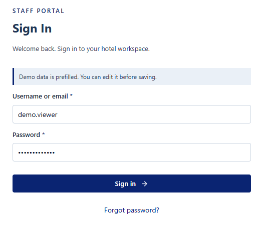

**Screen / Function Description**

This screen allows All provisioned internal users to:

- Enter a username or email and password to access HotelOps.

- Validate required credentials without disclosing whether an account exists.

- Apply account status, lockout and temporary-password rules before creating a session.

- Open the role-specific home page after successful authentication.

On this screen, the user can also:

- Open the Forgot Password instruction without exposing account existence.

- Display generic credential errors and temporary-lock information when authentication fails.

**Mapped Use Cases:** UC-001 Login

| **Field Name**                        | **Description**                                                                                                                                                                                                                                                                                                                                                                                           |
|---------------------------------------|-----------------------------------------------------------------------------------------------------------------------------------------------------------------------------------------------------------------------------------------------------------------------------------------------------------------------------------------------------------------------------------------------------------|
| Username / Email                      | Data type: string/text input. Required. Initial value: blank. Accepts either the provisioned username or email address. Leading/trailing spaces should be trimmed before validation. The field must not be blank. Unknown account, inactive account and wrong password must return the same generic authentication error so account existence is not disclosed. Maximum length: not specified in the SRS. |
| Password                              | Data type: password/string input. Required. Initial value: blank. Characters are masked in the UI. The value is verified against the stored credential and must never be written to the audit log. Maximum length: not specified in the SRS.                                                                                                                                                              |
| ***Actions and Validation Messages*** |                                                                                                                                                                                                                                                                                                                                                                                                           |
| Login                                 | Primary action button. Submits the credentials. The system checks required fields, credential validity, Active status and temporary lock state. After 5 consecutive failed attempts, the account is locked for 30 minutes. A successful login resets the failed-attempt counter and creates a session.                                                                                                    |
| Forgot Password                       | Link/action. Displays the same instruction for every input: the user must contact the Administrator for a password reset. The function must not reveal whether the username/email exists.                                                                                                                                                                                                                 |
| Authentication Message                | Read-only inline message. Invalid username/email, wrong password and Inactive account use the same generic error. A temporarily locked account displays the unlock time. An expired temporary password instructs the user to contact the Administrator.                                                                                                                                                   |

### 1.2 User Management

#### 1.2.1 User List 

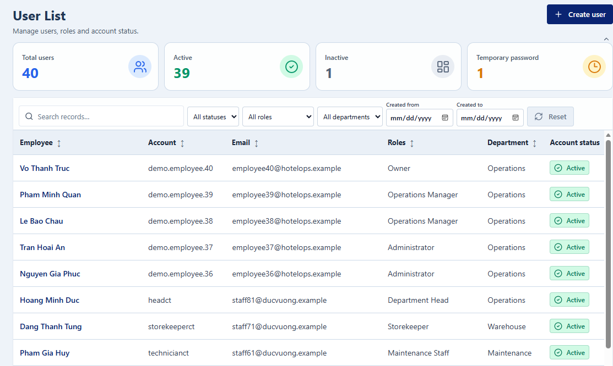

**UI LayoutScreen / Function Description**

This screen allows Administrator to:

- View user accounts within the Administrator's authorized scope.

- Search and filter accounts by organizational and access attributes.

- Sort and paginate the account list for efficient administration.

- Open an account to review or update its profile and effective access.

On this screen, the user can also:

- Create a new internal account.

- Activate or deactivate an eligible account while preserving historical records.

**Mapped Use Cases:** UC-141 View User List; UC-004 Create User Account; UC-005 Update User Account; UC-006 Activate/Deactivate User Account; UC-011 Review User Access Permissions

**Field Description**

| **Field Name**           | **Description**                                                                                                                                                                                                                                                              |
|--------------------------|------------------------------------------------------------------------------------------------------------------------------------------------------------------------------------------------------------------------------------------------------------------------------|
| ***Search and Filters*** |                                                                                                                                                                                                                                                                              |
| Search                   | Data type: string/text input. Optional. Initial value: blank. Searches identifying account information such as full name, username or email. Blank input means no keyword filter. Maximum length: not specified in the SRS.                                                  |
| Branch                   | Data type: reference/dropdown. Optional. Initial value: All Branches when the Administrator has access to multiple branches. Values are limited to branches in the Administrator's scope.                                                                                    |
| Department               | Data type: reference/dropdown. Optional. Initial value: All Departments. When Branch is selected, available departments must belong to that branch.                                                                                                                          |
| Role                     | Data type: reference/dropdown or multi-select filter. Optional. Initial value: All Roles. Values come from the system role catalog.                                                                                                                                          |
| Account Status           | Data type: enum/dropdown. Optional. Initial value: All Statuses. Allowed values: Active, Inactive; a temporarily locked Active account may be visually indicated as Temporarily Locked.                                                                                      |
| ***User List***          |                                                                                                                                                                                                                                                                              |
| User Table               | Read-only table. Recommended columns: Full Name, Username, Email, Branch/Department, Role(s), Account Status. Only records in the Administrator's authorized scope are returned. Lists are paginated with a default page size of 20 rows and a maximum of 100 rows per page. |
| Sort                     | Column-header action where supported. Sorts the list while using the record identifier as the tie-breaker for deterministic ordering.                                                                                                                                        |
| Pagination               | List navigation. Default page size: 20 rows; maximum: 100 rows per page.                                                                                                                                                                                                     |
| ***Actions***            |                                                                                                                                                                                                                                                                              |
| Create Account           | Action button/link. Opens User Detail in create mode.                                                                                                                                                                                                                        |
| View / Edit              | Row action. Opens the selected User Detail.                                                                                                                                                                                                                                  |
| Activate / Deactivate    | Row or detail action. Deactivation is blocked when the target is the current Administrator account, the last active Administrator, or still has open assigned work. Deactivation requires confirmation and a reason of at least 10 characters.                               |

#### 1.2.2 User Detail (Screen 9)

**UI Layout**

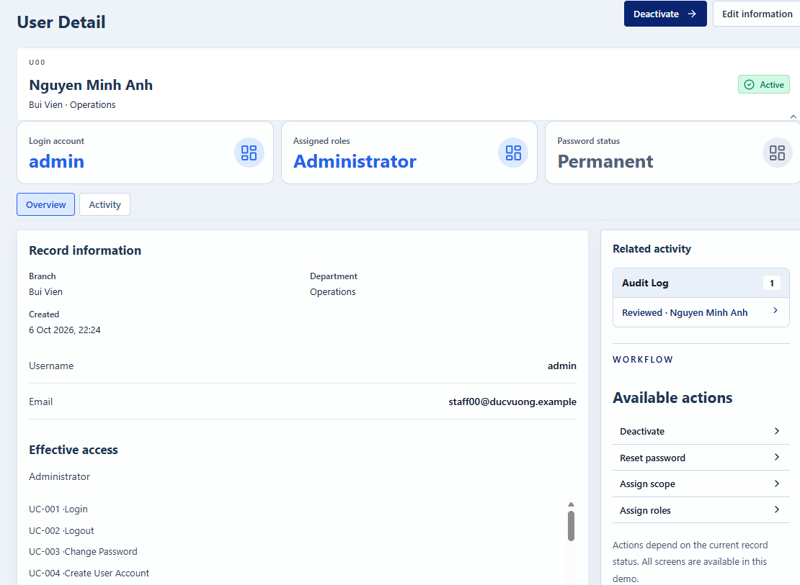

**Screen / Function Description**

This screen allows Administrator to:

1.  Create an internal staff account and maintain its personal information.

2.  Assign branch/department scope and one or more roles.

3.  Review effective permissions calculated from roles and operational scope.

4.  Reset a forgotten password by issuing a temporary password.

On this screen, the user can also:

5.  Activate or deactivate an account when business constraints are satisfied.

6.  Preserve historical references to deactivated users.

**Mapped Use Cases:** UC-004 Create User Account; UC-005 Update User Account; UC-006 Activate/Deactivate User Account; UC-007 Assign User to Branch/Department; UC-010 Assign/Revoke User Roles; UC-011 Review User Access Permissions

**Field Description**

| **Field Name**                      | **Description**                                                                                                                                                                                                              |
|-------------------------------------|------------------------------------------------------------------------------------------------------------------------------------------------------------------------------------------------------------------------------|
| ***Account Information***           |                                                                                                                                                                                                                              |
| Full Name                           | Data type: string/text input. Required when creating an account. Initial value: blank in create mode; current value in edit mode. Must not be blank. Maximum length: not specified in the SRS.                               |
| Username                            | Data type: string/text input. Required when creating an account. Must be unique across the whole system. Initial value: blank in create mode. Maximum length and post-creation editability are not specified in the SRS.     |
| Email                               | Data type: email/string input. Required by the account-creation flow. Must use a valid email format and be unique across the whole system. Initial value: blank in create mode.                                              |
| Phone                               | Data type: string/tel input. Optional. Store as text so leading zeroes and formatting characters are preserved. Maximum length: not specified in the SRS.                                                                    |
| Account Status                      | Data type: enum/read-only with controlled status actions. Allowed values: Active, Inactive. A lock is represented by locked_until on an Active account rather than by manually editing this field.                           |
| ***Operational Scope and Access***  |                                                                                                                                                                                                                              |
| Branch                              | Data type: reference/multi-select. Required according to operational scope. A user is assigned to one or more branches; only active branches can be selected.                                                                |
| Department                          | Data type: reference/multi-select. Required according to operational scope. Each selected department must belong to a selected branch and be active.                                                                         |
| Role(s)                             | Data type: reference/multi-select. One or more active roles may be assigned. Revoking a role must not remove the last active Administrator permission set from the system.                                                   |
| Effective Permissions               | Read-only list/table. Calculated from assigned roles plus branch/department scope. Granting a role does not bypass scope or segregation-of-duties rules.                                                                     |
| ***Credential and Status Actions*** |                                                                                                                                                                                                                              |
| Reset Password                      | Action. Generates a random temporary password valid for 24 hours, marks the account for mandatory password change and revokes existing sessions. The temporary password is displayed once and is never stored in audit logs. |
| Activate / Deactivate               | Action. Deactivation requires confirmation and a reason of at least 10 characters. It is rejected for the current Administrator, the last active Administrator, or an account with unresolved assigned work.                 |
| Save                                | Primary action. Validates required fields, username/email uniqueness, Branch-Department consistency, active master data and concurrent changes before saving.                                                                |

## 2. Hotel Structure (FE-02)

### 2.1 Room Management

#### 2.1.1 Room List 

**UI Layout**

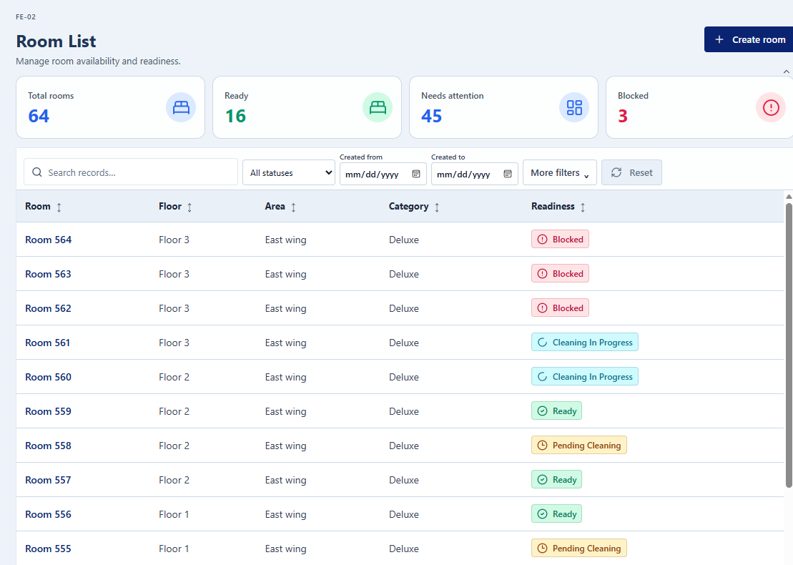

**Screen / Function Description**

This screen allows Administrator and other authorized operational users to:

7.  Search and view rooms within the user's authorized branch scope.

8.  Filter rooms by branch, floor, area, room type, operational status and active flag.

9.  Open a room to view its current operational status and status reason.

10. Sort and paginate the room directory.

On this screen, the user can also:

11. Create a new room if the user has room-management permission.

12. Open Room Detail to update or deactivate an eligible room.

**Mapped Use Cases:** UC-020 Create Room; UC-021 Update Room Information; UC-022 Deactivate Room; UC-023 View Room Directory

**Field Description**

| **Field Name**           | **Description**                                                                                                                                                                                                     |
|--------------------------|---------------------------------------------------------------------------------------------------------------------------------------------------------------------------------------------------------------------|
| ***Search and Filters*** |                                                                                                                                                                                                                     |
| Search                   | Data type: string/text input. Optional. Initial value: blank. Searches room-related identifiers such as room number. Blank input means no keyword filter.                                                           |
| Branch                   | Data type: reference/dropdown. Optional where the user has multiple branches. Initial value: All Branches or the user's single branch.                                                                              |
| Floor                    | Data type: reference/dropdown. Optional. Values are limited to floors in the selected branch.                                                                                                                       |
| Area                     | Data type: reference/dropdown. Optional. Values are limited to the selected branch/floor hierarchy.                                                                                                                 |
| Room Type                | Data type: reference/dropdown. Optional. Values are limited to room types in the selected branch.                                                                                                                   |
| Operational Status       | Data type: enum/dropdown. Optional. Allowed values: Ready, Pending Cleaning, Cleaning In Progress, Pending Inspection, Rework Required, Blocked, Inactive. Initial value: All Statuses.                             |
| Active Flag              | Data type: enum/dropdown. Optional. Allowed values: All, Active, Inactive. Initial value: All.                                                                                                                      |
| ***Room Directory***     |                                                                                                                                                                                                                     |
| Room Table               | Read-only table. Recommended columns: Room Number, Floor/Area, Room Type, Operational Status, Active Status. Default ordering is by Floor then Room Number. Only rooms in the user's authorized scope are returned. |
| Pagination               | Default page size: 20 rows; maximum: 100 rows per page.                                                                                                                                                             |
| ***Actions***            |                                                                                                                                                                                                                     |
| Create Room              | Action. Opens Room Detail in create mode.                                                                                                                                                                           |
| View Detail              | Row action. Opens the room profile, current status reason and history.                                                                                                                                              |

#### 2.1.2 Room Detail 

**UI Layout**

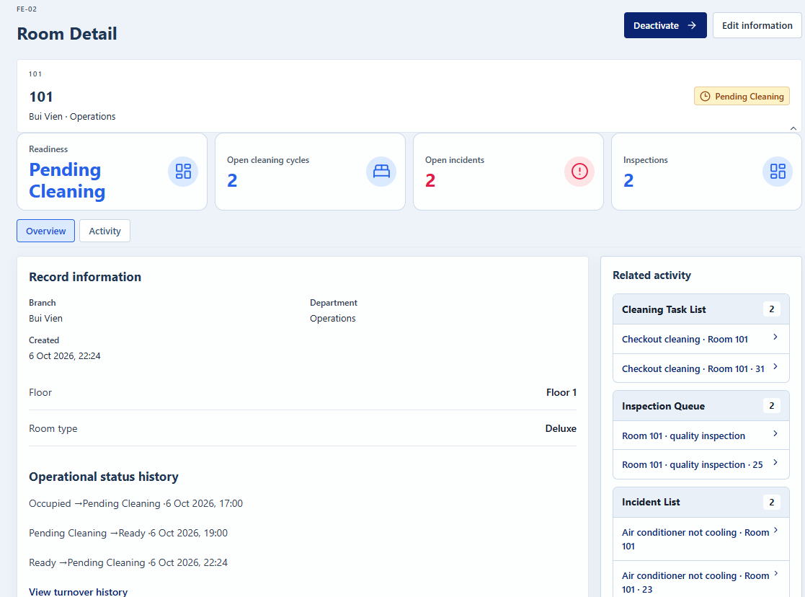

**Screen / Function Description**

This screen allows Administrator for maintenance actions; authorized operational users for viewing to:

13. Display the room profile, organizational location and current operational state.

14. Create or update room master information when the user has permission.

15. Show the source reason for the current room status and the room status history.

16. Deactivate or reactivate a room only when the required business conditions are satisfied.

On this screen, the user can also:

17. Prevent manual editing of the derived operational status.

18. Preserve historical room references after deactivation.

**Mapped Use Cases:** UC-020 Create Room; UC-021 Update Room Information; UC-022 Deactivate Room; UC-023 View Room Directory

**Field Description**

| **Field Name**           | **Description**                                                                                                                                                                                                                                |
|--------------------------|------------------------------------------------------------------------------------------------------------------------------------------------------------------------------------------------------------------------------------------------|
| ***Room Information***   |                                                                                                                                                                                                                                                |
| Branch                   | Data type: reference/dropdown. Required in create mode. Must be active.                                                                                                                                                                        |
| Room Number              | Data type: string/text input. Required. Must be unique within the selected Branch. Maximum length: not specified in the SRS.                                                                                                                   |
| Floor                    | Data type: reference/dropdown. Required according to the hotel structure. Must be active and belong to the same Branch.                                                                                                                        |
| Area                     | Data type: reference/dropdown. Optional. If selected, it must belong to the same Branch/location hierarchy.                                                                                                                                    |
| Room Type                | Data type: reference/dropdown. Required. Must be active and belong to the same Branch.                                                                                                                                                         |
| Active Status            | Data type: enum/read-only with Activate/Deactivate action. Allowed values: Active, Inactive.                                                                                                                                                   |
| ***Operational Status*** |                                                                                                                                                                                                                                                |
| Operational Status       | Read-only derived enum. Allowed display values: Ready, Pending Cleaning, Cleaning In Progress, Pending Inspection, Rework Required, Blocked, Inactive. Users must never type or directly overwrite this value.                                 |
| Status Reason            | Read-only text/linked references. Shows the current cleaning task, inspection, rework task or effective incident block responsible for the current status.                                                                                     |
| Status History           | Read-only table. Recommended columns: Old Status, New Status, Source Event, Actor and Time. Each status change is generated from an operational event and retained in history.                                                                 |
| ***Actions***            |                                                                                                                                                                                                                                                |
| Deactivate / Activate    | Controlled action. A room can be deactivated only when it has no open cleaning task, rework, inspection, incident or effective block, and its assets have been moved first. A reactivated room must satisfy active floor/room-type conditions. |
| Reason                   | Data type: multiline string. Required for deactivation/manual override actions. Minimum length: 10 characters.                                                                                                                                 |
| Save                     | Primary action. Validates required fields, uniqueness of Room Number within Branch, active location/room-type data and concurrent changes.                                                                                                     |

### 2.2 Room Type Management

#### 2.2.1 Room Type List

**UI Layout**

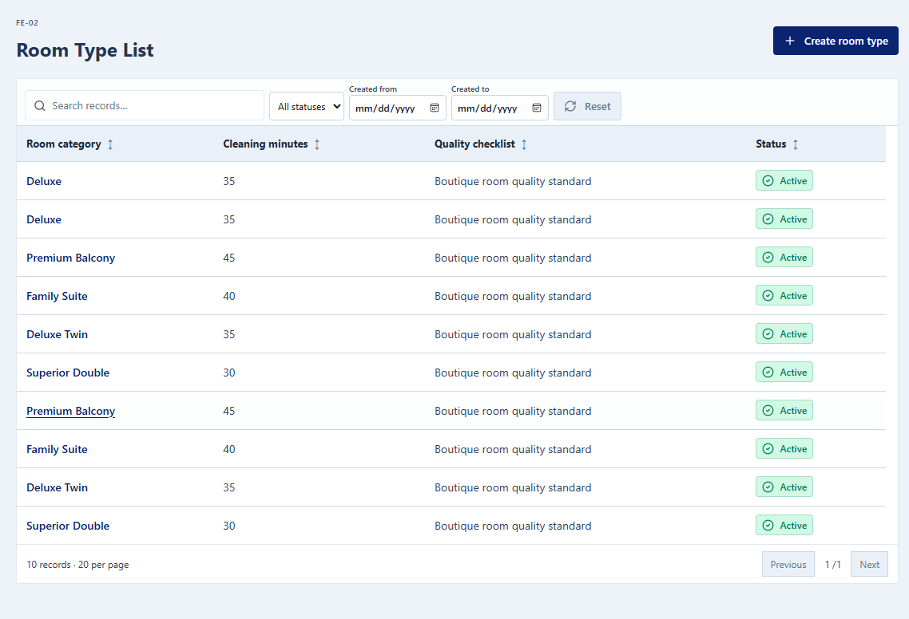

**Screen / Function Description**

This screen allows Administrator to:

- View room types of the branches within the Administrator's scope.

- Search room types by code or name and filter them by branch and status.

- Sort and paginate the room type list.

- Open a room type to review or update it.

On this screen, the user can also:

- Create a new room type.

- Deactivate a room type that is no longer used by any active room.

**Mapped Use Cases:** UC-142 View Room Types List; UC-017 Create Room Type; UC-018 Update Room Type; UC-019 Deactivate Room Type

**Field Description**

| **Field Name**           | **Description**                                                                                                                                                                           |
|--------------------------|-------------------------------------------------------------------------------------------------------------------------------------------------------------------------------------------|
| ***Search and Filters*** |                                                                                                                                                                                           |
| Search                   | Data type: string/text input. Optional. Initial value: blank. Searches room type code and name. Blank input means no keyword filter.                                                      |
| Branch                   | Data type: reference/dropdown. Optional where the Administrator has access to multiple branches. Values are limited to branches in the Administrator's scope.                             |
| Status                   | Data type: enum/dropdown. Optional. Allowed values: Active, Inactive. Initial value: All Statuses.                                                                                        |
| ***Room Type List***     |                                                                                                                                                                                           |
| Room Type Table          | Read-only table. Recommended columns: Code, Name, Branch, Number of Active Rooms, Status. Default ordering is by Code. Only records in the Administrator's authorized scope are returned. |
| Pagination               | Default page size: 20 rows; maximum: 100 rows per page.                                                                                                                                   |
| ***Actions***            |                                                                                                                                                                                           |
| Create Room Type         | Action button/link. Opens Room Type Detail in create mode.                                                                                                                                |
| View / Edit              | Row action. Opens the selected Room Type Detail.                                                                                                                                          |
| Deactivate               | Row or detail action. Allowed only when no active room uses the room type. Requires confirmation and a reason of at least 10 characters.                                                  |

## 3. Room Operations (FE-03)

### 3.1 Room Readiness

#### 3.1.1 Room Readiness Board 

**UI Layout**

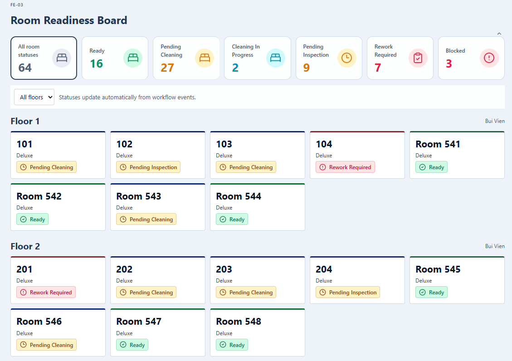

**Screen / Function Description**

This screen allows Housekeeping Supervisor; Operations Manager to:

19. Monitor every room in scope grouped by floor and current operational status.

20. Filter the board by floor, area, room type or status.

21. View the count of rooms in each operational status.

22. Open a room panel to understand why the room is not Ready.

On this screen, the user can also:

23. Start the appropriate next action such as creating a cleaning task, assigning an inspection or reporting an incident.

24. View room status history without manually changing the derived status.

**Mapped Use Cases:** UC-027 Manage Operational Room Status

**Field Description**

| **Field Name**          | **Description**                                                                                                                                                                                             |
|-------------------------|-------------------------------------------------------------------------------------------------------------------------------------------------------------------------------------------------------------|
| ***Filters***           |                                                                                                                                                                                                             |
| Floor                   | Data type: reference/dropdown. Optional. Initial value: All Floors.                                                                                                                                         |
| Area                    | Data type: reference/dropdown. Optional. Initial value: All Areas.                                                                                                                                          |
| Room Type               | Data type: reference/dropdown. Optional. Initial value: All Room Types.                                                                                                                                     |
| Room Status             | Data type: enum/dropdown. Optional. Allowed values: Ready, Pending Cleaning, Cleaning In Progress, Pending Inspection, Rework Required, Blocked, Inactive. Initial value: All Statuses.                     |
| ***Board Content***     |                                                                                                                                                                                                             |
| Status Counters         | Read-only integer values. Shows the number of rooms per status for the current filter set.                                                                                                                  |
| Room Card / Room Number | Read-only clickable component identifying each room. Selecting a room opens the status reason and available next actions.                                                                                   |
| Operational Status      | Read-only derived enum. The system recalculates it from cleaning, inspection, rework, block and activation events; users cannot type it.                                                                    |
| Status Reason           | Read-only linked information describing the active cleaning task, inspection, rework task or effective blocking incident.                                                                                   |
| Status History          | Read-only history view with old/new status, source event, actor and time.                                                                                                                                   |
| ***Actions***           |                                                                                                                                                                                                             |
| Next Action             | Context-sensitive action. May open Create Cleaning Task, Assign Inspection, Report Incident or a linked operational record. The target function re-checks the user's permission before allowing the action. |

## 4. Housekeeping Management (FE-04)

### 4.1 Cleaning Task Management

#### 4.1.1 Cleaning Task List 

**UI Layout**

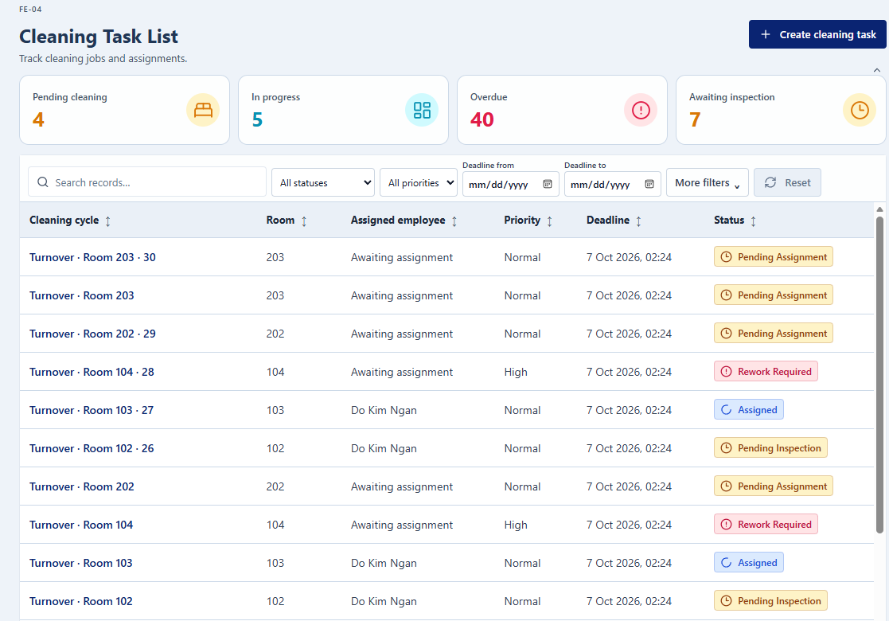

**Screen / Function Description**

This screen allows Housekeeping Supervisor; Housekeeping Staff (own tasks) to:

25. Monitor cleaning and rework tasks by operational state and due time.

26. Search and filter tasks by date, floor, status, assignee, priority and overdue status.

27. View room, assignee, due time and overdue information for each task.

28. Open the selected task to view blockers, timeline and task details.

On this screen, the user can also:

29. Create a new cleaning task.

30. Assign or reassign eligible tasks and cancel tasks that have not started.

**Mapped Use Cases:** UC-028 Create Cleaning Task; UC-029 Assign Cleaning Task; UC-030 Reassign Cleaning Task; UC-037 Monitor Cleaning Tasks

**Field Description**

| **Field Name**           | **Description**                                                                                                                                                                                                                    |
|--------------------------|------------------------------------------------------------------------------------------------------------------------------------------------------------------------------------------------------------------------------------|
| ***Search and Filters*** |                                                                                                                                                                                                                                    |
| Date                     | Data type: date picker. Optional. Initial value: current date for the monitoring view unless the implementation chooses another default.                                                                                           |
| Floor                    | Data type: reference/dropdown. Optional. Initial value: All Floors.                                                                                                                                                                |
| Status                   | Data type: enum/dropdown. Optional. Allowed values include Pending Assignment, Assigned, In Progress, On Hold, Pending Inspection, Rework Required, Completed, Cancelled. Initial value: All Statuses.                             |
| Assignee                 | Data type: user-reference/dropdown. Optional. Values are limited to eligible Housekeeping Staff in scope. Initial value: All Assignees.                                                                                            |
| Priority                 | Data type: enum/dropdown. Optional. Allowed values: Low, Normal, High, Critical. Initial value: All Priorities.                                                                                                                    |
| Overdue Only             | Data type: boolean/toggle. Optional. Initial value: Off. A task is overdue when it is not Completed/Cancelled and current server time is after Due Time.                                                                           |
| Search                   | Data type: string/text input. Optional. Initial value: blank.                                                                                                                                                                      |
| ***Task List***          |                                                                                                                                                                                                                                    |
| Cleaning Task Table      | Read-only table. Recommended columns: Task No., Room, Status, Assignee, Priority, Due Time, Overdue Flag. Default sorting is by Due Time. Housekeeping Staff see only their own relevant work; Supervisor sees tasks within scope. |
| Pagination               | Default page size: 20 rows; maximum: 100 rows per page.                                                                                                                                                                            |
| ***Actions***            |                                                                                                                                                                                                                                    |
| Create Cleaning Task     | Action. Opens create flow with Room, Cleaning Type, Priority, Due Time, Instructions and checklist information.                                                                                                                    |
| Assign / Reassign        | Action. Eligible assignees must be Active Housekeeping Staff in the room's branch/Housekeeping department. Reassignment is allowed only in valid task states.                                                                      |
| Cancel                   | Supervisor-only action. Allowed only before work starts (Pending Assignment or Assigned). Requires confirmation and a reason of at least 10 characters.                                                                            |

#### 4.1.2 Cleaning Task Detail 

**UI Layout**

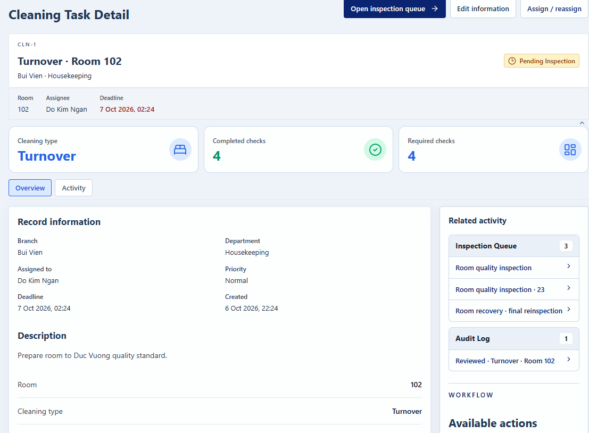

**Screen / Function Description**

This screen allows Housekeeping Supervisor; assigned Housekeeping Staff to:

31. Display the cleaning task, room, checklist, assignee, priority and due time.

32. Allow the assigned Housekeeping Staff to start/resume work and update progress.

33. Record notes, blockers and evidence during execution.

34. Submit the completed cleaning task for room inspection.

On this screen, the user can also:

35. Allow a Supervisor to assign/reassign eligible staff.

36. Prevent completion when mandatory items are incomplete or an open blocker exists.

**Mapped Use Cases:** UC-029 Assign Cleaning Task; UC-030 Reassign Cleaning Task; UC-031 Start Cleaning Task; UC-032 Update Cleaning Progress; UC-033 Report Cleaning Blocker; UC-034 Complete Cleaning Task

**Field Description**

| **Field Name**           | **Description**                                                                                                                                                                                                                              |
|--------------------------|----------------------------------------------------------------------------------------------------------------------------------------------------------------------------------------------------------------------------------------------|
| ***Task Information***   |                                                                                                                                                                                                                                              |
| Task No.                 | Data type: system identifier. Read-only. Generated by the system.                                                                                                                                                                            |
| Room                     | Data type: room reference. Required when creating. A room may have only one open cleaning task at a time.                                                                                                                                    |
| Cleaning Type            | Data type: enum/reference dropdown. Required. Example values defined by the SRS: Checkout, Stay-over, Deep Cleaning. Initial value: blank in create mode.                                                                                    |
| Priority                 | Data type: enum/dropdown. Required. Allowed values: Low, Normal, High, Critical.                                                                                                                                                             |
| Due Time                 | Data type: datetime. Required. Displayed in the system timezone. Time validation uses server time.                                                                                                                                           |
| Instructions             | Data type: multiline string. Optional. Maximum length: not specified in the SRS.                                                                                                                                                             |
| Assignee                 | Data type: user reference. Required before execution. Must be an Active Housekeeping Staff user in the correct branch and Housekeeping department.                                                                                           |
| Status                   | Data type: enum/read-only. Workflow-controlled; users change status only through valid actions.                                                                                                                                              |
| ***Execution***          |                                                                                                                                                                                                                                              |
| Cleaning Checklist Items | Data type: checklist/boolean items. Mandatory items must be completed before the task can be submitted as complete.                                                                                                                          |
| Progress                 | Data type: integer/percentage. Allowed range: 0 to 100. Reaching 100 does not automatically complete the task.                                                                                                                               |
| Notes                    | Data type: multiline string. Optional.                                                                                                                                                                                                       |
| Blocker Reason           | Data type: reference/text. Required when reporting a blocker. Reporting a blocker puts the task On Hold, closes the open work interval and notifies the Supervisor. The same open blocker reason cannot be reported twice for the same task. |
| Evidence                 | Data type: file upload. Optional. Allowed formats: JPG, PNG, PDF. Maximum 10 MB per file and 5 files per upload. File upload must complete before saving.                                                                                    |
| ***Actions***            |                                                                                                                                                                                                                                              |
| Start / Resume           | Action available only to the current assignee from Assigned or On Hold. The user must have a Working workday and no other open work interval.                                                                                                |
| Update Progress          | Action. Saves Progress, Notes and Evidence. Progress must remain within 0-100.                                                                                                                                                               |
| Complete                 | Action available only from In Progress when all mandatory checklist items are completed and no blocker is open. Completion changes the task to Pending Inspection; it does not directly make the room Ready.                                 |

## 5. Room Inspection (FE-05)

### 5.1 Inspection Management

#### 5.1.1 Inspection Queue

**UI Layout**

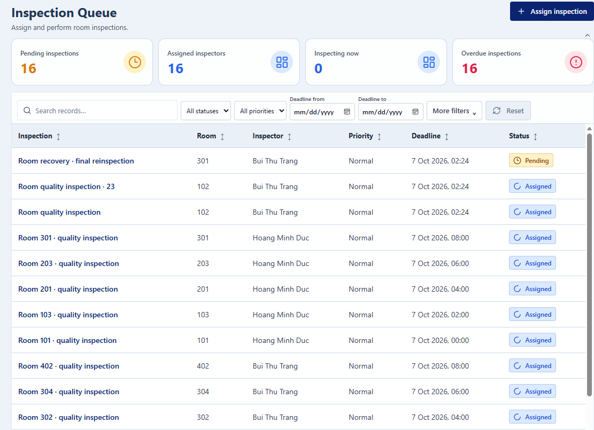

**Screen / Function Description**

This screen allows Housekeeping Supervisor to:

37. View rooms waiting for inspection or reinspection.

38. Review the cleaning/rework cycle and applicable checklist version.

39. Assign an eligible inspector and due time.

40. Open the selected inspection/reinspection work item.

On this screen, the user can also:

41. Prevent self-inspection by the person who performed the cleaning/rework.

42. Prevent more than one open inspection for the same cleaning cycle.

**Mapped Use Cases:** UC-041 Assign Room Inspection; UC-047 Reinspect Room

**Field Description**

| **Field Name**          | **Description**                                                                                                                                                                         |
|-------------------------|-----------------------------------------------------------------------------------------------------------------------------------------------------------------------------------------|
| ***Queue Filters***     |                                                                                                                                                                                         |
| Search / Room           | Data type: string/reference search. Optional. Initial value: blank.                                                                                                                     |
| Floor / Area            | Data type: reference filters. Optional. Values are restricted to the user's branch scope.                                                                                               |
| Queue Status            | Data type: enum/dropdown. Optional. Used to distinguish pending inspection, pending reinspection or failed-inspection items requiring action.                                           |
| ***Inspection Queue***  |                                                                                                                                                                                         |
| Room                    | Read-only room reference.                                                                                                                                                               |
| Cleaning / Rework Cycle | Read-only linked record. The inspection must be attached to the cleaning cycle that is Pending Inspection, or rework that is Pending Reinspection.                                      |
| Checklist Version       | Read-only/reference. Only a Published checklist version may be used. The selected version is preserved for historical inspection records.                                               |
| Inspector               | Data type: user-reference/dropdown. Required when assigning. Must be an Active Housekeeping Supervisor and must not be the person who performed the cleaning or rework being inspected. |
| Due Time                | Data type: datetime. Required when assigning. Uses server-time validation.                                                                                                              |
| ***Actions***           |                                                                                                                                                                                         |
| Assign Inspection       | Action. Creates one open Assigned inspection for the current cleaning cycle after eligibility and segregation-of-duties checks.                                                         |
| Open Inspection         | Row action. Opens Room Inspection for the assigned inspector.                                                                                                                           |

#### 5.1.2 Room Inspection

**UI Layout**

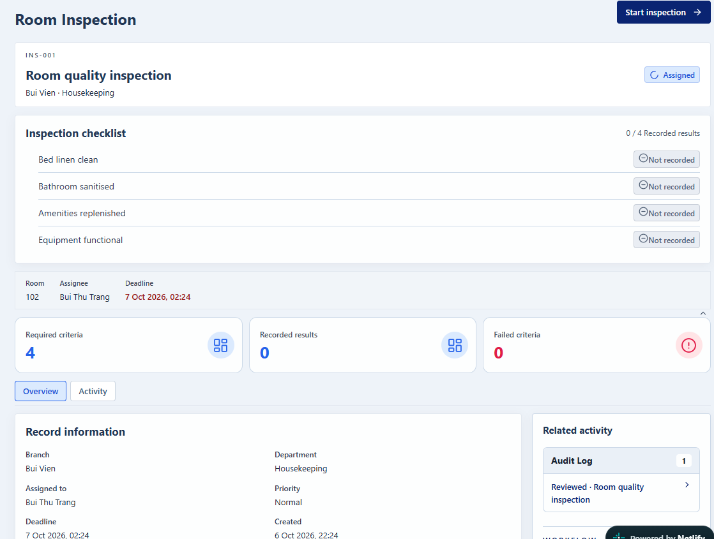

**Screen / Function Description**

This screen allows Assigned Housekeeping Supervisor / Inspector to:

43. Inspect the room against the checklist version attached to the cleaning cycle.

44. Record Pass or Fail for each checklist criterion.

45. Record defects, notes and evidence for failed criteria.

46. Conclude the inspection by approving or rejecting the room.

On this screen, the user can also:

47. Create a rework requirement when the inspection fails.

48. Keep completed inspection evidence immutable after conclusion.

**Mapped Use Cases:** UC-042 Perform Room Inspection; UC-043 Record Inspection Defects; UC-044 Approve Room Inspection; UC-045 Reject Room Inspection; UC-046 Request Cleaning Rework

**Field Description**

| **Field Name**               | **Description**                                                                                                                                                   |
|------------------------------|-------------------------------------------------------------------------------------------------------------------------------------------------------------------|
| ***Inspection Information*** |                                                                                                                                                                   |
| Inspection No.               | Data type: system identifier. Read-only.                                                                                                                          |
| Room                         | Read-only room reference.                                                                                                                                         |
| Inspector                    | Read-only current assignee. Only the assigned inspector can record results.                                                                                       |
| Checklist Version            | Read-only. The exact Published checklist version used by this inspection is preserved.                                                                            |
| Inspection Status            | Read-only enum such as Assigned, Inspecting, Pending Conclusion, Passed or Failed.                                                                                |
| ***Checklist Results***      |                                                                                                                                                                   |
| Criterion                    | Read-only checklist item text.                                                                                                                                    |
| Mandatory                    | Data type: boolean/read-only indicator showing whether the criterion must be completed.                                                                           |
| Result                       | Data type: enum/radio or dropdown. Allowed values: Pass, Fail. Required for every mandatory criterion before conclusion.                                          |
| Criterion Note               | Data type: multiline string. Optional unless needed to explain the result.                                                                                        |
| Defect Description           | Data type: multiline string. Required when Result = Fail. Each failed criterion must have at least one defect description before the inspection can be concluded. |
| Evidence                     | Data type: file upload. Optional. JPG, PNG or PDF; maximum 10 MB per file and 5 files per upload.                                                                 |
| Inspection Summary           | Read-only summary of passed/failed criteria and defects.                                                                                                          |
| ***Actions***                |                                                                                                                                                                   |
| Start                        | Changes an Assigned inspection to Inspecting for the assigned inspector.                                                                                          |
| Finish Inspection            | Action. Allowed only after required criteria are evaluated and each Fail has defect information; changes the inspection to Pending Conclusion.                    |
| Approve                      | Allowed only when all mandatory criteria are Pass. Passing completes the cleaning cycle and makes the room Ready unless an effective incident block still exists. |
| Reject                       | Records a failed inspection and moves the room/cleaning cycle to Rework Required. Rejection reason/defect information must support the decision.                  |

## 6. Incident & Maintenance (FE-06)

### 6.1 Incident Management

#### 6.1.1 Incident List 

**UI Layout**

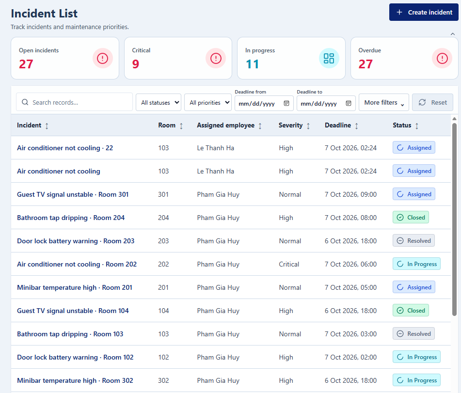

**Screen / Function Description**

This screen allows Maintenance Lead; Maintenance Staff; Operations Manager and other authorized users to:

49. View and search incidents within the user's operational scope.

50. Filter incidents by status, severity, category, location and deadline conditions.

51. Identify overdue/critical incidents that require action.

52. Open an incident for classification, triage, assignment, repair or closure.

On this screen, the user can also:

53. Create a new incident report.

54. Navigate to related maintenance work.

**Mapped Use Cases:** UC-143 View Incidents List; UC-049 Report Incident; UC-050 Classify Incident; UC-052 Triage Incident; UC-057 Escalate Critical Incident

**Field Description**

| **Field Name**           | **Description**                                                                                                                                                           |
|--------------------------|---------------------------------------------------------------------------------------------------------------------------------------------------------------------------|
| ***Search and Filters*** |                                                                                                                                                                           |
| Search                   | Data type: string/text input. Optional. Initial value: blank.                                                                                                             |
| Status                   | Data type: enum/dropdown. Optional. Values follow the incident lifecycle. Initial value: All Statuses.                                                                    |
| Severity                 | Data type: enum/dropdown. Optional. Allowed values: Low, Normal, High, Critical. Initial value: All Severities.                                                           |
| Category                 | Data type: reference/dropdown. Optional. Values come from active incident categories.                                                                                     |
| Branch                   | Data type: reference/dropdown. Optional where user has access to multiple branches.                                                                                       |
| Location                 | Data type: room/area/asset filter. Optional.                                                                                                                              |
| Assignee                 | Data type: user-reference filter. Optional.                                                                                                                               |
| Overdue / Deadline       | Data type: toggle/date filter. Optional. An incident is overdue when not Closed/Cancelled and current time is after the resolution deadline.                              |
| ***Incident List***      |                                                                                                                                                                           |
| Incident Table           | Read-only table. Recommended columns: Incident No., Location/Asset, Category, Severity, Priority, Status, Assignee, Response Deadline, Resolution Deadline, Overdue Flag. |
| Pagination               | Default page size: 20 rows; maximum: 100 rows per page.                                                                                                                   |
| ***Actions***            |                                                                                                                                                                           |
| Report Incident          | Action. Opens incident creation.                                                                                                                                          |
| View Detail              | Row action. Opens Incident Detail.                                                                                                                                        |

#### 6.1.2 Incident Detail 

**UI Layout**

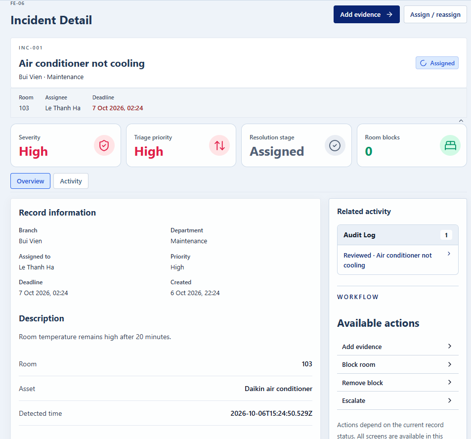

**Screen / Function Description**

This screen allows Maintenance Lead; Maintenance Staff; Operations Manager; authorized reporter/viewers to:

55. Display the incident location, description, evidence, classification, severity and deadlines.

56. Support triage, maintenance assignment and room blocking where permitted.

57. Track progress, repair result, materials used and evidence.

58. Verify/close or reopen the incident through controlled workflow actions.

On this screen, the user can also:

59. Escalate critical, at-risk or overdue incidents to management.

60. Recalculate any affected room status when blocks are added or removed.

**Mapped Use Cases:** UC-049 Report Incident; UC-050 Classify Incident; UC-051 Attach Incident Evidence; UC-052 Triage Incident; UC-053 Assign Maintenance Work; UC-056 Block Room Due to Incident; UC-057 Escalate Critical Incident; UC-058 Resolve Maintenance Incident; UC-059 Verify and Close Incident; UC-060 Reopen Incident

**Field Description**

| **Field Name**                  | **Description**                                                                                                                                                                                 |
|---------------------------------|-------------------------------------------------------------------------------------------------------------------------------------------------------------------------------------------------|
| ***Incident Identification***   |                                                                                                                                                                                                 |
| Incident No.                    | Data type: system identifier. Read-only and unique.                                                                                                                                             |
| Branch                          | Data type: reference/dropdown. Required when reporting an incident.                                                                                                                             |
| Room / Area / Asset             | Data type: reference selectors. At least one of Room, Area or Asset is required. An Asset must belong to the selected Branch.                                                                   |
| Description                     | Data type: multiline string. Required when reporting. Maximum length: not specified in the SRS.                                                                                                 |
| Detected Time                   | Data type: datetime. Required by the incident flow; generated/stored using server-time rules.                                                                                                   |
| Evidence                        | Data type: file upload. Optional. JPG/PNG/PDF; maximum 10 MB per file and 5 files per upload.                                                                                                   |
| ***Classification and Triage*** |                                                                                                                                                                                                 |
| Category                        | Data type: reference/dropdown. Required before triage.                                                                                                                                          |
| Severity                        | Data type: enum/dropdown. Required before triage. Allowed values: Low, Normal, High, Critical. Critical severity immediately alerts Maintenance Lead and Operations Manager.                    |
| Priority                        | Data type: enum/reference. Set during triage. Allowed operational values: Low, Normal, High, Critical.                                                                                          |
| Response Deadline               | Data type: datetime. Normally calculated from detected time and priority SLA. Changing the calculated deadline requires a reason.                                                               |
| Resolution Deadline             | Data type: datetime. Normally calculated from detected time and priority SLA. Must comply with server-time validation.                                                                          |
| Assigned Technician             | Data type: user reference. Must be Active Maintenance Staff or eligible Maintenance Lead in the incident branch. A Maintenance Lead can be assignee only when another eligible lead can verify. |
| Room Block                      | Data type: boolean/action state. One incident-room pair can have at most one effective block. Removing a block early requires a reason.                                                         |
| ***Repair and Verification***   |                                                                                                                                                                                                 |
| Progress                        | Data type: integer/percentage. Allowed range: 0-100. Reaching 100 does not automatically close the incident.                                                                                    |
| Diagnosis / Root Cause          | Data type: multiline string. Required when submitting the resolution result.                                                                                                                    |
| Action Taken                    | Data type: multiline string. Required when submitting the resolution result.                                                                                                                    |
| Materials Used                  | Data type: item/quantity lines. Quantities can only come from materials issued to the incident and cannot exceed the issued quantity not yet returned.                                          |
| Status                          | Read-only workflow enum. Changes only through valid actions.                                                                                                                                    |
| Verification Note               | Data type: multiline string. Required/used when Maintenance Lead verifies or returns the result. The verifier must not be the person who submitted/performed the same processing cycle.         |
| ***Exception Actions***         |                                                                                                                                                                                                 |
| Escalation Reason               | Data type: multiline string. Required when escalation/manual override needs explanation. Minimum 10 characters for applicable manual override/reopening-type actions.                           |
| Reopen Reason                   | Data type: multiline string. Required. Minimum 10 characters. Reopening is allowed only within 30 days after closure; the previous processing cycles remain in history.                         |

### 6.2 Maintenance Execution

#### 6.2.1 Maintenance Task Detail 

**UI Layout**

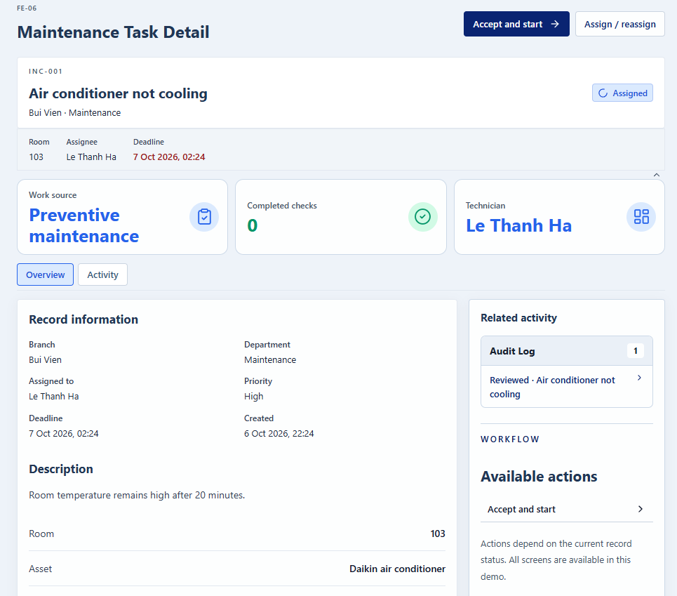

**Screen / Function Description**

This screen allows Assigned Maintenance Staff / Maintenance Lead to:

61. Display the assigned maintenance work, incident context, location, priority and deadlines.

62. Allow the assignee to accept/start work and update technical progress.

63. Record diagnosis, actions, materials used, notes and evidence.

64. Submit the repair result for independent verification.

On this screen, the user can also:

65. Put work On Hold or resume it with controlled work-time tracking.

66. Prevent material usage from exceeding materials issued to the incident.

**Mapped Use Cases:** UC-054 Accept and Start Maintenance; UC-055 Update Maintenance Progress; UC-058 Resolve Maintenance Incident

**Field Description**

| **Field Name**            | **Description**                                                                                                                                                                               |
|---------------------------|-----------------------------------------------------------------------------------------------------------------------------------------------------------------------------------------------|
| ***Work Information***    |                                                                                                                                                                                               |
| Incident / Work Reference | Read-only identifier linking the maintenance work to its source incident or schedule.                                                                                                         |
| Location / Asset          | Read-only source location/asset information.                                                                                                                                                  |
| Priority                  | Read-only current priority.                                                                                                                                                                   |
| Response Deadline         | Read-only datetime for SLA tracking.                                                                                                                                                          |
| Resolution Deadline       | Read-only datetime for SLA tracking.                                                                                                                                                          |
| Assigned Technician       | Read-only current assignee.                                                                                                                                                                   |
| Status                    | Read-only workflow enum such as Assigned, In Progress, On Hold, Pending Verification or Closed.                                                                                               |
| ***Progress and Result*** |                                                                                                                                                                                               |
| Progress                  | Data type: integer/percentage. Range: 0-100. Value 100 does not close the work automatically.                                                                                                 |
| Diagnosis                 | Data type: multiline string. Required when submitting final result.                                                                                                                           |
| Actions Taken             | Data type: multiline string. Required when submitting final result.                                                                                                                           |
| Issued Materials          | Read-only list of materials issued for this incident.                                                                                                                                         |
| Materials Used            | Data type: item/positive quantity. Must be linked to issued material and cannot exceed the issued quantity not yet returned.                                                                  |
| Notes                     | Data type: multiline string. Optional.                                                                                                                                                        |
| Evidence                  | Data type: file upload. Optional. JPG/PNG/PDF; max 10 MB/file, 5 files/upload.                                                                                                                |
| Hold Reason               | Data type: text/reference. Required when putting In Progress work On Hold. Holding closes the current work interval; SLA time is not paused.                                                  |
| Actual End Time           | Read-only server timestamp recorded when the final result is submitted.                                                                                                                       |
| ***Actions***             |                                                                                                                                                                                               |
| Accept and Start          | Action available to the current assignee from Assigned. The user must have a Working workday and no other open work interval.                                                                 |
| Save Progress             | Action. Validates Progress, notes, evidence and Materials Used.                                                                                                                               |
| Submit Result             | Action available from In Progress to the assignee. Requires Diagnosis, Action Taken and valid material usage; changes the incident/work to Pending Verification and closes the work interval. |

#### 6.2.2 Maintenance Task List 

**UI Layout**

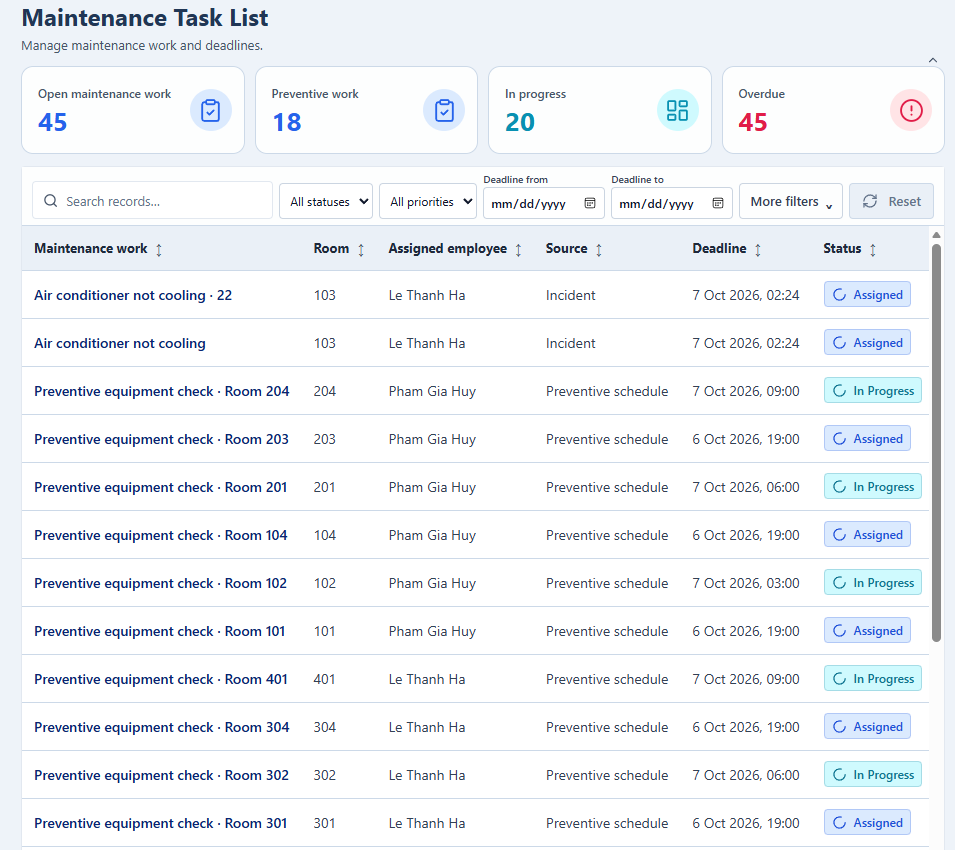

**Screen / Function Description**

This screen allows Maintenance Lead; Maintenance Staff to:

- View maintenance work from incidents and preventive maintenance schedules within the user's scope.

- Filter work by source, assignee, status, due date and time period.

- Identify overdue work that requires action.

- Open a work item to accept, start, update or resolve it.

On this screen, the user can also:

- See only the work assigned to them when the user is Maintenance Staff.

- Navigate to the source incident or preventive maintenance schedule.

**Mapped Use Cases:** UC-144 View Maintenance List; UC-054 Accept and Start Maintenance; UC-062 Execute Scheduled Maintenance

**Field Description**

| **Field Name**           | **Description**                                                                                                                                                                                                      |
|--------------------------|----------------------------------------------------------------------------------------------------------------------------------------------------------------------------------------------------------------------|
| ***Search and Filters*** |                                                                                                                                                                                                                      |
| Search                   | Data type: string/text input. Optional. Initial value: blank. Searches work reference, incident number, location or asset.                                                                                           |
| Source                   | Data type: enum/dropdown. Optional. Allowed values: Incident, Preventive Maintenance. Initial value: All Sources.                                                                                                    |
| Status                   | Data type: enum/dropdown. Optional. Values follow the maintenance work lifecycle. Initial value: All Statuses.                                                                                                       |
| Assignee                 | Data type: user-reference filter. Optional for Maintenance Lead; fixed to the current user for Maintenance Staff.                                                                                                    |
| Branch                   | Data type: reference/dropdown. Optional where the user has access to multiple branches.                                                                                                                              |
| Due Date                 | Data type: date range filter. Optional. The end date must not be earlier than the start date.                                                                                                                        |
| Overdue                  | Data type: toggle. Optional. Shows only work that is not Closed/Cancelled and is past its due time.                                                                                                                  |
| ***Maintenance List***   |                                                                                                                                                                                                                      |
| Maintenance Table        | Read-only table. Recommended columns: Work Reference, Source, Location/Asset, Priority, Assignee, Status, Due Date, Overdue Flag. Default ordering is by Due Date. Maintenance Staff see only work assigned to them. |
| Pagination               | Default page size: 20 rows; maximum: 100 rows per page.                                                                                                                                                              |
| ***Actions***            |                                                                                                                                                                                                                      |
| View Detail              | Row action. Opens Maintenance Task Detail for the selected work.                                                                                                                                                     |

## 7. Asset & Equipment Management (FE-07)

### 7.1 Asset Management

#### 7.1.1 Asset List 

**UI Layout**

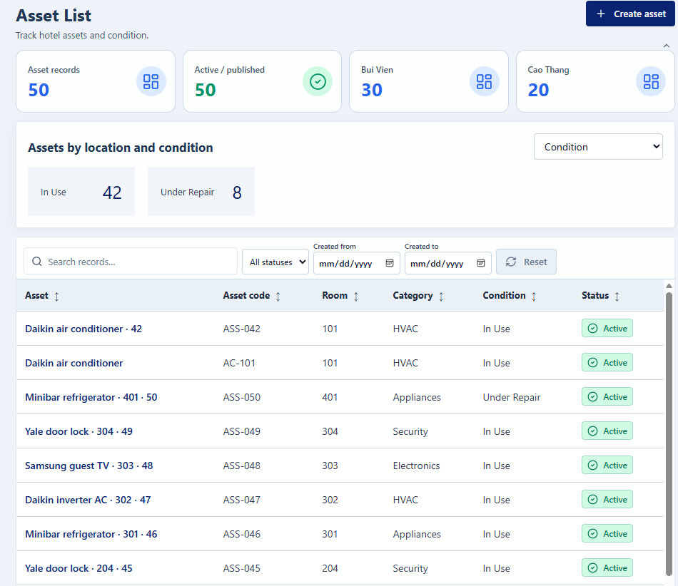

**Screen / Function Description**

This screen allows Operations Manager and authorized operational users to:

67. Search and view assets within the user's authorized branch scope.

68. Filter assets by branch, category, location, custodian department, condition and lifecycle status.

69. Review the current location, custodian and condition of each asset.

70. Open the selected Asset Detail.

On this screen, the user can also:

71. Register a new asset when the user has asset-management permission.

72. Support statistics/review by location using the same filtered asset population.

**Mapped Use Cases:** UC-065 Register Asset/Equipment; UC-071 View Asset Profile; UC-073 Review Assets by Location

**Field Description**

| **Field Name**           | **Description**                                                                                                                                                          |
|--------------------------|--------------------------------------------------------------------------------------------------------------------------------------------------------------------------|
| ***Search and Filters*** |                                                                                                                                                                          |
| Search                   | Data type: string/text input. Optional. Searches Asset Code, Name or other identifying information.                                                                      |
| Branch                   | Data type: reference/dropdown. Optional.                                                                                                                                 |
| Category                 | Data type: reference/dropdown. Optional.                                                                                                                                 |
| Location                 | Data type: room/area reference filter. Optional.                                                                                                                         |
| Custodian Department     | Data type: department-reference filter. Optional.                                                                                                                        |
| Condition                | Data type: enum/dropdown. Optional. Allowed values: In Use, Damaged, Under Repair.                                                                                       |
| Lifecycle Status         | Data type: enum/dropdown. Optional. Values include Active and Retired/inactive lifecycle states as implemented.                                                          |
| ***Asset List***         |                                                                                                                                                                          |
| Asset Table              | Read-only table. Recommended columns: Asset Code, Name, Category, Current Location, Custodian Department, Condition, Lifecycle Status. Default sorting is by Asset Code. |
| Pagination               | Default 20 rows/page, maximum 100.                                                                                                                                       |
| ***Actions***            |                                                                                                                                                                          |
| Register Asset           | Action. Opens Asset Detail in create mode.                                                                                                                               |
| View Detail              | Row action. Opens the selected asset profile and management actions.                                                                                                     |

#### 7.1.2 Asset Detail 

**UI Layout**

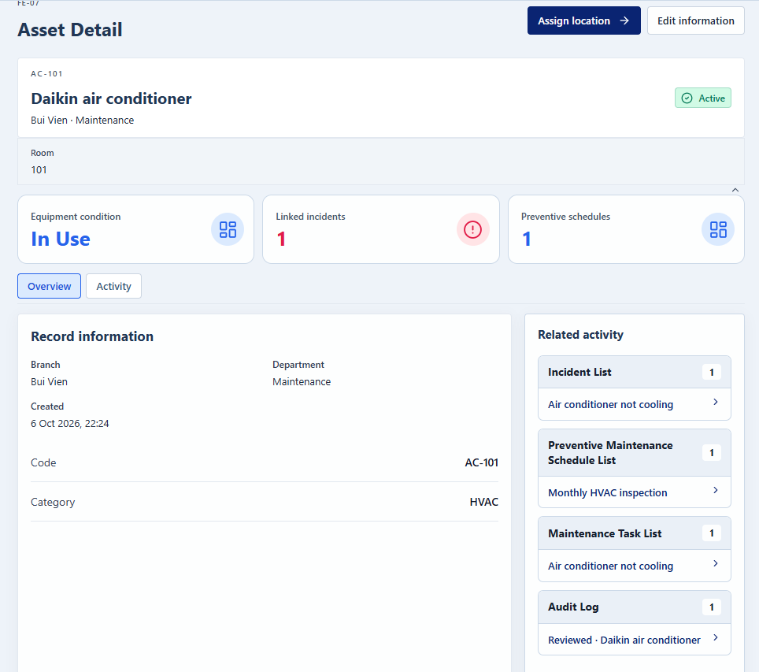

**Screen / Function Description**

This screen allows Operations Manager; authorized Department Head/Maintenance roles for permitted actions to:

73. Create and maintain asset identification and management information.

74. Assign or transfer the asset to its current room/area location.

75. Record custody handover and current asset condition.

76. Retire an asset only when no blocking operational dependencies remain.

On this screen, the user can also:

77. Preserve movement and custody history for auditability.

78. Offer incident reporting when a damaged asset has no open incident.

**Mapped Use Cases:** UC-065 Register Asset/Equipment; UC-066 Update Asset Information; UC-067 Assign Asset to Location; UC-068 Transfer Asset Location; UC-069 Record Asset Handover; UC-070 Update Asset Condition; UC-074 Retire/Deactivate Asset

**Field Description**

| **Field Name**                        | **Description**                                                                                                                                                                                                                                           |
|---------------------------------------|-----------------------------------------------------------------------------------------------------------------------------------------------------------------------------------------------------------------------------------------------------------|
| ***Asset Identification***            |                                                                                                                                                                                                                                                           |
| Branch                                | Data type: reference/dropdown. Required. An asset belongs to one branch.                                                                                                                                                                                  |
| Asset Code                            | Data type: string/text input. Required. Must be unique across the asset register. Maximum length: not specified in the SRS.                                                                                                                               |
| Name                                  | Data type: string/text input. Required. Maximum length: not specified in the SRS.                                                                                                                                                                         |
| Category                              | Data type: reference/dropdown. Required. An asset belongs to one category.                                                                                                                                                                                |
| Brand / Model                         | Data type: string/text input. Optional.                                                                                                                                                                                                                   |
| Serial Number                         | Data type: string/text input. Optional.                                                                                                                                                                                                                   |
| Purchase Date                         | Data type: date. Optional.                                                                                                                                                                                                                                |
| Warranty End                          | Data type: date. Optional. The SRS does not specify an explicit cross-field date rule.                                                                                                                                                                    |
| Notes                                 | Data type: multiline string. Optional.                                                                                                                                                                                                                    |
| Photos / Documents                    | Data type: file upload. Optional. Allowed JPG/PNG/PDF; max 10 MB/file and 5 files/upload.                                                                                                                                                                 |
| ***Location, Custody and Condition*** |                                                                                                                                                                                                                                                           |
| Current Location                      | Data type: room/area reference. The asset has exactly one current location at a time.                                                                                                                                                                     |
| Custodian Department                  | Data type: department reference. The asset has one current custodian department at a time.                                                                                                                                                                |
| Condition                             | Data type: enum. Allowed values: In Use, Damaged, Under Repair. Returning to In Use while linked incidents remain open requires a reason.                                                                                                                 |
| Lifecycle Status                      | Read-only/controlled enum. Active until retired/deactivated by a valid action.                                                                                                                                                                            |
| Transfer Reason                       | Data type: multiline string. Required when transferring location if the workflow requires explanation; cross-branch transfer requires scope in both branches. Asset with open incident/maintenance occurrence requires a confirmation note before moving. |
| Handover Receiver                     | Data type: user/department-head reference. Custody changes only after the designated receiver acknowledges the handover.                                                                                                                                  |
| ***Actions***                         |                                                                                                                                                                                                                                                           |
| Save                                  | Creates/updates the asset after validating unique code, active branch/category and valid references.                                                                                                                                                      |
| Transfer Location                     | Creates a movement history record with old/new location, time, actor and reason.                                                                                                                                                                          |
| Record Handover                       | Creates a Pending Acknowledgment custody handover. Rejection requires a reason.                                                                                                                                                                           |
| Retire Asset                          | Controlled action. Allowed only when no open incident, open maintenance occurrence, active preventive schedule or pending handover exists. Requires confirmation/reason under the common exception rule.                                                  |

## 8. Inventory Management (FE-08)

### 8.1 Inventory Monitoring

#### 8.1.1 Inventory Dashboard

**UI Layout**

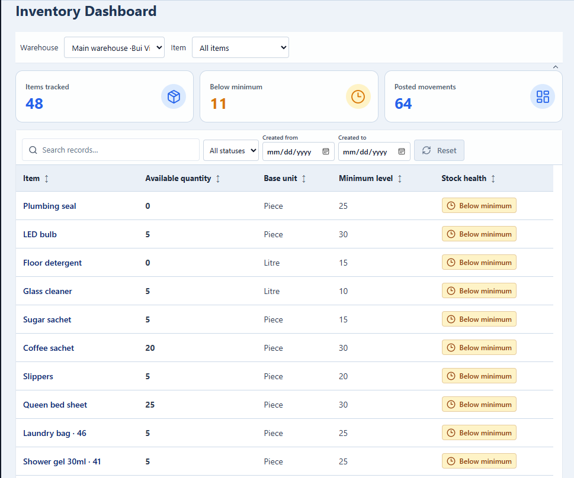

**Screen / Function Description**

This screen allows Storekeeper; Operations Manager (according to permission) to:

79. View current stock by warehouse and item.

80. Identify items below their configured minimum stock level.

81. Filter inventory information by warehouse/item and stock condition.

82. Open the related stock ledger for detailed movement history.

On this screen, the user can also:

83. Display in-transit quantities separately from available stock.

84. Avoid treating a period with no movements as a zero stock balance.

**Mapped Use Cases:** UC-089 View Stock Balance and Movement Ledger

**Field Description**

| **Field Name**          | **Description**                                                                                                                                            |
|-------------------------|------------------------------------------------------------------------------------------------------------------------------------------------------------|
| ***Filters***           |                                                                                                                                                            |
| Warehouse               | Data type: reference/dropdown. Optional. Initial value: All Warehouses within scope.                                                                       |
| Item                    | Data type: item reference/search. Optional.                                                                                                                |
| Item Type / Category    | Data type: reference filter. Optional if implemented.                                                                                                      |
| Below Minimum Only      | Data type: boolean/toggle. Optional. Initial value: Off.                                                                                                   |
| ***Stock Indicators***  |                                                                                                                                                            |
| Available Quantity      | Data type: numeric/read-only. Current posted stock balance available in the warehouse/item.                                                                |
| In-Transit Quantity     | Data type: numeric/read-only. Quantity dispatched in transfers but not yet fully received.                                                                 |
| Minimum Level           | Data type: numeric/read-only. Must be greater than or equal to 0 when configured per Warehouse/Item.                                                       |
| Below Minimum Indicator | Read-only derived status. Highlighted when stock meets the configured low-stock condition. Items with no minimum configured do not raise low-stock alerts. |
| Stock Summary           | Read-only cards/table values derived from posted stock movements.                                                                                          |
| ***Actions***           |                                                                                                                                                            |
| Open Ledger             | Drill-down action that opens Stock Balance & Movement details for the selected warehouse/item and period.                                                  |

### 8.2 Stock Transactions

#### 8.2.1 Stock Transaction List

**UI Layout**

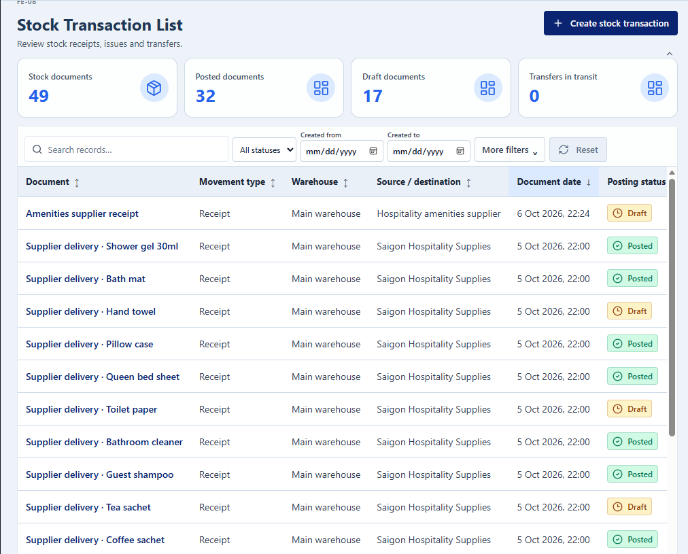

**Screen / Function Description**

This screen allows Storekeeper; Operations Manager for adjustment/reversal functions to:

85. View receipts, issues, returns, transfers and other permitted stock transactions.

86. Search/filter transactions by type, status, warehouse, item and period.

87. Open a transaction to verify/post, receive or reverse it according to permission.

88. Create a new transaction of an allowed type.

On this screen, the user can also:

89. Keep Posted transactions immutable and trace corrections through reversal/adjustment.

90. Show only transactions in the user's authorized scope.

**Mapped Use Cases:** UC-079 Create Stock Receipt; UC-081 Issue Stock; UC-082 Return Materials to Stock; UC-083 Create Stock Transfer; UC-088 Reverse Stock Transaction

**Field Description**

| **Field Name**           | **Description**                                                                                                                                               |
|--------------------------|---------------------------------------------------------------------------------------------------------------------------------------------------------------|
| ***Search and Filters*** |                                                                                                                                                               |
| Transaction Type         | Data type: enum/dropdown. Optional. Values may include Receipt, Issue, Return, Transfer, Adjustment, Reversal. Initial value: All Types.                      |
| Status                   | Data type: enum/dropdown. Optional. Values depend on transaction type (for example Draft, Posted, Cancelled, In Transit, Partially Received, Received).       |
| Warehouse                | Data type: reference/dropdown. Optional.                                                                                                                      |
| Item                     | Data type: item-reference filter. Optional.                                                                                                                   |
| Date From                | Data type: date/datetime. Optional.                                                                                                                           |
| Date To                  | Data type: date/datetime. Optional. Must not be earlier than Date From.                                                                                       |
| Search / Reference No.   | Data type: string/text input. Optional.                                                                                                                       |
| ***Transaction List***   |                                                                                                                                                               |
| Transaction Table        | Read-only table. Recommended columns: Document/Reference No., Type, Source/Receiving Warehouse, Destination (if applicable), Date, Status, Created/Posted By. |
| Pagination               | Default 20 rows/page; maximum 100.                                                                                                                            |
| ***Actions***            |                                                                                                                                                               |
| Create Transaction       | Action. Opens Stock Transaction Detail in an appropriate create mode.                                                                                         |
| View Detail              | Row action. Opens the selected transaction.                                                                                                                   |

#### 8.2.2 Stock Transaction Detail 

**UI Layout**

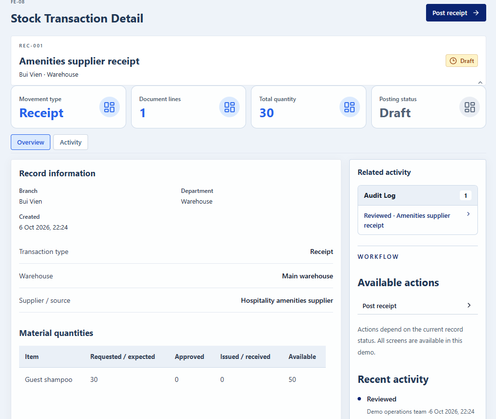

**Screen / Function Description**

This screen allows Storekeeper; Operations Manager for controlled correction actions to:

91. Create or view a stock transaction and its item lines.

92. Verify and post valid receipt/issue/return/transfer movements.

93. Confirm destination receipt quantities for transfers.

94. Correct posted stock only through controlled adjustment or reversal.

On this screen, the user can also:

95. Prevent stock from becoming negative.

96. Keep Draft/request/approval records from changing stock until the transaction is Posted.

**Mapped Use Cases:** UC-079 Create Stock Receipt; UC-080 Verify and Post Stock Receipt; UC-081 Issue Stock; UC-082 Return Materials to Stock; UC-083 Create Stock Transfer; UC-084 Confirm Stock Transfer Receipt; UC-087 Adjust Stock Balance; UC-088 Reverse Stock Transaction

**Field Description**

| **Field Name**                          | **Description**                                                                                                                                                                                                  |
|-----------------------------------------|------------------------------------------------------------------------------------------------------------------------------------------------------------------------------------------------------------------|
| ***Document Header***                   |                                                                                                                                                                                                                  |
| Transaction No.                         | Data type: system identifier/reference. Read-only after creation.                                                                                                                                                |
| Transaction Type                        | Data type: enum. Required in create mode. Determines applicable source/destination and line fields.                                                                                                              |
| Source / Receiving Warehouse            | Data type: warehouse reference. Required according to transaction type.                                                                                                                                          |
| Destination Warehouse                   | Data type: warehouse reference. Required for Transfer. Must differ from Source Warehouse.                                                                                                                        |
| Source / Supplier                       | Data type: string/reference. Optional or required according to receipt context. Purchasing approval itself is outside V1 scope.                                                                                  |
| Reference Document No.                  | Data type: string/text input. Optional.                                                                                                                                                                          |
| Linked Replenishment / Material Request | Data type: related-record reference. Optional for receipt; required/controlled for stock issues tied to approved material requests.                                                                              |
| Status                                  | Read-only workflow status.                                                                                                                                                                                       |
| ***Transaction Lines***                 |                                                                                                                                                                                                                  |
| Item                                    | Data type: item reference. Required. Item must be active/valid for new transactions.                                                                                                                             |
| Unit                                    | Data type: unit reference. Required. Must be a valid base/additional unit for the item with a positive conversion factor.                                                                                        |
| Expected Quantity                       | Data type: decimal/number. Must be greater than 0 when used.                                                                                                                                                     |
| Actual / Posted Quantity                | Data type: decimal/number. Must be greater than 0 for received/issued/transferred/returned quantities. A receipt difference from expected quantity requires a reason.                                            |
| Available Quantity                      | Read-only numeric value used for validation. Issue, transfer dispatch, adjustment or reversal must not make available stock negative.                                                                            |
| Damaged / Missing Quantity              | Data type: decimal/number when applicable to receipt/transfer confirmation. Values must be non-negative and require a reason when they represent a discrepancy/loss.                                             |
| Reason / Note                           | Data type: multiline string. Required for cancellation, reversal, manual correction or relevant discrepancies. Common exception reason minimum: 10 characters.                                                   |
| ***Actions***                           |                                                                                                                                                                                                                  |
| Save Draft                              | Saves a Draft where supported. Draft documents do not change stock.                                                                                                                                              |
| Post                                    | Validates quantities and posts the document. Only Posted movements change stock.                                                                                                                                 |
| Confirm Transfer Receipt                | Records destination received/damaged/missing quantities without exceeding the dispatched quantity not yet confirmed.                                                                                             |
| Reverse                                 | Operations Manager action. A Posted document is never edited/deleted; reversal creates an offsetting document. Reversal is rejected if it would create negative stock or dependent documents prevent correction. |

## 9. Material Request Management (FE-09)

### 9.1 Material Requests

#### 9.1.1 Material Request List 

**UI Layout**

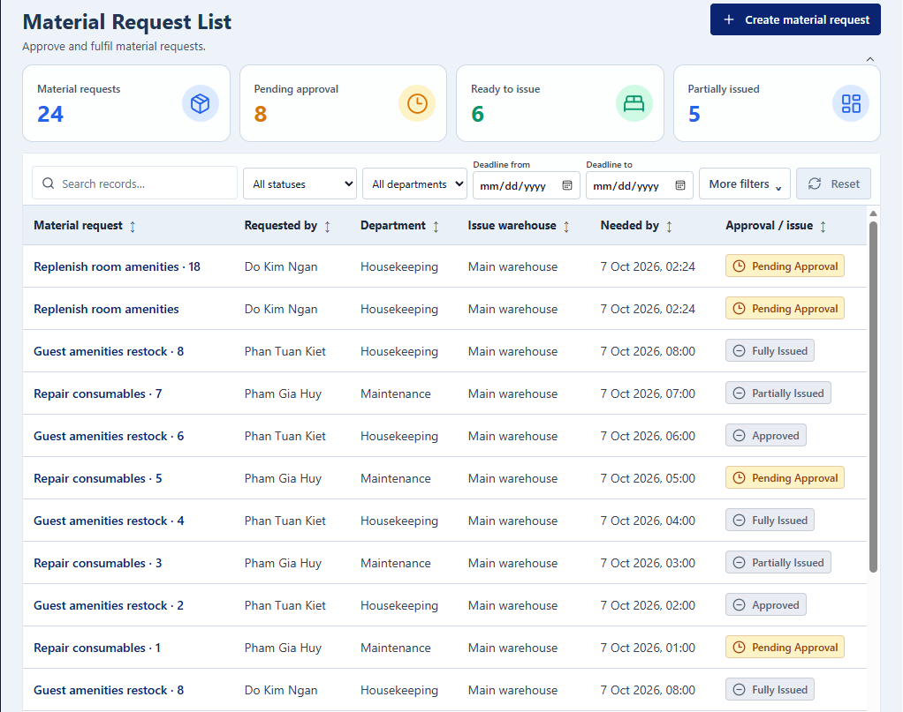

**Screen / Function Description**

This screen allows Operational users; Department Head; Storekeeper; Operations Manager according to role to:

97. View material requests visible to the current user by role and scope.

98. Switch between own requests, pending approvals and approved requests ready for issue where applicable.

99. Filter by status, department, requester, item and date range.

100. Open a request to review its complete lifecycle and quantities.

On this screen, the user can also:

101. Create a new material request.

102. Support approval and fulfillment work by linking to Material Request Detail.

**Mapped Use Cases:** UC-091 Create Material Request; UC-094 Review Material Request; UC-099 Track Material Request History

**Field Description**

| **Field Name**               | **Description**                                                                                                                                                                          |
|------------------------------|------------------------------------------------------------------------------------------------------------------------------------------------------------------------------------------|
| ***View Scope and Filters*** |                                                                                                                                                                                          |
| View Scope                   | Data type: tab/enum. Examples: My Requests, Pending My Approval, Approved to Issue. Available options depend on the user's role.                                                         |
| Status                       | Data type: enum/dropdown. Optional. Initial value: All Statuses.                                                                                                                         |
| Department                   | Data type: department reference. Optional.                                                                                                                                               |
| Requester                    | Data type: user-reference filter. Optional.                                                                                                                                              |
| Item                         | Data type: item-reference filter. Optional.                                                                                                                                              |
| Date From                    | Data type: date/datetime. Optional.                                                                                                                                                      |
| Date To                      | Data type: date/datetime. Optional. Must not be earlier than Date From.                                                                                                                  |
| Search                       | Data type: string/text input. Optional.                                                                                                                                                  |
| ***Request List***           |                                                                                                                                                                                          |
| Request Table                | Read-only table. Recommended columns: Request No., Requester, Department, Status, Approver, Needed-by Time, Requested/Approved/Issued summary. Default history ordering is newest first. |
| Pagination                   | Default 20 rows/page, maximum 100.                                                                                                                                                       |
| ***Actions***                |                                                                                                                                                                                          |
| Create Request               | Action. Opens Material Request Detail in create mode.                                                                                                                                    |
| View Detail                  | Row action. Opens lifecycle, approval and fulfillment information.                                                                                                                       |

#### 9.1.2 Material Request Detail 

**UI Layout**

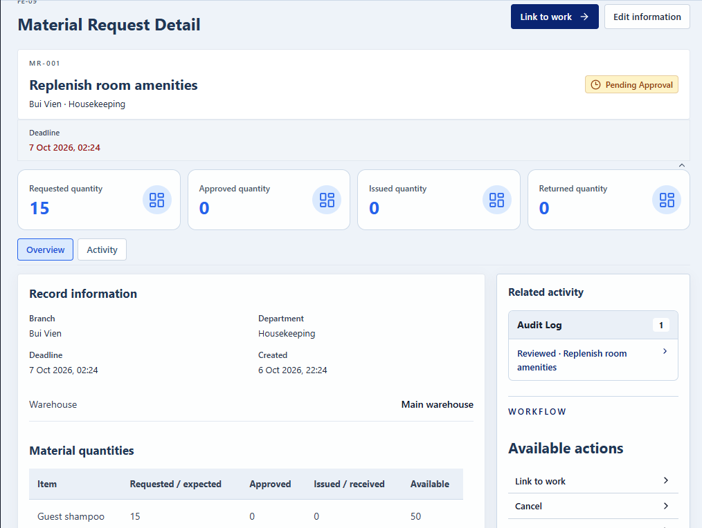

**Screen / Function Description**

This screen allows Requester; Department Head approver; Storekeeper; Operations Manager according to permission to:

103. Create and maintain material requests with one or more item lines.

104. Review and approve/reject requested quantities under segregation-of-duties rules.

105. Check stock availability and record full or partial fulfillment.

106. Track requested, approved, issued and remaining quantities separately.

On this screen, the user can also:

107. Link the request to operational work in the same branch.

108. Return unused materials through the warehouse process.

**Mapped Use Cases:** UC-091 Create Material Request; UC-092 Link Material Request to Work; UC-093 Update/Cancel Material Request; UC-094 Review Material Request; UC-095 Approve/Reject Material Request; UC-096 Check Material Availability; UC-097 Issue Approved Materials; UC-098 Manage Partial Material Fulfillment; UC-090 Return Unused Materials

**Field Description**

| **Field Name**                           | **Description**                                                                                                                                                                                                                                |
|------------------------------------------|------------------------------------------------------------------------------------------------------------------------------------------------------------------------------------------------------------------------------------------------|
| ***Request Header***                     |                                                                                                                                                                                                                                                |
| Request No.                              | Read-only system identifier after creation.                                                                                                                                                                                                    |
| Requester                                | Read-only authenticated user/creator.                                                                                                                                                                                                          |
| Receiving Department                     | Data type: department reference. Required. Must be active and appropriate for the request.                                                                                                                                                     |
| Receiving Location                       | Data type: location reference. Required where applicable by the request.                                                                                                                                                                       |
| Purpose                                  | Data type: multiline string. Required.                                                                                                                                                                                                         |
| Needed-by Time                           | Data type: datetime. Required. Uses server-time/deadline validation.                                                                                                                                                                           |
| Linked Work                              | Data type: related-record reference. Optional. May link only to an open work record of the same branch; Cancelled/Rejected requests cannot be linked.                                                                                          |
| Approver                                 | Read-only derived user. Normally the Department Head of the requester's department; must differ from the requester.                                                                                                                            |
| Status                                   | Read-only workflow enum such as Draft, Pending Approval, Needs Information, Approved, Partially Issued, Fully Issued, Rejected or Cancelled.                                                                                                   |
| ***Request Lines***                      |                                                                                                                                                                                                                                                |
| Item                                     | Data type: item reference. Required. At least one request line is required.                                                                                                                                                                    |
| Unit                                     | Data type: unit reference. Required. Must be valid for the selected item.                                                                                                                                                                      |
| Requested Quantity                       | Data type: decimal/number. Required and must be greater than 0.                                                                                                                                                                                |
| Approved Quantity                        | Data type: decimal/number. Default during approval = Requested Quantity. Must satisfy 0 \<= Approved Quantity \<= Requested Quantity. At least one line must be greater than 0 for approval; approving all lines as 0 is treated as rejection. |
| Available Quantity                       | Read-only numeric stock value. Review does not reserve stock.                                                                                                                                                                                  |
| Issued Quantity                          | Read-only accumulated numeric value from posted issues.                                                                                                                                                                                        |
| Remaining Approved Quantity              | Read-only derived quantity equal to remaining approved demand after issues.                                                                                                                                                                    |
| Issue Quantity                           | Data type: decimal/number. Must be greater than 0 and cannot exceed both available stock and remaining approved quantity.                                                                                                                      |
| Return Quantity                          | Data type: decimal/number when returning unused material. Must follow the linked issue and cannot exceed the quantity eligible for return.                                                                                                     |
| ***Review and Exception Fields***        |                                                                                                                                                                                                                                                |
| Review / Need Information Note           | Data type: multiline string. Required when the approver returns the request for more information.                                                                                                                                              |
| Reject / Cancel / Close Remainder Reason | Data type: multiline string. Required for applicable actions; minimum 10 characters under the common exception rule.                                                                                                                           |
| ***Actions***                            |                                                                                                                                                                                                                                                |
| Save Draft / Submit                      | Save Draft keeps the request editable; Submit creates/returns it to Pending Approval according to current state.                                                                                                                               |
| Approve / Reject                         | Department Head action. Approval validates approved quantities and segregation of duties; rejection requires reason.                                                                                                                           |
| Issue Full / Partial                     | Storekeeper action. Uses available stock and remaining approved quantities; partial issue leaves a remainder open.                                                                                                                             |
| Return Unused Materials                  | Starts the warehouse return process for excess/unused issued materials.                                                                                                                                                                        |

## 10. Replenishment Management (FE-10)

### 10.1 Replenishment Tracking

#### 10.1.1 Replenishment Detail 

**UI Layout**

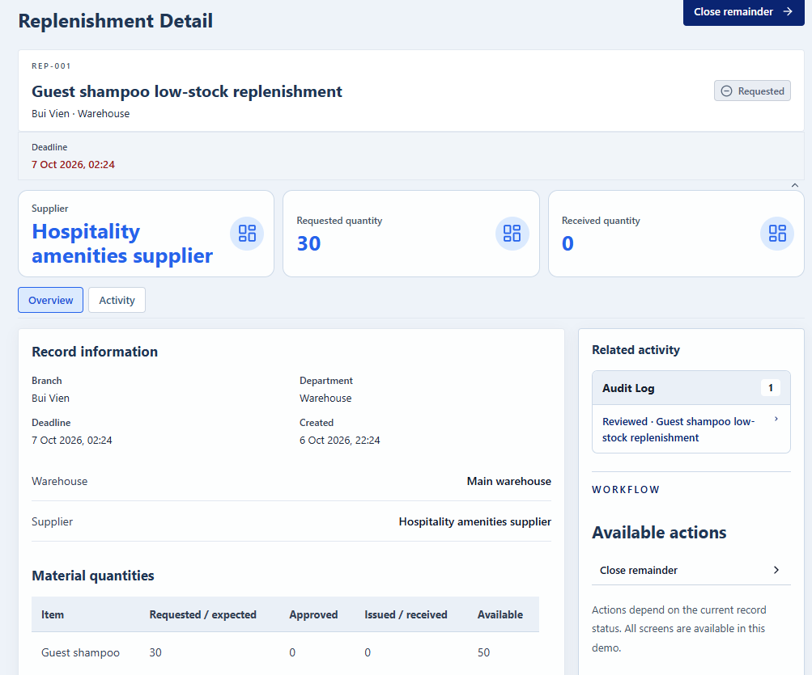

**Screen / Function Description**

This screen allows Storekeeper; Operations Manager to:

109. Display a replenishment request and its requested, received and remaining quantities.

110. Track posted receipts linked to the request.

111. Show material requests still waiting for the replenished items.

112. Monitor status until the replenishment is fully received or deliberately closed.

On this screen, the user can also:

113. Prevent duplicate open replenishments for the same shortage.

114. Close a remaining quantity with a reason when it will no longer arrive.

**Mapped Use Cases:** UC-100 Create Replenishment Request; UC-101 Track Material Replenishment

**Field Description**

| **Field Name**            | **Description**                                                                                                                |
|---------------------------|--------------------------------------------------------------------------------------------------------------------------------|
| ***Request Information*** |                                                                                                                                |
| Request No.               | Read-only system identifier.                                                                                                   |
| Warehouse                 | Data type: warehouse reference. Required. Receiving warehouse for the replenishment.                                           |
| Supplier Name             | Data type: string/text input. Optional. Purchasing approval is outside the V1 scope.                                           |
| Expected Date             | Data type: date. Optional.                                                                                                     |
| Status                    | Read-only workflow status such as Requested, Partially Received, Fully Received or Closed.                                     |
| ***Replenishment Lines*** |                                                                                                                                |
| Item                      | Data type: item reference. Required.                                                                                           |
| Unit                      | Data type: unit reference. Required and valid for the item.                                                                    |
| Requested Quantity        | Data type: decimal/number. Required and greater than 0.                                                                        |
| Received Quantity         | Read-only numeric value calculated only from Posted receipt lines linked to this replenishment. Each receipt line counts once. |
| Remaining Quantity        | Read-only derived value = Requested Quantity - Received Quantity, subject to closure status.                                   |
| ***Linked Information***  |                                                                                                                                |
| Linked Posted Receipts    | Read-only list of receipts contributing received quantities.                                                                   |
| Waiting Material Requests | Read-only list of material requests waiting for these items.                                                                   |
| ***Actions***             |                                                                                                                                |
| Close Remaining           | Storekeeper action. Used when the remaining quantity will not arrive. Requires a reason of at least 10 characters.             |
| Open Receipt              | Navigation action to related posted receipt details.                                                                           |

## 11. Task Assignment Management (FE-11)

### 11.1 Operational Tasks

#### 11.1.1 Task List 

**UI Layout**

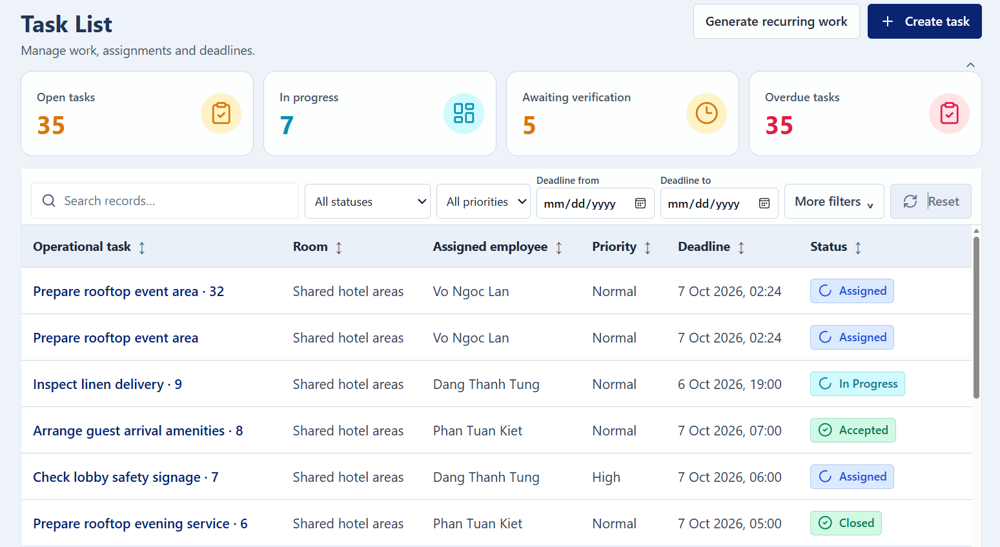

**Screen / Function Description**

This screen allows Department Head; assigned operational staff to:

115. View department tasks or the current user's assigned tasks.

116. Search and filter by department, assignee, status, priority, deadline and overdue state.

117. Identify tasks requiring attention based on status and due date.

118. Open Task Detail for execution or management.

On this screen, the user can also:

119. Create a new operational task when the user is an authorized Department Head.

120. Support workload review through the same task population and related time logs.

**Mapped Use Cases:** UC-102 Create Operational Task; UC-103 Set Task Priority and Deadline; UC-113 Review Task Workload and Time Logs

**Field Description**

| **Field Name**           | **Description**                                                                                                                  |
|--------------------------|----------------------------------------------------------------------------------------------------------------------------------|
| ***Search and Filters*** |                                                                                                                                  |
| Scope                    | Data type: tab/enum. Example values: My Tasks, Department Tasks. Available options depend on role.                               |
| Department               | Data type: department reference. Optional.                                                                                       |
| Assignee                 | Data type: user reference. Optional.                                                                                             |
| Status                   | Data type: enum/dropdown. Optional. Initial value: All Statuses.                                                                 |
| Priority                 | Data type: enum/dropdown. Optional. Allowed values: Low, Normal, High, Critical.                                                 |
| Deadline / Period        | Data type: date/date-range filter. Optional. Date-range end cannot precede start.                                                |
| Overdue Only             | Data type: boolean/toggle. A task is overdue when not Closed/Cancelled and current time is after Deadline.                       |
| Search                   | Data type: string/text input. Optional.                                                                                          |
| ***Task List***          |                                                                                                                                  |
| Task Table               | Read-only table. Recommended columns: Task No., Title, Category, Department, Assignee, Priority, Deadline, Status, Overdue Flag. |
| Pagination               | Default 20 rows/page, maximum 100.                                                                                               |
| ***Actions***            |                                                                                                                                  |
| Create Task              | Department Head action. Opens Task Detail in create mode.                                                                        |
| View Detail              | Row action. Opens the selected task.                                                                                             |

#### 11.1.2 Task Detail 

**UI Layout**

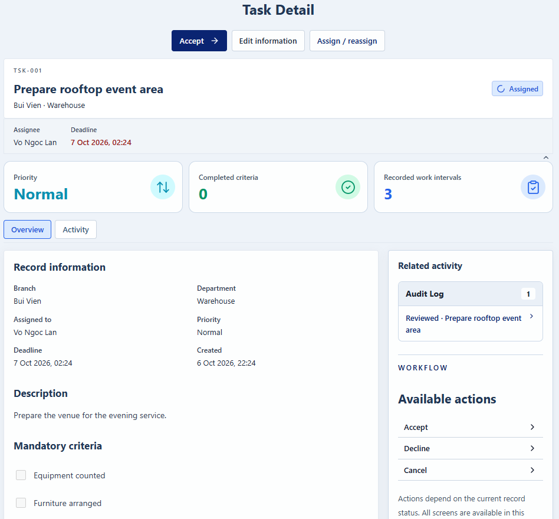

**Screen / Function Description**

This screen allows Department Head; assigned Housekeeping Staff / Maintenance Staff / Storekeeper to:

121. Create and define an operational task with outcome, criteria, priority and deadline.

122. Assign/reassign the task to an eligible executor.

123. Allow the assignee to accept, start, pause/resume and update progress.

124. Submit completion for Department Head verification or reopen unsatisfactory work.

On this screen, the user can also:

125. Record actual task work time automatically from work intervals.

126. Preserve prior cycles and results when a closed task is reopened.

**Mapped Use Cases:** UC-102 Create Operational Task; UC-103 Set Task Priority and Deadline; UC-104 Assign/Reassign Task; UC-105 Review and Verify Task Completion; UC-106 Reopen Assigned Task; UC-107 Accept Assigned Task; UC-108 Start Assigned Task; UC-109 Update Task Progress; UC-110 Pause/Resume Task; UC-111 Record Actual Working Time; UC-112 Complete Assigned Task

**Field Description**

| **Field Name**                           | **Description**                                                                                                                                                                            |
|------------------------------------------|--------------------------------------------------------------------------------------------------------------------------------------------------------------------------------------------|
| ***Task Definition***                    |                                                                                                                                                                                            |
| Task No.                                 | Read-only system identifier.                                                                                                                                                               |
| Title                                    | Data type: string/text input. Required. Maximum length: not specified in the SRS.                                                                                                          |
| Category                                 | Data type: reference/dropdown. Required. A need with a specialized workflow (cleaning, incident, material) must use that specialized process instead.                                      |
| Department                               | Data type: department reference. Required unless a valid location/operational context satisfies the task rule; task must have a location or department.                                    |
| Location                                 | Data type: room/area/location reference. Optional where Department provides sufficient context.                                                                                            |
| Description                              | Data type: multiline string. Optional/expected for clear work instructions.                                                                                                                |
| Expected Outcome                         | Data type: multiline string. Required.                                                                                                                                                     |
| Completion Criteria                      | Data type: repeatable text/criteria list. At least one criterion is required.                                                                                                              |
| Mandatory Criterion                      | Data type: boolean per completion criterion.                                                                                                                                               |
| Source Internal Request                  | Data type: related-record reference. Optional.                                                                                                                                             |
| ***Planning and Assignment***            |                                                                                                                                                                                            |
| Priority                                 | Data type: enum/dropdown. Required. Allowed values: Low, Normal, High, Critical.                                                                                                           |
| Planned Start                            | Data type: datetime. Optional/required according to task planning.                                                                                                                         |
| Deadline                                 | Data type: datetime. Required for deadline tracking. Must not be earlier than Planned Start. Changing Deadline after assignment requires a reason and preserves previous value in history. |
| Assignee                                 | Data type: user reference. Must be an Active executor (Housekeeping Staff, Maintenance Staff or Storekeeper) in the task's department and branch.                                          |
| Status                                   | Read-only workflow enum.                                                                                                                                                                   |
| ***Execution and Completion***           |                                                                                                                                                                                            |
| Progress                                 | Data type: integer/percentage. Range: 0-100. Reaching 100 does not complete the task automatically.                                                                                        |
| Pause Reason                             | Data type: text/reference. Required when pausing an In Progress task. Pausing closes the current work interval.                                                                            |
| Notes                                    | Data type: multiline string. Optional.                                                                                                                                                     |
| Evidence                                 | Data type: file upload. Optional. JPG/PNG/PDF; max 10 MB/file, 5 files/upload.                                                                                                             |
| Actual Working Time                      | Read-only duration derived from closed work intervals. Open interval time is shown separately as provisional; users cannot type or back-date work intervals.                               |
| Completion Result                        | Data type: criterion results/notes. Mandatory completion criteria must have results before submit.                                                                                         |
| Verification Result                      | Controlled Department Head action: Accept closes the task; Return sends it back to Accepted and requires a reason.                                                                         |
| Reopen Reason / Remediation Instructions | Data type: multiline string. Required when reopening a Closed task. Reopen starts a new cycle and keeps previous results.                                                                  |
| ***Actions***                            |                                                                                                                                                                                            |
| Accept / Decline                         | Assignee action from Assigned. Decline requires a reason and returns the task to Pending Assignment.                                                                                       |
| Start / Resume                           | Assignee action. Requires a Working workday and no other open work interval.                                                                                                               |
| Pause                                    | Assignee action from In Progress; Pause Reason required.                                                                                                                                   |
| Submit Completion                        | Assignee action from In Progress after mandatory criteria have results; changes task to Pending Verification.                                                                              |
| Verify / Return / Reopen                 | Department Head actions subject to current status and reason requirements.                                                                                                                 |

## 12. Work-Time Management (FE-12)

### 12.1 Shift Management

#### 12.1.1 Shift Management 

**UI Layout**

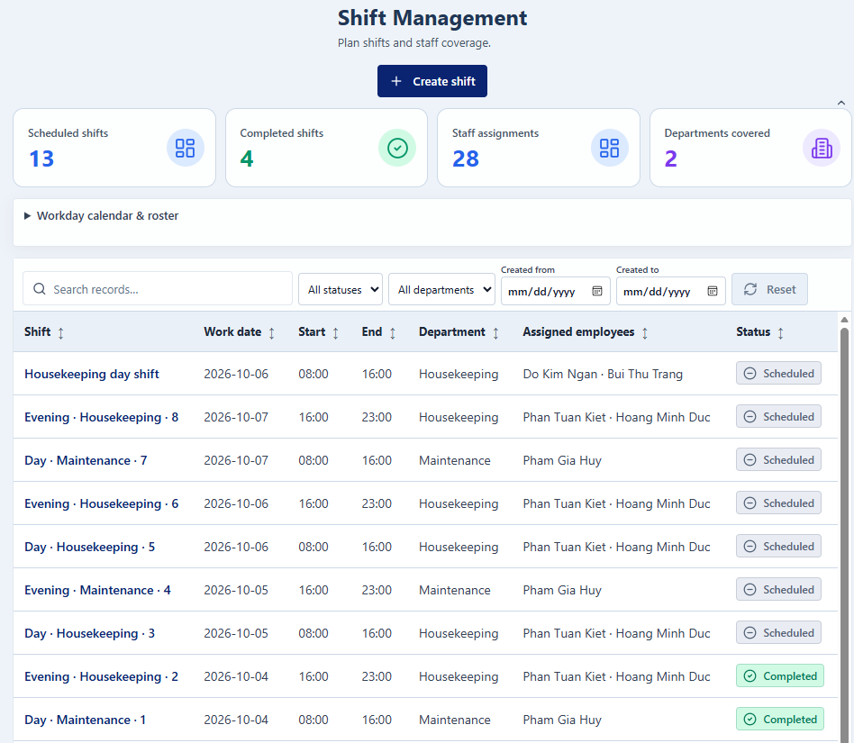

**Screen / Function Description**

This screen allows Department Head to:

127. View shift definitions and the department's weekly roster.

128. Create or update operational shift definitions.

129. Assign employees to shifts by date.

130. Prevent overlapping shift assignments for an employee.

On this screen, the user can also:

131. Remove eligible future shift assignments.

132. Notify affected employees after saved assignment changes.

**Mapped Use Cases:** UC-138 Manage Operational Workday and Shift Records

**Field Description**

| **Field Name**           | **Description**                                                                                                     |
|--------------------------|---------------------------------------------------------------------------------------------------------------------|
| ***Roster Context***     |                                                                                                                     |
| Department               | Data type: department reference. Required context. Department Head manages only authorized department/branch scope. |
| Week / Date              | Data type: date/week selector. Used to display and edit the roster period.                                          |
| Weekly Roster            | Calendar/grid component showing employees and assigned shifts by date.                                              |
| ***Shift Definition***   |                                                                                                                     |
| Shift Code               | Data type: string/text input. Required. Maximum length/uniqueness scope are not explicitly specified in the SRS.    |
| Shift Name               | Data type: string/text input. Required.                                                                             |
| Start Time               | Data type: time. Required.                                                                                          |
| End Time                 | Data type: time. Required. Must define a valid shift interval according to implementation/time rules.               |
| ***Shift Assignment***   |                                                                                                                     |
| Employee                 | Data type: user reference. Required for assignment. Must be an eligible active employee in the department/branch.   |
| Assignment Date          | Data type: date. Required.                                                                                          |
| Shift                    | Data type: shift-reference dropdown. Required.                                                                      |
| Overlap Validation       | System validation. An employee cannot have overlapping shift assignments.                                           |
| ***Actions***            |                                                                                                                     |
| Save                     | Saves shift definitions/assignments after validation and records the change in the audit log.                       |
| Remove Future Assignment | Action for eligible future assignments. Historical operational records remain traceable.                            |

### 12.2 Shift Handover

#### 12.2.1 Shift Handover Detail 

**UI Layout**

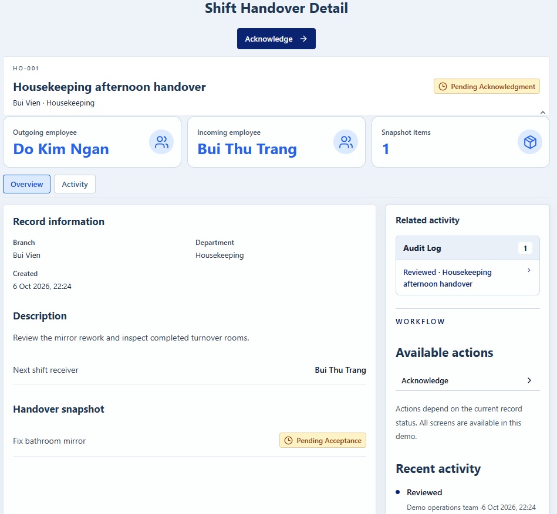

**Screen / Function Description**

This screen allows Housekeeping Supervisor; Housekeeping Staff; Maintenance Lead; Maintenance Staff; Storekeeper; Department Head; receiving employee to:

133. Prepare a snapshot of the sender's open work at the end of a shift.

134. Select the receiving employee and record item-specific/general notes.

135. Submit the handover for acknowledgment.

136. Allow the receiver to acknowledge or reject the handover.

On this screen, the user can also:

137. Keep the submitted snapshot unchanged for historical traceability.

138. Require source-record reassignment through the appropriate assignment use case rather than through handover alone.

**Mapped Use Cases:** UC-140 Manage Operational Shift Handover

**Field Description**

| **Field Name**          | **Description**                                                                                                                     |
|-------------------------|-------------------------------------------------------------------------------------------------------------------------------------|
| ***Handover Header***   |                                                                                                                                     |
| Handover No.            | Read-only system identifier if implemented.                                                                                         |
| Sender                  | Read-only current authenticated employee.                                                                                           |
| Receiver                | Data type: user reference. Required. Must be an employee of the same department on the next shift.                                  |
| Submitted Time          | Read-only server timestamp.                                                                                                         |
| Status                  | Read-only enum such as Pending Acknowledgment, Acknowledged or Rejected.                                                            |
| ***Snapshot Items***    |                                                                                                                                     |
| Open Operational Tasks  | Read-only snapshot of the sender's open tasks at submission time.                                                                   |
| Cleaning / Rework Tasks | Read-only snapshot of open cleaning/rework work.                                                                                    |
| Incidents               | Read-only snapshot of relevant open incidents.                                                                                      |
| Internal Requests       | Read-only snapshot of open internal requests handled by the sender.                                                                 |
| Unready Rooms           | Read-only snapshot included for lead roles where applicable.                                                                        |
| Item Note               | Data type: multiline string per snapshot item. Optional.                                                                            |
| General Note            | Data type: multiline string. Optional.                                                                                              |
| ***Actions***           |                                                                                                                                     |
| Submit                  | Creates the handover as Pending Acknowledgment and notifies the receiver.                                                           |
| Acknowledge             | Receiver action. Records acknowledgment time once and confirms awareness; it does not automatically reassign each source work item. |
| Reject Reason           | Data type: multiline string. Required when rejecting. Minimum 10 characters under the common rejection rule.                        |

## 13. Internal Request Management (FE-13)

### 13.1 Internal Requests

#### 13.1.1 Internal Request List 

**UI Layout**

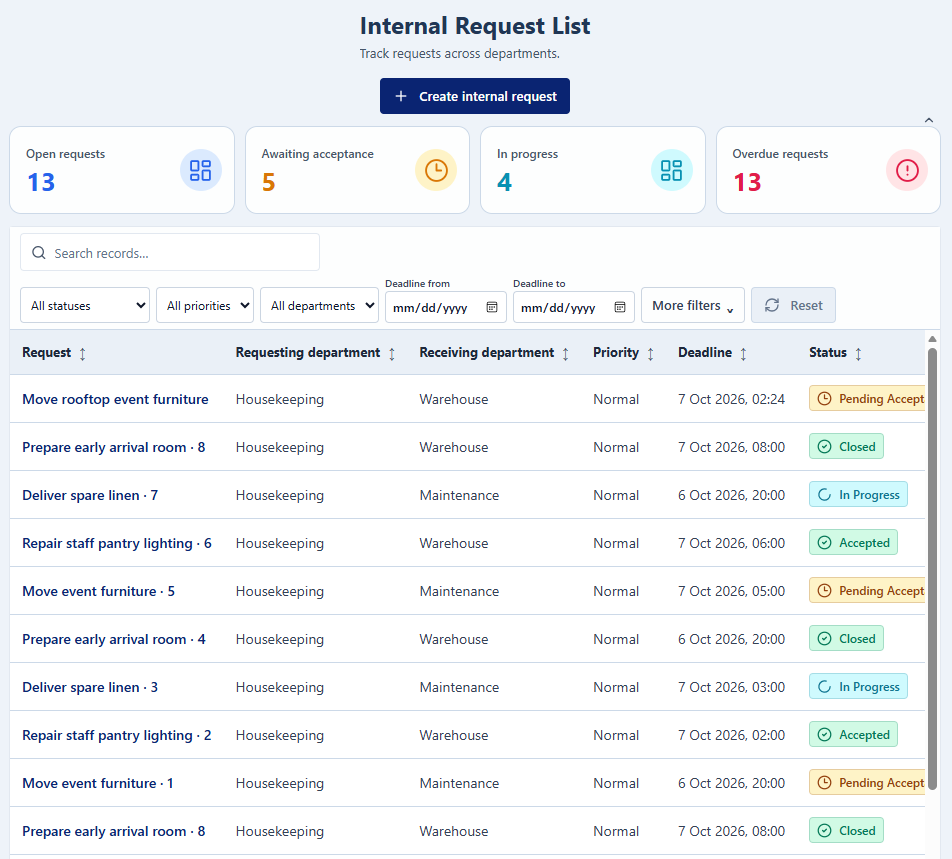

**Screen / Function Description**

This screen allows Authorized operational users; Department Head; Operations Manager to:

139. View internal requests the user sent, received or is responsible for.

140. Filter by direction, status, type, priority, department and overdue state.

141. Search requests and review key handler/deadline information.

142. Open the complete request history and processing timeline.

On this screen, the user can also:

143. Create a new cross-department internal request.

144. Withdraw a request that is still Pending Acceptance when the current user is the requester.

**Mapped Use Cases:** UC-114 Create Internal Request; UC-123 View Internal Request History

**Field Description**

| **Field Name**           | **Description**                                                                                                                                                                                                |
|--------------------------|----------------------------------------------------------------------------------------------------------------------------------------------------------------------------------------------------------------|
| ***Search and Filters*** |                                                                                                                                                                                                                |
| Direction                | Data type: enum/dropdown. Optional. Allowed values: Sent, Received, All. Initial value may depend on role.                                                                                                     |
| Status                   | Data type: enum/dropdown. Optional. Initial value: All Statuses.                                                                                                                                               |
| Request Type             | Data type: reference/dropdown. Optional.                                                                                                                                                                       |
| Priority                 | Data type: enum/dropdown. Optional. Allowed values: Low, Normal, High, Critical.                                                                                                                               |
| Department               | Data type: department reference. Optional.                                                                                                                                                                     |
| Handler                  | Data type: user-reference filter. Optional if implemented.                                                                                                                                                     |
| Overdue Only             | Data type: boolean/toggle. A request is overdue when it is not Closed/Rejected/Cancelled and current time is after the deadline.                                                                               |
| Search                   | Data type: string/text input. Optional.                                                                                                                                                                        |
| ***Request List***       |                                                                                                                                                                                                                |
| Internal Request Table   | Read-only table. Recommended columns: Request No., Title/Type, Requester, Receiving Department, Handler, Priority, Deadline, Status, Overdue Flag. Default sorting is by Deadline for history/list monitoring. |
| Pagination               | Default 20 rows/page; maximum 100.                                                                                                                                                                             |
| ***Actions***            |                                                                                                                                                                                                                |
| Create Request           | Action. Opens Internal Request Detail in create mode.                                                                                                                                                          |
| View Detail              | Row action. Opens routing, decisions, handlers, handovers, progress, linked work, escalations and result.                                                                                                      |
| Withdraw                 | Requester action available only while the request is Pending Acceptance. Requires a reason and changes the request to Cancelled.                                                                               |

#### 13.1.2 Internal Request Detail 

**UI Layout**

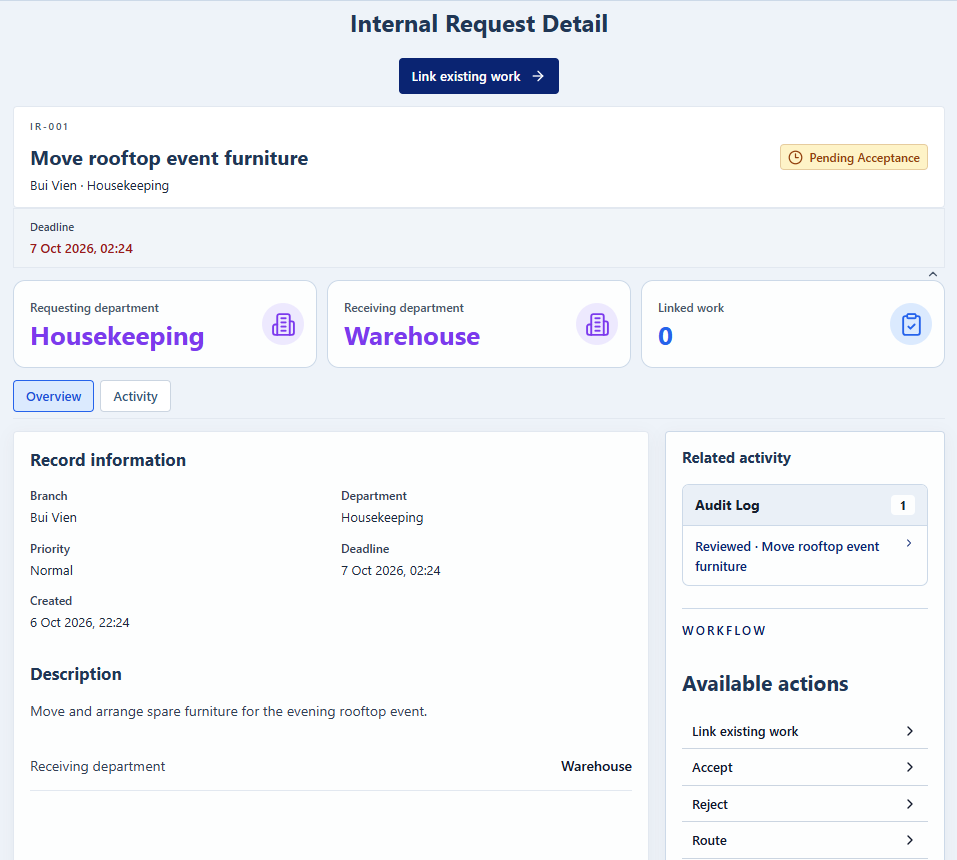

**Screen / Function Description**

This screen allows Requester; receiving Department Head; assigned handler; Operations Manager for escalation to:

145. Create and process a non-material support request between hotel departments.

146. Route, accept/reject and assign the request to a responsible handler.

147. Update progress and link the operational work needed to fulfill the request.

148. Complete, hand over, reopen or escalate the request through controlled actions.

On this screen, the user can also:

149. Prevent material needs from being handled as Internal Requests.

150. Require mandatory linked work to be closed before completing the request.

**Mapped Use Cases:** UC-114 Create Internal Request; UC-115 Route and Assign Internal Request; UC-116 Accept/Reject Internal Request; UC-117 Update Internal Request Progress; UC-118 Create Linked Operational Work; UC-119 Record Request Handover; UC-120 Complete Internal Request; UC-121 Reopen Internal Request; UC-122 Escalate Overdue Internal Request; UC-123 View Internal Request History

**Field Description**

| **Field Name**            | **Description**                                                                                                                                                                                            |
|---------------------------|------------------------------------------------------------------------------------------------------------------------------------------------------------------------------------------------------------|
| ***Request Information*** |                                                                                                                                                                                                            |
| Request No.               | Read-only system identifier after creation.                                                                                                                                                                |
| Request Type              | Data type: reference/dropdown. Required. Material need types must use Material Request instead of Internal Request.                                                                                        |
| Requesting Department     | Read-only department of the requester/source context.                                                                                                                                                      |
| Receiving Department      | Data type: department reference. Required and must be active.                                                                                                                                              |
| Title                     | Data type: string/text input. Required. Maximum length: not specified in the SRS.                                                                                                                          |
| Description               | Data type: multiline string. Required.                                                                                                                                                                     |
| Location                  | Data type: room/area/location reference. Optional.                                                                                                                                                         |
| Priority                  | Data type: enum/dropdown. Required. Allowed values: Low, Normal, High, Critical.                                                                                                                           |
| Desired Deadline          | Data type: datetime. Required. Must satisfy server-time/deadline validation.                                                                                                                               |
| Attachments               | Data type: file upload. Optional. JPG/PNG/PDF; max 10 MB/file, 5 files/upload.                                                                                                                             |
| Requester                 | Read-only authenticated user.                                                                                                                                                                              |
| Handler                   | Data type: user reference when assigned. Must belong to the current receiving department.                                                                                                                  |
| Status                    | Read-only workflow enum such as Pending Acceptance, Accepted, In Progress, Closed, Rejected or Cancelled.                                                                                                  |
| ***Processing***          |                                                                                                                                                                                                            |
| Progress                  | Data type: integer/percentage. Range 0-100. Reaching 100 does not close the request; only Department Head completion closes it.                                                                            |
| Progress Notes            | Data type: multiline string. Optional during update.                                                                                                                                                       |
| Linked Work               | Read-only/action list of related Cleaning Task, Incident, Material Request or Operational Task. Creating linked work uses the target process and permissions and does not automatically close the request. |
| Route Target Department   | Data type: department reference. Used by the receiving Department Head while request is Pending Acceptance.                                                                                                |
| Reject / Route Reason     | Data type: multiline string. Rejection requires a reason; common exception reason minimum is 10 characters.                                                                                                |
| Changed Deadline Reason   | Data type: multiline string. Required when the receiving Department Head changes the deadline.                                                                                                             |
| Handover Receiver         | Data type: user reference. Must be an eligible handler in the receiving department. Responsibility transfers only after acknowledgment.                                                                    |
| Handover Summary / Note   | Data type: multiline string. Required/used to explain current status during handover.                                                                                                                      |
| Result Note               | Data type: multiline string. Required when Department Head completes/closes the request.                                                                                                                   |
| Reopen Reason             | Data type: multiline string. Required. Minimum 10 characters. Reopen allowed within 7 days after closure and returns the request to In Progress with the last handler.                                     |
| Escalation Changes        | Controlled fields for Operations Manager on overdue/at-risk requests: new Priority, Deadline, Receiving Department or Handler.                                                                             |
| Escalation Reason         | Data type: multiline string. Required for escalation/manual override.                                                                                                                                      |
| ***Actions***             |                                                                                                                                                                                                            |
| Accept / Reject           | Receiving Department Head action while Pending Acceptance. Rejection requires reason.                                                                                                                      |
| Assign / Route            | Receiving Department Head action. First assignment moves an Accepted request to In Progress.                                                                                                               |
| Update Progress           | Current handler or receiving Department Head action. Only Department Head can change deadline.                                                                                                             |
| Complete                  | Department Head action. Allowed only when all mandatory linked work is closed and no handover is pending; Result Note is mandatory.                                                                        |
| Reopen / Escalate         | Controlled actions subject to reopen window or overdue/at-risk eligibility.                                                                                                                                |

## 14. Notification & Operational Dashboard (FE-14)

### 14.1 Operational Dashboard

#### 14.1.1 Dashboard 

**UI Layout**

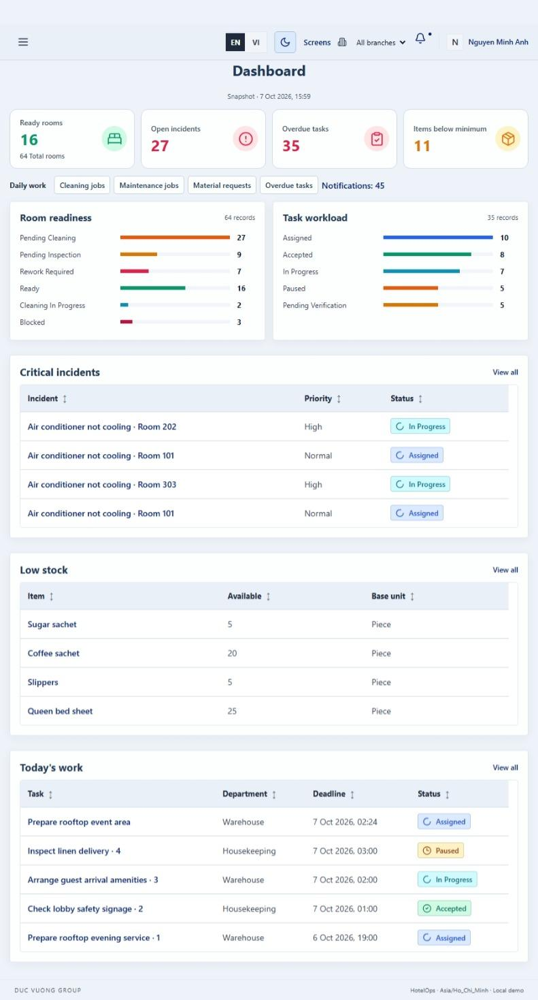

**Screen / Function Description**

This screen allows Operations Manager; Owner to:

151. Display role-authorized operational KPIs for rooms, tasks, incidents/maintenance and inventory/materials.

152. Filter management metrics by branch, department and period.

153. Use one consistent snapshot time for all figures on the dashboard.

154. Drill down from a metric to the corresponding operational screen.

On this screen, the user can also:

155. Display N/A instead of 0 when a ratio has no denominator.

156. Show missing-source warnings rather than silently treating unavailable data as zero.

**Mapped Use Cases:** UC-131 View Room Readiness Dashboard; UC-132 View Task Workload Dashboard; UC-133 View Incident and Maintenance Dashboard; UC-134 View Inventory and Material Dashboard

**Field Description**

| **Field Name**                  | **Description**                                                                                                                      |
|---------------------------------|--------------------------------------------------------------------------------------------------------------------------------------|
| ***Dashboard Filters***         |                                                                                                                                      |
| Branch                          | Data type: reference/dropdown. Optional. Values are limited to branches in the user's management scope.                              |
| Department                      | Data type: department-reference dropdown. Optional.                                                                                  |
| Period From                     | Data type: date/datetime. Optional. Default period is the last 30 days.                                                              |
| Period To                       | Data type: date/datetime. Optional. Must not be earlier than Period From.                                                            |
| Snapshot Time                   | Read-only server timestamp. All metrics shown together must use the same snapshot time.                                              |
| ***Room Readiness KPIs***       |                                                                                                                                      |
| Ready Rooms                     | Read-only integer count.                                                                                                             |
| Pending Cleaning                | Read-only integer count.                                                                                                             |
| Cleaning In Progress            | Read-only integer count.                                                                                                             |
| Pending Inspection              | Read-only integer count.                                                                                                             |
| Rework Required                 | Read-only integer count.                                                                                                             |
| Blocked Rooms                   | Read-only integer count.                                                                                                             |
| Ready Ratio                     | Read-only percentage = Ready Rooms / Active Rooms. Display N/A when denominator is 0.                                                |
| Overdue Cleaning Tasks          | Read-only integer/KPI count.                                                                                                         |
| First-Time Inspection Pass Rate | Read-only percentage/KPI. Display N/A when denominator is 0.                                                                         |
| ***Other Operational KPIs***    |                                                                                                                                      |
| Task Workload Summary           | Read-only chart/card summary by status, department, employee, priority, time and overdue status as authorized.                       |
| Incident & Maintenance Summary  | Read-only chart/card summary of open incidents, severity, response/completion times, recurring incidents and preventive maintenance. |
| Inventory & Material Summary    | Read-only chart/card summary of stock levels, below-minimum items, receipts/issues, material fulfillment and replenishment needs.    |
| ***Actions***                   |                                                                                                                                      |
| Drill Down                      | Selecting a card/chart opens the relevant operational List/Board with corresponding filters applied.                                 |

## 15. Operational Reports & Audit History (FE-15)

### 15.1 Reporting

#### 15.1.1 Operational Reports 

**UI Layout**

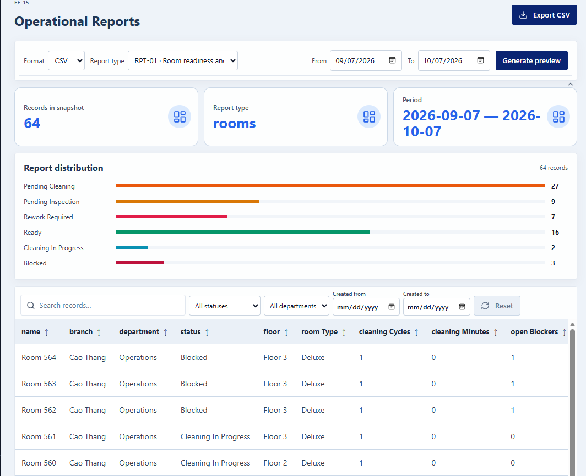

**Screen / Function Description**

This screen allows Operations Manager; Owner to:

157. Select an operational report type and configure its filters.

158. Preview report results using one consistent snapshot time.

159. Export the same filtered snapshot to CSV, XLSX or PDF.

160. Limit report content to fields and branches the user is authorized to access.

On this screen, the user can also:

161. Refuse exports that exceed the configured row limit rather than truncating them.

162. Record successful exports in the audit log.

**Mapped Use Cases:** UC-135 Generate and Export Operational Reports

**Field Description**

| **Field Name**                     | **Description**                                                                                                                   |
|------------------------------------|-----------------------------------------------------------------------------------------------------------------------------------|
| ***Report Selection and Filters*** |                                                                                                                                   |
| Report Type                        | Data type: enum/reference dropdown. Required. Values come from the operational report catalog (RPT-01 to RPT-07 in the SRS).      |
| Period From                        | Data type: date/datetime. Required according to report. Default reporting period is the last 30 days.                             |
| Period To                          | Data type: date/datetime. Required according to report. Must not be earlier than Period From.                                     |
| Branch                             | Data type: reference/dropdown. Optional/required according to scope. User cannot select a branch outside authorized scope.        |
| Department                         | Data type: reference/dropdown. Optional. Must be valid for selected Branch.                                                       |
| Additional Report Filters          | Report-specific fields such as Status, Priority, Room, Asset, Item or other criteria. Values must be limited to the user's scope. |
| ***Preview and Output***           |                                                                                                                                   |
| Preview                            | Action. Validates filters and generates the report at one Snapshot Time without changing operational data.                        |
| Snapshot Time                      | Read-only server timestamp. Preview and export must use the same snapshot and filters.                                            |
| Report Result                      | Read-only table/chart. Missing values are not silently converted to 0; ratios with zero denominator display N/A.                  |
| Export Format                      | Data type: enum/dropdown. Required when exporting. Allowed values: CSV, XLSX, PDF.                                                |
| Export                             | Action. Creates a file with the same filters/snapshot and records the export in the audit log.                                    |
| Export Row Limit                   | Validation. Maximum 50,000 data rows per export file. Larger result sets must be refused and the user must narrow the filters.    |
| No Data / Missing Data Message     | Read-only informational message shown when no records match or source data is incomplete.                                         |

### 15.2 Audit History

#### 15.2.1 Audit Log 

**UI Layout**

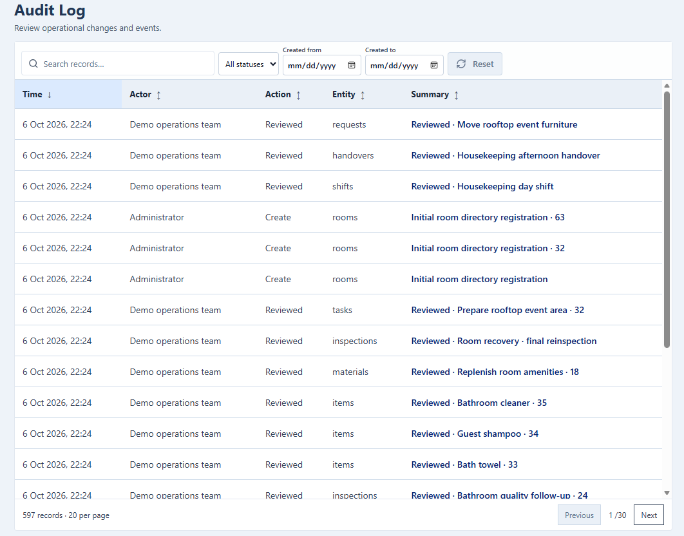

**Screen / Function Description**

This screen allows Administrator to:

163. View the history of important create, update, approval, rejection, completion and critical actions.

164. Filter audit entries by period, actor, entity type, action and branch.

165. Search and sort the audit trail, newest first by default.

166. Open an audit entry to inspect detailed before/after values where available.

On this screen, the user can also:

167. Keep audit records append-only and read-only.

168. Prevent editing or deletion of audit history through the UI.

**Mapped Use Cases:** UC-136 View Audit Logs; UC-137 Inspect Record Change History

**Field Description**

| **Field Name**                | **Description**                                                                                                                                       |
|-------------------------------|-------------------------------------------------------------------------------------------------------------------------------------------------------|
| ***Search and Filters***      |                                                                                                                                                       |
| Date From                     | Data type: date/datetime. Optional.                                                                                                                   |
| Date To                       | Data type: date/datetime. Optional. Must not be earlier than Date From.                                                                               |
| Actor                         | Data type: user-reference filter. Optional.                                                                                                           |
| Entity Type                   | Data type: enum/reference dropdown. Optional. Example entity types include User, Room, Task, Incident, Asset, Stock Transaction and Material Request. |
| Action                        | Data type: enum/reference dropdown. Optional. Examples: Create, Update, Approve, Reject, Assign, Complete, Close, Reopen, Deactivate.                 |
| Branch                        | Data type: branch-reference dropdown. Optional and restricted to authorized scope.                                                                    |
| Search                        | Data type: string/text input. Optional.                                                                                                               |
| ***Audit Entries***           |                                                                                                                                                       |
| Time                          | Read-only timestamp column. Generated by the server. Default list ordering is newest first.                                                           |
| Actor                         | Read-only user/reference column identifying who performed the action.                                                                                 |
| Action                        | Read-only action column.                                                                                                                              |
| Entity                        | Read-only affected entity/object reference.                                                                                                           |
| Summary                       | Read-only brief description of the event.                                                                                                             |
| Before / After Values         | Read-only detailed values shown in the selected audit entry when available.                                                                           |
| Pagination                    | Default 20 rows/page; maximum 100.                                                                                                                    |
| ***Actions and Constraints*** |                                                                                                                                                       |
| View Detail                   | Row action. Opens actor, time, action, entity and before/after change information.                                                                    |
| Edit / Delete                 | Not available. Audit records are append-only, read-only for all users and retained for 365 days according to the SRS retention parameter.             |

## 16. Background Job Inventory

### 16.1 Check Overdue and At-Risk Work (JOB-01)

***Trigger***: Scheduled — every 5 minutes (SYS-PAR-15)

***Purpose***: Detects cleaning/rework tasks, incidents, maintenance occurrences, operational tasks and internal requests that become overdue or at risk, and alerts the responsible users (UC-127).

***Processing steps*:**

1.  Read the scan interval (SYS-PAR-15) and the at-risk threshold (SYS-PAR-21).

2.  Find open records whose due time has passed (overdue) or whose elapsed time has reached SYS-PAR-21 of the allowed time (at risk) (GBR-055, GBR-080).

3.  For each record without an open alert episode, create one in-app notification for the assignee and the responsible supervisor, lead or Department Head (GBR-158).

4.  Close the alert episode of records that are no longer overdue or at risk, so that a later recurrence raises a new alert.

5.  Log the number of alerts created in this run.

***Failure behavior*:**

| **Scenario**                   | **System behavior**                                                                                                                                    |
|--------------------------------|--------------------------------------------------------------------------------------------------------------------------------------------------------|
| Database unreachable           | The run ends without changes and logs an error. The next run checks again; no alert is lost or duplicated because episodes are checked before sending. |
| Notification cannot be created | The alert is queued and re-created by JOB-03 (GBR-010).                                                                                                |

### 16.2 Check Low Stock (JOB-02)

***Trigger***: Scheduled — every 5 minutes (SYS-PAR-15)

***Purpose***: Compares available stock with the minimum stock level of each warehouse and item, and alerts the responsible users (UC-128).

***Processing steps*:**

1.  Find warehouse/item pairs that have a minimum stock level (GBR-094).

2.  Select the pairs whose available quantity is below the minimum level.

3.  For each pair without an open low-stock episode, create one in-app notification for the responsible users (GBR-158).

4.  Close the episode of pairs whose available quantity is back at or above the minimum level.

5.  Log the number of alerts created in this run.

***Failure behavior*:**

| **Scenario**                 | **System behavior**                                                        |
|------------------------------|----------------------------------------------------------------------------|
| Database unreachable         | The run ends without changes and logs an error. The next run checks again. |
| Item without a minimum level | The item is skipped; it never raises a low-stock alert (GBR-094).          |

### 16.3 Retry Failed Notifications (JOB-03)

***Trigger***: Scheduled — every 5 minutes

***Purpose***: Re-creates notifications that could not be created after a successful business operation (GBR-010).

***Processing steps*:**

1.  Find queued notifications that have not been created yet.

2.  Check that each recipient still has read permission on the source record (GBR-010).

3.  Create the notification and remove it from the queue.

4.  Log the number of notifications created and still queued.

***Failure behavior*:**

| **Scenario**                         | **System behavior**                                                                            |
|--------------------------------------|------------------------------------------------------------------------------------------------|
| Notification still cannot be created | The item stays in the queue and is retried in the next run. The business data is not affected. |
| Recipient no longer has permission   | The item is removed from the queue without creating a notification.                            |

### 16.4 Generate Preventive Maintenance Occurrences (JOB-04)

***Trigger***: Scheduled — daily at 0:30 AM

***Purpose***: Creates maintenance occurrences for Active preventive maintenance schedules before their due dates (GBR-083).

***Processing steps*:**

1.  Find Active schedules whose next due date is within SYS-PAR-16 days and that have no occurrence for that due date.

2.  Create the occurrence, assigned to the schedule's default assignee or Pending Assignment if none (GBR-083).

3.  Calculate the next due date from the scheduled due date, not from the completion date.

4.  Send an assignment notification to the assignee (UC-124).

5.  Log the number of occurrences created.

***Failure behavior*:**

| **Scenario**                        | **System behavior**                                                                                             |
|-------------------------------------|-----------------------------------------------------------------------------------------------------------------|
| Error while creating one occurrence | That schedule's transaction is rolled back and logged; other schedules continue. The next run creates it again. |
| Job runs twice for the same day     | No duplicate is created because one schedule can have only one occurrence per due date.                         |

### 16.5 Generate Recurring Tasks (JOB-05)

***Trigger***: Scheduled — daily at 0:45 AM

***Purpose***: Creates task occurrences for Active recurring task series before they are due (GBR-124).

***Processing steps*:**

1.  Find Active task series whose next occurrence is due within SYS-PAR-17 day(s) and has not been created.

2.  Create the task occurrence with the series' default assignee (GBR-124).

3.  Send an assignment notification to the assignee (UC-124).

4.  Log the number of tasks created.

***Failure behavior*:**

| **Scenario**                    | **System behavior**                                                                                       |
|---------------------------------|-----------------------------------------------------------------------------------------------------------|
| Error while creating one task   | That series' transaction is rolled back and logged; other series continue. The next run creates it again. |
| Job runs twice for the same day | No duplicate is created because one series can have only one occurrence per due date.                     |

### 16.6 Clean Up Old Notifications and Audit Log Entries (JOB-06)

***Trigger***: Scheduled — daily at 2:00 AM

***Purpose***: Deletes notifications and audit records older than their retention periods to prevent unbounded database growth (GBR-160, GBR-164).

***Processing steps*:**

1.  Read the notification retention (SYS-PAR-14) and the audit log retention (SYS-PAR-13).

2.  Delete notifications older than SYS-PAR-14 days in batches.

3.  Delete audit records older than SYS-PAR-13 days in batches.

4.  Log the number of records deleted.

***Failure behavior*:**

| **Scenario**                    | **System behavior**                                                                                     |
|---------------------------------|---------------------------------------------------------------------------------------------------------|
| Database timeout during delete  | The current batch is rolled back and a warning is logged. The next run continues; no data is corrupted. |
| Retention period not configured | The job uses the default of 365 days and logs a warning.                                                |

## 17. External API Inventory

### 17.1 HTTP Method: URL pattern (API-ID)

| ***URL***     | HTTP method: URL pattern                   |
|---------------|--------------------------------------------|
| ***Purpose*** | Purpose in one plain-language sentence     |
| ***Caller***  | Who the caller is (which external system)  |
| ***Auth***    | Authentication requirement (yes/no + type) |

### 17.2 VnPay Webhook (API-02)

| ***URL***     | POST: /api/v1/commerce/payment/webhook/vnpay                                   |
|---------------|--------------------------------------------------------------------------------|
| ***Purpose*** | Receives payment confirmation (IPN) from VNPay; triggers access grant creation |
| ***Caller***  | VNPay payment gateway                                                          |
| ***Auth***    | HMAC-SHA512 signature validation                                               |

### 17.3 SePay Webhook (API-03)

| ***URL***     | POST: /api/v1/commerce/payment/webhook/sepay                             |
|---------------|--------------------------------------------------------------------------|
| ***Purpose*** | Receives payment confirmation from SePay; triggers access grant creation |
| ***Caller***  | SePay payment gateway                                                    |
| ***Auth***    | HMAC signature validation                                                |

