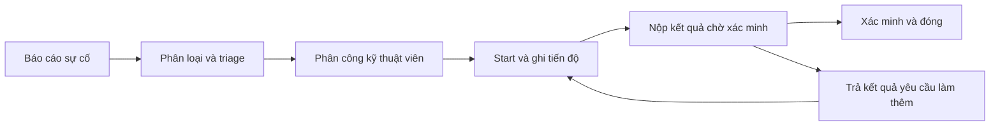
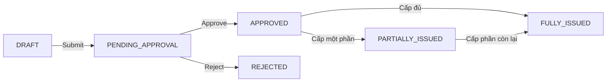

# Kịch bản demo: Sự cố – bảo trì và Yêu cầu – duyệt – cấp phát vật tư

Ngày đối chiếu: **18/11/2026**. Áp dụng source hiện tại của HotelOps và `HotelOpsDB` vừa nhập từ `dbtest6flow.sql`. Hướng dẫn này dành cho người trình diễn; tên nút tiếng Anh được giữ theo giao diện/source để dễ tìm.

## 1. Đọc trước khi demo: tình trạng thực tế

**Chưa thể cam kết chạy xuyên suốt hai luồng với cấu hình hiện tại.** Các bước ở phần 4–5 là kết quả mong muốn sau khi đáp ứng điều kiện đầu vào, không phải biên bản E2E đã chạy đạt.

Đã kiểm tra chỉ đọc database local `DESKTOP-JI8U50T\SQLEXPRESS / HotelOpsDB`:

| Điểm kiểm tra | Kết quả hiện tại | Ảnh hưởng và việc cần hoàn tất trước buổi demo |
|---|---|---|
| Phân loại sự cố | Không có giá trị `INCIDENT_CATEGORY` hoạt động | Có thể tiếp nhận báo cáo ban đầu chưa phân loại; bước **Classify incident → Triage** cần danh mục hợp lệ. Người phụ trách phải chốt và cấu hình danh mục trước. |
| SLA theo ưu tiên | `incident_priority_sla_targets` có **0** dòng hoạt động | Không có lựa chọn triage/SLA được xác nhận. Admin có quyền vào `/structure/priority-sla` để cấu hình theo SLA đã được duyệt; không lấy một con số giả làm SLA chính thức. |
| Quyền đọc yêu cầu vật tư | Danh mục `permissions` có **0** bản ghi `MR_VIEW` | Source yêu cầu quyền này độc lập cho tạo/đọc và cấp phát. Luồng vật tư hiện **Blocked**, kể cả khi tài khoản đã có `MR_CREATE` hoặc `MR_FULFILL`. Cần quyết định/cấu hình quyền được nhóm phê duyệt, không tự thêm bằng SQL để vượt lỗi. |
| Người duyệt phiếu HK | HK ID 1 có `manager_user_id = 2` (`mai.tran`); tài khoản này có role hoạt động `HK_SUPERVISOR`, không phải `DEPT_MANAGER` | Chưa đủ căn cứ có người duyệt hợp lệ theo code hiện tại. Phải xác nhận danh sách **Approver** trả về từ server sau khi hoàn thiện cấu hình; không mặc định `mai.tran`, `ha.pham` hay Operations Manager đều duyệt được. |
| `ha.pham` làm người yêu cầu | `department_id = NULL` | Không chọn tài khoản này làm requester mẫu khi chưa có bộ phận phù hợp. Các phiếu mẫu đang thuộc `lan.dang`, bộ phận HK. |
| Schema bổ sung vật tư/tài sản | Đợt import đã phát hiện thiếu 5 bảng mà source tham chiếu, gồm nhóm `material_replenishment*` | Không đưa bổ sung hàng vào kịch bản demo chính. Nguồn DB chưa được xác nhận tương thích mọi module; xem [báo cáo import](../../artifacts/db-import-20261118-6flow/RESULT.md) nếu có trong workspace local. |

Tài liệu **không thay đổi dữ liệu, quyền, danh mục, mật khẩu hay schema**. Nếu các điều kiện trên chưa được xử lý, có thể giới thiệu màn hình và dữ liệu đầu vào nhưng phải nói rõ bước đang bị chặn; không trình bày kết quả mong muốn như kết quả đã xảy ra.

## 2. Chuẩn bị buổi demo

### 2.1. Ứng dụng và phiên đăng nhập

1. Dùng bản frontend/backend đã build từ cùng source, cùng kết nối `HotelOpsDB`. Sau khi pull code, cần build/chạy lại để tránh trình diễn binary hoặc `frontend/dist` cũ.
2. Chốt một địa chỉ **HTTPS** hoạt động, ví dụ `https://localhost:7443` **nếu ứng dụng được cấu hình/chạy ở cổng đó**. Các đường dẫn bên dưới được nối vào địa chỉ này. Đây không phải xác nhận service hiện đang chạy ở 7443.
3. Mở `/login`, thử đăng nhập và tải menu. Không dùng việc mở HTML thành công ở `http://127.0.0.1:5080` để kết luận thao tác đăng nhập/ghi đã hoạt động: source dùng cookie Secure và kiểm tra HTTPS trong các luồng có quyền.
4. Chuẩn bị profile trình duyệt độc lập cho từng người. Hai tab trong cùng profile dùng chung cookie; đăng nhập người thứ hai sẽ thay phiên của người thứ nhất.
5. Thử đăng nhập trước giờ demo. Nếu bị yêu cầu đổi mật khẩu tạm, hoàn thành trước; không ghi mật khẩu vào tài liệu hoặc ảnh bằng chứng.
6. Tải đúng chi nhánh **DVBV, ID 1** cho bộ dữ liệu bên dưới. Đây là ID quan sát từ database hiện tại, không phải hằng số nghiệp vụ dùng cho mọi môi trường.

### 2.2. Phân vai

| Người/vai trò | Tài khoản mẫu, ID quan sát | Nhiệm vụ và giới hạn |
|---|---|---|
| Người báo sự cố | `lan.dang`, User ID **6**, HK ID **1** | Báo cáo tại phòng thuộc phạm vi được phép; đồng thời là chủ các phiếu vật tư mẫu. Phải xác nhận các nút tạo/đọc thực sự khả dụng. |
| Trưởng bảo trì | `minh.le`, User ID **3**, MT ID **2** | Phân loại, triage, phân công và xác minh khi server cho phép. Không tự đóng thay bước thực hiện của kỹ thuật viên. |
| Kỹ thuật viên | `thinh.ngo`, User ID **9**, MT ID **2** | Bắt đầu workday, nhận/bắt đầu việc được giao, ghi tiến độ và nộp kết quả. Không tự xác minh kết quả của chính mình. |
| Người duyệt vật tư | **Chọn từ Approver do server trả về** | Phải khác requester/người gửi; đáp ứng quyền duyệt, mapping quản lý, bộ phận/chi nhánh và đúng người được chỉ định trong chu kỳ duyệt hiện tại. Chưa chốt tài khoản khả dụng trên DB này. |
| Thủ kho | `tung.vo`, User ID **5**, WH ID **4** | Kiểm tra khả dụng và cấp phát. Phải khác requester và người duyệt; không dùng role DEPT_MANAGER đang bị tắt của tài khoản này để giả định quyền duyệt. |

Không dùng `sysadmin` thay tất cả các vai. Quyền Reception/Department Head còn có phần yêu cầu chưa chốt; tài liệu mô tả điều kiện code đang kiểm tra, không đề xuất ma trận quyền mới. `MaterialApprovalAuthority` hiện kiểm tra `DEPT_MANAGER`, mapping quản lý và manager hiện tại. Nếu người yêu cầu chính là trưởng bộ phận, code có tuyến fallback theo bộ phận của kho và `MR_APPROVE_FALLBACK`; không tự chọn tuyến này để bỏ qua xung đột.

### 2.3. Dữ liệu đã có để thực hành

| Dữ liệu | Giá trị đã đọc trên DB | Cách sử dụng |
|---|---|---|
| Sự cố thử | Incident ID **13**, mã **W6_20261118-INC**, phòng ID **19**, trạng thái **OPEN** | Dùng để demo xử lý tiếp từ phân loại. Mở dữ liệu này không chứng minh vừa thực hiện bước tạo sự cố. |
| Phòng thử bảo trì | Room ID **19**, số phòng theo fixture **W6-1811-M** | Đọc lại phòng/chi nhánh trước khi thao tác; Room ID khác số phòng. Đã có sự cố 13 nên không tạo thêm bản trùng chỉ để có ảnh demo. |
| Vật tư đủ số lượng nhỏ | Request ID **14**, mã **W6_20261118-MR1**, requester **6**, bộ phận **1**, kho **2**, **DRAFT** | Phiếu chính để tự Submit → Approve → Issue sau khi hết blocker. |
| Phiếu thử cấp từng phần | Request ID **15**, mã **W6_20261118-MR2**, **DRAFT** | Có thể dùng để cấp 3 rồi 2, nếu tồn và quyền cho phép; không thao tác cùng phiếu 14 bằng hai kịch bản. |
| Phiếu thử thiếu tồn | Request ID **16**, mã **W6_20261118-MR3**, **DRAFT** | Yêu cầu **5.000 đơn vị**, dùng kiểm tra trường hợp thiếu tồn **chỉ nếu tồn hiện tại thực sự thấp hơn**. |
| Dòng vật tư | Cả ba phiếu: Item ID **1**, UOM ID **1**; phiếu 14/15 yêu cầu **5**, phiếu 16 yêu cầu **5000** | Theo tài liệu fixture: mã vật tư **AMN-SOAP**. Xác nhận lại tên/đơn vị trên catalog; không tự thay đơn vị. |
| Kho của phiếu mẫu | Warehouse ID **2**, mã **WH-HK**, bộ phận HK | Đây là kho đã gắn với phiếu; không đổi sang WH-MAIN/WH-MT ngay lúc cấp phát. |

Phiếu trên là **dữ liệu đầu vào**, chưa phải phiếu đã duyệt hoặc đã xuất kho. Không dùng lịch sử tháng 10 hoặc maintenance legacy ở trạng thái khác làm bằng chứng đã hoàn tất workflow mới.

### 2.4. Workday và hàng tồn

- `thinh.ngo` phải có workday đang làm việc, đúng chi nhánh/bộ phận và không có work interval khác đang chạy khi Start/Resume yêu cầu.
- Bộ fixture có phân ca cho ngày **18–20/11/2026**, ca MORNING **06:00–14:00 giờ Việt Nam**. Phân công `thinh.ngo` ngày 18 là Shift Assignment ID **27** theo tài liệu fixture; tải lại để xác nhận chưa thay đổi. ID này khác Shift ID.
- Nếu demo vào ngày/giờ khác, người có quyền phải chuẩn bị ca phù hợp qua luồng lập ca; không sửa lịch sử cũ hoặc dùng một ca đã hết để ép Start.
- Nhân viên mở `/workday/scheduled`, nhập Branch ID `1` → **View workday** → chọn ca hợp lệ → **Start scheduled workday** → xem Review → **Confirm scheduled start**. Xác nhận workday đã bắt đầu trước khi chuyển sang việc bảo trì.
- Trước cấp phát, kiểm tra tồn **khả dụng** của đúng vật tư/đơn vị/kho. Chụp số tồn ban đầu. Số lượng nhìn thấy trước đó không phải giữ chỗ; server kiểm tra lại khi xuất.

## 3. Phiếu ghi nhanh khi trình diễn

Điền vào trước khi bắt đầu, dùng cùng ID suốt từng luồng:

| Thông tin | Giá trị khi demo |
|---|---|
| Base URL HTTPS / thời gian demo | … |
| Chi nhánh / phòng | DVBV / Room ID … |
| Incident ID / mã | … |
| Maintenance Work ID / mã / kỹ thuật viên | … |
| Request ID / mã / requester / approver | … |
| Item / đơn vị / kho / tồn khả dụng ban đầu | … |
| Fulfillment ID / Stock Document ID sau cấp | … |

Lưu ID khi server xác nhận; không dùng Incident ID thay Work ID, không lấy số phòng thay Room ID, không lấy username thay User ID.

## 4. Luồng 1 — Báo sự cố và xử lý bảo trì

### 4.1. Câu chuyện demo

“Nhân viên phát hiện điều hòa phòng thử không làm mát. Trưởng bảo trì tiếp nhận, phân loại và giao kỹ thuật viên. Kỹ thuật viên xử lý, ghi kết quả; trưởng bảo trì kiểm tra độc lập rồi đóng hồ sơ.”

Luồng chính dưới đây **không tiêu hao vật tư** để tách riêng việc kiểm tra bảo trì khỏi blocker quyền vật tư. Nếu thực tế có dùng vật tư thì phải ghi đầy đủ, không cố để trống nhằm vượt bước kiểm tra.

### 4.2. Từng bước thao tác và kết quả mong muốn

| Bước | Ai / màn hình | Thao tác cụ thể | Kết quả mong muốn và bằng chứng |
|---|---|---|---|
| 1. Chọn phòng | Người báo, `/room-directory` hoặc `/rooms/status` | Chọn DVBV, tải dữ liệu; mở đúng phòng. Kiểm tra các sự cố đang mở và block hiện hữu. Nếu dùng fixture 13, ghi nhận đang tiếp tục hồ sơ sẵn có và chuyển bước 3. | Nhìn thấy đúng Room ID/chi nhánh; biết phòng có block nào trước demo. |
| 2. Báo sự cố mới | Người báo, **Report an incident for this room** hoặc `/operations/incidents` → **Create Incident** | Chỉ dùng phòng demo khác đã được chuẩn bị và không có báo cáo trùng. Nhập tiêu đề `DEMO-18NOV-AC: Điều hòa không làm mát`, mô tả `Đã bật điều hòa nhưng không có khí lạnh; đề nghị kỹ thuật kiểm tra`, thời điểm phát hiện và vị trí đúng. Thực hiện review các sự cố tương tự theo màn hình; nếu có sự cố tương đương, mở hồ sơ đó. Hoàn thiện trường bắt buộc rồi **Save create incident**. | Server xác nhận tạo, trả Incident ID/mã; đọc lại hồ sơ. API tạo mong muốn **201**, dữ liệu mới OPEN. Chỉ đánh dấu “đã demo báo sự cố” khi thật sự tạo thành công. |
| 3. Phân loại | `minh.le`, `/operations/incidents/{IncidentID}` | Tải chi tiết. Trong **Classify incident**, chọn **Category**, **Severity**, **Affects room readiness** theo mô tả và quy định đã chốt → **Save classification**. Demo bảo trì không cần block phòng có thể dùng tác động No nếu đúng tình huống. | Phân loại được lưu, tải lại còn đúng các lựa chọn. Nếu Category trống, **dừng tại đây: Blocked**, không nhập ID giả. Có tác động/block phải được kiểm tra từ hồ sơ, không suy ra chỉ từ việc chọn Severity. |
| 4. Triage | `minh.le`, **Triage incident** | Chọn **Priority** từ SLA options. Nhập **Initial action plan**: `Kiểm tra nguồn điện, bộ lọc và hệ thống làm lạnh; thử lại trước khi bàn giao.` Giữ deadline mặc định đã được duyệt. Bấm **Review triage** → **Confirm triage**. | Thông báo `Triage saved. The incident is pending assignment.`; assignment workflow **PENDING_ASSIGNMENT**, Incident vẫn **OPEN**. Đọc được deadline phản hồi/giải quyết. Nếu SLA options trống, không thể qua bước này. |
| 5. Phân công | `minh.le`, **Assign or reassign technician** | **Load eligible technicians**; chọn **Work department** đúng MT và **Technician = thinh.ngo** nếu có trong danh sách. Nhập **Instructions** và **Planned end** ở giờ Việt Nam, còn trong tương lai/phù hợp ca. **Review assignment** → **Confirm assignment**. | Server xác nhận assignment workflow **ASSIGNED**, có Work ID và người nhận đúng. Mở work từ **Browse related maintenance works** hoặc `/operations/maintenance/{WorkID}`; không đoán Work ID từ Incident ID. |
| 6. Nhận và bắt đầu | `thinh.ngo`, chi tiết work | Đọc phân công, hướng dẫn, workday. Khi khả dụng, bấm **Start maintenance** → **Confirm start**. | Work chuyển **IN_PROGRESS**, mở work interval; Incident chưa đóng. Nếu thiếu workday/sai người/đang có việc khác chạy, server từ chối, không tự đổi trạng thái trong DB. |
| 7. Ghi tiến độ | `thinh.ngo`, **Record progress and materials** | Nhập **Progress note**: `Đã kiểm tra nguồn, vệ sinh bộ lọc và chạy thử; đang theo dõi nhiệt độ.` Nhập Progress (%) nếu màn hình cung cấp. **Review progress** → **Confirm progress**. Nếu có vật tư, chọn dòng chứng từ đã cấp hợp lệ bằng **Load issued materials**, đúng đơn vị/số lượng thực dùng. | Có log tiến độ mới, đúng người thực hiện; dữ liệu còn sau reload. Tiến độ 100% không tự thay cho bước nộp/xác minh. Vật tư dùng không vượt phần đã cấp trừ đã dùng/đã trả theo kiểm tra server. |
| 8. Nộp kết quả | `thinh.ngo`, **Submit result for verification** | **Diagnosis / root cause**: `Bộ lọc bẩn làm giảm lưu lượng gió.` **Action taken**: `Đã vệ sinh bộ lọc, kiểm tra nguồn và chạy thử; phòng đạt nhiệt độ yêu cầu.` Thêm ghi chú/bằng chứng khi được yêu cầu → **Review submission** → **Confirm submission**. | Work có status **COMPLETED**, submission workflow **PENDING_VERIFICATION**; interval hiện tại đóng. Incident vẫn mở chờ người xác minh. Chụp trạng thái này để phân biệt nộp xong với đóng xong. |
| 9. Xác minh độc lập | `minh.le`, work vừa nộp | Tải lại, đọc chẩn đoán, xử lý, log, bằng chứng và vật tư. Tại **Accept and close**, nhập **Verification note** ít nhất 10 ký tự, ví dụ `Đã kiểm tra chạy thử, chấp nhận kết quả sửa chữa.` → **Review closure** → **Confirm closure**. | Work **CLOSED** và Incident **CLOSED** sau xác nhận; người xác minh khác kỹ thuật viên. Có note/người/thời điểm xác minh. Nếu chưa đạt, dùng nhánh trả lại bên dưới. |
| 10. Đối chiếu cuối | Người trình diễn | Reload Incident, maintenance và phòng. Xem log/hồ sơ liên quan, kiểm tra interval và các block còn hiệu lực. | Chứng minh cùng một chuỗi Incident → Work → kết quả → đóng. Block do sự cố được xử lý theo server; **không khẳng định phòng READY** nếu còn block khác, vệ sinh/kiểm tra chưa đạt hoặc điều kiện sẵn sàng khác. |

Các trường có nhãn **UTC+7 / Asia/Ho_Chi_Minh** nhập giờ Việt Nam. Trường **UTC/ISO** mới dùng `Z`; ví dụ 14:00 Việt Nam là 07:00Z cùng ngày. Không dán thời gian `Z` vào ô giờ địa phương. Nếu chủ động đổi deadline triage thì phải ghi lý do tối thiểu 10 ký tự theo màn hình và review lại.

### 4.3. Nhánh phụ để trình diễn khả năng kiểm soát

Chọn tối đa một nhánh để buổi demo gọn:

- **Trả kết quả:** ở bước 9, dùng **Return result for more work**, nhập lý do cụ thể ít nhất 10 ký tự → **Review return** → **Confirm return**. Mong muốn kết quả bị trả lại cho đúng assignee, chưa đóng Incident và không tự mở lại interval. Kỹ thuật viên phải **Resume maintenance** → **Confirm resume**, làm thêm và nộp lại; chỉ đóng sau xác minh đạt. Không gán một status mới nếu màn hình không trả về nó.
- **Tạm dừng:** đang IN_PROGRESS, dùng **Hold maintenance**, nhập lý do → **Confirm hold**. Mong muốn **ON_HOLD**, interval đóng nhưng đồng hồ SLA không tự dừng. Sau **Resume maintenance** → **Confirm resume**, work quay **IN_PROGRESS**, mở interval mới.
- **Sai người:** người không được giao thử mở thao tác Start; mong muốn không có nút hợp lệ hoặc bị từ chối, work/interval không đổi. Chỉ thử trên bản ghi demo, không dò ID ngoài phạm vi.

### 4.4. Tiêu chí đạt luồng 1

- Đối chiếu được Incident ID, Work ID, phòng và chi nhánh từ đầu đến cuối.
- Có phân loại/triage hợp lệ và assignment đúng kỹ thuật viên.
- Có thời gian thực hiện và log tiến độ; nộp kết quả thể hiện chờ xác minh.
- Người xác minh độc lập đóng được work và incident; reload giữ trạng thái cuối.
- Giải thích đúng việc sửa chữa hoàn tất không đồng nghĩa phòng đã đủ mọi điều kiện READY.
- Nếu dùng Incident 13 có sẵn, ghi rõ phần “báo sự cố mới” chưa được thực hiện trong lượt đó.

## 5. Luồng 2 — Yêu cầu, duyệt và cấp phát vật tư

### 5.1. Câu chuyện và số liệu demo

“Nhân viên HK cần 5 đơn vị vật tư để phục vụ công việc. Người được chỉ định xem xét và duyệt 5. Thủ kho kiểm tra kho WH-HK, cấp đúng 5 và ghi người nhận. Phiếu thể hiện đã cấp đủ, tồn kho giảm theo chứng từ.”

Dùng **phiếu 14** cho lượt chính sau khi quyền và người duyệt hợp lệ. Nếu muốn chứng minh bước tạo mới, tạo một phiếu mới có tiền tố `DEMO-18NOV-MR` trong mục đích; không nói phiếu seed DRAFT vừa được tạo qua UI.

### 5.2. Từng bước thao tác và kết quả mong muốn

| Bước | Ai / màn hình | Thao tác cụ thể | Kết quả mong muốn và bằng chứng |
|---|---|---|---|
| 1. Xác nhận đầu vào | `lan.dang`, `/operations/material-requests` | Mở đúng chi nhánh và tải danh sách. Tìm `W6_20261118-MR1`, mở `/operations/material-requests/14`. | Đúng requester 6, HK 1, WH-HK 2, DRAFT, vật tư 1/đơn vị 1/số lượng 5. Nếu bị 403 do `MR_VIEW`, ghi Blocked và dừng, không đổi sang sysadmin để bỏ qua. |
| 2. Tạo mới nếu cần demo từ đầu | `lan.dang`, thao tác **Create** | Chọn branch/kho hợp lệ; Purpose `DEMO-18NOV-MR: Cấp vật tư phục vụ công việc HK`; Needed at/Priority theo trường hiện có. **Add material** → chọn Item, Unit, Quantity `5`, ghi chú. Lưu bằng **Save create**; nếu có lựa chọn gửi ngay thì để lưu nháp cho kịch bản tách Submit. Ghi Request ID mới và dùng nó thay 14 ở các bước sau. | API tạo mong muốn **201**; đọc lại có đủ dòng và trạng thái DRAFT khi chưa Submit. Không nhân bản phiếu mỗi lần bấm nút chậm. |
| 3. Gửi duyệt | Requester, chi tiết phiếu | Chọn thao tác **Submit**. Chọn **Approver** từ server; kiểm tra mục đích, kho và số lượng → **Save submit**. Nếu giao diện phiên bản đang chạy có bước review/confirm thì hoàn tất cả hai; các thao tác chung hiện tại dùng nút Save theo tên action. | **PENDING_APPROVAL**; có chu kỳ duyệt hiện tại trạng thái **PENDING**, đúng người duyệt được chỉ định. Có submitted time/history; tạo nháp chưa đủ để người khác duyệt. |
| 4. Xem và quyết định | Profile của đúng approver, cùng Request ID | Mở phiếu từ hàng đợi/list hoặc URL chi tiết. Đọc requester, mục đích, kho và dòng vật tư. Chọn **Approve**; nhập **Approved quantity for line 1 = 5**, Decision note có thể ghi `Đồng ý cấp đủ phục vụ công việc HK.` → **Save approve**. | Phiếu **APPROVED**, chu kỳ **APPROVED**, số duyệt 5 và số đã cấp 0. Có lịch sử người/thời điểm quyết định. Người yêu cầu/người gửi không tự duyệt; người không được chỉ định không thể thay người duyệt hiện tại. |
| 5. Kiểm tra kho | `tung.vo`, cùng phiếu | Chọn **View available stock**. Ghi lại tồn khả dụng và kho. Chuyển **Issue**, chọn **Issuing warehouse = approved request warehouse 2** → **Refresh issuing warehouse availability**. | Hiển thị requested 5, approved 5, issued 0, remaining 5; fulfillable hiện tại ít nhất 5 mới chạy nhánh cấp đủ. Preview tồn không tạo chứng từ và không trừ tồn. |
| 6. Cấp phát | `tung.vo`, **Issue approved materials** | Giữ chế độ **FullRemaining** nếu đủ tồn; nhập **Receiver name = tên người thực nhận** (ví dụ nhân viên demo `lan.dang`). Kiểm tra đúng kho/dòng/số lượng → **Save issue**, hoàn thành xác nhận nếu giao diện yêu cầu. | Server xác nhận tạo fulfillment, API mong muốn **201**. Phiếu **FULLY_ISSUED**, fulfillment **ISSUED**; chứng từ stock loại **ISSUE** có trạng thái **POSTED**. Lưu Fulfillment ID/Stock Document ID. Không yêu cầu thêm một bước Post chứng từ xuất nữa nếu fulfillment đã post thành công. |
| 7. Kiểm tra số lượng và tồn | Thủ kho/người có quyền, reload phiếu và `/inventory/stock` | Tải lại phiếu, lịch sử, dòng cấp phát và tồn kho đúng item/kho. | Requested = 5, Approved = 5, tổng Fulfilled = 5, Open remainder = 0. Tồn giảm theo lượng quy đổi về đơn vị cơ sở; xem công thức dưới. Không có cấp phát thứ hai do double-click. |
| 8. Đối chiếu người yêu cầu | `lan.dang`, cùng Request ID | Mở lại hồ sơ, xem quyết định duyệt, lịch sử cấp và người nhận. | Người yêu cầu nhìn được kết quả theo quyền; trạng thái/quantities khớp với thủ kho. `Receiver name` là ghi nhận người nhận, **không tự chứng minh có một bước xác nhận nhận hàng độc lập**. |

**Những điều không được đổi ngay lúc cấp:** requester/approver, kho đã duyệt, vật tư/đơn vị và số lượng vượt phần còn lại. Đổi kho được duyệt phải theo luồng sửa và duyệt lại; không chọn một kho khác chỉ vì còn nhiều tồn.

### 5.3. Cách nói và kiểm tra số liệu khi thuyết trình

Với mỗi dòng, gọi **R** là số yêu cầu, **A** là số được duyệt, **F** là tổng số đã cấp qua mọi lần cấp:

- Điều kiện đối chiếu: `0 ≤ F ≤ A ≤ R`; phần còn được cấp = `A − F`.
- Lượt chính: `R = 5`, `A = 5`, `F = 5` → còn `0`, phiếu **FULLY_ISSUED**.
- Nếu đơn vị cấp và đơn vị cơ sở có hệ số `k`, lượng xuất cơ sở = `số cấp × k`. Tồn sau = tồn trước − lượng xuất cơ sở, khi không có giao dịch đồng thời khác. Chỉ nói “giảm 5” nếu đã xác nhận `k = 1`.
- Nếu duyệt 4 trong số 5 yêu cầu và cấp đủ 4, phiếu có thể **FULLY_ISSUED theo lượng đã duyệt**, không có nghĩa toàn bộ lượng yêu cầu ban đầu đều được chấp thuận.
- Kiểm tra lại số tồn qua API/ledger; không dùng phép tính trên slide thay cho trạng thái đã lưu.

### 5.4. Nhánh cấp từng phần hoặc thiếu tồn

**Nhánh chủ động cấp 3 rồi 2**, dùng phiếu 15 riêng khi đã được duyệt 5:

1. Thủ kho chọn mode **Partial**. Nếu màn hình đang báo thiếu và hiển thị **Enter partial quantities**, có thể dùng nút đó để chuyển chế độ.
2. Nhập **Quantity to issue = 3**, Receiver name → **Save issue**.
3. Reload: `Approved = 5`, `Fulfilled = 3`, còn `2`; phiếu **PARTIALLY_ISSUED**. Tồn chỉ giảm phần 3 đã post.
4. Kiểm tra khả dụng mới rồi cấp thêm 2 bằng lượt fulfillment khác. Reload: tổng cấp 5, còn 0, **FULLY_ISSUED**; không cấp thêm 5 lần nữa.

**Nhánh thật sự thiếu tồn**, dùng phiếu 16:

- Chỉ gọi đây là thiếu tồn sau khi availability xác nhận phần có thể cấp thấp hơn phần còn lại. Số yêu cầu 5000 tự nó chưa chứng minh thiếu.
- Nếu cố cấp toàn bộ không đủ, mong muốn server từ chối và không ghi một phần chứng từ/tồn do thao tác full đó; reload để xác minh.
- Có thể cấp một phần trong giới hạn khả dụng. Dòng số 0 được bỏ qua; không kỳ vọng lưu một lượt xuất hoàn toàn bằng 0 thành công.
- Liên kết tạo replenishment có thể xuất hiện, nhưng **không bấm tiếp trong demo chính**: database vừa nhập thiếu các bảng replenishment đã ghi ở phần 1. Ghi rõ phần còn thiếu và dừng ở trạng thái chưa cấp đủ, không gọi là hoàn tất.

### 5.5. Các nhánh kiểm soát khác

- **Reject:** đúng approver chọn **Reject**, nhập lý do theo yêu cầu (ít nhất 10 ký tự khi bắt buộc), **Save reject**. Mong muốn **REJECTED**, không có fulfillment và không giảm tồn.
- **Yêu cầu bổ sung thông tin:** dùng action **Information**, nhập lý do; chỉ mô tả trạng thái được server trả về và chỉnh/gửi lại theo thao tác được cung cấp. Không khẳng định đây là phê duyệt.
- **Sai người duyệt hoặc thủ kho trùng requester/approver:** mong muốn không có thao tác hợp lệ hoặc bị từ chối; không thay đổi quyết định/tồn.
- **Bấm lại sau mất mạng:** đọc chi tiết, history/fulfillment trước. Không nhấn Issue lại chỉ vì chưa thấy thông báo; kết quả có thể đã được lưu.

### 5.6. Tiêu chí đạt luồng 2

- Cùng Request ID xuyên suốt; tách được người yêu cầu, người duyệt và thủ kho.
- Có chu kỳ duyệt và quyết định thật, không chỉ một nhãn APPROVED.
- Có fulfillment và chứng từ ISSUE/POSTED gắn đúng phiếu/kho/dòng.
- Số đã yêu cầu, đã duyệt, đã cấp, còn lại và biến động tồn đối chiếu được.
- Phần cấp chưa đủ được mô tả đúng; không gọi PARTIALLY_ISSUED là kết thúc đủ hàng.

## 6. Nếu muốn nối hai luồng trong cùng câu chuyện

Chỉ thêm phần này sau khi cả hai luồng riêng đã chạy được:

1. Dùng sự cố/công việc bảo trì thuộc chi nhánh được phép. Tạo yêu cầu từ liên kết ngữ cảnh hoặc chọn **Linked incident** trong form vật tư; reload để kiểm tra Incident ID thực sự được lưu.
2. Chọn vật tư, đơn vị, kho và người duyệt phù hợp với người yêu cầu thực tế. Phiếu xà phòng HK mẫu không mặc nhiên là vật tư sửa điều hòa của MT; không chỉ đổi nội dung thuyết trình mà giữ sai dữ liệu.
3. Gửi duyệt và cấp phát đúng quy trình ở phần 5. Ghi mã phiếu và chứng từ.
4. Kỹ thuật viên mở work → **Record progress and materials** → **Load issued materials**; chọn đúng stock document line có thể sử dụng, đơn vị và số lượng thực dùng → Review/Confirm progress.
5. Nộp kết quả và xác minh như phần 4. Mong muốn truy vết được Incident → Request → fulfillment/chứng từ xuất → usage của maintenance; không ghi usage cho vật tư chưa cấp hoặc vượt lượng còn được sử dụng.

Không trình bày liên kết này là đã kiểm chứng end-to-end chỉ vì có trường Linked incident hoặc một ID trên màn hình.

## 7. Kịch bản thuyết trình và bằng chứng

Sau khi hoàn tất chuẩn bị, dự kiến **20–30 phút**, chưa gồm thời gian sửa cấu hình hoặc xử lý lỗi:

| Thời lượng | Nội dung | Màn hình cần để lại trước khi chuyển phần |
|---|---|---|
| 2–3 phút | Giới thiệu vai trò, chi nhánh, phạm vi và ID | Phiếu ghi nhanh, không lộ mật khẩu/cookie/token. |
| 8–12 phút | Báo/tiếp nhận → triage → phân công → thực hiện → nộp → đóng | Incident và work cùng ID, pending verification rồi closed. Nếu dùng seed thì nêu rõ không demo tạo mới. |
| 7–10 phút | DRAFT → Submit → Approve → Issue → đối chiếu tồn | Quyết định duyệt, fulfillment, requested/approved/fulfilled/remainder và chứng từ kho. |
| 3–5 phút tùy chọn | Trả kết quả hoặc cấp từng phần | Một trạng thái trung gian được lưu; không làm quá nhiều nhánh để mất mạch demo. |

Ảnh/bằng chứng nên lưu:

1. Incident detail sau tạo/triage và assignment thể hiện đúng người.
2. Work IN_PROGRESS, log tiến độ, sau Submit có PENDING_VERIFICATION.
3. Kết quả xác minh, work/incident CLOSED; trạng thái phòng được reload riêng.
4. Phiếu vật tư DRAFT, chu kỳ PENDING_APPROVAL, APPROVED và quyết định đúng người.
5. Availability trước cấp; fulfillment/chứng từ; quantities và tồn sau cấp.
6. Với nhánh phụ: PARTIALLY_ISSUED hoặc lý do trả/từ chối và trạng thái chưa hoàn tất tương ứng.

Sau demo, kết thúc workday theo luồng hệ thống nếu không còn công việc cần làm. Không tự xóa audit/chứng từ hoặc restore database để “dọn” dữ liệu mà chưa có yêu cầu riêng; dùng mã demo mới cho lượt sau.

## 8. Khi gặp lỗi ngay trên sân khấu

| Hiện tượng | Kiểm tra và cách xử lý | Có tính là bước thành công không? |
|---|---|---|
| Không có Category / SLA options | Đối chiếu blocker phần 1; ghi màn hình và chuyển giới thiệu bước sau bằng tài liệu nếu cần. | Không. Không tạo category/SLA giả hoặc nhảy qua triage. |
| Menu vật tư mất / 403 | Kiểm tra `MR_VIEW` và các quyền độc lập, tài khoản/chi nhánh. Danh mục quyền còn thiếu nên cần xử lý chuẩn bị. | Không; ghi Blocked. |
| Approver trống | Kiểm tra bộ phận requester, manager hiện tại, role/grant/mapping và tuyến phê duyệt; không lấy username bất kỳ. | Không; không tự duyệt bằng requester. |
| Không Start/Resume được | Đúng assignee? workday Working? ca hợp lệ? có work interval khác chạy? đúng trạng thái? | Không; không tạo công việc khác để né điều kiện. |
| 409/412, bản ghi thay đổi | Tải lại hồ sơ/phiên bản mới, đọc trạng thái rồi review lại thao tác nếu vẫn hợp lệ. | Không dựa vào bản review cũ. |
| Mất mạng / outcome unknown sau Save | Đọc lại ID, lịch sử và chứng từ; xác định đã lưu hay chưa trước khi gửi thêm. | Chỉ ghi đạt khi đọc được kết quả đã lưu. |
| 401 / phiên hết hạn | Đăng nhập/xác minh lại đúng tài khoản, tải lại dữ liệu. | Không tự gửi lại lệnh ghi cũ. |
| 503 / schema prerequisite / thiếu bảng | Ghi bước, module và thông báo; đối chiếu báo cáo import. | Blocked, không sửa schema/quyền ngay giữa demo để tạo kết quả giả. |
| Không đủ tồn | Tải lại availability; cấp một phần theo mức được phép hoặc dừng tại phần thiếu. | Chỉ đạt nhánh cấp một phần nếu chứng từ và số liệu khớp. |

## 9. Checklist chốt trước giờ demo

- [ ] Chốt URL HTTPS và xác nhận đã chạy đúng source/database; đăng nhập được từng profile.
- [ ] Các tài khoản còn hoạt động, vào đúng chi nhánh và có đủ quyền độc lập cho thao tác.
- [ ] Category sự cố và SLA theo ưu tiên đã có cấu hình được duyệt, server trả được options.
- [ ] Người duyệt vật tư hợp lệ xuất hiện từ API; đã xử lý blocker `MR_VIEW` bằng quyết định chính thức.
- [ ] Có ca/workday phù hợp cho kỹ thuật viên vào thời điểm thực tế; không có interval khác đang chạy.
- [ ] Ghi Incident ID / Work ID / Request ID; biết rõ bước nào dùng seed, bước nào tạo mới.
- [ ] Phiếu chính còn DRAFT trước lượt demo; tồn đúng kho đủ cho nhánh đã chọn.
- [ ] Chạy rehearsal bằng đúng UI/tài khoản, có reload và đối chiếu số liệu; không chỉ thử qua SQL.
- [ ] Chuẩn bị ảnh bằng chứng dự phòng và đánh dấu rõ ảnh rehearsal, không trình bày là kết quả của lượt đang chạy.

## 10. Căn cứ đối chiếu và trạng thái xác minh tài liệu

- Tài liệu hiện có: [6 workflow](6-workflows.md), [dữ liệu W6_20261118](6-workflows-test-data.md), [ghi chú thay đổi SRS](../requirements/SRS_CHANGE_NOTES.md). Tài liệu trên có thông tin của môi trường/máy trước đó; số liệu blocker ở phần 1 đã được đọc lại trên DB local hiện tại.
- Source frontend: `frontend/src/dev2/Workspace.tsx`, `catalog.generated.ts`, các panel IncidentClassification/Triage, MaintenanceAssignment/Resume/Progress/Submission/Verify và MaterialApprover/Approval/Issue.
- Source backend: `IncidentClassificationService`, `IncidentTriageStore`, `PrioritySlaAdministrationService`, `MaterialApprovalAuthority`, `MaterialRequestService.Commands` và các contract Dev2Authorization liên quan. Phạm vi nghiệp vụ: FE-06; FE-09 và cấp phát FE-08, không mở rộng sang replenishment FE-10.
- **Đã làm:** đối chiếu tên thao tác, trạng thái trả về và đọc dữ liệu/quyền/cấu hình tối thiểu trên DB local. File tài liệu này là file duy nhất tạo mới trong tác vụ.
- **Chưa làm:** đăng nhập từng người và thực hiện mutation qua UI/API; chưa nghiệm thu hai luồng E2E. Không sửa dữ liệu/schema/quyền để làm bài demo.
- Build: **Not Run**; automated tests: **Not Run** vì chỉ viết Markdown, không sửa code. Việc kiểm tra DB chỉ đọc không đồng nghĩa các bước demo đã Passed.
