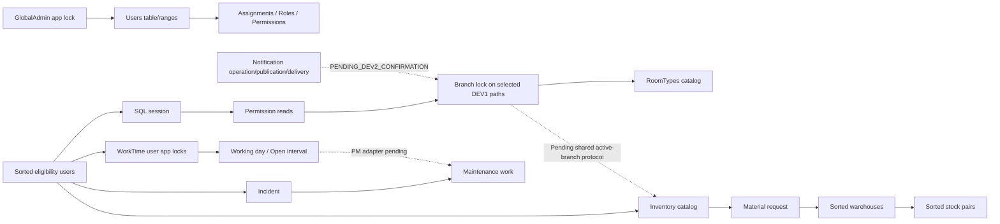

# Actual lock graph và authority matrix

Đây là các **partial order đã đọc từ source**, không là một global total order đã được áp dụng. SQL lock behavior/races không chạy lại trong coordination task. Các cạnh cần integration acceptance mang PENDING_DEV2_CONFIRMATION. SQL1205 là FAIL trong concurrency acceptance, không đổi thành PASS nhờ retry.

## Per-writer actual order

| Writer / source | Order và modes hiện tại | Owner/lifetime, sorted set, re-read, phantom/rollback |
|---|---|---|
| SqlSessionService:42–113 | User UPDLOCK/HOLDLOCK → Session UPDLOCK/HOLDLOCK; policy time revalidation | Caller-owned local locking SQL tx; same context; no commit. No tracked stale User/session |
| UserEligibilityLock:13–35 | distinct user IDs ascending, từng row UPDLOCK/HOLDLOCK | Requires caller tx; AsNoTracking; future responsibility eligibility account+employment/deleted; no module locks/commit |
| GlobalAdminSerialization/Role assignment | GlobalAdmin exclusive transaction applock **first** → Users TABLOCKX/HOLDLOCK → UserRoles→Roles→RolePermissions→Permissions ROWLOCK/HOLDLOCK → actor/target/authority/destination checks | RoleAssignmentService:35–50; GlobalAdminSerialization:104–125. Conservative stable universe includes ranges; không thay bằng generic user-first order |
| WorkdayService / A1 | sorted Users U/H → per-user WorkTime exclusive app lock → Working/Open U/H → session/grants → branch/membership/shift/template/department/source reads | Workday owns Serializable; A1 same-context participant, fixed tx ID/lock set. SQL filtered uniques protect one WORKING/OPEN. Source permissions/locks caller owns; no A1 commit |
| Branch create/update | actor User U/H → session/grants → schema; create uses Branch Create app lock, normalized code query; update Branch U/H → conditional version update/audit → final gate | BranchAdministrationService Execute/Row; Serializable. Create unique SQL index backstop; audit failure/denial disposes tx without commit |
| RoomType directory | actor eligibility → SQL session/permission → branch as requested → RoomTypes exclusive app lock | Read Serializable; current RoomTypeDirectoryService:110–140. No business writes |
| Turnover history | actor eligibility → session/permission → explicit Branch U/H → RoomTypes exclusive app lock → history reads | TurnoverHistoryBoundary:28–52; final gate then read tx commit. Historical read auth not execution ownership |
| Cleaning Monitor GET | Session service internally User→Session; then branch CLEANING_VIEW queries → count/page/detail → same gate again | Monitor:119–139 Serializable; no SaveChanges/business audit/Cancel writer; do not activate as notification producer |
| Historical assignments H-B | sorted actor+targets U/H → SQL gate/eligibility → Branch U/H → RoomTypes app lock → workflow/source writes → audit → final gate → commit | S only, not current. Serializable/range reads; source has no notification reservation path |
| Incident status/triage/create | Status/Triage: Incident U/H → actor existence/linked work reads; Create validates references **before** tx then optional Asset update/link, new Incident/audit | IncidentService:20–43,145+,228–315. No complete sorted User/Branch protocol; default tx isolation. Rollback via disposal; active branch create guard missing |
| Corrective Maintenance | optional discovered assignee/prepareOwners User locks → Incident U/H → MaintenanceWork U/H → Reload of tracked pair → state/actor checks → source/event/audit | Commands:25–95; return responsibility rechecks assignee/state; default tx caller-owned service. Create locks Incident then number/range gates. No A1/notification participant call |
| Asset transfer/handover | Asset U/H → actor/target checks; handover acceptance uses User responsibility lock before Asset/Handover | AssetService.Location:21–83; Handover/Validation helpers. No universal branch-first order proven; exact cross-feature asset/room/PM edges pending |
| Inventory | optional User prepareOwners → Catalog exclusive app lock → document/owner feature locks → sorted numeric Warehouse app lock+U/H → sorted (warehouse,item) Stock app locks → number allocation | InventoryService:90–128, Documents.cs. All modules sharing gates must cooperate; ordinary Branch Any query does not retain a Branch guard. Receipt primitive uses caller tx, no inner commit |
| Material Request | sorted discovered/current responsibility users U/H → Inventory Catalog → Request app lock+row U/H → approval cycle/linked data → issue/stock integration | Commands:22–42,90+,158+; source discovery rechecked after wait; explicit rollback in catch. Need actual branch/notification/PM integration edges |
| Replenishment | Inventory Catalog → sorted linked MR Request locks → Warehouse app lock+U/H → ordered stock-pair locks → number/coverage; Receive may lock linked Document then inventory receipt primitive | Service:46–151. Caller owns default tx; catch RollbackAsync+Clear. Range/unique open-coverage assumptions from actual patches need SQL tests with new contracts |
| Notification reservation/publication/intents/inbox | No current executable paths found | Design only: exact ordering relative to existing nodes PENDING_DEV2_CONFIRMATION, no fabricated source order |

U/H = UPDLOCK,HOLDLOCK. App locks đều yêu cầu transaction owner trong source đã trích. Serializable/HOLDLOCK chỉ giữ các range thực sự truy vấn; không phải proof global phantom protection giữa noncooperating writers.

## Graph và missing edges

Các chuỗi trong graph là union của những writer cụ thể, không một transaction được chứng minh đi qua tất cả nodes. Không tự thêm reservation→room→incident→stock thành global order. DEV2 cần gửi sequence thực tế của activated notification/PM/room/branch paths và reconcile với graph trước shared diff.

Missing edges: operation reservation vs sorted Users/time/global-admin guard; Room→RoomBlock→Incident release order; Asset↔PM↔Room; Maintenance↔A1→Source close; Inventory/MR/Replenishment↔Branch active retained lock; recipient/grant/source-read evaluation vs publication/worker claim; explicit-user DH candidate locks; global admin vs new organizational locks. Ownership DEV2 hoặc joint theo từng adapter, không yêu cầu DEV1 rewrite toàn hệ thống.

## Authority tách riêng

| Lớp | Current evidence | Không được suy ra |
|---|---|---|
| Authentication | HotelOpsCookie + CookieSessionValidator + protected ticket + SQL session validation; P0 expiry policy preserved | Cookie hợp lệ không cấp business permission/ownership |
| Current user | CurrentUserAccessor kiểm request SessionSnapshot khớp protected ticket/user/session/restricted/created time | Không tự SQL refresh hoặc quyền recipient |
| Authorization | PermissionService dùng SQL grant paths, assignment validity, role active, actual branch context và resource resolver | Không role hierarchy/Admin bypass; OWN cần verified resource ownership; permission grant không xác lập business responsibility |
| Employment eligibility | UserEligibilityLock và feature guards kiểm account ACTIVE + employment ACTIVE + not deleted dưới locks | EfPermissionDataSource.IsActiveUserAsync riêng chỉ kiểm account/deleted, không phải employment gate đầy đủ |
| Responsibility | Exact persisted assignee/assignment/inspector/current source cycle, transition prerequisites/SoD | Department membership hoặc VIEW grant không cho assign/execute/approve thay người khác |
| Branch/DH | Active branch membership + branch role validity; DH branch-wide DEPT_MANAGER, không manager một department | Department.ManagerUserId và UserBranchAccess.IsPrimary không tự chọn primary notification DH |
| Recipient source-read | Cần explicit-user evaluator/adapter, historical source support, actual permission binding | Không dùng producer HttpContext/grants hoặc fake SQL session cho recipient; recipient không cần đang có web session để được xét eligibility |
| Deactivation | Current UC006 deactivation fail-closed; Dev1DeactivationPredicates là positive evidence only; UC012 fail-closed | Negative subset query không chứng minh không còn trách nhiệm/open work; không bypass gates bằng time model mới |

Completed/cancelled/history: actual resource/type adapter phải cho phép đúng quyền đọc history, không bắt buộc executing ownership chỉ vì dùng chung permission code. Cleaning execution resolver currently giới hạn IN_PROGRESS/current owner/active Room; không đem dùng nguyên trạng để chứng minh recipient đọc source completed. Branch inactive history là policy riêng cần binding approved; không vô hiệu hóa global branch checks để làm notification pass.

Current InventoryController:19–24 dùng CurrentUserAccessor, server caller ID và InventoryAccess.Authorize trước service. Current Incidents/Maintenance/MaterialRequests/Replenishments controllers không có source permission binding/server actor replacement tương ứng đã được chứng minh; fallback cookie vẫn bảo vệ authentication nhưng không thay authorization, và một số requests truyền ActorUserId từ DTO. Đây là việc DEV2 cần hoàn thiện trong ownership với existing approved permissions; không được coi một authenticated GET trả 200 là đủ recipient source-read policy.

## C01 coverage boundaries

EF SaveChangesAsync hiện có, nhưng ExecuteUpdate/ExecuteSql và ADO commands không phát SaveChanges event. ADO gate commands current bind `command.Transaction = db.Database.CurrentTransaction.GetDbTransaction()`; commit owner đa số là EF transaction service, không phải participant.

Không tìm thấy production explicit new SqlConnection / new TransactionScope / direct synchronous Commit hoặc explicit savepoint calls trong bounded source search; **không** khẳng định interceptor tự chặn external ADO/future commit hoặc implicit EF savepoints. C01 cần cover/explicitly forbid bypass trên activated producer paths bằng context/physical transaction identity và wrapper/enlistment contract, cả sync/async, rollback/savepoints và ambiguous commit. Interceptor chỉ gắn EF không chứng minh bảo vệ raw DbTransaction.Commit.

Required race suite: user/permission revoke vs source write sau lock wait; assignment/reassignment vs notification facts; inspection/room block vs Ready/check-in; incident close vs block acquire; PM pause vs End; MR/replenishment/stock locks hai thứ tự; branch create/open work vs deactivate cả hai thứ tự. Historical Task86 chứng minh actor-lock wait revocation và branch create/update concurrency, **không** chứng minh các global race edges này.

## Quy tắc song song bổ sung — có hiệu lực cho bản handoff này

Codex B đang làm các UC DEV1 độc lập trong worktree riêng. COORD-FINAL-01 chỉ kiểm chứng current source của worktree DEV1 chính và shared contracts liên quan DEV2. Không bắt đầu implementation thuộc Codex B; không lấy source từ worktree B làm current runtime DEV1.

Danh sách worktrees được khám phá lại bằng `git worktree list --porcelain` tại cả preflight và postflight, không dùng số lượng hoặc danh sách đường dẫn cố định. `evidence/PARALLEL_PREFLIGHT.json` và `evidence/PARALLEL_POSTFLIGHT.json` ghi exact path, HEAD, branch, index SHA256 và status từng worktree. Bản này chỉ đọc metadata Git ở các worktree ngoài DEV1 chính; không capture lại source của Codex B.

Không sửa/reset/clean/checkout/chuyển branch/đồng bộ/di chuyển/xóa worktree Codex B. Không ghi Git config hoặc index. Hoạt động đồng thời của B, nếu có, được ghi riêng; không nhận là thay đổi do COORD-FINAL-01 và không tuyên bố đã kiểm chứng implementation của B.

Trước tích hợp Codex B phải có bàn giao exact diff, base HEAD/branch, danh sách file và SHA256; review conflicts với toàn bộ local patches DEV1/shared contracts hiện tại; xin approval riêng cho phạm vi tích hợp cụ thể. Chỉ tích hợp và chạy verification phù hợp sau approval. Cùng HEAD không có nghĩa cùng working-tree source. Không tự động đồng bộ branch hoặc áp dụng diff của B.

Các kết luận về tìm kiếm ở worktrees trong bản capture trước chỉ là evidence lịch sử. Bản handoff này không khẳng định source của worktree B vẫn sạch hoặc không có publisher tại thời điểm B đang làm việc. Source/runtime được bàn giao vẫn là current DEV1 chính, đã đối chiếu hash trước/sau. Thay đổi source được dựa vào trong DEV1 chính phải dẫn tới `SNAPSHOT_INCONSISTENT`; thay đổi metadata của B chỉ được ghi nhận riêng khi không làm thay đổi source được dựa vào.

Không thay đổi approval boundary: business/architecture decisions đã chốt không tự cấp quyền áp dụng shared DDL/EF/DI/RBAC/coordinator. DEV2 có thể triển khai các thành phần nội bộ thuộc ownership theo contract; shared diff vẫn phải có file-specific review và approval riêng.

